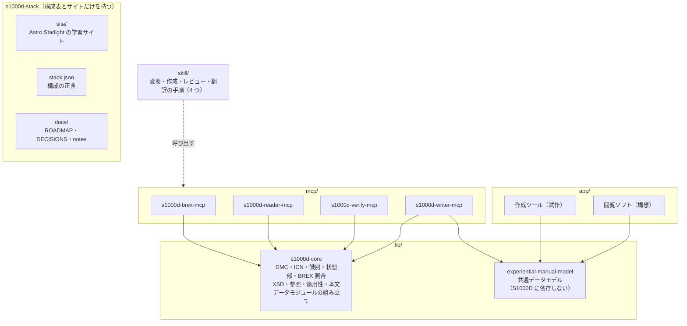

# s1000d-stack

<p align="center"></p>

[English](./README.md) | **日本語**

LLM が S1000D® の技術文書を正しく読み、プロジェクトの決まり（ビジネスルール）に沿って検査・作成できるようにするための MCP サーバー・共有ライブラリ・Skill と、画面や機器の操作を体験しながら学べるマニュアルの作成ツール・閲覧ソフトをまとめるプロジェクトです。

このリポジトリは構成表（`stack.json`）と学習サイト（`site/`）、計画と決定の記録（`docs/`）だけを持ちます。各部品は独立したリポジトリです。

> [!IMPORTANT]
> このプロジェクトは ASD（Aerospace, Security and Defence Industries Association of Europe）とは無関係の個人プロジェクトです。S1000D® は ASD の登録商標です。
> S1000D の仕様書・XML スキーマ・既定 BREX・公式サンプルは、利用条件により再配布できないため、どのリポジトリにも含まれていません。利用者ご自身で [s1000d.org](https://s1000d.org/) から入手し、展開したフォルダーを環境変数 `S1000D_SPEC_DIR` で指定するか、設定ファイル `~/.config/s1000d-stack/config.json` に `{"specDir": "/絶対パス"}` と書いてください（Claude Desktop に plugin で入れたときのように、環境変数がサーバーに渡らない場合）。

## できること

段階 1（BREX の理解と照合）と段階 2（検証と構造での読み取り）が揃い、段階 2.5（CSDB 製品に組み込める基盤）の最初の部品として修正提案を足しました。段階 3 では、LLM が XML を書かずにデータモジュールを作る s1000d-writer-mcp を足しました。部品メーカーや技術マニュアル制作会社が、顧客から渡された BREX（Business Rules Exchange）を理解し、自分たちのデータモジュールが XML スキーマ（XSD）と BREX に従っているかを確かめ、違反の直し方の候補を受け取り、データモジュールを XML ではなく構造として読む作業を、LLM から行えるようにします。さらに、体験型マニュアルなどの構造化した下書きからデータモジュールを作り、検証して直し、翻訳用に文を出し入れする作業も、LLM に XML を書かせずに行えるようにします。

段階 3 の Skill 4 つ（experience-to-s1000d・s1000d-publish・s1000d-review・s1000d-translate）と、体験型マニュアルの作成ツールの試作（仮称 manual-editor）は作成済みです。Skill は、MCP サーバーをどの順番で呼び、各段階で利用者に何を聞くかを Claude に伝える手順です。作成ツールは、体験型マニュアルを画面の上で作り、experiential-manual-model の JSON で保存します。

> [!NOTE]
> Skill 4 つは claude-plugins に登録済みです（`/plugin install s1000d-review@shuji-bonji` など）。作成ツールは試作で、まだ公開していません。

| 部品 | 役割 |
| --- | --- |
| [s1000d-core](https://github.com/shuji-bonji/s1000d-core) | DMC・ICN の分解、識別・状態部の読み取り、BREX の読み取りと照合、XSD 検証、参照の解決、適用性の評価、本文の読み取り、修正候補の決定、データモジュールの組み立てと採番、修正候補の適用、配布物と CSDB の場所の解決（環境変数か設定ファイル）。全 MCP が依存する共有ライブラリ（npm: `@shuji-bonji/s1000d-core`） |
| [s1000d-brex-mcp](https://github.com/shuji-bonji/s1000d-brex-mcp) | BREX のルールを人が読める形で一覧にし（`explain_brex`）、SNS や属性値の意味を引き（`lookup_sns` / `lookup_value`）、使える図の形式を返し（`list_notations`）、データモジュールを BREX の連鎖に照合する（`check_against_brex`）MCP サーバー |
| [s1000d-verify-mcp](https://github.com/shuji-bonji/s1000d-verify-mcp) | データモジュール 1 件を整形式 → XSD → BREX の連鎖 → 参照の順に検証し（`verify_data_module`）、XSD 検証だけ（`validate_schema`）、参照の解決（`check_references`）、フォルダー全体の検証（`verify_csdb`）、見つかった XSD の一覧（`list_schemas`）を行う MCP サーバー。結果は 1 つの検証状態（`verification`）にまとめて返す。違反ごとの直し方の候補（`suggest_fixes`）も返し、候補はサーバーが BREX のルール・XSD の定義・CSDB から決める |
| [s1000d-reader-mcp](https://github.com/shuji-bonji/s1000d-reader-mcp) | データモジュールとパブリケーションモジュールを構造として読み（`read_data_module` / `read_publication_module`）、CSDB の一覧と参照の解決（`list_data_modules` / `resolve_reference`）、適用性の語彙（`describe_applicability`）、ICN メタデータ（`read_icn_metadata`）を返す MCP サーバー。どの製品に当てはまるかはサーバーが判定し、すべての応答に検証状態が付く |
| s1000d-writer-mcp | LLM に XML を書かせずにデータモジュールを作る MCP サーバー。構造化した下書きから XML を組み立てて検証し（`build_data_module`）、候補が 1 つに決まる修正だけを自動で適用する。体験型マニュアルの変換（`convert_manual`）、候補の中から選んだ修正の適用（`apply_fixes`）、コメントデータモジュールの作成（`create_comment`）、翻訳用の文の取り出しと書き戻し（`extract_segments` / `apply_segments`）も行う。既定では何も書き込まない |
| Skill 4 つ（`skill/`） | experience-to-s1000d（体験型マニュアルを CSDB に変換）、s1000d-publish（下書きからデータモジュールを作成）、s1000d-review（レビューと comment DM）、s1000d-translate（翻訳）。MCP サーバーを呼ぶ順番と、各段階で利用者に聞くことを Claude に伝える手順で、処理は持たない。公開済み（0.1.0、claude-plugins） |
| manual-editor（仮称。`app/manual-editor`） | 体験型マニュアルを画面の上で作る Web アプリの試作（SvelteKit ＋ PWA）。manual-model の JSON を読み書きし、検査と体験表示ができる。S1000D への出力は Skill `experience-to-s1000d` に渡して行う。AI が無くても動く |
| [experiential-manual-model](https://github.com/shuji-bonji/experiential-manual-model) | 体験型操作マニュアルの共通データモデル（TypeScript の型・JSON Schema・検査・2021 年の JSON からの変換）。S1000D に依存しない（npm: `@shuji-bonji/experiential-manual-model`） |

BREX への照合は S1000D Issue 7 の Chap 4.10.2（BREX data module）と Chap 7.9（Business rules processing）に沿い、`brexDmRef` の連鎖（プロジェクト → 組織 → 既定 BREX）を各層に個別に当てます。XSD 検証は、利用者が入手した配布物の XSD で行います。文章で書かれた取り決め（nonContextRules）の判断と、S1000D への準拠の判定は、どの部品にも含みません。

## 全体像



専門家エージェント（MCP と Skill）を先に作り、それを開発の道具として使いながら製品（作成ツール・閲覧ソフト）を作ります。S1000D との対応関係は共通データモデルとその変換関数に集め、エージェントと製品が別々に解釈しないようにします。製品は AI が無くても動く状態を保ちます。

## 構成表

<!-- stack:begin — scripts/generate-stack.mjs が生成。手で編集しない -->

> 版は実測（2026-10-28 時点の `npm view`）。

| リポジトリ | 役割 | 配布形態 | 状態 | 版 | npm |
| --- | --- | --- | --- | --- | --- |
| [s1000d-core](https://github.com/shuji-bonji/s1000d-core) | core | library | 公開済み | 0.8.1 | `@shuji-bonji/s1000d-core` |
| [s1000d-brex-mcp](https://github.com/shuji-bonji/s1000d-brex-mcp) | mcp | mcp-server | 公開済み | 0.4.0 | `@shuji-bonji/s1000d-brex-mcp` |
| [s1000d-verify-mcp](https://github.com/shuji-bonji/s1000d-verify-mcp) | mcp | mcp-server | 公開済み | 0.6.0 | `@shuji-bonji/s1000d-verify-mcp` |
| [s1000d-reader-mcp](https://github.com/shuji-bonji/s1000d-reader-mcp) | mcp | mcp-server | 公開済み | 0.7.0 | `@shuji-bonji/s1000d-reader-mcp` |
| [experiential-manual-model](https://github.com/shuji-bonji/experiential-manual-model) | model | library | 公開済み | 0.1.0 | `@shuji-bonji/experiential-manual-model` |
| [s1000d-writer-mcp](https://github.com/shuji-bonji/s1000d-writer-mcp) | mcp | mcp-server | 公開済み | 0.1.1 | `@shuji-bonji/s1000d-writer-mcp` |
| [experience-to-s1000d-skill](https://github.com/shuji-bonji/experience-to-s1000d-skill) | procedure | skill | 公開済み | 0.1.0 | — |
| [s1000d-publish-skill](https://github.com/shuji-bonji/s1000d-publish-skill) | procedure | skill | 公開済み | 0.1.0 | — |
| [s1000d-review-skill](https://github.com/shuji-bonji/s1000d-review-skill) | procedure | skill | 公開済み | 0.1.0 | — |
| [s1000d-translate-skill](https://github.com/shuji-bonji/s1000d-translate-skill) | procedure | skill | 公開済み | 0.1.0 | — |
| manual-editor | app | app | 開発中 | 0.1.0 | — |
| manual-viewer | app | app | 構想 | — | — |

<!-- stack:end -->

`stack.json` は `scripts/generate-stack.mjs` が npm とローカルの実測から生成します。手で書くのはスクリプトの `REGISTRY` だけです。

```sh
node scripts/generate-stack.mjs            # 生成（手元）
node scripts/generate-stack.mjs --readme   # README.md と README.ja.md の表も差し替える
node scripts/generate-stack.mjs --check    # CI。npm と stack.json がずれていれば exit 1
```

## リポジトリの構成

```text
s1000d-stack/
├── README.md           英語（日本語は README.ja.md）
├── stack.json          構成表（生成物）
├── scripts/            stack.json の生成・照合
├── site/               学習サイト（Astro Starlight。英語がルート、日本語は /ja/）
├── docs/
│   ├── ROADMAP.md      目的・段階・作業手順・進捗
│   ├── DECISIONS.md    決定事項（D-01〜）と未決事項（U-01〜）
│   └── notes/          調査メモ（IETM・S1000D・BREX、配布物の性質、仕様書の読解結果）
├── specs/              S1000D の配布物（git 管理外。利用者が置く）
└── lib/ mcp/ skill/ app/   各リポジトリの作業コピー（git 管理外）
```

`lib/`・`mcp/`・`skill/`・`app/` は `.gitignore` で除外した作業コピーの置き場で、clone しても中身は入りません。構成は [houki-hub](https://github.com/shuji-bonji/houki-hub)、[pdf-agent-stack](https://github.com/shuji-bonji/pdf-agent-stack) と同じです。

## 学習サイト

`site/` は Astro Starlight で作る学習サイトです（英語がルート、日本語は `/ja/`）。IETM と S1000D の関係、データモジュールと DMC、BREX の仕組み、このスタックの使い方を、仕様書の翻訳ではなく自分の言葉で説明します。概念の入門は Zenn Book [IETM入門 — 概念から S1000D まで](https://zenn.dev/shuji_bonji/books/ietm-overview) にあり、サイトはこのスタックの利用者向けの説明に絞ります。

```sh
cd site
npm install
npm run dev
```

## 関連

- [Zenn Book「IETM入門 — 概念から S1000D まで」](https://zenn.dev/shuji_bonji/books/ietm-overview)
- [houki-hub](https://github.com/shuji-bonji/houki-hub) / [pdf-agent-stack](https://github.com/shuji-bonji/pdf-agent-stack) — 同じ構成の束ね

## ライセンス

コードは MIT、サイトの文章は CC BY 4.0、自作のサンプルデータは MIT です（`docs/DECISIONS.md` D-11）。
