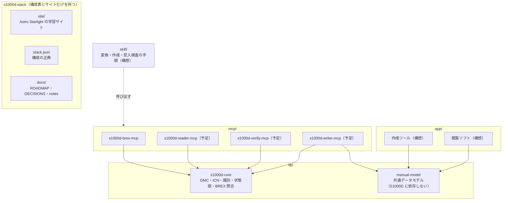

# s1000d-stack

LLM が S1000D® の技術文書を正しく読み、プロジェクトの決まり（ビジネスルール）に沿って検査・作成できるようにするための MCP サーバー・共有ライブラリ・Skill と、画面や機器の操作を体験しながら学べるマニュアルの作成ツール・閲覧ソフトをまとめるプロジェクトです。

このリポジトリは構成表（`stack.json`）と学習サイト（`site/`）、計画と決定の記録（`docs/`）だけを持ちます。各部品は独立したリポジトリです。

> [!IMPORTANT]
> このプロジェクトは ASD（Aerospace, Security and Defence Industries Association of Europe）とは無関係の個人プロジェクトです。S1000D® は ASD の登録商標です。
> S1000D の仕様書・XML スキーマ・既定 BREX・公式サンプルは、利用条件により再配布できないため、どのリポジトリにも含まれていません。利用者ご自身で [s1000d.org](https://s1000d.org/) から入手し、展開したフォルダーを環境変数 `S1000D_SPEC_DIR` で指定してください。

## できること（段階 1）

部品メーカーや技術マニュアル制作会社が、顧客から渡された BREX（Business Rules Exchange）を理解し、自分たちのデータモジュールがそれに従っているかを確かめる作業を、LLM から行えるようにします。

| 部品 | 役割 |
| --- | --- |
| [s1000d-core](https://github.com/shuji-bonji/s1000d-core) | DMC・ICN の分解、識別・状態部の読み取り、BREX の読み取りと照合。全 MCP が依存する共有ライブラリ（npm: `@shuji-bonji/s1000d-core`） |
| s1000d-brex-mcp | BREX のルールを人が読める形で一覧にし（`explain_brex`）、SNS や属性値の意味を引き（`lookup_sns` / `lookup_value`）、使える図の形式を返し（`list_notations`）、データモジュールを BREX の連鎖に照合する（`check_against_brex`）MCP サーバー |

照合は S1000D Issue 7 の Chap 4.10.2（BREX data module）と Chap 7.9（Business rules processing）に沿い、`brexDmRef` の連鎖（プロジェクト → 組織 → 既定 BREX）を各層に個別に当てます。XML スキーマ（XSD）による検証と、文章で書かれた取り決め（nonContextRules）の判断は含みません。

## 全体像



専門家エージェント（MCP と Skill）を先に作り、それを開発の道具として使いながら製品（作成ツール・閲覧ソフト）を作ります。S1000D との対応関係は共通データモデルとその変換関数に集め、エージェントと製品が別々に解釈しないようにします。製品は AI が無くても動く状態を保ちます。

## 構成表

<!-- stack:begin — scripts/generate-stack.mjs が生成。手で編集しない -->

> 版は実測（2026-10-25 時点の `npm view`）。

| リポジトリ | 役割 | 配布形態 | 状態 | 版 | npm |
| --- | --- | --- | --- | --- | --- |
| [s1000d-core](https://github.com/shuji-bonji/s1000d-core) | core | library | 公開済み | 0.2.0 | `@shuji-bonji/s1000d-core` |
| s1000d-brex-mcp | mcp | mcp-server | 開発中 | 0.1.0 | — |
| s1000d-verify-mcp | mcp | mcp-server | 開発中 | 0.1.0 | — |
| s1000d-reader-mcp | mcp | mcp-server | 開発中 | 0.1.0 | — |
| experiential-manual-model | model | library | 開発中 | 0.1.0 | — |
| s1000d-writer-mcp | mcp | mcp-server | 予定 | — | — |
| s1000d-skills | procedure | skill | 構想 | — | — |
| manual-editor | app | app | 構想 | — | — |
| manual-viewer | app | app | 構想 | — | — |

<!-- stack:end -->

`stack.json` は `scripts/generate-stack.mjs` が npm とローカルの実測から生成します。手で書くのはスクリプトの `REGISTRY` だけです。

```sh
node scripts/generate-stack.mjs            # 生成（手元）
node scripts/generate-stack.mjs --readme   # README の表も差し替える
node scripts/generate-stack.mjs --check    # CI。npm と stack.json がずれていれば exit 1
```

## リポジトリの構成

```text
s1000d-stack/
├── README.md
├── stack.json          構成表（生成物）
├── scripts/            stack.json の生成・照合
├── site/               学習サイト（Astro Starlight）
├── docs/
│   ├── ROADMAP.md      目的・段階・作業手順・進捗
│   ├── DECISIONS.md    決定事項（D-01〜）と未決事項（U-01〜）
│   └── notes/          調査メモ（IETM・S1000D・BREX、配布物の性質、仕様書の読解結果）
├── specs/              S1000D の配布物（git 管理外。利用者が置く）
└── lib/ mcp/ skill/ app/   各リポジトリの作業コピー（git 管理外）
```

`lib/`・`mcp/`・`skill/`・`app/` は `.gitignore` で除外した作業コピーの置き場で、clone しても中身は入りません。構成は [houki-hub](https://github.com/shuji-bonji/houki-hub)、[pdf-agent-stack](https://github.com/shuji-bonji/pdf-agent-stack) と同じです。

## 学習サイト

`site/` は Astro Starlight で作る日本語の学習サイトです。IETM と S1000D の関係、データモジュールと DMC、BREX の仕組み、このスタックの使い方を、仕様書の翻訳ではなく自分の言葉で説明します。概念の入門は Zenn Book [IETM入門 — 概念から S1000D まで](https://zenn.dev/shuji_bonji/books/ietm-overview) にあり、サイトはこのスタックの利用者向けの説明に絞ります。

```sh
cd site
npm install
npm run dev
```

## 関連

- [Zenn Book「IETM入門 — 概念から S1000D まで」](https://zenn.dev/shuji_bonji/books/ietm-overview)
- [houki-hub](https://github.com/shuji-bonji/houki-hub) / [pdf-agent-stack](https://github.com/shuji-bonji/pdf-agent-stack) — 同じ構成の束ね

## ライセンス

コードは MIT、サイトの文章は CC BY 4.0、自作のサンプルデータは MIT です（`docs/DECISIONS.md` D-11）。
