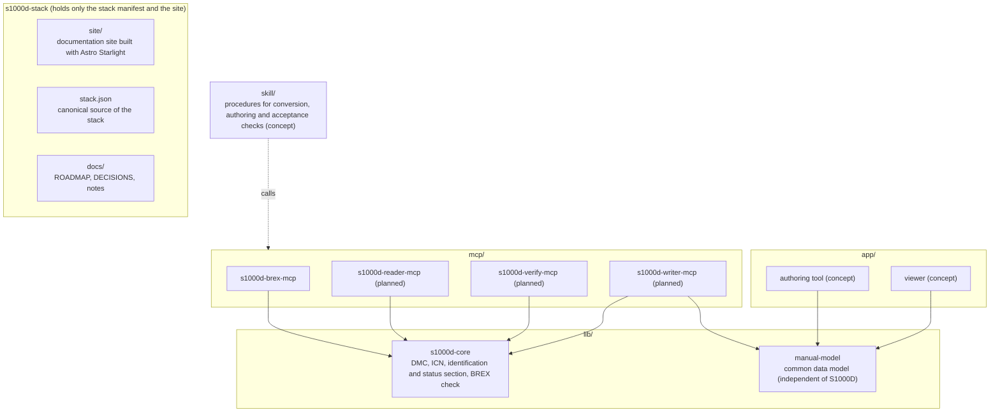

# s1000d-stack

<p align="center"></p>

**English** | [日本語](./README.ja.md)

s1000d-stack is a project that brings together the MCP servers, shared libraries and Skills that let an LLM read technical documents written in S1000D® correctly and check and create them according to the rules agreed for a project (business rules), together with an authoring tool and a viewer for manuals that teach through hands-on operation of screens and equipment.

This repository holds only the stack manifest (`stack.json`), the documentation site (`site/`) and the record of plans and decisions (`docs/`). Each component is an independent repository.

> [!IMPORTANT]
> This is a personal project and is not affiliated with ASD (Aerospace, Security and Defence Industries Association of Europe). S1000D® is a registered trademark of ASD.
> The S1000D specification, XML schemas, default BREX and official samples are not included in any package or repository, because their terms of use do not grant redistribution. Obtain them from [s1000d.org](https://s1000d.org/) and point the `S1000D_SPEC_DIR` environment variable at the extracted folder.

## What it does (stage 1)

Lets parts manufacturers and technical publication companies use an LLM to understand the BREX (Business Rules Exchange) handed over by a customer and to confirm that their own data modules follow it.

| Component | Role |
| --- | --- |
| [s1000d-core](https://github.com/shuji-bonji/s1000d-core) | Splits DMCs and ICNs, reads the identification and status section, reads and checks against BREX. The shared library that every MCP depends on (npm: `@shuji-bonji/s1000d-core`) |
| s1000d-brex-mcp | An MCP server that lists BREX rules in a form people can read (`explain_brex`), looks up the meaning of SNS and attribute values (`lookup_sns` / `lookup_value`), returns the illustration formats that may be used (`list_notations`), and checks data modules against the BREX chain (`check_against_brex`) |

The check follows Chap 4.10.2 (BREX data module) and Chap 7.9 (Business rules processing) of S1000D Issue 7, and applies the `brexDmRef` chain (project → organisation → default BREX) to each layer separately. It does not include validation against the XML schema (XSD) or judgement of agreements written as prose (nonContextRules).

## Overview



The expert agents (MCP and Skills) come first; the products (authoring tool and viewer) are built while using those agents as development tools. The mapping to S1000D is gathered into the common data model and its conversion functions, so that the agents and the products do not interpret it separately. The products stay usable without AI.

## Stack manifest

<!-- stack:begin — scripts/generate-stack.mjs が生成。手で編集しない -->

> Versions are measured (`npm view` as of 2026-10-26).

| Repository | Layer | Form | Status | Version | npm |
| --- | --- | --- | --- | --- | --- |
| [s1000d-core](https://github.com/shuji-bonji/s1000d-core) | core | library | released | 0.2.0 | `@shuji-bonji/s1000d-core` |
| s1000d-brex-mcp | mcp | mcp-server | in development | 0.1.0 | — |
| s1000d-verify-mcp | mcp | mcp-server | in development | 0.1.0 | — |
| s1000d-reader-mcp | mcp | mcp-server | in development | 0.1.0 | — |
| experiential-manual-model | model | library | in development | 0.1.0 | — |
| s1000d-writer-mcp | mcp | mcp-server | planned | — | — |
| s1000d-skills | procedure | skill | concept | — | — |
| manual-editor | app | app | concept | — | — |
| manual-viewer | app | app | concept | — | — |

<!-- stack:end -->

`scripts/generate-stack.mjs` generates `stack.json` from measurements of npm and the local checkouts. The only part written by hand is the script's `REGISTRY`.

```sh
node scripts/generate-stack.mjs            # generate (locally)
node scripts/generate-stack.mjs --readme   # also replace the tables in README.md and README.ja.md
node scripts/generate-stack.mjs --check    # CI: exit 1 if npm and stack.json disagree
```

## Repository layout

```text
s1000d-stack/
├── README.md           English (README.ja.md is Japanese)
├── stack.json          stack manifest (generated)
├── scripts/            generates and checks stack.json
├── site/               documentation site (Astro Starlight; English, Japanese under /ja/)
├── docs/
│   ├── ROADMAP.md      goals, stages, work procedure, progress (Japanese)
│   ├── DECISIONS.md    decisions (D-01–) and open items (U-01–) (Japanese)
│   └── notes/          research notes on IETM, S1000D, BREX, the distribution files and the specification (Japanese)
├── specs/              S1000D distribution files (not in git; placed by the user)
└── lib/ mcp/ skill/ app/   working copies of each repository (not in git)
```

`lib/`, `mcp/`, `skill/` and `app/` are places for working copies excluded by `.gitignore`; cloning does not fill them. The layout is the same as [houki-hub](https://github.com/shuji-bonji/houki-hub) and [pdf-agent-stack](https://github.com/shuji-bonji/pdf-agent-stack).

## Documentation site

`site/` is a documentation site built with Astro Starlight, in English with a Japanese version under `/ja/`. It explains the relationship between IETM and S1000D, data modules and DMCs, how BREX works, and how to use this stack, in its own words rather than as a translation of the specification. An introduction to the concepts is in the Zenn Book [IETM入門 — 概念から S1000D まで](https://zenn.dev/shuji_bonji/books/ietm-overview) (in Japanese); the site is limited to explanations for users of this stack.

```sh
cd site
npm install
npm run dev
```

## Related

- [Zenn Book "IETM入門 — 概念から S1000D まで"](https://zenn.dev/shuji_bonji/books/ietm-overview)
- [houki-hub](https://github.com/shuji-bonji/houki-hub) / [pdf-agent-stack](https://github.com/shuji-bonji/pdf-agent-stack) — sets of tools with the same layout

## License

Code is MIT, the site's text is CC BY 4.0, and the sample data created for this project is MIT (`docs/DECISIONS.md` D-11).
