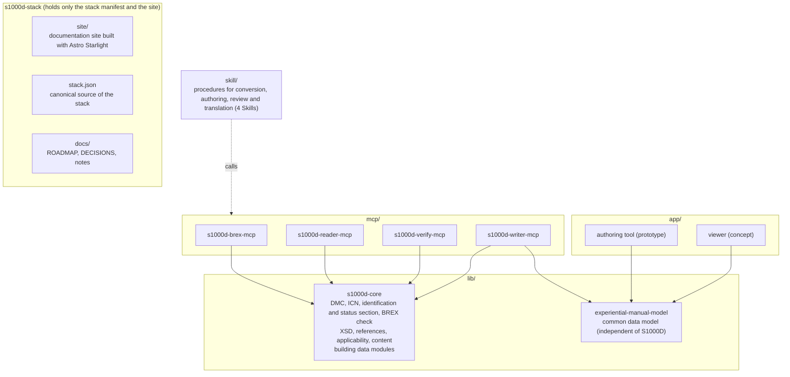

# s1000d-stack

<p align="center"></p>

**English** | [日本語](./README.ja.md)

s1000d-stack is a project that brings together the MCP servers, shared libraries and Skills that let an LLM read technical documents written in S1000D® correctly and check and create them according to the rules agreed for a project (business rules), together with an authoring tool and a viewer for manuals that teach through hands-on operation of screens and equipment.

This repository holds only the stack manifest (`stack.json`), the documentation site (`site/`) and the record of plans and decisions (`docs/`). Each component is an independent repository.

> [!IMPORTANT]
> This is a personal project and is not affiliated with ASD (Aerospace, Security and Defence Industries Association of Europe). S1000D® is a registered trademark of ASD.
> The S1000D specification, XML schemas, default BREX and official samples are not included in any package or repository, because their terms of use do not grant redistribution. Obtain them from [s1000d.org](https://s1000d.org/) and point the `S1000D_SPEC_DIR` environment variable at the extracted folder, or write `{"specDir": "/absolute/path"}` to the config file `~/.config/s1000d-stack/config.json` (for cases where environment variables do not reach the server, as when it is installed as a plugin in Claude Desktop).

## What it does

Stage 1 (understanding and checking against BREX) and stage 2 (verification and reading as structure) are complete, and fix suggestions have been added as the first component of stage 2.5 (a foundation that CSDB products can build in). In stage 3, s1000d-writer-mcp has been added, which lets an LLM create data modules without writing XML. Parts manufacturers and technical publication companies can use an LLM to understand the BREX (Business Rules Exchange) handed over by a customer, to confirm that their own data modules follow the XML schema (XSD) and the BREX, to receive candidate corrections for the violations, and to read data modules as structure rather than as XML. They can also use an LLM, without letting it write XML, to create data modules from a structured draft such as an experiential manual, verify and repair them, and hand sentences out and back for translation.

The four Skills of stage 3 (experience-to-s1000d, s1000d-publish, s1000d-review and s1000d-translate) and a prototype of the authoring tool for experiential manuals (provisionally called manual-editor) have been created. A Skill is a procedure that tells Claude which MCP servers to call in which order and what to ask the user at each step. The authoring tool creates an experiential manual on screen and saves it as a JSON of experiential-manual-model.

> [!NOTE]
> The four Skills are registered in claude-plugins (for example `/plugin install s1000d-review@shuji-bonji`). The authoring tool is a prototype and has not been published yet.

| Component | Role |
| --- | --- |
| [s1000d-core](https://github.com/shuji-bonji/s1000d-core) | Splits DMCs and ICNs, reads the identification and status section, reads and checks against BREX, validates against the XSD, resolves references, evaluates applicability, reads the content section, decides fix candidates, builds and numbers data modules, applies fix candidates, and decides where the distribution and the CSDB are (from environment variables or a config file). The shared library that every MCP depends on (npm: `@shuji-bonji/s1000d-core`) |
| [s1000d-brex-mcp](https://github.com/shuji-bonji/s1000d-brex-mcp) | An MCP server that lists BREX rules in a form people can read (`explain_brex`), looks up the meaning of SNS and attribute values (`lookup_sns` / `lookup_value`), returns the illustration formats that may be used (`list_notations`), and checks data modules against the BREX chain (`check_against_brex`) |
| [s1000d-verify-mcp](https://github.com/shuji-bonji/s1000d-verify-mcp) | An MCP server that validates one data module in the order well-formedness → XSD → BREX chain → references (`verify_data_module`), runs XSD validation only (`validate_schema`), resolves references (`check_references`), validates a whole folder (`verify_csdb`) and lists the XSDs it found (`list_schemas`). The results are returned combined into a single verification status (`verification`). It also returns candidate corrections for each finding (`suggest_fixes`); the server decides the candidates from the BREX rules, the XSD definitions and the CSDB |
| [s1000d-reader-mcp](https://github.com/shuji-bonji/s1000d-reader-mcp) | An MCP server that reads data modules and publication modules as structure (`read_data_module` / `read_publication_module`), lists a CSDB and resolves references (`list_data_modules` / `resolve_reference`), returns the applicability vocabulary (`describe_applicability`) and reads ICN metadata (`read_icn_metadata`). The server evaluates which product the content applies to, and every response carries the verification status |
| s1000d-writer-mcp | An MCP server that creates data modules without letting the LLM write XML. It builds the XML from a structured draft and verifies it (`build_data_module`), and automatically applies only the fixes that have exactly one candidate. It also converts experiential manuals (`convert_manual`), applies a fix chosen from the candidates (`apply_fixes`), creates comment data modules (`create_comment`), and takes out and puts back sentences for translation (`extract_segments` / `apply_segments`). It writes nothing by default |
| Four Skills (`skill/`) | experience-to-s1000d (converts an experiential manual into a CSDB), s1000d-publish (creates data modules from drafts), s1000d-review (review and comment data modules) and s1000d-translate (translation). Procedures that tell Claude the order in which to call the MCP servers and what to ask the user at each step; they have no processing of their own. Published (0.1.0, claude-plugins) |
| manual-editor (provisional name; `app/manual-editor`) | A prototype of a web app for creating experiential manuals on screen (SvelteKit and PWA). It reads and writes the JSON of manual-model, and offers validation and a hands-on preview. S1000D output is done by passing the JSON to the Skill `experience-to-s1000d`. It works without AI |
| [experiential-manual-model](https://github.com/shuji-bonji/experiential-manual-model) | The common data model for experiential operation manuals (TypeScript types, JSON Schema, validation and a converter from the 2021 JSON). Independent of S1000D (npm: `@shuji-bonji/experiential-manual-model`) |

The BREX check follows Chap 4.10.2 (BREX data module) and Chap 7.9 (Business rules processing) of S1000D Issue 7, and applies the `brexDmRef` chain (project → organisation → default BREX) to each layer separately. XSD validation uses the XSDs from the S1000D distribution you obtained. Judgement of agreements written as prose (nonContextRules) and judgement of conformance to S1000D are not included in any component.

## Overview



The expert agents (MCP and Skills) come first; the products (authoring tool and viewer) are built while using those agents as development tools. The mapping to S1000D is gathered into the common data model and its conversion functions, so that the agents and the products do not interpret it separately. The products stay usable without AI.

## Stack manifest

<!-- stack:begin — scripts/generate-stack.mjs が生成。手で編集しない -->

> Versions are measured (`npm view` as of 2026-10-28).

| Repository | Layer | Form | Status | Version | npm |
| --- | --- | --- | --- | --- | --- |
| [s1000d-core](https://github.com/shuji-bonji/s1000d-core) | core | library | released | 0.8.1 | `@shuji-bonji/s1000d-core` |
| [s1000d-brex-mcp](https://github.com/shuji-bonji/s1000d-brex-mcp) | mcp | mcp-server | released | 0.4.0 | `@shuji-bonji/s1000d-brex-mcp` |
| [s1000d-verify-mcp](https://github.com/shuji-bonji/s1000d-verify-mcp) | mcp | mcp-server | released | 0.6.0 | `@shuji-bonji/s1000d-verify-mcp` |
| [s1000d-reader-mcp](https://github.com/shuji-bonji/s1000d-reader-mcp) | mcp | mcp-server | released | 0.7.0 | `@shuji-bonji/s1000d-reader-mcp` |
| [experiential-manual-model](https://github.com/shuji-bonji/experiential-manual-model) | model | library | released | 0.1.0 | `@shuji-bonji/experiential-manual-model` |
| [s1000d-writer-mcp](https://github.com/shuji-bonji/s1000d-writer-mcp) | mcp | mcp-server | released | 0.1.1 | `@shuji-bonji/s1000d-writer-mcp` |
| [experience-to-s1000d-skill](https://github.com/shuji-bonji/experience-to-s1000d-skill) | procedure | skill | released | 0.1.0 | — |
| [s1000d-publish-skill](https://github.com/shuji-bonji/s1000d-publish-skill) | procedure | skill | released | 0.1.0 | — |
| [s1000d-review-skill](https://github.com/shuji-bonji/s1000d-review-skill) | procedure | skill | released | 0.1.0 | — |
| [s1000d-translate-skill](https://github.com/shuji-bonji/s1000d-translate-skill) | procedure | skill | released | 0.1.0 | — |
| manual-editor | app | app | in development | 0.1.0 | — |
| manual-viewer | app | app | concept | — | — |

<!-- stack:end -->

`scripts/generate-stack.mjs` generates `stack.json` from measurements of npm and the local checkouts. The only part written by hand is the script's `REGISTRY`.

```sh
node scripts/generate-stack.mjs            # generate (locally)
node scripts/generate-stack.mjs --readme   # also replace the tables in README.md and README.ja.md
node scripts/generate-stack.mjs --check    # CI: exit 1 if npm and stack.json disagree
```

## Repository layout

```text
s1000d-stack/
├── README.md           English (README.ja.md is Japanese)
├── stack.json          stack manifest (generated)
├── scripts/            generates and checks stack.json
├── site/               documentation site (Astro Starlight; English, Japanese under /ja/)
├── docs/
│   ├── ROADMAP.md      goals, stages, work procedure, progress (Japanese)
│   ├── DECISIONS.md    decisions (D-01–) and open items (U-01–) (Japanese)
│   └── notes/          research notes on IETM, S1000D, BREX, the distribution files and the specification (Japanese)
├── specs/              S1000D distribution files (not in git; placed by the user)
└── lib/ mcp/ skill/ app/   working copies of each repository (not in git)
```

`lib/`, `mcp/`, `skill/` and `app/` are places for working copies excluded by `.gitignore`; cloning does not fill them. The layout is the same as [houki-hub](https://github.com/shuji-bonji/houki-hub) and [pdf-agent-stack](https://github.com/shuji-bonji/pdf-agent-stack).

## Documentation site

`site/` is a documentation site built with Astro Starlight, in English with a Japanese version under `/ja/`. It explains the relationship between IETM and S1000D, data modules and DMCs, how BREX works, and how to use this stack, in its own words rather than as a translation of the specification. An introduction to the concepts is in the Zenn Book [IETM入門 — 概念から S1000D まで](https://zenn.dev/shuji_bonji/books/ietm-overview) (in Japanese); the site is limited to explanations for users of this stack.

```sh
cd site
npm install
npm run dev
```

## Related

- [Zenn Book "IETM入門 — 概念から S1000D まで"](https://zenn.dev/shuji_bonji/books/ietm-overview)
- [houki-hub](https://github.com/shuji-bonji/houki-hub) / [pdf-agent-stack](https://github.com/shuji-bonji/pdf-agent-stack) — sets of tools with the same layout

## License

Code is MIT, the site's text is CC BY 4.0, and the sample data created for this project is MIT (`docs/DECISIONS.md` D-11).
