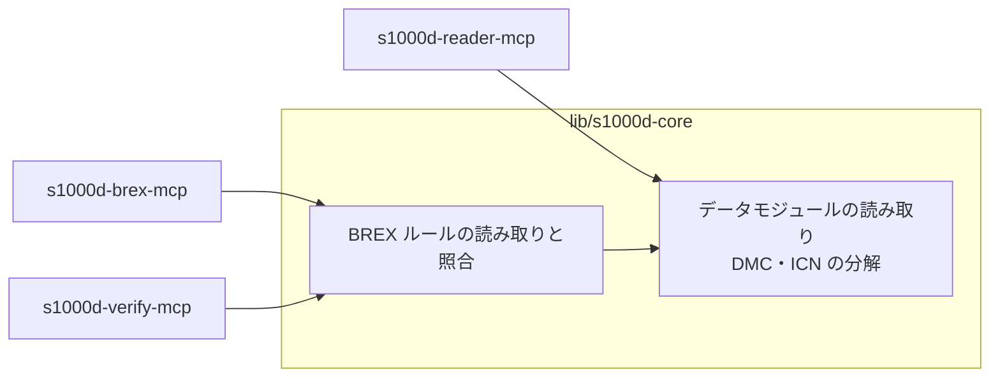

# 決定事項と未決事項

s1000d-stack で決めたことと、その理由を記録します。日付は JST です。

## 決定事項

### D-01 名前は S1000D に寄せる（2026-10-23）

- MCP サーバーと共有ライブラリの名前は `s1000d-` で始めます。扱う対象（BREX、DMC、データモジュール）はすべて S1000D の概念で、IETM の概念ではないためです。
- 一般向けの製品（作成ツール・閲覧ソフト）には S1000D の名前を付けません。一般の利用者は S1000D を知らないためです。製品名は後で決めます。
- 略称 `s1kd` は使いません。既存のオープンソースのツール群 s1kd-tools と紛らわしくなるためです。
- 以前の仮称「IETM Stack」は使いません。
- README とパッケージの説明文では、初出を「BREX（Business Rules Exchange）」と書き、「S1000D」を併記します。法人カードの Brex と取り違えられないようにするためです。

### D-02 商標の注記（2026-10-23）

S1000D は ASD の商標で、EU では登録商標です。次の 3 点を守ります。

1. 自分の名前空間に置く（`@shuji-bonji/s1000d-…`、`shuji-bonji/s1000d-…`）
2. README とパッケージの説明に「ASD とは無関係であること」「S1000D® は ASD の登録商標であること」を書く
3. 「公式」「認定」と受け取られる表現やロゴを使わない

### D-03 仕様書・スキーマ・公式サンプルを同梱しない（2026-10-23）

- 利用条件は非独占的な利用を許諾するだけで、再配布の権利は与えていません。明示されていない権利はすべて著作権者に留保されています。
- 改変・翻案・翻訳は禁止され、追加してよいのはビジネスルールだけです。
- 対象には仕様書本体だけでなく、XML スキーマ、XML インスタンス・スタイルシートなどの例、ダウンロードページのその他の情報も含まれます。

このため、次のように扱います。

| 対象 | 扱い |
|---|---|
| npm パッケージ・リポジトリ | 自分で書いたコードと自作のデータだけを入れる。Private の間も仕様書はコミットしない |
| MCP サーバー | 利用者が入手した仕様書・スキーマを環境変数 `S1000D_SPEC_DIR` で指定する方式にする |
| テスト | 自作のデータモジュールと自作の BREX を使う |
| 学習サイト | 仕様書の章を日本語に置き換える書き方はしない。概念を自分の言葉と構成で説明する |

判断の根拠は Issue 4.0・5.0 の利用条件の抜粋と公式サイトの記載です。2026-10-23 に Issue 7 の利用条件（`S1000D-A-00-00-0000-00A-021A-D`）の全文を読み、この判断を確定しました。再配布を無償で認める「Special usage rights」の対象は ASD・AIA・A4A の会員企業や加盟国の国防省など 8 区分に限られ、個人の開発者は含まれません。要点は [notes/background.md の「利用条件（Issue 7）の確認結果」](./notes/background.md#利用条件issue-7の確認結果) にあります。

同じ判断をしている例として、i2oss/s1000d-mcp は「公式 XSD は登録制のポータル経由の配布で再配布できない」として自作のサブセット XSD を使い、Oxygen XML の S1000D フレームワークはスキーマを同梱せず利用者に入手させています。

### D-04 構成は houki-hub に揃える（2026-10-23）

- s1000d-stack は構成表（`stack.json`）、ドキュメントサイト（`site/`）、`docs/`、`scripts/` だけを持ちます。
- 各部品は独立したリポジトリで、作業コピーを `mcp/`・`lib/`・`skill/`・`app/` に置き、`.gitignore` で除外します。
- 共有ライブラリ s1000d-core も独立したリポジトリにします（houki-abbreviations と同じ扱い）。

### D-05 リポジトリと配置（2026-10-23）

GitHub は s1000d-core を除き Private です（s1000d-core は 2026-10-24 に npm 公開と同時に Public にしました）。

| 種類 | 段階 | GitHub | npm | ローカル |
|---|---|---|---|---|
| hub | 1 | `shuji-bonji/s1000d-stack`（Private。サイトは GitHub Pages `https://shuji-bonji.github.io/s1000d-stack/` で公開予定） | — | `/Users/bonji/workspace/shuji-bonji/s1000d-stack` |
| ライブラリ | 1 | `shuji-bonji/s1000d-core`（**Public**、2026-10-24） | `@shuji-bonji/s1000d-core` **0.1.0 公開済み**（2026-10-24） | `s1000d-stack/lib/s1000d-core` |
| MCP | 1 | `shuji-bonji/s1000d-brex-mcp`（ローカルは 2026-10-23 に作成、未コミット） | `@shuji-bonji/s1000d-brex-mcp`（未公開） | `s1000d-stack/mcp/s1000d-brex-mcp` |
| MCP | 2 | `shuji-bonji/s1000d-reader-mcp` | `@shuji-bonji/s1000d-reader-mcp` | `s1000d-stack/mcp/s1000d-reader-mcp` |
| MCP | 2 | `shuji-bonji/s1000d-verify-mcp` | `@shuji-bonji/s1000d-verify-mcp` | `s1000d-stack/mcp/s1000d-verify-mcp` |
| ライブラリ（未作成） | 2 | `shuji-bonji/experiential-manual-model`（U-04 で 2026-10-24 に確定） | `@shuji-bonji/experiential-manual-model` | `s1000d-stack/lib/experiential-manual-model` |
| MCP | 3 | `shuji-bonji/s1000d-writer-mcp` | `@shuji-bonji/s1000d-writer-mcp` | `s1000d-stack/mcp/s1000d-writer-mcp` |
| Skill（未作成） | 3 | 未定（名前の規則は U-09） | — | `s1000d-stack/skill/` |
| app（未作成） | 3〜4 | 未定（製品名は U-05） | — | `s1000d-stack/app/` |

MCP の 4 つのリポジトリは作成済みですが、中身はまだ空です（2026-10-23 時点）。hub に `.gitignore` を置くまで、hub 側で `git add .` をしないでください。`mcp/` 以下が gitlink として登録されてしまいます。

### D-06 仕様書の置き場所（2026-10-23、同日改定）

```text
/Users/bonji/workspace/shuji-bonji/s1000d-stack/specs/s1000d/   ← hub の .gitignore で除外
├── archives/     ダウンロードした zip（Issue 1.7〜7）
├── issue-7/      展開したもの（最初の対象）
└── issue-4.2/    必要になったら展開
```

- hub の直下に置き、MCP の 4 つが 1 つのコピーを共有します。`S1000D_SPEC_DIR` は hub からの相対パスで指定できます。
- 当初は `shuji-bonji/` の外（`/Users/bonji/workspace/specs/s1000d/`）としていましたが、チャットから読むたびにフォルダーの許可申請が要るため、接続済みの hub の中に改めました。なお `/Users/bonji/workspace/shuji-bonji/specs/` は仕様プロジェクト用リポジトリの置き場で、S1000D の仕様書とは関係ありません。
- 混入防止は `.gitignore` だけに頼るので、順序を守ります。
  1. hub の `.gitignore`（`/specs/`、`*.zip` を含む）を**先にコミットする**
  2. その後に zip を移し、展開する
- 各 MCP リポジトリの `.gitignore` にも `/specs/` と `*.zip` を入れ、MCP 単体で作業するときに置いても登録されないようにします。

### D-07 ドキュメントサイトは Astro Starlight（2026-10-23）

- 他のリポジトリと同じ Node と TypeScript の環境で動き、全文検索（Pagefind）や目次などドキュメントサイトに必要な機能が揃っているためです。
- MkDocs（Material for MkDocs）は 2026-11-05 に保守終了予定のため採用しません。
- VitePress は使いません。
- **テーマは `starlight-theme-rapide` を使います（2026-10-24 追記、同日改定）。** 当初は Starlight の既定の見た目のままとしていましたが、同日に `site/astro.config.mjs` の `plugins` に `starlightThemeRapide()` を追加して採用しました（`site/package.json` の依存は `starlight-theme-rapide` ^0.6.0、Starlight 0.42 対応）。スターターテンプレートの Varsha（ランディングページ＋ Starlight 0.42.5 ＋ブログ。MIT だが「Built with varsha」の表記を残す条件付き、Star 2）は採用しません。細かな調整は `site/src/styles/custom.css` で行います。

### D-08 最初の成果物は BREX MCP（2026-10-22）

- BREX はデータモジュールの種類の 1 つなので、読み取り処理は reader の土台になり、照合処理は verify の中心になります。
- 公開されている S1000D の MCP サーバーで BREX を扱うものは見当たりません。

### D-09 専門家エージェントと製品を並行して作る（2026-10-22）

- MCP と Skill を先に作り、製品の開発（テストの判定役、テストデータの作成）に使います。
- S1000D との対応関係は共通データモデルとその変換関数に集め、エージェントと製品が別々に解釈しないようにします。
- 製品は AI が無くても動く状態を保ちます。

### D-10 BREX の照合処理は s1000d-core に置く（2026-10-23）

- BREX のルールを読み取り、データモジュールに当てて違反を返す処理は、s1000d-core に実装します。s1000d-brex-mcp（段階 1）と s1000d-verify-mcp（段階 2）は、どちらもこの処理を呼ぶだけにします。
- 理由は、同じ照合処理を 2 つの MCP に別々に実装すると結果が食い違う可能性があることと、D-09 の「解釈を 1 か所に集める」方針に合わせるためです。
- s1000d-core が大きくなった場合は、照合処理だけを別のライブラリに分けます。その場合も MCP 側に照合処理を持たせません。



### D-11 ライセンス（2026-10-23）

| 対象 | ライセンス |
|---|---|
| コード（s1000d-core、各 MCP、app、scripts） | MIT |
| 学習サイトの文章（`site/`） | CC BY 4.0 |
| 自作のサンプルデータ（券売機の例など） | MIT（2026-10-24 に確定。当初は MIT または CC0） |

計画を立てたチャットで検討した案を記録し、2026-10-24 にサンプルデータのライセンスを MIT に確定しました。

### D-12 XML は @xmldom/xmldom、XPath は fontoxpath で評価する（2026-10-23）

- s1000d-core の XML 層は `@xmldom/xmldom`（DOM）＋ `fontoxpath`（XPath 3.1）で実装します。両方を `XmlEngine` インターフェースの後ろに置き、差し替えられる形にします。
- 理由: 2026-10-23 の実測で、Issue 7 の既定 BREX の `objectPath` 274 件のうち 1 件が XPath 2.0 の構文（`for … return some … satisfies`）で書かれており、XPath 1.0 だけの `xpath` パッケージでは評価できませんでした（もう 1 件は `not (` の空白を受け付けない `xpath` 側の不具合）。`fontoxpath` は 274 件すべてを構文解析・評価でき、`@xmldom/xmldom` の Document をそのまま文脈に取れます（slimdom は不要）。Bike Samples 106 件 × 該当ルールの評価 25,758 回は約 8 秒で、`xpath` と同じ結果でした。
- 実装上の注意: `fontoxpath` の `ANY_TYPE` は結果が節点 1 つのとき配列ではなく節点そのものを返す。また `ANY_TYPE` で属性を選ぶと節点ではなく文字列に原子化して返すため、違反箇所の行番号を保つには先に節点集合として評価する（`xml/xmldom-fontoxpath.ts`）。`@xmldom/xmldom` 0.9 は致命的な構文エラーを `onError` に渡さず `ParseError` を投げる。どちらも `XmlEngine` の実装で正規化済み。
- XSD 検証の方式は決めていません（U-08 に残す）。

### D-13 MCP サーバーは MCP SDK v2 で書く（2026-10-23）

- `@modelcontextprotocol/server` 2.x（`serveStdio` ＋ `buildServer()`、`fromJsonSchema` で JSON Schema をそのまま使う）を使います。rfcxml-mcp など既存の MCP が v2 に移行済みで、同じ型にするためです。
- `initialize` の `instructions` に「しないこと」（XSD 検証をしない、準拠を判定しない、重大度を解釈しない、仕様書を同梱しない）を先に書きます（shuji-mcp-patterns §G）。
- Node は 22 以上（SDK v2 の要件）。

### D-14 npm への公開は Trusted Publisher で行う（2026-10-24）

- 各パッケージの公開は、`v*` の tag を push したときに GitHub Actions が OIDC で `npm publish --provenance --access public` を実行する方式にします（houki-abbreviations の `publish.yml` と同じ）。`NPM_TOKEN` は Secrets に置きません。
- Trusted Publisher は既存パッケージにしか設定できないため、各パッケージの **初回だけは手動で** `npm publish --access public` を行い、その後に npm 側で Trusted Publisher（Repository と `publish.yml`）を登録します。s1000d-core は 2026-10-24 に 0.1.0 を手動公開済みで、npm 側の登録は作業中。
- 手順は各リポジトリの `docs/RELEASE.md` に書きます。

### D-15 XSD 検証は libxml2-wasm で行う（2026-10-24）

- s1000d-verify-mcp（段階 2）の XML スキーマ検証には `libxml2-wasm` を使います。判断の根拠は「U-08 の比較結果（2026-10-24）」の実測です。要点は、Issue 7 の XSD 33 本と Bike Samples 106 件で `xmllint-wasm` と判定結果が同じで、コンパイル済みの `XsdValidator` を使い回せるため 106 件を 0.27 秒（`xmllint-wasm` は 7.8 秒）で検証できることです。
- `xs:import` の解決に使う `xmlRegisterInputProvider` / `XmlBufferInputProvider` は `@alpha` 表記の API なので、XSD 検証は s1000d-core の `XmlEngine`（D-12）と同じく 1 つのインターフェース（仮称 `SchemaValidator`）の後ろに置き、API が変わっても差し替えられるようにします。
- `XmlDocument` / `XsdValidator` は `dispose()` が必要です。検証器は CSDB 単位でスキーマごとに 1 つ作って使い回し、文書は検証のたびに破棄します。
- DOCTYPE の `ENTITY` / `NOTATION` 宣言の読み取りは、引き続き s1000d-core（`@xmldom/xmldom`）が行います。`libxml2-wasm` には宣言を列挙する API が無いためです。
- `libxml2-wasm` は ESM のみ、Node 18 以上です。MCP SDK v2 の要件（Node 22 以上、D-13）の範囲に収まります。

### D-16 hub と brex-mcp の公開は段階 2 が揃った時点で行う（2026-10-24）

- U-01 の判断です。s1000d-core は 2026-10-24 に公開済みですが、hub（学習サイト）と s1000d-brex-mcp の公開は、段階 2（s1000d-reader-mcp、s1000d-verify-mcp、manual-model）が揃った時点で行います。
- 理由は、BREX の照合だけでは「XSD 未検証」の前提付きの結果になり、verify-mcp と一緒に出したほうが利用者が結果を正しく読めるためです。
- 公開時の作業は次のとおりです。(1) hub を Public にし、GitHub Pages の Source を GitHub Actions にする。(2) `deploy.yml` の push トリガーを戻す。(3) brex-mcp を Public にし、初回だけ手動で `npm publish --access public`、その後 npm 側で Trusted Publisher を登録する（D-14）。(4) サイトの `guide/getting-started.md` と `mcp/brex-mcp.md` の「npm 未公開（開発中）」の note を消す。(5) `stack.json` の brex-mcp の status を `released` にする。

### D-17 XSD 検証のインターフェースと実装は s1000d-core に置く（2026-10-24）

- `SchemaValidator` インターフェース、検証状態の型 `VerificationStatus`、`S1000D_SPEC_DIR` から `xml_schema_flat/` を探す処理、`verifyDataModule()` は s1000d-core の本体に置きます。
- `libxml2-wasm`（D-15）による実装は、s1000d-core のサブパス `@shuji-bonji/s1000d-core/xsd-libxml2` に置きます。`libxml2-wasm` は `peerDependencies` にし、`peerDependenciesMeta` で optional にします。XSD 検証を使わない brex-mcp は `libxml2-wasm` を入れずに済みます。
- 理由: reader-mcp も応答に検証状態を含めるため XSD 検証が要り、verify-mcp に置くと reader に同じ実装を複製することになります（D-10 が避けた形）。D-15 の「`XmlEngine`（D-12）と同じく 1 つのインターフェースの後ろに置く」に沿って、`XmlEngine` と同じ core に置きます。
- 代案として検討したもの: (A) verify-mcp に置く（reader に複製が要る）、(C) 別パッケージ `@shuji-bonji/s1000d-xsd` を作る（リポジトリと公開手順が 1 つ増える）。core が大きくなったときは (C) に分けます（D-10 の末尾と同じ）。
- 詳細は [design/verify-mcp.md](./design/verify-mcp.md)「`SchemaValidator` と `libxml2-wasm` の置き場所」にあります。

### D-18 reader-mcp は検証状態を自分で作り、既定では XSD 検証だけを行う（2026-10-24）

- MCP サーバー同士は呼び合えないため、reader-mcp は verify-mcp に委譲せず、s1000d-core の `verifyDataModule()` を呼んで `VerificationStatus` を作り、すべての応答に含めます。verify-mcp も同じ関数を呼ぶので、2 つの MCP の検証状態は同じ形・同じ結果になります。
- `read_data_module` の既定は XSD 検証だけ（`verify: "schema"`）です。XSD に違反した文書は要素の位置が仕様と違う可能性があり、本文の読み取り結果が信用できなくなるため、XSD は省きません。BREX の照合は本文の意味にはほとんど影響せず、1 件あたり 0.1 秒前後かかるため、`verify: "full"` を指定したときだけ行います。行わなかったときは `verification.brex.state` を `not-run` と明記します。
- reader-mcp を単体で使うことも、verify-mcp と組み合わせることも想定します。単体で使ったときに「何を確認していないか」が応答に書かれていることが要点で、単体の利用を避ける必要はありません。
- `notApplicable` と判定した要素は既定で残して印を付けます（`omitNotApplicable: true` で省けます）。
- 詳細は [design/reader-mcp.md](./design/reader-mcp.md) にあります。

## 未決事項

| ID | 内容 | 判断の材料 |
|---|---|---|
| ~~U-01~~ | 最初の公開の時期 | **解決（2026-10-24）**: 段階 2 が揃った時点で hub と brex-mcp を公開する（D-16）。以下は経過。「すべて揃った時点」と「段階 1 の 3 つが揃った時点」のどちらにするか。BREX を扱う MCP は他に無いこと、Zenn Book「IETM入門」を公開済みであることは早い公開の理由になる。「揃った」の条件には、サイトの BREX・データモジュールの説明を仕様書と照合済みであることを含める。**2026-10-24 時点**: s1000d-core は公開済み。hub は Private のため GitHub Pages を有効にできず（Free プラン）、`deploy.yml` は `workflow_dispatch` だけにしてある。hub を Public にするときに push トリガーを戻す。brex-mcp を npm に公開したら、サイトの `guide/getting-started.md` と `mcp/brex-mcp.md` にある「npm 未公開（開発中）」の note を 2 つとも消す |
| ~~U-02~~ | Issue 7 の利用条件の全文に、再配布や組み込みについての特別な許可があるか | **解決（2026-10-23）**: 無い。「Special usage rights」の対象は 8 区分の団体・企業・機関に限られる。D-03 に反映済み |
| U-03 | 自作サンプルデータを共有パッケージに切り出す時期 | 2 つ目の MCP がテストで使い始めた時点を目安にする |
| ~~U-04~~ | 共通データモデルのパッケージ名 | **解決（2026-10-24）**: `@shuji-bonji/experiential-manual-model`（GitHub は `shuji-bonji/experiential-manual-model`、ローカルは `s1000d-stack/lib/experiential-manual-model`）。`manual-model` だけでは IETM や S1000D 一般のマニュアルのモデルと受け取られるため、「体験型」を表す `experiential` を入れる。npm で `experiential-manual-model` / `experiential-manual` / `experience-manual-model` / `xp-manual-model` が空いていることを 2026-10-24 に確認した。文書の中では引き続き「manual-model」と略して書くことがある |
| U-05 | 作成ツール・閲覧ソフトの製品名 | 一般の利用者向けの名前にする |
| ~~U-06~~ | Starlight の日本語検索の精度 | **解決（2026-10-24）**: 生成された Pagefind の索引を Node から検索して確認。単語（照合・券売機・適用性・識別・商標）は期待どおり。Pagefind は日本語を単語に分けて索引するため、「データモジュール」のような複合語をそのまま入れると同じつながりで現れたページ（1 件）だけが返り、「データ モジュール」と空けると 9 件になる。サイトの見出しに主要な複合語をそのまま書くことで補う |
| U-07 | Issue 4.2 に対応する時期 | 段階 2 で reader を作るときに判断する。Issue 4.2 以降の ICN メタデータファイル（IMF）を reader の対象に含めるかも一緒に判断する |
| ~~U-08~~ | XSD 検証の方式（段階 2）。XML の読み取りと XPath は D-12 で決定済み | **解決（2026-10-24）**: `libxml2-wasm` に確定（D-15）。根拠は下記「U-08 の判断材料」と「U-08 の比較結果（2026-10-24）」 |
| ~~U-10~~ | s1000d-core の npm 公開の時期 | **解決（2026-10-24）**: brex-mcp の CI が `file:` 依存を解決できず落ちたため、core を先に `0.1.0` として npm に公開し、GitHub も Public にした。brex-mcp の依存は `^0.1.0`。hub と brex-mcp の公開（U-01）は従来どおり段階 1 が揃った時点で判断する |
| U-09 | Skill のリポジトリ名の規則 | houki-hub に倣うなら `s1000d-<名前>-skill`（例: `s1000d-review-skill`）。段階 3 で Skill を作るときに決める |

### U-08 の判断材料

BREX のルールは `objectPath` に XPath で対象を書くため、XML を DOM として保持して XPath を評価できるライブラリが必要です。fast-xml-parser のように JSON に変換する方式では XPath を評価できません。また、データモジュールの DOCTYPE には ICN の `ENTITY` 宣言と `NOTATION` 宣言（内部 DTD サブセット）が入るため、選ぶパーサーがこれを読み飛ばせるか、取り出せるかも確認が要ります。

2026-10-23 時点の npm の実測です。

| パッケージ | 最新版 | 最終更新 | 状態 |
|---|---|---|---|
| `@xmldom/xmldom` ＋ `xpath` | 0.9.12 / 0.0.35 | 2026-08 / 2026-10 | 純粋な JS。XPath 1.0 |
| `fontoxpath`（＋ `slimdom`） | 3.34.0 | 2026-04 | 純粋な JS。XPath 3.1。slimdom は 2024-04 で止まっている |
| `libxml2-wasm` | 0.7.2 | 2026-09 | wasm。XSD 検証を持つが include/import は「実験的」。保守は個人 1 名 |
| `xmllint-wasm` | 5.3.0 | 2026-08 | wasm。xmllint 相当で XSD 検証向け |
| `libxmljs2` | 0.37.0 | 2025-06 | README に「NO LONGER MAINTAINED」。ネイティブビルド |
| `libxmljs3` | 0.25.3 | 2022-05 | 止まっている |

libxml2 本体は、長年の保守担当者が退いて「公式に保守されていない」状態と報じられています。wasm 版もネイティブ版も libxml2 を包んでいるため、この懸念は共通です。

経過:

1. 当初は「XPath 1.0 で足りる」と見て `xpath` パッケージを候補にしたが、既定 BREX に XPath 2.0 の式が含まれることが実測で分かり、`fontoxpath` に決めた（D-12）。
2. 残るのは XSD 検証（段階 2）の方式。純粋な JS で S1000D 規模の XSD 1.0 を検証できる実績のあるライブラリは見当たらないため、`xmllint-wasm` と `libxml2-wasm` を段階 2 で比べる。libxml2 本体の保守状況の懸念は両者に共通する。

### U-08 の比較結果（2026-10-24）

`xmllint-wasm` 5.3.0 と `libxml2-wasm` 0.7.2 を、Issue 7 の `xml_schema_flat/`（XSD 33 本）と Bike Samples（データモジュール 106 件、うち 31 件が DOCTYPE に `<!ENTITY … NDATA>` 宣言を持つ）で比べました。実行環境は開発機に接続した Linux VM、Node 22.23.4 です。スクリプトは hub の `scripts/experiments/u08-xsd-compare.mjs` にあります。

| 観点 | xmllint-wasm 5.3.0 | libxml2-wasm 0.7.2 |
|---|---|---|
| `xs:import` の解決（各 XSD が `xml.xsd` / `xlink.xsd` / `rdf.xsd` を import する） | `preload` に全 XSD の文字列を渡せば解決する。渡さないと「Failed to locate a schema at location 'xml.xsd'」でコンパイルに失敗 | `xmlRegisterInputProvider(new XmlBufferInputProvider({ 'xml.xsd': bytes, … }))` で解決する。渡さないと同じ理由で失敗。API は `@alpha` 表記 |
| 判定の正しさ | 106 件すべて適合。未知の要素・`xml:lang` の不正な位置・`year="abcd"` の型違反を検出 | 同じ 106 件すべて適合、同じ 3 種の違反を検出。エラー文は両者とも libxml2 のものなので一致 |
| 内部 DTD サブセット（`ENTITY` / `NOTATION` 宣言） | 31 件を問題なく読む | 31 件を問題なく読む。ただし `XmlDtd` は宣言を列挙する API を持たないので、NOTATION の取り出しは引き続き s1000d-core（`@xmldom/xmldom`）側で行う |
| 速度（106 件） | **7.8 秒**。呼び出しごとに Worker を起こしてスキーマをコンパイルし直す | **0.27 秒**。スキーマ 19 種を 1 回ずつコンパイルして `XsdValidator` を使い回せる |
| エラー情報 | `errors[].message`、`loc.fileName`、`loc.lineNumber` | `XmlValidateError.details[]` に `message` / `line` / `col` / `level`、可能なら `xpath` |
| 同梱する libxml2 | 2.13.8 | 2.14.0 |
| 配布形態 | Node 用は CommonJS（`index-node.js`）、ブラウザー用は ESM。`package.json` に `type` 無し。Node 16 以上 | ESM のみ（`lib/index.mjs`）。Node 18 以上。`browser: false` |
| 依存 | 0 | 0 |
| メモリー管理 | 不要（呼び出しごとに使い捨て） | `XmlDocument` / `XsdValidator` を `dispose()` する必要がある（`using` 構文にも対応） |
| 最終更新（npm） | 2026-08-05（18 版） | 2026-09-07（16 版） |
| ライセンス | MIT | MIT（libxml2 の MIT ライセンスも同梱） |

判断:

- verify-mcp は「1 つの CSDB の全データモジュールを同じ XSD で検証する」使い方になるので、スキーマのコンパイルを使い回せる `libxml2-wasm` が約 30 倍速い。`xmllint-wasm` の 1 件 70 ms 前後は単発なら問題にならないが、Bike Samples 規模（106 件）で 8 秒、実務の CSDB（数千件）では分単位になる。
- `libxml2-wasm` の `xs:import` 解決 API（`xmlRegisterInputProvider`）は `@alpha` 表記だが、Issue 7 の XSD 33 本については問題なく動いた。この API が変わった場合に影響を局所化できるよう、XSD 検証も s1000d-core の `XmlEngine` と同様に 1 つのインターフェース（仮に `SchemaValidator`）の後ろに置く。
- ENTITY / NOTATION の取り出しは既に s1000d-core にあるので、どちらを選んでも追加の実装は要らない。
- libxml2 本体の保守状況の懸念は両者に共通で、判断の材料にならない。

**結論: XSD 検証は `libxml2-wasm` で行う。2026-10-24 に D-15 として確定した。**

出典: [libxml2-wasm（GitHub）](https://github.com/jameslan/libxml2-wasm)、[xmllint-wasm（GitHub）](https://github.com/notengrafik/xmllint-wasm)、[libxmljs2 の README](https://cdn.jsdelivr.net/npm/libxmljs2@0.37.0/README.md)、[libxml2 が保守されなくなったという報道](https://www.linux.org/threads/linuxiac-libxml2-becomes-officially-unmaintained-after-maintainer-steps-down.59832/latest)
