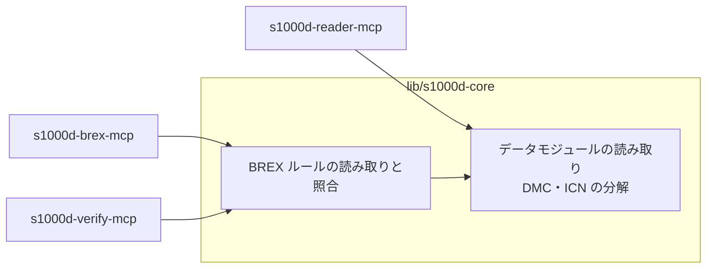

# 決定事項と未決事項

s1000d-stack で決めたことと、その理由を記録します。日付は JST です。

## 決定事項

### D-01 名前は S1000D に寄せる（2026-10-23）

- MCP サーバーと共有ライブラリの名前は `s1000d-` で始めます。扱う対象（BREX、DMC、データモジュール）はすべて S1000D の概念で、IETM の概念ではないためです。
- 一般向けの製品（作成ツール・閲覧ソフト）には S1000D の名前を付けません。一般の利用者は S1000D を知らないためです。製品名は後で決めます。
- 略称 `s1kd` は使いません。既存のオープンソースのツール群 s1kd-tools と紛らわしくなるためです。
- 以前の仮称「IETM Stack」は使いません。
- README とパッケージの説明文では、初出を「BREX（Business Rules Exchange）」と書き、「S1000D」を併記します。法人カードの Brex と取り違えられないようにするためです。

### D-02 商標の注記（2026-10-23）

S1000D は ASD の商標で、EU では登録商標です。次の 3 点を守ります。

1. 自分の名前空間に置く（`@shuji-bonji/s1000d-…`、`shuji-bonji/s1000d-…`）
2. README とパッケージの説明に「ASD とは無関係であること」「S1000D® は ASD の登録商標であること」を書く
3. 「公式」「認定」と受け取られる表現やロゴを使わない

### D-03 仕様書・スキーマ・公式サンプルを同梱しない（2026-10-23）

- 利用条件は非独占的な利用を許諾するだけで、再配布の権利は与えていません。明示されていない権利はすべて著作権者に留保されています。
- 改変・翻案・翻訳は禁止され、追加してよいのはビジネスルールだけです。
- 対象には仕様書本体だけでなく、XML スキーマ、XML インスタンス・スタイルシートなどの例、ダウンロードページのその他の情報も含まれます。

このため、次のように扱います。

| 対象 | 扱い |
|---|---|
| npm パッケージ・リポジトリ | 自分で書いたコードと自作のデータだけを入れる。Private の間も仕様書はコミットしない |
| MCP サーバー | 利用者が入手した仕様書・スキーマを環境変数 `S1000D_SPEC_DIR` で指定する方式にする |
| テスト | 自作のデータモジュールと自作の BREX を使う |
| 学習サイト | 仕様書の章を日本語に置き換える書き方はしない。概念を自分の言葉と構成で説明する |

判断の根拠は Issue 4.0・5.0 の利用条件の抜粋と公式サイトの記載です。2026-10-23 に Issue 7 の利用条件（`S1000D-A-00-00-0000-00A-021A-D`）の全文を読み、この判断を確定しました。再配布を無償で認める「Special usage rights」の対象は ASD・AIA・A4A の会員企業や加盟国の国防省など 8 区分に限られ、個人の開発者は含まれません。要点は [notes/background.md の「利用条件（Issue 7）の確認結果」](./notes/background.md#利用条件issue-7の確認結果) にあります。

同じ判断をしている例として、i2oss/s1000d-mcp は「公式 XSD は登録制のポータル経由の配布で再配布できない」として自作のサブセット XSD を使い、Oxygen XML の S1000D フレームワークはスキーマを同梱せず利用者に入手させています。

### D-04 構成は houki-hub に揃える（2026-10-23）

- s1000d-stack は構成表（`stack.json`）、ドキュメントサイト（`site/`）、`docs/`、`scripts/` だけを持ちます。
- 各部品は独立したリポジトリで、作業コピーを `mcp/`・`lib/`・`skill/`・`app/` に置き、`.gitignore` で除外します。
- 共有ライブラリ s1000d-core も独立したリポジトリにします（houki-abbreviations と同じ扱い）。

### D-05 リポジトリと配置（2026-10-23）

GitHub はすべて Private で作成済みです。

| 種類 | 段階 | GitHub | npm | ローカル |
|---|---|---|---|---|
| hub | 1 | `shuji-bonji/s1000d-stack` | — | `/Users/bonji/workspace/shuji-bonji/s1000d-stack` |
| ライブラリ（未作成） | 1 | `shuji-bonji/s1000d-core` | `@shuji-bonji/s1000d-core` | `s1000d-stack/lib/s1000d-core` |
| MCP | 1 | `shuji-bonji/s1000d-brex-mcp` | `@shuji-bonji/s1000d-brex-mcp` | `s1000d-stack/mcp/s1000d-brex-mcp` |
| MCP | 2 | `shuji-bonji/s1000d-reader-mcp` | `@shuji-bonji/s1000d-reader-mcp` | `s1000d-stack/mcp/s1000d-reader-mcp` |
| MCP | 2 | `shuji-bonji/s1000d-verify-mcp` | `@shuji-bonji/s1000d-verify-mcp` | `s1000d-stack/mcp/s1000d-verify-mcp` |
| ライブラリ（未作成） | 2 | 未定 | `@shuji-bonji/manual-model`（仮） | `s1000d-stack/lib/` |
| MCP | 3 | `shuji-bonji/s1000d-writer-mcp` | `@shuji-bonji/s1000d-writer-mcp` | `s1000d-stack/mcp/s1000d-writer-mcp` |
| Skill（未作成） | 3 | 未定（名前の規則は U-09） | — | `s1000d-stack/skill/` |
| app（未作成） | 3〜4 | 未定（製品名は U-05） | — | `s1000d-stack/app/` |

MCP の 4 つのリポジトリは作成済みですが、中身はまだ空です（2026-10-23 時点）。hub に `.gitignore` を置くまで、hub 側で `git add .` をしないでください。`mcp/` 以下が gitlink として登録されてしまいます。

### D-06 仕様書の置き場所（2026-10-23、同日改定）

```text
/Users/bonji/workspace/shuji-bonji/s1000d-stack/specs/s1000d/   ← hub の .gitignore で除外
├── archives/     ダウンロードした zip（Issue 1.7〜7）
├── issue-7/      展開したもの（最初の対象）
└── issue-4.2/    必要になったら展開
```

- hub の直下に置き、MCP の 4 つが 1 つのコピーを共有します。`S1000D_SPEC_DIR` は hub からの相対パスで指定できます。
- 当初は `shuji-bonji/` の外（`/Users/bonji/workspace/specs/s1000d/`）としていましたが、チャットから読むたびにフォルダーの許可申請が要るため、接続済みの hub の中に改めました。なお `/Users/bonji/workspace/shuji-bonji/specs/` は仕様プロジェクト用リポジトリの置き場で、S1000D の仕様書とは関係ありません。
- 混入防止は `.gitignore` だけに頼るので、順序を守ります。
  1. hub の `.gitignore`（`/specs/`、`*.zip` を含む）を**先にコミットする**
  2. その後に zip を移し、展開する
- 各 MCP リポジトリの `.gitignore` にも `/specs/` と `*.zip` を入れ、MCP 単体で作業するときに置いても登録されないようにします。

### D-07 ドキュメントサイトは Astro Starlight（2026-10-23）

- 他のリポジトリと同じ Node と TypeScript の環境で動き、全文検索（Pagefind）や目次などドキュメントサイトに必要な機能が揃っているためです。
- MkDocs（Material for MkDocs）は 2026-11-05 に保守終了予定のため採用しません。
- VitePress は使いません。

### D-08 最初の成果物は BREX MCP（2026-10-22）

- BREX はデータモジュールの種類の 1 つなので、読み取り処理は reader の土台になり、照合処理は verify の中心になります。
- 公開されている S1000D の MCP サーバーで BREX を扱うものは見当たりません。

### D-09 専門家エージェントと製品を並行して作る（2026-10-22）

- MCP と Skill を先に作り、製品の開発（テストの判定役、テストデータの作成）に使います。
- S1000D との対応関係は共通データモデルとその変換関数に集め、エージェントと製品が別々に解釈しないようにします。
- 製品は AI が無くても動く状態を保ちます。

### D-10 BREX の照合処理は s1000d-core に置く（2026-10-23）

- BREX のルールを読み取り、データモジュールに当てて違反を返す処理は、s1000d-core に実装します。s1000d-brex-mcp（段階 1）と s1000d-verify-mcp（段階 2）は、どちらもこの処理を呼ぶだけにします。
- 理由は、同じ照合処理を 2 つの MCP に別々に実装すると結果が食い違う可能性があることと、D-09 の「解釈を 1 か所に集める」方針に合わせるためです。
- s1000d-core が大きくなった場合は、照合処理だけを別のライブラリに分けます。その場合も MCP 側に照合処理を持たせません。



### D-11 ライセンス（2026-10-23）

| 対象 | ライセンス |
|---|---|
| コード（s1000d-core、各 MCP、app、scripts） | MIT |
| 学習サイトの文章（`site/`） | CC BY 4.0 |
| 自作のサンプルデータ（券売機の例など） | MIT または CC0 |

計画を立てたチャットで検討した案をそのまま記録しています。異論があれば変更します。

## 未決事項

| ID | 内容 | 判断の材料 |
|---|---|---|
| U-01 | 最初の公開の時期 | 「すべて揃った時点」と「段階 1 の 3 つが揃った時点」のどちらにするか。BREX を扱う MCP は他に無いこと、Zenn Book「IETM入門」を公開済みであることは早い公開の理由になる。「揃った」の条件には、サイトの BREX・データモジュールの説明を仕様書と照合済みであることを含める |
| ~~U-02~~ | Issue 7 の利用条件の全文に、再配布や組み込みについての特別な許可があるか | **解決（2026-10-23）**: 無い。「Special usage rights」の対象は 8 区分の団体・企業・機関に限られる。D-03 に反映済み |
| U-03 | 自作サンプルデータを共有パッケージに切り出す時期 | 2 つ目の MCP がテストで使い始めた時点を目安にする |
| U-04 | 共通データモデルのパッケージ名 | `manual-model` は仮称 |
| U-05 | 作成ツール・閲覧ソフトの製品名 | 一般の利用者向けの名前にする |
| U-06 | Starlight の日本語検索の精度 | Pagefind で日本語ページを検索して確認する |
| U-07 | Issue 4.2 に対応する時期 | 段階 2 で reader を作るときに判断する。Issue 4.2 以降の ICN メタデータファイル（IMF）を reader の対象に含めるかも一緒に判断する |
| U-08 | XML の読み取りと XSD 検証の方式 | 下記「U-08 の判断材料」 |
| U-09 | Skill のリポジトリ名の規則 | houki-hub に倣うなら `s1000d-<名前>-skill`（例: `s1000d-review-skill`）。段階 3 で Skill を作るときに決める |

### U-08 の判断材料

BREX のルールは `objectPath` に XPath で対象を書くため、XML を DOM として保持して XPath を評価できるライブラリが必要です。fast-xml-parser のように JSON に変換する方式では XPath を評価できません。また、データモジュールの DOCTYPE には ICN の `ENTITY` 宣言と `NOTATION` 宣言（内部 DTD サブセット）が入るため、選ぶパーサーがこれを読み飛ばせるか、取り出せるかも確認が要ります。

2026-10-23 時点の npm の実測です。

| パッケージ | 最新版 | 最終更新 | 状態 |
|---|---|---|---|
| `@xmldom/xmldom` ＋ `xpath` | 0.9.12 / 0.0.35 | 2026-08 / 2026-10 | 純粋な JS。XPath 1.0 |
| `fontoxpath`（＋ `slimdom`） | 3.34.0 | 2026-04 | 純粋な JS。XPath 3.1。slimdom は 2024-04 で止まっている |
| `libxml2-wasm` | 0.7.2 | 2026-09 | wasm。XSD 検証を持つが include/import は「実験的」。保守は個人 1 名 |
| `xmllint-wasm` | 5.3.0 | 2026-08 | wasm。xmllint 相当で XSD 検証向け |
| `libxmljs2` | 0.37.0 | 2025-06 | README に「NO LONGER MAINTAINED」。ネイティブビルド |
| `libxmljs3` | 0.25.3 | 2022-05 | 止まっている |

libxml2 本体は、長年の保守担当者が退いて「公式に保守されていない」状態と報じられています。wasm 版もネイティブ版も libxml2 を包んでいるため、この懸念は共通です。

案（まだ決定ではありません）:

1. 段階 1 の BREX 照合は XPath 1.0 で足りるので、純粋な JS（`@xmldom/xmldom` ＋ `xpath`）で始める。ネイティブも wasm も要らず、XPath 1.0 は仕様が固定なので保守の心配が小さい。
2. s1000d-core の中で「XML を読んで XPath を評価する」部分を 1 つのインターフェースの後ろに置き、後で差し替えられるようにする。
3. XSD 検証（段階 2）の方式は、そのときに `xmllint-wasm` と `libxml2-wasm` を比べて決める。純粋な JS で S1000D 規模の XSD 1.0 を検証できる実績のあるライブラリは見当たらない。

出典: [libxml2-wasm（GitHub）](https://github.com/jameslan/libxml2-wasm)、[xmllint-wasm（GitHub）](https://github.com/notengrafik/xmllint-wasm)、[libxmljs2 の README](https://cdn.jsdelivr.net/npm/libxmljs2@0.37.0/README.md)、[libxml2 が保守されなくなったという報道](https://www.linux.org/threads/linuxiac-libxml2-becomes-officially-unmaintained-after-maintainer-steps-down.59832/latest)
