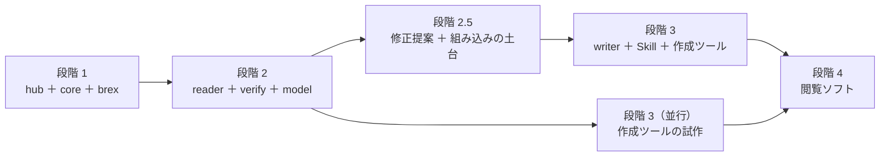
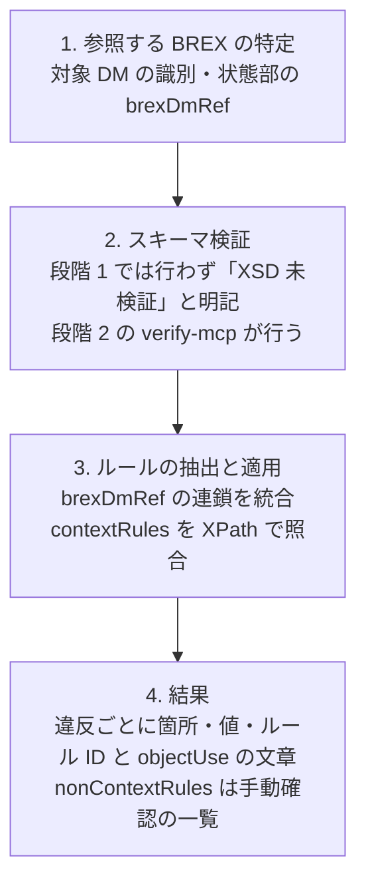
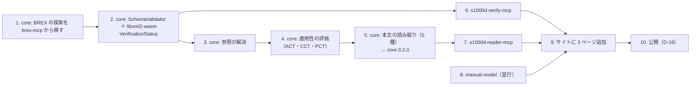

# s1000d-stack ロードマップ

LLM が S1000D の技術文書を正しく読み、プロジェクトの決まり（ビジネスルール）に沿って検査・作成できるようにするための MCP サーバー・共有ライブラリ・Skill と、体験型マニュアルの作成ツール・閲覧ソフトをまとめるプロジェクトです。

- 作成日: 2026-10-23（JST）、更新日: 2026-10-27（JST、段階 2.5 の作業 3 を記録）
- 構成の手本: [houki-hub](https://github.com/shuji-bonji/houki-hub)、[pdf-agent-stack](https://github.com/shuji-bonji/pdf-agent-stack)
- 決定事項: [DECISIONS.md](./DECISIONS.md)
- 調査メモ: [notes/background.md](./notes/background.md)
- 段階 2 の設計: [design/verify-mcp.md](./design/verify-mcp.md)、[design/reader-mcp.md](./design/reader-mcp.md)、[design/manual-model.md](./design/manual-model.md)
- 段階 2.5 の設計: [design/agent-platform.md](./design/agent-platform.md)

## 目指すもの

1. **一般向け**: 画面や機器の操作を体験しながら学べるマニュアルを、軽い Web 形式で作れるようにします（2021 年の作品 [experience_based_operation_explanation](https://github.com/shuji-bonji/experience_based_operation_explanation) の再構築）。
2. **産業向け**: 同じデータを S1000D のデータモジュールとして出力・検査できるようにし、部品メーカーや技術マニュアル制作会社の作業を支援します。
3. **組み込み基盤**（2026-10-25 に追加、D-19）: CSDB 製品にオーサリング支援・レビュー・翻訳・プロジェクト管理の AI エージェントを組み込めるようにする基盤を目指します。最低限の要件は、LLM エージェントが**スキーマ検証・クロスリファレンスチェック・適用性チェック・修正提案**をできることです。決定論的に確かめられることは core が行い、LLM は文章の生成と説明に限ります。設計は [design/agent-platform.md](./design/agent-platform.md)。

専門家エージェント（MCP と Skill）を先に作り、それを開発の道具として使いながら製品（作成ツール・閲覧ソフト）を作ります。

## 全体像

experiential-manual-model（文書の中では「manual-model」と略します。U-04）は s1000d-core に依存させません。一般向けの製品が S1000D の概念を抱え込まないようにするためです（D-01、D-09）。S1000D との変換関数は writer 側に置きます。

## 段階

| 段階 | 成果物 | 完了の条件 |
|---|---|---|
| 1 | s1000d-stack（サイトの骨組みと用語の説明）、s1000d-core、s1000d-brex-mcp | **自動**: 自作 BREX と自作データモジュールで、BREX の説明と照合のテストが CI で通る（2026-10-23 済み）。**手動**: 既定の BREX（利用者が入手したもの）を `explain_brex` で読み、自作データモジュールを照合して、結果が仕様書の BREX の章の記述と矛盾しないことを確認済み（2026-10-23 済み。券売機の説明 DM は既定 BREX の 243 ルールに違反なし）。**サイト**: BREX・データモジュールの説明を仕様書と照合済み（2026-10-24 に、作業 3 で読んだ Chap 4.10.2〜4.10.3・7.9 と既定 BREX の実測に基づいて執筆。2026-10-24 に利用者が 9 ページを通読し、仕様書との矛盾が無いことを確認済み。確認の根拠は [notes/site-review.md](./notes/site-review.md)）。**段階 1 は 2026-10-24 に完了** |
| 2 | s1000d-reader-mcp、s1000d-verify-mcp、manual-model | 公式 XSD（利用者が入手したもの）による検証、参照の解決、適用性の判定ができる。reader の応答には対象データモジュールの版（issue）と検証状態を必ず含め、適用性の判定は reader が済ませてから LLM に渡す。**段階 2 は 2026-10-26 に完了**（3 部品と brex-mcp を npm に公開、hub と学習サイトを公開） |
| 2.5 | 修正提案（verify-mcp `suggest_fixes`）、`CsdbSource` インターフェース、HTTP transport、DML・DDN の読み取り、サイトの「組み込み基盤」のページ | LLM エージェントがスキーマ検証・クロスリファレンスチェック・適用性チェック・修正提案の 4 つをできる。修正提案の候補は core が決め、LLM は候補の外の値を出さない。CSDB をフォルダー以外（製品のデータベース・API）から読める |
| 3 | s1000d-writer-mcp（LLM に XML を書かせず、構造化された入力から組み立てて「生成 → 検証 → 修正」を回す）、Skill（experience-to-s1000d / s1000d-publish / s1000d-review。STE の用語集は利用者のものを参照）、作成ツールの試作、comment DM の生成、翻訳向けの文の抜き出しと差し戻し | 券売機の例を共通データモデル経由で S1000D に出力し、verify を通る |
| 4 | 閲覧ソフト。最初の成果物は、S1000D の CSDB を直接表示する簡易な技術マニュアルの Web システム（基盤の参照実装。設計は [design/agent-platform.md](./design/agent-platform.md)「参照実装」）。その後に共通データモデルを表示する閲覧ソフト | 簡易 Web マニュアルで、PM の目次から DM をたどり、製品を選ぶと当てはまらない節が消え、参照先へ移れ、各ページに版・検証状態・機密区分が出る。閲覧ソフトは共通データモデルを表示し、WebMCP で AI が操作を案内できる |

## 段階 1 の作業（完了）

| 順 | 作業 | 置き場所 |
|---|---|---|
| 1 | hub に `.gitignore`（`/specs/`、`*.zip`、`/mcp/`、`/lib/`、`/skill/`、`/app/`）を置いてコミットする。**その後で**仕様書の zip を `s1000d-stack/specs/s1000d/archives/` に移し、Issue 7 を `issue-7/` に展開する（D-06）。展開後のファイル構成（パスとファイル名だけ。内容は写さない）と、XSD・既定 BREX の場所を notes/background.md に記録する。この記録が brex-mcp の README の「利用者が置くべき構成」の元になる | s1000d-stack/specs/（git 管理外）、docs/notes/background.md |
| 2 | 仕様書の利用条件（`S1000D-A-00-00-0000-00A-021A-D`）の全文を読み、DECISIONS.md の判断を確定する | docs/DECISIONS.md |
| 3 | 仕様書の BREX の章（Chap 4.10.2〜4.10.3、PDF p.2110〜2143）を読み、各ルールの意味（`allowedObjectFlag` の値、`valueForm` の種類、`brexDmRef` の連鎖の規則、nonContextRules の扱い）を確かめる | docs/notes/background.md |
| 4 | hub の骨組み（README、`stack.json`、`scripts/`、Starlight の `site/`）を作る。`.gitignore` は作業 1 で置いたものを使う | s1000d-stack |
| 5 | s1000d-core の雛形を作り、DMC と ICN の分解、データモジュールの識別・状態部の読み取りを実装する。XML の読み取りと XPath の評価は 1 つのインターフェースの後ろに置く（D-12） | lib/s1000d-core |
| 6 | s1000d-core に BREX の照合処理を実装し（D-10）、s1000d-brex-mcp のツールからそれを呼ぶ | lib/s1000d-core、mcp/s1000d-brex-mcp |
| 7 | 自作のサンプルデータ（券売機の例など）と自作 BREX でテストする。ICN は架空の MIC・CAGE コードで採番する | lib/s1000d-core のテストデータ |

### 進捗（2026-10-24）

| 作業 | 状態 |
|---|---|
| 1 | 済み。`.gitignore` を作成し、zip を `specs/s1000d/archives/` へ移し、Issue 7 を `issue-7/` に展開した。構成は notes/background.md に記録済み。`.gitignore` と `docs/` は 2026-10-24 にコミット済み |
| 2 | 済み。D-03 を確定し、U-02 を解決した |
| 3 | 済み。Chap 4.10.2〜4.10.3 を読み、判定規則を notes/background.md の「BREX の章の読解結果」に記録した。Chap 7.9（Business rules processing）も同日に読み、結果を同メモの「Chap 7.9 の読解結果」に記録した |
| 4 | 済み（2026-10-24）。hub の README、`stack.json`（`scripts/generate-stack.mjs` で生成。status に `developing` を追加）、Astro Starlight の `site/`（9 ページ: はじめに、IETM と S1000D、データモジュールと DMC、BREX、s1000d-brex-mcp、s1000d-core、構成と進み方、仕様書の扱いと商標、トップ）、GitHub Pages の `deploy.yml`、`stack-check.yml`。Pagefind の日本語検索を確認（U-06）。サイトの題名は「S1000D Stack」。hub が Private のため GitHub Pages は使えず（U-01）、`deploy.yml` は手動実行だけにしてある。テーマは `starlight-theme-rapide`（D-07 追記）。利用者による 9 ページの通読は済み（2026-10-24。照合シートは notes/site-review.md） |
| 5 | 済み。`lib/s1000d-core` に雛形を作成（DMC・ICN の分解と組み立て、ファイル名の分解、`xsi:noNamespaceSchemaLocation` からの版・種類の推定、識別・状態部の読み取り、`XmlEngine` インターフェースと `@xmldom/xmldom` ＋ `fontoxpath` の実装）。自作テスト 19 件と、配布物に対するテスト 4 件（`S1000D_SPEC_TESTS=1` で有効）が通る。GitHub リポジトリは Public にし、npm に 0.1.0 を公開済み（2026-10-24、D-05・D-14） |
| 6 | 済み。s1000d-core に BREX の読み取り（`readBrex`）・照合（`checkAgainstBrexLayer` / `checkAgainstBrexChain`）・連鎖の解決・SNS 検索・CSDB フォルダーの解決器を実装（D-10）。`mcp/s1000d-brex-mcp` を SDK v2（`serveStdio` ＋ `buildServer`）で作成し、5 ツール（`explain_brex` / `lookup_sns` / `lookup_value` / `list_notations` / `check_against_brex`）と `instructions` を実装。InMemoryTransport のテスト 12 件、配布物テスト 3 件、stdio の実機確認が通る。core は npm 0.1.0 を参照（2026-10-24） |
| 7 | 自作データ（券売機の説明 DM と 2 層の自作 BREX）でのテストは済み。既定 BREX と Bike Samples 全件の照合も通る（公式サンプル 105 件に既定 BREX への違反 55 件を検出。既定 BREX 側の厳しさか、サンプル側の不備かは未調査。2026-10-27 追記: このうち NOTATION の 36 件は core の照合の誤りで、core の `8be8a91`（0.3.0）で消えた。段階 2.5 の進捗を参照）。テストデータの共有パッケージへの切り出しは U-03 のとおり未 |

### BREX のルールの種類

BREX データモジュールの内容部には、次の種類のルールが入ります。要素名は Issue 7 の `brex.xsd` と既定 BREX で確認済みです（2026-10-23）。

| 種類 | 内容 | ツールへの対応 |
|---|---|---|
| contextRules › structureObjectRuleGroup › structureObjectRule | XPath（`objectPath`、属性 `allowedObjectFlag`）で指した要素・属性の使用可否と、`objectUse`（人が読む説明）、許可する値（`objectValue`、属性 `valueAllowed`・`valueForm`・`valueTailoring`）、`brDecisionRef`（ビジネスルール決定点への参照）。既定 BREX には 274 ルール・1,445 値がある | `explain_brex`、`check_against_brex` |
| nonContextRules › nonContextRule | 機械で判定できない取り決めを文章で書いたもの | `explain_brex` に含める。`check_against_brex` は「手動で確認する項目」として一覧で返す |
| snsRules › snsDescr | システム番号の体系（SNS）の定義。既定 BREX には無く、プロジェクトの BREX で使う | `lookup_sns` |
| contextRules › notationRuleList › notationRule › notationName | 使ってよい図・マルチメディアの形式（NOTATION）。`structureObjectRuleGroup` の兄弟として `contextRules` の中に置く。`rulesContext` 無しなら基本セット、スキーマ指定ならその文脈での再定義・除外。既定 BREX には無い。仕様書側の一覧は `notations/notations.xml`（121 件） | `list_notations` |
| 識別・状態部の `brexDmRef` | この BREX が従う上位の BREX。既定 BREX は自分自身を指しており、連鎖の終端になる | `check_against_brex` が連鎖をたどって統合する |

### s1000d-brex-mcp のツール案

| ツール | 内容 |
|---|---|
| `explain_brex` | BREX のルールを、どの要素に何を求めているかが分かる文章に直して一覧にする。contextRules と nonContextRules の両方を含め、どちらかを区別して返す |
| `lookup_sns` | システム番号（SNS）がどの装置・系統を指すかを返す |
| `lookup_value` | 属性の値がプロジェクトで何を意味するかを返す |
| `list_notations` | BREX が許可している図・マルチメディアの形式の一覧を返す。3D の形式は BREX で決まるため、MCP や Skill は形式を決め打ちにせずこれを読む |
| `check_against_brex` | データモジュールを BREX と照合し、違反を箇所付きで返す。nonContextRules は手動確認の項目として別に返す |

### BREX 照合処理の流れ

既存の検査ツールが行う 4 つの工程と同じです。MCP では工程を道具に分け、結果を LLM が次の判断に使える構造で返します。

- 工程 1 で BREX の DMC からファイルを探すために、ツールの引数に CSDB のフォルダー（または BREX ファイルのパス）を取ります。既定 BREX は `S1000D_SPEC_DIR` の下をファイル名 `DMC-S1000D-*-04-10-0301-00A-022A-D*.XML` で探します（システム差異コードは版で変わり、仕様書本文と実ファイルで食い違いもあるため決め打ちしない）。
- 工程 3 では、対象 DM の `xsi:noNamespaceSchemaLocation` に合う `rulesContext` のブロックと、`rulesContext` 無しの共通ブロックを適用します。判定は `allowedObjectFlag`（`0` = あれば違反、`1` = 無ければ違反、`2` = あれば `objectValue` と照合）で行い、`objectValue` の `pattern` は XSD 正規表現を JavaScript の正規表現に変換して全体一致で評価します。詳細は notes/background.md の「BREX の章の読解結果」を参照してください。
- 工程 3 で照合できるのは contextRules だけです。nonContextRules は人（または LLM）が読んで判断する項目として返します。
- 工程 4 の違反報告には、ルール ID（`brDecisionRef/@brDecisionIdentNumber`）、`objectUse` の文章、違反箇所（XPath と行番号）、実際の値、`brSeverityLevel` を含めます。

## 段階 2 の作業

設計は `docs/design/` の 3 文書（2026-10-24 作成）にあります。core の変更を先に済ませ、2 つの MCP はそれを呼ぶだけにします（D-10 と同じ考え方）。

| 順 | 作業 | 置き場所 | 設計 |
|---|---|---|---|
| 1 | brex-mcp の `services/brex-locator.ts` にある既定 BREX の探索（`DMC-S1000D-*-04-10-0301-00A-022A-D*.XML` を探し、中身の DMC が一致するものを優先する）を s1000d-core に移し、brex-mcp はそれを呼ぶ形に直す。verify-mcp と重複させないため | lib/s1000d-core、mcp/s1000d-brex-mcp | verify-mcp.md「3. BREX の照合」 |
| 2 | s1000d-core に `SchemaValidator` インターフェース、`VerificationStatus` の型、`S1000D_SPEC_DIR` から `xml_schema_flat/` を探す処理、`verifyDataModule()` を足す。`libxml2-wasm` の実装はサブパス `@shuji-bonji/s1000d-core/xsd-libxml2`（任意の peerDependency）に置く（D-17） | lib/s1000d-core | verify-mcp.md「SchemaValidator と libxml2-wasm の置き場所」 |
| 3 | s1000d-core に参照の解決を足す: `dmRef`、`pmRef`（`parsePmcFileName` を追加）、ICN（`ENTITY` 宣言 → ファイル）、`internalRef`、`applicRefId`。`listDataModules` を PMC・DML・DDN・IMF・UPF も拾う `listCsdbObjects` に広げる | lib/s1000d-core | verify-mcp.md「4. 参照の解決」 |
| 4 | s1000d-core に適用性の評価を足す: ACT・CCT・PCT の読み取り、`assert` / `evaluate` の評価、`product` との照合。範囲の書式は BREX の `matchesRange` を再利用する | lib/s1000d-core（`src/applic/`） | reader-mcp.md「適用性の判定」 |
| 5 | s1000d-core に本文の読み取りを足す: `descript` / `proced` / `process` / `fault` / `pm` の 5 種を共通の形（`blocks` / `steps` / `flow`）に揃える。ここまでを core 0.2.0 として公開し（D-14 の手順）、brex-mcp の依存を `^0.2.0` に上げる | lib/s1000d-core（`src/content/`） | reader-mcp.md「本文の構造の返し方」 |
| 6 | s1000d-verify-mcp を作る: 5 ツール（`verify_data_module` / `validate_schema` / `check_references` / `verify_csdb` / `list_schemas`）、`instructions`、自作データのテスト、配布物のテスト（Bike Samples 106 件が XSD に適合、既定 BREX への違反 55 件が brex-mcp と一致）。作業 2 が済めば着手できる。U-03（自作サンプルデータの共有パッケージ）はこのときに判断する | mcp/s1000d-verify-mcp | verify-mcp.md |
| 7 | s1000d-reader-mcp を作る: 6 ツール（`list_data_modules` / `read_data_module` / `read_publication_module` / `resolve_reference` / `describe_applicability` / `read_icn_metadata`）、`instructions`、テスト | mcp/s1000d-reader-mcp | reader-mcp.md |
| 8 | manual-model を作る: 型、JSON Schema、`validateManual`、`fromLegacyJson`、券売機の例 `examples/kenbaiki.manual.json`。core に依存しないので、作業 1〜7 と並行できる。名前は `@shuji-bonji/experiential-manual-model`（U-04） | lib/experiential-manual-model | manual-model.md |
| 9 | サイトに「s1000d-verify-mcp」「s1000d-reader-mcp」「適用性」の 3 ページを足し、`stack.json` に verify / reader / manual-model を加える。既存の brex-mcp のページにある「XSD 未検証」の説明を verify-mcp への案内に直す | s1000d-stack/site、stack.json | — |
| 10 | 公開（D-16 の 5 つの作業）と、verify-mcp・reader-mcp の初回の手動 `npm publish` と Trusted Publisher の登録（D-14） | hub、各 MCP | DECISIONS.md D-14・D-16 |
| 11 | MCP 3 本を MCP Registry（`io.github.shuji-bonji/*`）と claude-plugins marketplace に載せる（D-23） | 各 MCP、claude-plugins | DECISIONS.md D-23 |

調査の宿題（Bike Samples 105 件に既定 BREX への違反 55 件が出る原因）は作業 6 のテストで同じ数が出ることを確かめたうえで、作業 9 のサイトの題材として調べます。

### 進捗（段階 2）

| 作業 | 状態 |
|---|---|
| 設計 | 済み（2026-10-24）。`docs/design/` の 3 文書。同日に D-17（`SchemaValidator` の置き場所）・D-18（reader の検証の既定）・U-04（パッケージ名）を確定 |
| 1 | core 側は済み（2026-10-24。`src/brex/locate.ts` に `locateBrex` / `findDefaultBrex` / `isDefaultBrexDmc` / `BrexLocateError`。自作データのテスト 9 件と配布物のテスト 1 件を追加し、46 件すべて通過。core 0.2.0 に含む）。brex-mcp を core の関数に切り替える作業は、brex-mcp が npm の core を参照しているため（`^0.1.0`。`file:` 依存は CI で解決できない、U-10）、core 0.2.0 の公開（作業 5）の後に行う |
| 2 | 済み（2026-10-24、core 0.2.0 に含む）。`src/xml/schema-validator.ts`（`SchemaValidator` ほかのインターフェース）、`src/xsd-libxml2.ts`（`Libxml2SchemaValidator`。サブパス `@shuji-bonji/s1000d-core/xsd-libxml2`、`libxml2-wasm` は任意の peerDependency）、`src/verify/`（`findSchemaDirs` / `locateXsd` / `VerificationStatus` / `verifyDataModule`）。XSD の版は `brex.xsd` 冒頭の `Issue number:` から読む（フォルダー名に頼らない）。自作 XSD の単体テスト 10 件と配布物のテスト 1 件（Bike Samples 106 件が適合、約 0.45 秒）を追加し、57 件すべて通過。`verifyDataModule` の `references` は作業 3 まで `not-run` |
| 3 | 済み（2026-10-25、core 0.2.0 に含む）。`src/pmc.ts`（PMC）、`src/csdb-index.ts`（`listCsdbObjects` / `CsdbIndex`。PMC・DML・DDN・IMF・UPF・ICN も拾う）、`src/refs/`（`collectReferences` / `resolveReferences`）、`verifyDataModule` の `references`。自作データのテスト 8 件と配布物のテスト 1 件を追加し、65 件すべて通過。Bike Samples で分かったこと（仕様書の章への `dmRef`、`referencedApplicGroupRef/applicRef` 経由の `applicRefId`、`.PNG` と宣言された ICN の実ファイルが `.SVG`）は notes/background.md「参照の解決で分かった配布物の性質」に記録 |
| 4 | 済み（2026-10-25、core 0.2.0 に含む）。`src/applic/`（`readAct` / `readCct` / `readPct` / `readApplicStatements` / `evaluateApplic` / `ApplicEvaluator` / `buildApplicRepository`）。自作データのテスト 9 件と配布物のテスト 1 件を追加し、75 件すべて通過。Bike Samples で分かったこと（PCT が `type` に値を割り当てていない、PCT の条件値と CCT の列挙の不一致、`applicIdentValue` の先が配布物に無い）は notes/background.md「適用性の評価で分かった配布物の性質」に記録 |
| 5 | 済み（2026-10-25）。`src/content/`（`readContent` / `readContentFromXml` / `countNodes`）。自作データのテスト 7 件と配布物のテスト 1 件を追加し、84 件すべて通過。**core 0.2.0 を npm に公開済み**（2026-10-25、利用者がタグ `v0.2.0` を push。`latest`、サブパス `./xsd-libxml2` と任意の peerDependency `libxml2-wasm`、provenance 付き）。作業 1 の残り（brex-mcp の切り替え）も済み: 依存を `^0.2.0` に上げ、`services/brex-locator.ts` は core の `locateBrex` を呼ぶだけにした（brex-mcp の `edfe6e2`、15 件すべて通過、`libxml2-wasm` は入らない） |
| 6 | 済み（2026-10-25、verify-mcp の `686fb58`）。5 ツール（`verify_data_module` / `validate_schema` / `check_references` / `verify_csdb` / `list_schemas`）、`instructions`、自作データのテスト 13 件、配布物のテスト 5 件（Bike Samples の DMC 106 件＋ PMC 4 件がすべて XSD 適合、BREX の連鎖が解決。110 件で約 16 秒）、stdio の実機確認。実機確認で見つけた「データ辞書の中の XSD の写し（import が絶対 URL）」は verify-mcp 側で除外し、core にも同じ除外を入れた（core の `a0e9eb6`、**0.2.1 として未公開**）。npm への公開は D-16 のとおり段階 2 が揃った時点 |
| 7 | 済み（2026-10-25、reader-mcp の `6e567c7`）。6 ツール（`list_data_modules` / `read_data_module` / `read_publication_module` / `resolve_reference` / `describe_applicability` / `read_icn_metadata`）、`instructions`、自作データのテスト 14 件（ACT・手順 DM・PM のフィクスチャを追加）、配布物のテスト 5 件、stdio の実機確認。D-18 のとおり既定は XSD 検証だけ、`product` 無しは `undetermined` ＋ `displayText`。適用性リポジトリは CSDB から集める。npm への公開は D-16 のとおり段階 2 が揃った時点 |
| 8 | 済み（2026-10-25、`lib/experiential-manual-model` の `09f9d2c`。GitHub の `shuji-bonji/experiential-manual-model` は未作成、未 push）。型・JSON Schema・`validateManual`・`fromLegacyJson`・`numberSteps`・券売機の例 `examples/kenbaiki.manual.json`。実行時の依存なし。テスト 10 件（2021 年の `JSON.json` 79 画面・212 ボタンが読め、検査と JSON Schema を通る）。2021 年の JSON の実際のフィールド名は README の推測と違い `purchaseTypes` / `screenID` / `destination` だった（両方読む） |
| 9 | 済み（2026-10-25、hub の `bd61c95`）。サイトに `guide/applicability`・`mcp/verify-mcp`・`mcp/reader-mcp` を追加し、brex-mcp・guide/brex・about/stack・core・index・getting-started を 2026-10-25 時点に直した。`generate-stack.mjs` の REGISTRY を更新し `stack.json` と README の表を再生成（npm 照合は一致）。13 ページがビルドでき、内部リンクの切れは無い。**新しい 3 ページの通読（記述と仕様書・実装の照合）は利用者が行う**（段階 1 の notes/site-review.md と同じ要領） |
| 10 | 済み（2026-10-26）。4 パッケージ（`@shuji-bonji/experiential-manual-model`・`s1000d-brex-mcp`・`s1000d-verify-mcp`・`s1000d-reader-mcp`）の 0.1.0 を 16:24〜16:26 JST に手動で `npm publish` し、npm 側で Trusted Publisher を登録。4 リポジトリと hub を Public にし、GitHub Pages の Source を GitHub Actions にした。各リポジトリに `publish.yml`・`docs/RELEASE.md`・CHANGELOG 0.1.0 を追加。サイトの「npm 未公開」の note 4 か所（×2 言語）と `guide/architecture.md` の状態、hub README の「できること」と全体像の図を現状に直し、`deploy.yml` の push トリガーを戻し、REGISTRY の 4 つを `released` にして `stack.json` と README の表を再生成（npm 照合は 5 つとも一致）。サイトは 28 ページ（14 × 2 言語）がビルドでき、`check:i18n` ok、内部リンク切れ無し。手順の記録は notes/handoff.md の 10-0〜10-4。**段階 2 は 2026-10-26 に完了** |
| 11 | 済み（2026-10-27）。3 本に `mcpName`・`server.json`・`.claude-plugin/plugin.json`・`scripts/sync-plugin-version.mjs` を足して 0.1.1 を `publish.yml` 経由で公開（`npm version patch` → `git push --follow-tags`。Trusted Publisher の初回動作確認を兼ねた）。`mcp-publisher publish` で Registry に `active` で登録。claude-plugins に category `s1000d` を新設して 3 件を収録（marketplace 0.7.0）。`claude plugin install s1000d-brex-mcp@shuji-bonji` が成功 |
| 保守 | 2026-10-25: 4 リポジトリの `vitest` を 2.1 → 4.1 に上げた（2.x の依存に脆弱性の報告 6 件。開発時だけの依存。`npm audit` 0 件）。brex-mcp の CI の Node を 22・24 に揃えた（`engines` が >=22 のため） |

## 段階 2.5 の作業（組み込み基盤に向けて）

設計は [design/agent-platform.md](./design/agent-platform.md)。段階 2 の作業 10（公開）と並行して進められます。

| 順 | 作業 | 置き場所 |
|---|---|---|
| 1 | core に `suggestFixes()` と `Fix` 型。BREX の 4 種の違反（許可値・取り除く・足す・NOTATION）、未解決の参照（別の版・近い DMC・拡張子違いの ICN・近い id）、適用性の判定不能（足りない属性と ACT・PCT の値）の候補を決定論的に決める。XSD 違反は XSD の定義（`xs:enumeration` など）を読んで候補にする | lib/s1000d-core（`src/fix/`） |
| 2 | verify-mcp に `suggest_fixes`。`instructions` に「候補の外の値を提案しない」「`confidence: none` なら利用者に聞く」 | mcp/s1000d-verify-mcp |
| 3 | core に `CsdbSource` インターフェース（フォルダー実装を既定）。`CsdbIndex` をその上に載せ、製品側が自分の CSDB を差し込めるようにする | lib/s1000d-core |
| 4 | 各 MCP に HTTP（Streamable HTTP）transport の起動オプション。認証・権限は製品側の責務 | mcp/* |
| 5 | core に DML・DDN の読み取りと、CSDB との照合（「DML にあるのに無い」「版が違う」）。verify-mcp と reader-mcp に反映 | lib/s1000d-core、mcp/* |
| 6 | サイトに「組み込み基盤」のページ（4 つの要件、境界、製品側が組む部分、LLM 活用時の注意点への対応、近似スキーマとの違い） | s1000d-stack/site |
| 7 | reader-mcp に概要モード（`section: "outline"`: 見出し・手順の番号と最初の 1 文・警告の数）と節点ごとの文字数。機密区分（`securityClassification`）を応答の先頭に必ず付ける | lib/s1000d-core、mcp/s1000d-reader-mcp |
| 8 | 版が混ざった CSDB での `verify_csdb` の確認（XSD を版ごとに選ぶ） | mcp/s1000d-verify-mcp |

### 進捗（段階 2.5）

| 作業 | 状態 |
|---|---|
| 設計 | 済み（2026-10-25、design/agent-platform.md、D-19） |
| 1 | 済み（2026-10-27 04:30 JST 頃、core の `4565bdc`、**core 0.3.0 として 2026-10-27 10:40 JST に公開**）。`src/fix/`（`Fix` 型、`suggestFixes`、`suggestBrexFixes` / `suggestSchemaFixes` / `suggestReferenceFixes` / `suggestApplicabilityFixes` / `findUndeterminedApplicability`、XSD の定義を読む `XsdIndex`、`nearMatches`）と、reader-mcp から移した `findApplicTables`。自作データのテスト 15 件と配布物のテスト 2 件を追加し、自作 88 件・配布物 13 件がすべて通る。Bike Samples 106 件では、BREX 違反・未解決の参照・版の食い違いの 1,136 件すべてに修正提案が付き（0.7 秒）、うち 954 件は仕様書の章への `dmRef`（候補なし・説明だけ）。改変した Bike Samples の DM で、`securityClassification` の違反に公式 XSD の `securityClassificationAttType` の列挙が候補として付くことも確かめた |
| 2 | 済み（2026-10-27、verify-mcp の `0c6ef76`、0.2.0 で公開）。ツール `suggest_fixes`（6 本目）と `instructions` の追記。自作データのテスト 4 件と配布物のテスト 1 件を追加し、17＋6 件がすべて通る。stdio の実機確認済み。テストはローカルの core（`npm pack` した 0.3.0 相当）を `--no-save` で入れて実行した。**core 0.3.0 の公開 → verify-mcp の依存を `^0.3.0` に上げる → push の順**（npm の 0.2.0 には `suggestFixes` が無く、CI が落ちるため。verify-mcp Issue #1）。2026-10-27 11:00 頃、core 0.3.0 の公開を受けて依存を `^0.3.0` に上げた（`e9070db`）。2026-10-27 11:07 JST に 0.2.0 を npm と MCP Registry に公開 |
| 1 の副産物 | 済み（2026-10-27、core の `8be8a91`、0.3.0 で公開）。BREX の NOTATION の照合で、除外（`allowedNotationFlag="0"`）だけの層を「使ってよい NOTATION が 0 件」と読んでいた誤りを直した。根拠は Issue 7 Chap 4.10.2.2 Para 2.2.2（`allowedNotationFlag` は基本セットに対する相対的な宣言で、基本セットを BREX で決めないときは BREX 以外の手段で範囲を決める）。新しい `notationPolicy`（`closed` / `open`）で判定する。Bike Samples の NOTATION の違反 36 件が 0 件になり、Bike Samples の BREX の違反は禁止要素の 18 件だけになった。brex-mcp の `list_notations` は `effectiveFor` に `mode`（closed / open / unrestricted）と `excluded` を足して切り替えた（brex-mcp 0.2.0、Issue #1）。reader-mcp も依存を上げ、ACT・CCT・PCT の探索を core の `findApplicTables` に切り替えた（reader-mcp 0.2.0、Issue #1）。どちらも 2026-10-27 11:07〜11:09 JST に npm と MCP Registry に公開。サイト（`guide/brex.md`・`mcp/verify-mcp.md`・`mcp/brex-mcp.md`・`lib/s1000d-core.md`・`guide/architecture.md`、日英）と README の表も同日に更新（s1000d-stack #4） |
| 3 | 済み（2026-10-27。core 側は 16:30 JST 頃の `8c132bb`、**core 0.5.0 として 18:40 JST 頃に公開**。MCP 側は 18:50 JST 頃、reader-mcp の `263d2a4`・verify-mcp の `c3492d7`、未 push・未公開。次は両方とも 0.4.0）。`src/csdb-source.ts` に `CsdbSource`（`list()` / `readText()`）、既定の `DirectoryCsdbSource`、テスト・先読み用の `MemoryCsdbSource`、ファイル名から種類を決める `classifyCsdbFileName`。`CsdbIndex.fromSource(source)` と `index.read(object)`、`createBrexResolver(index)`。`findApplicTables` と BREX の解決器は `readFileSync` ではなく `index.read` で読み、`verifyDataModule` の `references.csdb` は `CsdbSource` も受け取る。**同期インターフェース**にした（`resolveReferences`・`suggestFixes`・`findApplicTables` が同期で、非同期にすると API を変えることになる。非同期にしか読めない置き場所は先に読み込んで `MemoryCsdbSource` に渡す）。テスト 13 件を追加し、自作 107 件・配布物 13 件がすべて通る。MCP 側: reader-mcp（`services/context.ts` の `readDmByCode` / `applicRepository` / `loadObject` と新しい `readObjectText`、`tools/handlers.ts`）と verify-mcp（`verify_csdb`）の `readFileSync(o.path)` を `index.read(o)` に置き換え、依存を core `^0.5.0` に上げた。reader 19 件・verify 25 件（配布物のテストを含む）がすべて通る。サイトの `lib/s1000d-core.md`（日英）に節「CSDB の置き場所は差し替えられる」を足し、`guide/architecture.md`・README・`stack.json` の core の版を 0.5.0 にした（hub の `12c8231`。29 ページ、`check:i18n` ok、内部リンク切れ 0）。**MCP の公開（0.4.0）と `-dev` 版の作り直しは利用者** |
| 4〜8 | 未 |

## 対象とする S1000D の版

- 最初の対象: Issue 7
- 次の対象: Issue 4.2（国内外の実例が Issue 4 系に多いため）
- s1000d-core は版ごとに読み分けられる構造にします。

## 未決事項

[DECISIONS.md の未決事項](./DECISIONS.md#未決事項) を参照してください。
