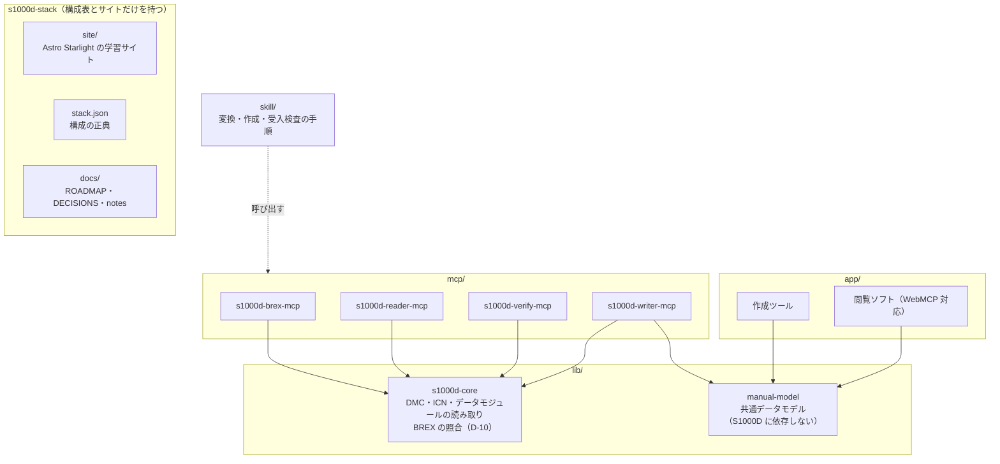
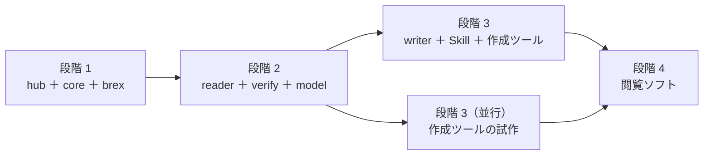
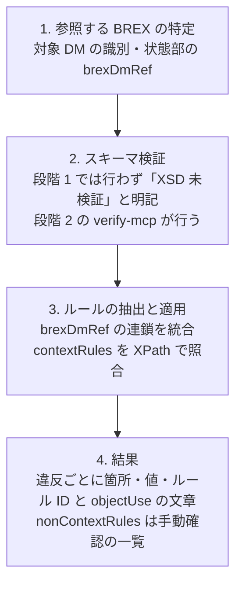

# s1000d-stack ロードマップ

LLM が S1000D の技術文書を正しく読み、プロジェクトの決まり（ビジネスルール）に沿って検査・作成できるようにするための MCP サーバー・共有ライブラリ・Skill と、体験型マニュアルの作成ツール・閲覧ソフトをまとめるプロジェクトです。

- 作成日: 2026-10-23（JST）、更新日: 2026-10-23（JST）
- 構成の手本: [houki-hub](https://github.com/shuji-bonji/houki-hub)、[pdf-agent-stack](https://github.com/shuji-bonji/pdf-agent-stack)
- 決定事項: [DECISIONS.md](./DECISIONS.md)
- 調査メモ: [notes/background.md](./notes/background.md)

## 目指すもの

1. **一般向け**: 画面や機器の操作を体験しながら学べるマニュアルを、軽い Web 形式で作れるようにします（2021 年の作品 [experience_based_operation_explanation](https://github.com/shuji-bonji/experience_based_operation_explanation) の再構築）。
2. **産業向け**: 同じデータを S1000D のデータモジュールとして出力・検査できるようにし、部品メーカーや技術マニュアル制作会社の作業を支援します。

専門家エージェント（MCP と Skill）を先に作り、それを開発の道具として使いながら製品（作成ツール・閲覧ソフト）を作ります。

## 全体像

manual-model は s1000d-core に依存させません。一般向けの製品が S1000D の概念を抱え込まないようにするためです（D-01、D-09）。S1000D との変換関数は writer 側に置きます。

## 段階

| 段階 | 成果物 | 完了の条件 |
|---|---|---|
| 1 | s1000d-stack（サイトの骨組みと用語の説明）、s1000d-core、s1000d-brex-mcp | **自動**: 自作 BREX と自作データモジュールで、BREX の説明と照合のテストが CI で通る。**手動**: 既定の BREX（利用者が入手したもの）を `explain_brex` で読み、自作データモジュールを照合して、結果が仕様書の BREX の章の記述と矛盾しないことを確認済み。**サイト**: BREX・データモジュールの説明を仕様書と照合済み |
| 2 | s1000d-reader-mcp、s1000d-verify-mcp、manual-model | 公式 XSD（利用者が入手したもの）による検証、参照の解決、適用性の判定ができる。reader の応答には対象データモジュールの版（issue）と検証状態を必ず含め、適用性の判定は reader が済ませてから LLM に渡す |
| 3 | s1000d-writer-mcp、Skill（experience-to-s1000d / s1000d-publish / s1000d-review）、作成ツールの試作 | 券売機の例を共通データモデル経由で S1000D に出力し、verify を通る |
| 4 | 閲覧ソフト | 共通データモデルを表示し、WebMCP で AI が操作を案内できる |

## 段階 1 の作業

| 順 | 作業 | 置き場所 |
|---|---|---|
| 1 | hub に `.gitignore`（`/specs/`、`*.zip`、`/mcp/`、`/lib/`、`/skill/`、`/app/`）を置いてコミットする。**その後で**仕様書の zip を `s1000d-stack/specs/s1000d/archives/` に移し、Issue 7 を `issue-7/` に展開する（D-06）。展開後のファイル構成（パスとファイル名だけ。内容は写さない）と、XSD・既定 BREX の場所を notes/background.md に記録する。この記録が brex-mcp の README の「利用者が置くべき構成」の元になる | s1000d-stack/specs/（git 管理外）、docs/notes/background.md |
| 2 | 仕様書の利用条件（`S1000D-A-00-00-0000-00A-021A-D`）の全文を読み、DECISIONS.md の判断を確定する | docs/DECISIONS.md |
| 3 | 仕様書の BREX の章（Chap 4.10.2〜4.10.3、PDF p.2110〜2143）を読み、各ルールの意味（`allowedObjectFlag` の値、`valueForm` の種類、`brexDmRef` の連鎖の規則、nonContextRules の扱い）を確かめる | docs/notes/background.md |
| 4 | hub の骨組み（README、`stack.json`、`scripts/`、Starlight の `site/`）を作る。`.gitignore` は作業 1 で置いたものを使う | s1000d-stack |
| 5 | s1000d-core の雛形を作り、DMC と ICN の分解、データモジュールの識別・状態部の読み取りを実装する。XML の読み取りと XPath の評価は 1 つのインターフェースの後ろに置く（U-08） | lib/s1000d-core |
| 6 | s1000d-core に BREX の照合処理を実装し（D-10）、s1000d-brex-mcp のツールからそれを呼ぶ | lib/s1000d-core、mcp/s1000d-brex-mcp |
| 7 | 自作のサンプルデータ（券売機の例など）と自作 BREX でテストする。ICN は架空の MIC・CAGE コードで採番する | lib/s1000d-core のテストデータ |

### 進捗（2026-10-23）

| 作業 | 状態 |
|---|---|
| 1 | 済み。`.gitignore` を作成し、zip を `specs/s1000d/archives/` へ移し、Issue 7 を `issue-7/` に展開した。構成は notes/background.md に記録済み。`.gitignore` と `docs/` のコミットは未 |
| 2 | 済み。D-03 を確定し、U-02 を解決した |
| 3 | 済み。Chap 4.10.2〜4.10.3 を読み、判定規則を notes/background.md の「BREX の章の読解結果」に記録した。Chap 7.9（Business rules processing）は未読で、作業 6 の前に読む |
| 4〜7 | 未着手 |

### BREX のルールの種類

BREX データモジュールの内容部には、次の種類のルールが入ります。要素名は Issue 7 の `brex.xsd` と既定 BREX で確認済みです（2026-10-23）。

| 種類 | 内容 | ツールへの対応 |
|---|---|---|
| contextRules › structureObjectRuleGroup › structureObjectRule | XPath（`objectPath`、属性 `allowedObjectFlag`）で指した要素・属性の使用可否と、`objectUse`（人が読む説明）、許可する値（`objectValue`、属性 `valueAllowed`・`valueForm`・`valueTailoring`）、`brDecisionRef`（ビジネスルール決定点への参照）。既定 BREX には 274 ルール・1,445 値がある | `explain_brex`、`check_against_brex` |
| nonContextRules › nonContextRule | 機械で判定できない取り決めを文章で書いたもの | `explain_brex` に含める。`check_against_brex` は「手動で確認する項目」として一覧で返す |
| snsRules › snsDescr | システム番号の体系（SNS）の定義。既定 BREX には無く、プロジェクトの BREX で使う | `lookup_sns` |
| contextRules › notationRuleList › notationRule › notationName | 使ってよい図・マルチメディアの形式（NOTATION）。`structureObjectRuleGroup` の兄弟として `contextRules` の中に置く。`rulesContext` 無しなら基本セット、スキーマ指定ならその文脈での再定義・除外。既定 BREX には無い。仕様書側の一覧は `notations/notations.xml`（121 件） | `list_notations` |
| 識別・状態部の `brexDmRef` | この BREX が従う上位の BREX。既定 BREX は自分自身を指しており、連鎖の終端になる | `check_against_brex` が連鎖をたどって統合する |

### s1000d-brex-mcp のツール案

| ツール | 内容 |
|---|---|
| `explain_brex` | BREX のルールを、どの要素に何を求めているかが分かる文章に直して一覧にする。contextRules と nonContextRules の両方を含め、どちらかを区別して返す |
| `lookup_sns` | システム番号（SNS）がどの装置・系統を指すかを返す |
| `lookup_value` | 属性の値がプロジェクトで何を意味するかを返す |
| `list_notations` | BREX が許可している図・マルチメディアの形式の一覧を返す。3D の形式は BREX で決まるため、MCP や Skill は形式を決め打ちにせずこれを読む |
| `check_against_brex` | データモジュールを BREX と照合し、違反を箇所付きで返す。nonContextRules は手動確認の項目として別に返す |

### BREX 照合処理の流れ

既存の検査ツールが行う 4 つの工程と同じです。MCP では工程を道具に分け、結果を LLM が次の判断に使える構造で返します。

- 工程 1 で BREX の DMC からファイルを探すために、ツールの引数に CSDB のフォルダー（または BREX ファイルのパス）を取ります。既定 BREX は `S1000D_SPEC_DIR` の下をファイル名 `DMC-S1000D-*-04-10-0301-00A-022A-D*.XML` で探します（システム差異コードは版で変わり、仕様書本文と実ファイルで食い違いもあるため決め打ちしない）。
- 工程 3 では、対象 DM の `xsi:noNamespaceSchemaLocation` に合う `rulesContext` のブロックと、`rulesContext` 無しの共通ブロックを適用します。判定は `allowedObjectFlag`（`0` = あれば違反、`1` = 無ければ違反、`2` = あれば `objectValue` と照合）で行い、`objectValue` の `pattern` は XSD 正規表現を JavaScript の正規表現に変換して全体一致で評価します。詳細は notes/background.md の「BREX の章の読解結果」を参照してください。
- 工程 3 で照合できるのは contextRules だけです。nonContextRules は人（または LLM）が読んで判断する項目として返します。
- 工程 4 の違反報告には、ルール ID（`brDecisionRef/@brDecisionIdentNumber`）、`objectUse` の文章、違反箇所（XPath と行番号）、実際の値、`brSeverityLevel` を含めます。

## 対象とする S1000D の版

- 最初の対象: Issue 7
- 次の対象: Issue 4.2（国内外の実例が Issue 4 系に多いため）
- s1000d-core は版ごとに読み分けられる構造にします。

## 未決事項

[DECISIONS.md の未決事項](./DECISIONS.md#未決事項) を参照してください。
