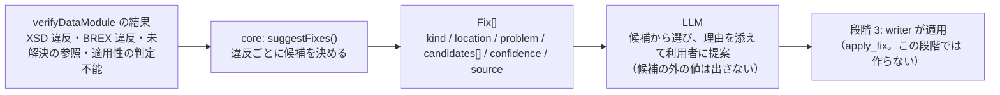

# 組み込み基盤に向けた次のステップ（段階 2.5）の設計

CSDB 製品（例: WebX Systems の UltraCSDB のような S1000D の CSDB）に、オーサリング支援・レビュー・翻訳・プロジェクト管理を行う AI エージェントを組み込めるようにするための基盤を、このスタックの次の目標とします。段階 2 までの成果（verify-mcp・reader-mcp・s1000d-core）がその基盤の中心で、この文書は「最低限の要件」と「組み込みに要る広げ方」を定めます。

- 作成日: 2026-10-25（JST）
- 段階: 2.5（段階 2 の完了後、段階 3 の writer と並行して進める）
- 前提の決定: D-09（専門家エージェントを先に作る）、D-10・D-17（処理は core に集める）、D-18（LLM に式を渡さない）、D-19（この文書で決める）

## 最低限の要件

LLM エージェントが CSDB の中で次の 4 つをできることを、最低限の要件とします。

| 要件 | いまの状態 | 担当 |
|---|---|---|
| スキーマ検証 | 済み。verify-mcp `validate_schema` / `verify_data_module`（core `verifyDataModule`、`Libxml2SchemaValidator`） | verify-mcp |
| クロスリファレンスチェック | 済み。verify-mcp `check_references`（`dmRef` / `pmRef` / ICN / `internalRef` / `applicRefId`、理由付き）。DML・DDN との照合は未 | verify-mcp |
| 適用性チェック | 済み。reader-mcp `describe_applicability` / `read_data_module`（core `ApplicEvaluator`、3 値判定） | reader-mcp |
| **修正提案** | 実装済み（2026-10-27、npm 未公開）。core `suggestFixes()`、verify-mcp `suggest_fixes`。違反・未解決・判定不能のそれぞれについて、「何を」「どこで」「どの値に」直せばよいかの候補を返す | verify-mcp（処理は core） |

## 修正提案の設計

### 方針

修正提案は 2 層に分けます。**候補を決めるのは core（決定論的）**、**文章にするのは LLM** です。LLM は core が返した候補の中から選んで説明するだけで、許可値や参照先を自分で考え出しません（D-18 と同じ境界）。



### 違反の種類ごとの候補

| 元になる結果 | 候補の決め方（core が行う） | 出どころ（`source`） |
|---|---|---|
| BREX `value` 違反 | その `structureObjectRule` の `objectValue`（`valueAllowed` と説明文）をそのまま候補にする。`range` なら範囲、`pattern` なら正規表現を示す | BREX のルール ID |
| BREX `forbidden` 違反 | 「この要素・属性を取り除く」。`objectUse` の文章を理由に添える | BREX |
| BREX `missing` 違反 | 「`objectPath` の指す要素・属性を足す」。`objectValue` があれば初期値の候補にする | BREX |
| BREX `notation` 違反 | 許可された NOTATION の一覧（`list_notations` と同じ） | BREX |
| XSD 違反（列挙・型・未知の要素） | libxml2 の文章をそのまま載せ、該当する XSD の定義を読んで `xs:enumeration` の値、`xs:pattern`、親要素で許される子要素の名前を候補にする（XSD は `@xmldom/xmldom` ＋ `fontoxpath` で読める） | XSD のファイル名と定義の場所 |
| 未解決の `dmRef` | 同じ DMC の別の版（`issueMismatch`）、CSDB にある「情報コード以外が同じ DMC」「システム差異コードだけ違う DMC」を候補にする。モデル識別コード `S1000D` への参照は「仕様書への参照。CSDB には無い」と説明だけ返す | CsdbIndex |
| 未解決の ICN | 宣言のファイル名と拡張子だけ違うファイル（`.PNG` ↔ `.SVG`）、実体名と同じ名前のファイルを候補にする | CsdbIndex と DOCTYPE |
| 未解決の `internalRef` / `applicRefId` | 同じ文書の `@id` から、文字列の近いもの（接頭辞が同じ、編集距離が小さい）を候補にする | 文書内の id |
| 適用性 `undetermined` | 足りない属性（`missingProperties`）と、ACT の列挙・PCT の製品にある値を候補にする | ACT・PCT |

### 応答の形

```ts
export interface Fix {
  /** 何に対する提案か */
  kind: 'brex-value' | 'brex-forbidden' | 'brex-missing' | 'brex-notation' | 'schema' | 'reference' | 'applicability';
  /** 違反の場所（XPath と行） */
  location?: NodeLocation;
  /** 何が問題か（元の結果の文章） */
  problem: string;
  /** 直し方の候補。空なら「候補を決められない」 */
  candidates: Array<{ action: 'replace' | 'remove' | 'add' | 'retarget' | 'provide'; value?: string; description: string }>;
  /** 候補の確からしさ。exact = 1 つに決まる、several = 複数から選ぶ、none = 候補なし */
  confidence: 'exact' | 'several' | 'none';
  /** 候補の出どころ（ルール ID、XSD の定義、CsdbIndex など）。LLM が「なぜその候補か」を説明するのに使う */
  source: string;
}
```

点数は出しません（background.md「change-request-locator から取り入れたい設計」）。`confidence` は 3 段階です。

実装（2026-10-27、core `src/fix/types.ts`）では、上の形に次の項目を足しました。どれも省略できます。

| 項目 | 置き場所 | 用途 |
|---|---|---|
| `valueForm` | 候補 | `single` / `range` / `pattern`。BREX の `objectValue` と XSD の `xs:pattern` を書き方ごと渡す。`range` と `pattern` は値ではなく制約なので、確からしさは `several` にする |
| `target` | 候補 | 直す対象（`@属性名`、要素名、`dmRefIdent/issueInfo`、製品の属性 id など） |
| `note` | 修正 | 候補を決められない理由や、選ぶときの注意（仕様書の章への参照である、など） |
| `brSeverityLevel` | 修正 | BREX 違反の重大度（解釈しない） |

`action: 'provide'` は文書の変更ではなく、適用性の判定に使う製品の値を与える候補です。確からしさは「候補が 1 つで値が決まる（取り除くを含む）」なら `exact`、「候補が複数、または値が範囲・正規表現・未定」なら `several`、「候補なし」なら `none` です（`confidenceOf`）。

### ツール

verify-mcp に `suggest_fixes` を足します。入力は `verify_data_module` と同じ（`path` / `xml` / `csdbDirs`）で、内部で検証してから候補を付けます。応答は `verification` と `fixes[]`。`instructions` に「候補の外の値を提案しない」「`confidence: none` のときは利用者に聞く」を書きます。

実装（2026-10-27）では、入力に `skip`・`product`（適用性を見る製品。省くと適用性は見ない）・`includeSpecificationReferences`（既定 false）・`maxFixes`（既定 200）・`maxCandidates`（既定 20）を足し、応答に `fixCount`・`byConfidence`・`omitted`・`applicability` を足しました。仕様書の章への `dmRef` は Bike Samples の 1 件の BR 文書だけで 100 件を超え、候補も無いので、既定では件数だけを返します。

## 組み込みに要る広げ方

| 項目 | 内容 | 大きさ |
|---|---|---|
| `CsdbSource` インターフェース | いまの core は「フォルダーの中の `DMC-….XML`」を CSDB と見なす（`CsdbIndex.fromDirs`）。製品の CSDB はデータベースや API なので、一覧・取得・（段階 3 で）書き戻しをインターフェースにし、フォルダー実装を既定にして、製品側が自分の実装を差し込めるようにする。`XmlEngine` / `SchemaValidator` と同じ形 | 小。既存 API は変えない |

実装（2026-10-27、core `src/csdb-source.ts`）: `CsdbSource` は `description`・`list(): CsdbObject[]`・`readText(object): string` の 3 つです。既定は `DirectoryCsdbSource`（フォルダー群）、ほかに `MemoryCsdbSource`（ファイル名と XML の組をメモリーに持つ）があります。`CsdbIndex.fromSource(source)` で索引を作り、`index.read(object)` で中身を読みます。core の中で他の DM を読む箇所（`findApplicTables` の ACT・CCT・PCT、`createBrexResolver` の BREX）は `index.read` に切り替えました。**同期にしました。** `resolveReferences`・`suggestFixes`・`findApplicTables` が同期関数で、ここを非同期にするとそれらの API を変えることになるためです。データベースや API から非同期にしか読めない製品は、先に読み込んで `MemoryCsdbSource` に渡すか、同期で読めるキャッシュを `readText` の後ろに置きます。非同期の `CsdbSource` が要ると分かったら、HTTP transport（作業 4）か writer（段階 3）と合わせて考えます。`CsdbObject.path` は置き場所の中での識別子で、応答にそのまま載ります。reader-mcp と verify-mcp の `readFileSync(o.path)` を `index.read(o)` に置き換える作業は、core 0.5.0 の公開後に行います。
| HTTP transport | 各 MCP を stdio だけでなく Streamable HTTP でも起動できるようにする（MCP SDK v2 の transport の切り替え）。認証・権限・マルチテナントは製品側の責務とし、持ち込まない | 小 |

実装（2026-10-27、各 MCP の `src/http.ts`）: `--http` で起動すると、SDK v2 の `createMcpHandler`（要求ごとにサーバーを 1 つ作る、web 標準の `fetch` 形）を `node:http` に載せて `/mcp` で受けます。`@modelcontextprotocol/node` は使わず、`IncomingMessage` → `Request`、`Response` → `ServerResponse`（SSE は本文をそのまま流す）の変換を自前で書きました。既定は `127.0.0.1:3000`。loopback に束縛したときは SDK の `hostHeaderValidationResponse` / `originValidationResponse` で `Host` と `Origin` を localhost 系に限り（DNS rebinding 対策）、それ以外のアドレスでは検査しません。`GET /healthz` は名前と版を返します。認証・権限・マルチテナントは持たず、製品側のリバースプロキシや認証の後ろに置く前提です。3 本とも同じファイルで、差はパッケージ名だけです（core には置きません。MCP の起動は core の責務ではないため）。
| DML・DDN の読み取り | データモジュールリスト・納入票を読み、「DML にあるのに CSDB に無い」「版が違う」を照合する（プロジェクト管理の土台）。reader の `include` に `dml` / `ddn` は既にある | 中 |

実装（2026-10-28、core `src/dml/`）: `readDml` / `readDdn` が `dml.xsd` / `ddn.xsd` の構造（`dmlEntry` は `dmRef` / `pmRef` / `infoEntityRef` / `dmlRef` / `commentRef` のどれか 1 つ、`deliveryListItem` は `dispatchFileName` と任意の `issueInfo`）を読み、`reconcileDml` / `reconcileDdn` が CSDB の索引と照合します。判定は `found`（版まで一致）/ `issue-mismatch`（対象はあるが指定の版が無い。CSDB の最新の版を添える）/ `not-found` / `not-checked`（comment への参照）の 4 つと、`notListed`（CSDB にあるのに DML に無い DM・PM。DML に出てくるモデル識別コードだけを対象にし、言語は見ない）です。`dmlType`（c / p / s）・`dmlEntryType`（c / d / n）・`issueType` は解釈せず列挙のまま返します（意味は仕様書の該当章を読んでから付ける）。DDN は `dispatchFileName` で照合し、発行情報（`_NNN-NN`）だけ違う名前を `issue-mismatch` にします。拡張 DMC（`DME-`）のデータモジュールは索引に `kind: 'dme'` で入り、ファイル名で見つかります（DMC の分解は未対応）。MCP への反映は core 0.6.0 の公開後です。
| comment DM の生成 | レビュー結果を S1000D の comment データモジュール（`comment.xsd`）として書き出す。CSDB の中でレビューは comment DM で回る | 中。writer（段階 3）の最初の一部 |
| 翻訳向けの文の抜き出しと差し戻し | `extractSegments`（構造を保ったまま翻訳対象の文だけを取り出す）/ `applySegments`（同じ構造に差し戻す）。言語違いの DM は DMC が同じで `language` だけ違う。訳の品質評価は xcomet-mcp と組み合わせる | 中 |

## 製品に組み込むときの境界

- **決定論的に確かめられることは core が行い、LLM は文章の生成と説明に限る。** 準拠の判定、適用性の評価、許可値の決定、参照先の決定を LLM にさせない。
- **検証状態（`VerificationStatus`）をすべての応答に付ける。** 製品側はこれを監査の記録として保存できる。
- **エージェントは製品側が組む。** このスタックは core・MCP・Skill（手順）を提供し、Author / Reviewer / Translator / Project Manager の役割分担や UI は製品の設計に任せる。段階 3 の Skill（`s1000d-review` など）は、組み込むときの手順の見本になる。
- **仕様書・XSD・既定 BREX は同梱しない**（D-03）。製品ベンダーは自社で配布物を持っているので、`S1000D_SPEC_DIR` 方式はそのまま使える。

## LLM 活用時の注意点とこのスタックの対応

S1000D を LLM で扱うときに挙げられる注意点（2026-10-25 に利用者が整理したもの）を、このスタックで何がどこまで対応できているか、何を足すかに分けて記録します。

| 注意点 | 対応済み（段階 1〜2） | 足すもの |
|---|---|---|
| **仕様の複雑さ**: Issue（版）が複数あり、プロジェクト固有の BREX が加わるため、スキーマ検証だけでは足りない | XSD・BREX の連鎖・参照・適用性を 1 つの検証状態にまとめる（verify）。版は `schemaLocation` から読み分け、XSD は `brex.xsd` の版で選ぶ。BREX は連鎖を既定 BREX までたどって層ごとに照合する | Issue 4.2 の対応（U-07）。段階 2.5 では「版が違う DM が混ざった CSDB」で `verify_csdb` が版ごとに XSD を選ぶことを確かめる |
| **公式スキーマの入手性**: XSD は登録ユーザー向けの配布で、オープンに再利用できない。近似スキーマで検証する例もある | 近似スキーマは作らない。利用者が入手した本物の XSD を `S1000D_SPEC_DIR` から読み、無ければ `schema-not-found` と明記する（D-03、D-15）。製品ベンダーは配布物を持っているので、組み込みではこの方式がそのまま使える | `list_schemas` の案内を製品向けに整える（どの zip をどこに展開するか）。近似スキーマを使う実装との違い（「検証した」と「本物で検証した」の区別）をサイトに書く |
| **処理上の留意点**: 適用性や参照関係を失わないよう前処理が要る。テキスト化すると論理情報が欠ける。XML が冗長で、コンテキスト長を消費する | reader は XML をテキスト化せず、構造（節・手順・警告・図・参照）を保った木にする。適用性は判定して結果だけを渡し、参照は題名付きで解決する。`maxNodes`・`section`・`omitNotApplicable` で量を絞れる | **概要モード**: `read_data_module` に `section: "outline"`（見出し・手順の番号と最初の 1 文・警告の数だけ）を足し、LLM が全文を読む前に当たりを付けられるようにする。節点ごとの文字数を返して、LLM 側が予算を立てられるようにする |
| **生成時の課題**: LLM に XML を直接出力させると、スキーマ準拠や参照の整合性を保証しにくい | 段階 2.5 の `suggest_fixes` は候補を core が決め、LLM は候補の外の値を出さない | **段階 3 の writer は LLM に XML を書かせない**。LLM は共通データモデル（experiential-manual-model）か、writer の構造化された入力（題名・段落・手順・参照の DMC）を出し、XML は writer が組み立てて、verify に通らなければ `suggest_fixes` の候補で直す「生成 → 検証 → 修正」の繰り返しにする。DMC・ICN の採番、`brexDmRef`、`issueInfo` は writer が付ける |
| **その他**: 図（CGM など）・マルチメディア、機密区分、専門用語（Simplified Technical English など）への対応が別途要る | 図は ICN として参照を解決し、`hotspot` の `applicationStructureIdent` を返す。使ってよい形式は BREX の `list_notations` で読む。機密区分（`securityClassification`）は識別・状態部にそのまま返す | **図の中身は読まない**（CGM の描画・画像の理解はこのスタックの対象外。製品側が表示用の変換物を持つ。experiential-manual-model の `Asset.display` と同じ考え方）。**機密区分は応答の先頭に出し、エージェントが扱いを決められるようにする**（`verification` と同じく必ず付ける項目にする）。**STE（ASD-STE100）は ASD の仕様で利用条件が要る**ため、辞書を同梱せず、利用者が持つ用語集を Skill から参照する形にする（段階 3 の `s1000d-review` の一部） |

これらのうち、段階 2.5 で行うのは「概要モード」「版が混ざった CSDB の確認」「機密区分を必ず付ける」「近似スキーマとの違いの説明」の 4 つです（4 つとも 2026-10-28 に済み。概要モードは reader-mcp `section: "outline"`、機密区分は reader-mcp の応答の先頭、版の確認は verify-mcp のテスト、近似スキーマとの違いはサイトの `guide/embedding.md`）。writer の方針と STE は段階 3 に入れます。

## 参照実装: 簡易な技術マニュアルの Web システム

2026-10-25 に利用者が「これらを参照に、簡易的な技術マニュアル等の Web システムの構築も目指すことが望ましい」と決めました。この基盤を使う側の実物を 1 つ持ち、組み込みの形を製品ベンダーに示すためのものです。段階 4 の閲覧ソフトの最初の成果物として置きます。

### できること（最小）

| 機能 | 使う部品 |
|---|---|
| CSDB のフォルダーを開き、PM の目次からデータモジュールをたどる | core `CsdbIndex`、`readPublicationModule`（reader-mcp と同じ呼び出し） |
| データモジュールを表示する（節・手順・警告・図・表・参照） | core `readContent` の `ContentNode` 木をそのまま HTML にする。XML をテキスト化しない |
| 製品（applicability）を選ぶと、当てはまらない節・手順が消える | core `ApplicEvaluator`。判定は表示側では行わない |
| 参照をクリックすると参照先の DM・図へ移る。無いものは「無い」と表示する | core `collectReferences` / `resolveReference` |
| 各ページの先頭に版（issue）・検証状態・機密区分を表示する | `VerificationStatus`、`securityClassification`（段階 2.5 作業 7） |
| AI に質問する欄（任意）。答えは reader-mcp の応答だけから作る | reader-mcp の HTTP transport（段階 2.5 作業 4）。ブラウザー側は WebMCP（段階 4 の条件） |

### しないこと

- オーサリング（書く・直す）は持たない。作成ツール（段階 3）の仕事です。
- 図の中身（CGM の描画）は扱わない。表示用の SVG・PNG を製品側が用意する前提で、ICN の参照先をそのまま `` にします。
- 認証・権限・マルチテナントは持たない（D-19 の境界と同じ）。
- 検索エンジンや全文検索は持たない。目次と参照でたどる範囲に限ります。

### 位置付け

- この基盤の「最初の利用者」であり、reader・verify・適用性の API が製品から使える形になっているかを確かめる場です。API に足りないものは、この Web システムを作る中で core・MCP 側に戻します。
- S1000D の CSDB を直接表示します。体験型マニュアル（experiential-manual-model）を表示する閲覧ソフトは、この後に同じ部品で作ります。
- 技術の選定（SvelteKit・PWA など）は U-10 として未決にし、段階 3 の作成ツールの試作と合わせて決めます。

## 作業（段階 2.5）

| 順 | 作業 | 置き場所 |
|---|---|---|
| 1 | core に `suggestFixes()`（BREX の 4 種、参照、適用性）と `Fix` 型。XSD の候補は XSD の定義を読む部分を含める | lib/s1000d-core（`src/fix/`） |
| 2 | verify-mcp に `suggest_fixes`。`instructions` に候補の外の値を提案しない旨 | mcp/s1000d-verify-mcp |
| 3 | core に `CsdbSource` インターフェース（フォルダー実装を既定に）。`CsdbIndex` はその上に載せる。済み（2026-10-27）。MCP 側の置き換えは core 0.5.0 の公開後 | lib/s1000d-core |
| 4 | 各 MCP に HTTP transport の起動オプション。済み（2026-10-27、`--http`） | mcp/* |
| 5 | core に DML・DDN の読み取りと照合。verify-mcp `verify_csdb` と reader-mcp `list_data_modules` に反映。core 側は済み（2026-10-28）。MCP 側は core 0.6.0 の公開後 | lib/s1000d-core、mcp/* |
| 6 | サイトに「組み込み基盤」のページ（4 つの要件と境界、LLM 活用時の注意点への対応、近似スキーマとの違い）。済み（2026-10-28、`guide/embedding.md`、日英） | s1000d-stack/site |
| 7 | reader-mcp に概要モード（`section: "outline"`）と節点ごとの文字数。DM 全体と各節の `securityClassification` を応答の先頭に必ず付ける。済み（2026-10-28。core 0.7.0 の `outlineContent` / `measureContent`、reader-mcp の `section: "outline"` と先頭の `securityClassification`） | lib/s1000d-core、mcp/s1000d-reader-mcp |
| 8 | 版（Issue）が混ざった CSDB での `verify_csdb`（XSD を版ごとに選ぶ）の確認。Issue 4.2 の XSD が無い間は自作の `xml_schema_flat/` で確かめる。済み（2026-10-28、verify-mcp のテストに固定） | mcp/s1000d-verify-mcp |

comment DM の生成、翻訳向けの API、「LLM に XML を書かせない」writer の方針、STE の用語集の参照は、段階 3 の writer と Skill の作業に入れます。
