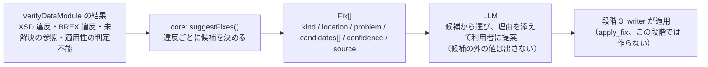

# 組み込み基盤に向けた次のステップ（段階 2.5）の設計

CSDB 製品（例: WebX Systems の UltraCSDB のような S1000D の CSDB）に、オーサリング支援・レビュー・翻訳・プロジェクト管理を行う AI エージェントを組み込めるようにするための基盤を、このスタックの次の目標とします。段階 2 までの成果（verify-mcp・reader-mcp・s1000d-core）がその基盤の中心で、この文書は「最低限の要件」と「組み込みに要る広げ方」を定めます。

- 作成日: 2026-10-25（JST）
- 段階: 2.5（段階 2 の完了後、段階 3 の writer と並行して進める）
- 前提の決定: D-09（専門家エージェントを先に作る）、D-10・D-17（処理は core に集める）、D-18（LLM に式を渡さない）、D-19（この文書で決める）

## 最低限の要件

LLM エージェントが CSDB の中で次の 4 つをできることを、最低限の要件とします。

| 要件 | いまの状態 | 担当 |
|---|---|---|
| スキーマ検証 | 済み。verify-mcp `validate_schema` / `verify_data_module`（core `verifyDataModule`、`Libxml2SchemaValidator`） | verify-mcp |
| クロスリファレンスチェック | 済み。verify-mcp `check_references`（`dmRef` / `pmRef` / ICN / `internalRef` / `applicRefId`、理由付き）。DML・DDN との照合は未 | verify-mcp |
| 適用性チェック | 済み。reader-mcp `describe_applicability` / `read_data_module`（core `ApplicEvaluator`、3 値判定） | reader-mcp |
| **修正提案** | **未**。違反・未解決・判定不能のそれぞれについて、「何を」「どこで」「どの値に」直せばよいかの候補を返す | verify-mcp に `suggest_fixes` を足す（処理は core） |

## 修正提案の設計

### 方針

修正提案は 2 層に分けます。**候補を決めるのは core（決定論的）**、**文章にするのは LLM** です。LLM は core が返した候補の中から選んで説明するだけで、許可値や参照先を自分で考え出しません（D-18 と同じ境界）。



### 違反の種類ごとの候補

| 元になる結果 | 候補の決め方（core が行う） | 出どころ（`source`） |
|---|---|---|
| BREX `value` 違反 | その `structureObjectRule` の `objectValue`（`valueAllowed` と説明文）をそのまま候補にする。`range` なら範囲、`pattern` なら正規表現を示す | BREX のルール ID |
| BREX `forbidden` 違反 | 「この要素・属性を取り除く」。`objectUse` の文章を理由に添える | BREX |
| BREX `missing` 違反 | 「`objectPath` の指す要素・属性を足す」。`objectValue` があれば初期値の候補にする | BREX |
| BREX `notation` 違反 | 許可された NOTATION の一覧（`list_notations` と同じ） | BREX |
| XSD 違反（列挙・型・未知の要素） | libxml2 の文章をそのまま載せ、該当する XSD の定義を読んで `xs:enumeration` の値、`xs:pattern`、親要素で許される子要素の名前を候補にする（XSD は `@xmldom/xmldom` ＋ `fontoxpath` で読める） | XSD のファイル名と定義の場所 |
| 未解決の `dmRef` | 同じ DMC の別の版（`issueMismatch`）、CSDB にある「情報コード以外が同じ DMC」「システム差異コードだけ違う DMC」を候補にする。モデル識別コード `S1000D` への参照は「仕様書への参照。CSDB には無い」と説明だけ返す | CsdbIndex |
| 未解決の ICN | 宣言のファイル名と拡張子だけ違うファイル（`.PNG` ↔ `.SVG`）、実体名と同じ名前のファイルを候補にする | CsdbIndex と DOCTYPE |
| 未解決の `internalRef` / `applicRefId` | 同じ文書の `@id` から、文字列の近いもの（接頭辞が同じ、編集距離が小さい）を候補にする | 文書内の id |
| 適用性 `undetermined` | 足りない属性（`missingProperties`）と、ACT の列挙・PCT の製品にある値を候補にする | ACT・PCT |

### 応答の形

```ts
export interface Fix {
  /** 何に対する提案か */
  kind: 'brex-value' | 'brex-forbidden' | 'brex-missing' | 'brex-notation' | 'schema' | 'reference' | 'applicability';
  /** 違反の場所（XPath と行） */
  location?: NodeLocation;
  /** 何が問題か（元の結果の文章） */
  problem: string;
  /** 直し方の候補。空なら「候補を決められない」 */
  candidates: Array<{ action: 'replace' | 'remove' | 'add' | 'retarget' | 'provide'; value?: string; description: string }>;
  /** 候補の確からしさ。exact = 1 つに決まる、several = 複数から選ぶ、none = 候補なし */
  confidence: 'exact' | 'several' | 'none';
  /** 候補の出どころ（ルール ID、XSD の定義、CsdbIndex など）。LLM が「なぜその候補か」を説明するのに使う */
  source: string;
}
```

点数は出しません（background.md「change-request-locator から取り入れたい設計」）。`confidence` は 3 段階です。

### ツール

verify-mcp に `suggest_fixes` を足します。入力は `verify_data_module` と同じ（`path` / `xml` / `csdbDirs`）で、内部で検証してから候補を付けます。応答は `verification` と `fixes[]`。`instructions` に「候補の外の値を提案しない」「`confidence: none` のときは利用者に聞く」を書きます。

## 組み込みに要る広げ方

| 項目 | 内容 | 大きさ |
|---|---|---|
| `CsdbSource` インターフェース | いまの core は「フォルダーの中の `DMC-….XML`」を CSDB と見なす（`CsdbIndex.fromDirs`）。製品の CSDB はデータベースや API なので、一覧・取得・（段階 3 で）書き戻しをインターフェースにし、フォルダー実装を既定にして、製品側が自分の実装を差し込めるようにする。`XmlEngine` / `SchemaValidator` と同じ形 | 小。既存 API は変えない |
| HTTP transport | 各 MCP を stdio だけでなく Streamable HTTP でも起動できるようにする（MCP SDK v2 の transport の切り替え）。認証・権限・マルチテナントは製品側の責務とし、持ち込まない | 小 |
| DML・DDN の読み取り | データモジュールリスト・納入票を読み、「DML にあるのに CSDB に無い」「版が違う」を照合する（プロジェクト管理の土台）。reader の `include` に `dml` / `ddn` は既にある | 中 |
| comment DM の生成 | レビュー結果を S1000D の comment データモジュール（`comment.xsd`）として書き出す。CSDB の中でレビューは comment DM で回る | 中。writer（段階 3）の最初の一部 |
| 翻訳向けの文の抜き出しと差し戻し | `extractSegments`（構造を保ったまま翻訳対象の文だけを取り出す）/ `applySegments`（同じ構造に差し戻す）。言語違いの DM は DMC が同じで `language` だけ違う。訳の品質評価は xcomet-mcp と組み合わせる | 中 |

## 製品に組み込むときの境界

- **決定論的に確かめられることは core が行い、LLM は文章の生成と説明に限る。** 準拠の判定、適用性の評価、許可値の決定、参照先の決定を LLM にさせない。
- **検証状態（`VerificationStatus`）をすべての応答に付ける。** 製品側はこれを監査の記録として保存できる。
- **エージェントは製品側が組む。** このスタックは core・MCP・Skill（手順）を提供し、Author / Reviewer / Translator / Project Manager の役割分担や UI は製品の設計に任せる。段階 3 の Skill（`s1000d-review` など）は、組み込むときの手順の見本になる。
- **仕様書・XSD・既定 BREX は同梱しない**（D-03）。製品ベンダーは自社で配布物を持っているので、`S1000D_SPEC_DIR` 方式はそのまま使える。

## 作業（段階 2.5）

| 順 | 作業 | 置き場所 |
|---|---|---|
| 1 | core に `suggestFixes()`（BREX の 4 種、参照、適用性）と `Fix` 型。XSD の候補は XSD の定義を読む部分を含める | lib/s1000d-core（`src/fix/`） |
| 2 | verify-mcp に `suggest_fixes`。`instructions` に候補の外の値を提案しない旨 | mcp/s1000d-verify-mcp |
| 3 | core に `CsdbSource` インターフェース（フォルダー実装を既定に）。`CsdbIndex` はその上に載せる | lib/s1000d-core |
| 4 | 各 MCP に HTTP transport の起動オプション | mcp/* |
| 5 | core に DML・DDN の読み取りと照合。verify-mcp `verify_csdb` と reader-mcp `list_data_modules` に反映 | lib/s1000d-core、mcp/* |
| 6 | サイトに「組み込み基盤」のページ（4 つの要件と境界） | s1000d-stack/site |

comment DM の生成と翻訳向けの API は、段階 3 の writer の作業に入れます。
