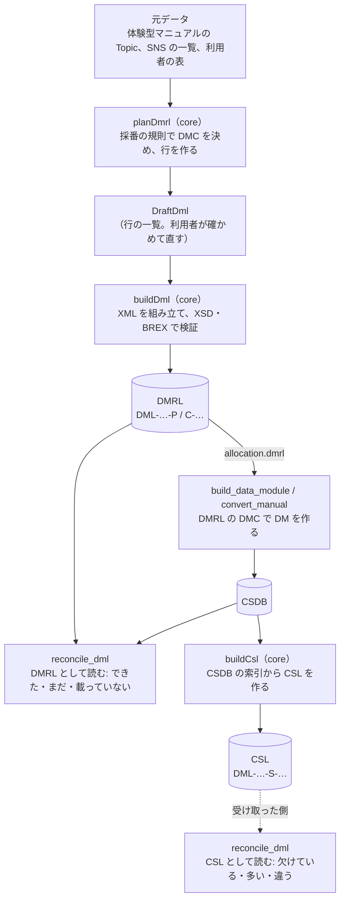

# DMRL と CSL の書き出し（core・writer-mcp）

S1000D の処理系に、データ管理リスト（DML）を**書く**処理を足すための設計です。DML には、これから作る DM・PM の一覧である DMRL（Data Management Requirement List）と、CSDB にある CSDB オブジェクトの一覧である CSL（CSDB Status List）の 2 種類があり、同じスキーマ（`dml.xsd`）で書きます。

- 作成日: 2026-11-25（JST）
- 状態: 提案。「確定が要ること」の DL-1〜DL-7 を利用者が決めてから実装します
- 関係する決定: D-26（DML・DDN の照合は verify-mcp）、D-27（組み立ては core に置く）、D-31・D-32（既にある文書は元の XML を保って直す）、D-40（OSS の CSDB を後の段階として計画する）
- ROADMAP: 段階 5

## 1. 目的

S1000D の作業は、DM を書く前に「どの DM・PM を作るか」を DMRL で決め、発注元や協力会社と合意するところから始まります。いまの処理系は DM を作る・直す・照合することはできますが、その前の計画と、その後の CSDB の状態の報告を、標準の形で出せません。

| 使う人 | DMRL・CSL を書けると何ができるか |
|---|---|
| 体験型マニュアルを S1000D にする人（Skill `experience-to-s1000d`） | 変換の前に、作られる DM の一覧（DMC と題名）を DMRL として確かめられる。再変換しても同じ DMC が使われる |
| DM を 1 件ずつ作る人（Skill `s1000d-publish`） | DMRL に載っている DMC を使って DM を作り、作り終わったかを照合で確かめられる |
| 輸出先から S1000D を求められる中小企業（IETM / IETP の製品） | 元請けに DMRL と CSL を標準の形で出せる |
| CSDB 製品への組み込み | 製品の DB から DMRL・CSL を組み立てるときに、core の関数を使える |

## 2. 仕様で決まっていること

Issue 7 の Chap 4.5（`DMC-S1000D-A-30-10-0000-00A-024D-D`）、`dml.xsd`、データ辞書、既定 BREX で 2026-11-25 に確かめた内容です。

### DML の種類

`dmlCode/@dmlType` の値で区別します（Chap 4.5 Para 4.1.1.1.3）。DML コードの中では大文字で書きます。

| `dmlType` | 種類 | 中身 |
|---|---|---|
| `p` | 部分の DMRL | 協力会社ごとに、自分が受け持つ DM・PM を並べたもの |
| `c` | 完全な DMRL | 部分の DMRL を 1 社がまとめた、プロジェクト全体の一覧 |
| `s` | CSL | CSDB にある CSDB オブジェクトの一覧。受け取った側が自分の CSDB と比べる |

Bike Samples の DML（`DML-S1000DBIKE-B6865-S-2026-00001_001-00.XML`）は `s`、つまり CSL です。2026-10-28 に `reconcile_dml` で照合した 108 行は、CSL の照合でした。

### DMRL と CSL の違い

| 項目 | DMRL（`p` / `c`） | CSL（`s`） |
|---|---|---|
| いつ作るか | プロジェクトの始めに作り、作る DM が変わるたびに更新する（Para 2.1） | 定期的に、または CSDB オブジェクトを渡すたびに作る（Para 3.1） |
| まだ無い DM を載せるか | 載せる。CSDB にある DM と、まだ無い DM の両方が並ぶ | 載せない。CSDB にあるものだけ |
| 各行の版（`issueInfo`） | 原則として持たない。DM の版が上がっても DMRL は変わらない（BREX-S1-00003） | 必ず持つ（BREX-S1-00004） |
| 載せてよい行 | DM。プロジェクトの決定で PM、例外として IPD の図（BRDP-S1-00351）。comment と DML は載せない（BREX-S1-00001） | DM・図とマルチメディア・PM を最低限とし、何を載せるかはプロジェクトが決める（BRDP-S1-00353） |
| 各行に必ず書くもの | 題名と責任会社（`responsiblePartnerCompany`）（BREX-S1-00002） | 版。機密区分・責任会社・発行日は照合で比べる項目（Para 3.2.1.3） |
| `answer`（回答） | DM の行にだけ使える（BREX-S1-00008） | 使わない（BREX-S1-00007） |

### 行の要素と属性

`dmlEntry` は、`dmRef` / `pmRef` / `infoEntityRef` / `commentRef` / `dmlRef` のどれか 1 つと、`security`（任意）、`responsiblePartnerCompany`（必須）、`answer`（任意）、`remarks`（任意）を持ちます。属性は 2 つです。

| 属性 | 値 | 意味 |
|---|---|---|
| `dmlEntryType` | `n` / `c` / `d` | 前の版の DML と比べて、新しい・変わった・削除された行 |
| `issueType` | `new` / `changed` / `deleted` / `revised` / `status` / `rinstate-changed` / `rinstate-revised` / `rinstate-status` | 行が指す CSDB オブジェクトの発行の種類 |

`answer/@answerToEntry`（`y` / `n`）は、DMRL の行に対する回答です。Para 4.2.4 は 2 つの使い方を挙げています。1 つは、協力会社が DMC の予約を DMRL で依頼し、CSDB の持ち主が行ごとに `y`（空いている）か `n`（予約済み）で返す使い方です。もう 1 つは、CSDB の持ち主が次の版の変更を `dmlEntryType` で示し、相手が `y`（同意）か `n`（不同意。理由を `remarks` に書く）で返す使い方です。

### DML の採番

DML コードは `モデル識別コード-発信者の CAGE-種類-年-連番` です（Para 4.1.1.1）。

- 連番はその年の最初の納入を `00001` にし、納入のたびに 1 つ上げます（Para 5.1、BREX-S1-00009）。
- 発行番号は同じ連番の DML の改訂に使い、作業中の版は `inWork` で表します（Para 5.1）。
- 新しい DML（`dmlStatus/@issueType="new"`）の発行番号は `001` を超えません（BREX-S1-00005）。
- CSL の発行番号は、受け取った側が誤りを見つけて CSL を直したときに上げます（Para 5.2）。
- 発信者の CAGE コードは登録されたものに限られます（Para 4.1.1.1.2）。試作では架空の CAGE を使い、ICN と同じく学習サイトに「実際の納入では登録が前提」と書きます。

### 既定 BREX のルール

既定 BREX の `BREX-S1-00001`〜`00009` が DML を対象にしています。00002・00003・00009 は `allowedObjectFlag="2"`（値の確認）で、残りは「この形があれば違反」の XPath です。いずれも verify の BREX の照合で機械的に確かめられる形です。ただし、次の節に書くとおり、いまの core は DML の BREX をたどっていません。

## 3. いまの処理系でできること・足りないこと

| 部品 | できること | 足りないこと |
|---|---|---|
| core `src/dml/` | `readDml` / `readDdn`、`reconcileDml` / `reconcileDdn`、DML・DDN のファイル名の分解 | DML を組み立てる関数が無い。`dmlType` を解釈しないので、DMRL の「まだ作っていない DM」も CSL の「欠けている DM」も同じ `not-found` になる |
| core `readBrexDmRefOf` | `dmStatus` / `pmStatus` / `commentStatus` の `brexDmRef` を読む | `dmlStatus` を読まない。DML を verify に渡しても BREX の層が 0 件になり、BREX-S1-00001〜00009 が照合されない |
| core `src/write/` の `allocation.ledger` | `sourceId` → DMC の台帳を入力で受け取り、応答で返す。同じ `sourceId` には同じ DMC を返す | 台帳は writer の独自の形で、DMRL として出せない。DMRL から台帳を作ることもできない |
| verify-mcp `reconcile_dml` | DML・DDN を CSDB と照合し、行ごとの状態と `notListed` を返す | DMRL か CSL かで結果の意味を分けていない |
| writer-mcp | DM・PM・comment を作る、直す、改版する | DML を作るツールが無い |

## 4. 全体の流れ



## 5. 設計

### 5.1 下書きの形: `DraftDml`

DM の下書き（`DraftDataModule`）と同じく、LLM や画面は XML を書かず、この形を渡します。

```ts
export interface DraftDml {
  /** DML コード。seqNumber を省くと、CSDB にある同じ種類・年の DML の次の番号にする */
  dmlCode: { modelIdentCode: string; senderIdent: string; dmlType: 'p' | 'c' | 's'; yearOfDataIssue: string; seqNumber?: string };
  issueInfo?: IssueInfo;              // 省略時は 001-00
  issueDate?: string;                 // YYYY-MM-DD。省略時は今日（実行環境の日付。応答に書く）
  securityClassification: string;     // 省略を許さない（DM と同じ）
  brexDmRef?: DmCode;                 // 省略時は既定 BREX
  remarks?: string;
  entries: DraftDmlEntry[];
}

export interface DraftDmlEntry {
  /** 行が指すもの。どれか 1 つ */
  target:
    | { kind: 'dm'; dmCode: DmCode; issueInfo?: IssueInfo; language?: Language; title: { techName: string; infoName?: string } }
    | { kind: 'pm'; pmCode: PmCode; issueInfo?: IssueInfo; language?: Language; title: string }
    | { kind: 'icn'; infoEntityIdent: string }
    | { kind: 'comment'; commentCode: CommentCode; language: Language }
    | { kind: 'dml'; dmlCode: DraftDml['dmlCode']; issueInfo?: IssueInfo };
  responsiblePartnerCompany: { enterpriseCode?: string; enterpriseName?: string };
  securityClassification?: string;
  dmlEntryType?: 'n' | 'c' | 'd';
  issueType?: string;                 // XSD の列挙のまま
  answer?: { answerToEntry: 'y' | 'n'; remarks?: string };
  remarks?: string;
  /** 採番に使った元データの識別子（Topic.id など）。XML には書かず、台帳に使う */
  sourceId?: string;
}
```

DMRL と CSL の規則（2 節の表）は、XML を組み立てる前に入力の形として検査し、合わないものは `input-error` にします。たとえば `dmlType` が `s` なのに版の無い行がある、`p` / `c` に comment の行がある、DM 以外の行に `answer` がある、などです。この検査は、既定 BREX の BREX-S1-00001〜00008 と同じ内容を先に確かめるものです。BREX の照合の代わりではありません。値を補って通すことはしません（D-31）。

### 5.2 core に足す関数

| 関数 | 入力 | 返すもの |
|---|---|---|
| `planDmrl` | `Allocation`（writer の採番の規則と台帳）、元データの一覧（`sourceId`・種類・題名・責任会社）、`dmlType`（`p` / `c`） | `DraftDml`。DMC は `allocateDmc` で決め、台帳にあればそれを使う。DM の本文は作らない |
| `buildDml` | `DraftDml` | DML の XML、ファイル名（`DML-….XML`）、検証状態（XSD と BREX） |
| `buildCsl` | `CsdbIndex`、対象の種類（DM・ICN・PM など）、版の範囲（最新だけか全部か。BRDP-S1-00354） | `DraftDml`（`dmlType: 's'`）。行は CSDB の索引から作り、版・題名・機密区分・責任会社は各オブジェクトの識別・状態部から写す |
| `dmrlToLedger` / `ledgerToDmrl` | DMRL と台帳 | 一方からもう一方を作る。writer の採番が DMRL の DMC を使えるようにする |
| `editDml` | 既にある DML の XML と、行の追加・取り除き・`dmlEntryType` の付け替え | 元の XML を保ったまま、編集した範囲だけを書き換えた XML（D-32 と同じ方法） |

あわせて、`readBrexDmRefOf` の状態部の一覧に `identAndStatusSection/dmlStatus` を足します。これで verify が DML の BREX の連鎖をたどり、BREX-S1-00001〜00009 が照合されるようになります。DML を作らない利用者にも効く修正なので、この段階の最初に行います。

### 5.3 照合の読み分け

`reconcileDml` の結果は、DML の種類で意味が変わります。いまの 4 つの状態（`found` / `issue-mismatch` / `not-found` / `not-checked`）はそのまま残し、種類に応じた読みを `interpretation` として足す案です（DL-3）。

| 状態 | DMRL（`p` / `c`）として読む | CSL（`s`）として読む |
|---|---|---|
| `found` | 作成済み | 一致 |
| `issue-mismatch` | DMRL の行が版を持つときだけ起きる。版の指定と違う | 版が違う（Para 3.2.1.3） |
| `not-found` | まだ作っていない（進み具合として数える） | 受け取った側に無い（Para 3.2.1.2） |
| `notListed` | 計画に無い DM が CSDB にある | 送った側の一覧に無い（Para 3.2.1.1） |

CSL の照合では、版のほかに題名・機密区分・責任会社・発行日も比べられます（Para 3.2.1.3）。最初の版では版だけを比べ、ほかの項目は DL-4 で決めます。

### 5.4 writer-mcp のツール

| ツール | 入力 | 返すもの |
|---|---|---|
| `build_dml`（新規） | `draft`（`DraftDml`）、`csdbDirs`、`write`（既定 false） | `xml`、`fileName`、`verification`、`_notes` |
| `plan_dmrl`（新規） | `allocation`、`sources[]`、`dmlType`、`manual`（体験型マニュアルの JSON。省略可） | `draft`（`DraftDml`）、`ledger` |
| `build_csl`（新規） | `csdbDirs`、`include`（種類）、`issues`（`latest` / `all`）、`dmlCode`、`write` | `build_dml` と同じ |
| `convert_manual`（変更） | 入力はいまのまま。`planOnly: true` を足す | `planOnly` のときは DM を作らず、`plan_dmrl` と同じ形の DMRL の下書きを返す |
| `build_data_module` / `convert_manual`（変更） | `allocation.dmrl`（DMRL のパスか XML）を足す | DMRL にある DMC を、台帳と同じく優先して使う。DMRL に無い DM を作るときは `_notes` に書く |

`plan_dmrl` と `build_dml` を分けるのは、利用者が DMRL の中身（作る DM の範囲、題名、責任会社）を確かめてから XML にするためです。LLM は行の候補を出すだけで、どの DM を作るかは利用者が決めます。

### 5.5 Skill の手順の変更

| Skill | 変更 |
|---|---|
| `experience-to-s1000d` | 「`convert_manual` に `planOnly` で DMRL の下書きを出す → 利用者が確かめる → `build_dml` → `allocation.dmrl` を付けて変換 → `reconcile_dml` で計画と照合」の順にする。DMRL を使わない従来の手順も残す |
| `s1000d-publish` | CSDB に DMRL があれば、作る DM の DMC を DMRL から選び、作った後に `reconcile_dml` で進み具合を報告する |

### 5.6 しないこと

- **部分の DMRL を完全な DMRL にまとめる処理**（Para 2.2）は、最初の版に入れません。同じ DMC を 2 社が持つ、などの食い違いを一覧にするところまでを `reconcile` の延長で行い、どちらを採るかは人が決めます。
- **DDN の書き出し**は別の作業にします。DDN は納入の単位で、どの版を送るかの判断が入るためです。
- **`answer` を使った予約と同意のやり取り**は、読み取りと書き込みはできるようにしますが、やり取りの流れ（誰がいつ返すか）は持ちません。
- **プロジェクトの決定（BRDP）**の値は決めません。PM を DMRL に載せるか（BRDP-S1-00351）、CSL に何を載せるか（00353）、最新の版だけか（00354）は、入力で受け取ります。

## 6. 後の段階の CSDB（RDB ＋ オブジェクトストレージ）との関係

D-40 で、フォルダー ＋ Git と `CsdbSource` による組み込みの次に、RDB とオブジェクトストレージで OSS の CSDB を作ることを計画に入れました（ROADMAP の段階 6）。DMRL と CSL は、その CSDB の表の設計に次のようにつながります。

| DML | CSDB の中での扱い |
|---|---|
| DMRL | 「計画した DM」の表。`DraftDml` の行をそのまま行にし、CSDB の DM の表と DMC で結ぶ。照合の結果を進み具合の画面に出す |
| CSL | DM・ICN・PM の表から、`buildCsl` と同じ規則で書き出す |

この段階で作る `DraftDml` と `planDmrl` / `buildCsl` を、そのまま段階 6 の取り込みと書き出しに使えるように、入力と出力を CSDB の置き場所に依存しない形（`CsdbIndex` と `DraftDml`）にしておきます。

## 7. 確定が要ること

| ID | 内容 | 提案 |
|---|---|---|
| DL-1 | 設計文書と関数の名前。DMRL だけでなく CSL も同じ処理で書く | 文書は「DML の書き出し」とし、関数は `buildDml`・`planDmrl`・`buildCsl` にする |
| DL-2 | `readBrexDmRefOf` に `dmlStatus` を足す修正を、この段階と切り離して先に公開するか | 先に公開する。DML の照合を使っている利用者にも効き、変更が小さいため |
| DL-3 | 照合の読み分けの形 | 状態の値は変えず、`interpretation`（DMRL: `created` / `planned` / `unplanned`、CSL: `match` / `missing` / `extra` / `issue-differs`）を足す。既存の応答の利用者を壊さない |
| DL-4 | CSL の照合で版以外の項目（題名・機密区分・責任会社・発行日）を比べるか | 最初は版だけ。ほかは `compare` の指定で選べるようにし、後の版で足す |
| DL-5 | DMRL の行に版を持たせるか | 既定では持たせない（BREX-S1-00003）。`DraftDmlEntry.target.issueInfo` は入力で受け取れるようにし、渡されたときだけ書く |
| DL-6 | 発信者の CAGE コードの扱い | ICN と同じく入力で受け取る。試作の例は架空の CAGE にし、学習サイトに登録が前提と書く |
| DL-7 | 例のデータ | 券売機の CSDB（s1000d-examples）に、部分の DMRL 1 件と CSL 1 件を足す。DMRL には「まだ作っていない DM」を 1 行含め、照合の読み分けを確かめる |

## 8. 作業の順序

| 順 | 作業 | 置き場所 |
|---|---|---|
| 5-1 | DL-1〜DL-7 を決め、DECISIONS に書く | docs/ |
| 5-2 | `readBrexDmRefOf` に `dmlStatus` を足し、Bike Samples の CSL で BREX の層が既定 BREX までたどれることをテストで固定する | lib/s1000d-core |
| 5-3 | `DraftDml` の型と JSON Schema、入力の検査、`buildDml`。自作の DMRL・CSL が Issue 7 の XSD と既定 BREX を通ることを確かめる | lib/s1000d-core（`src/dml/`） |
| 5-4 | `planDmrl`・`dmrlToLedger` / `ledgerToDmrl`・`buildCsl`。Bike Samples の CSDB から作った CSL が、配布物の CSL と同じ 108 行になるかを比べる | lib/s1000d-core |
| 5-5 | `reconcileDml` の `interpretation`（DL-3） | lib/s1000d-core、mcp/s1000d-verify-mcp |
| 5-6 | writer-mcp の `plan_dmrl`・`build_dml`・`build_csl`、`convert_manual` の `planOnly`、`allocation.dmrl` | mcp/s1000d-writer-mcp |
| 5-7 | `editDml`（行の追加・取り除き。D-32 の方法） | lib/s1000d-core、mcp/s1000d-writer-mcp |
| 5-8 | Skill 2 つの手順、例のデータ（DL-7）、サイトの「データ管理リスト」のページ（日英）、公開 | skill/、examples/、site/ |
