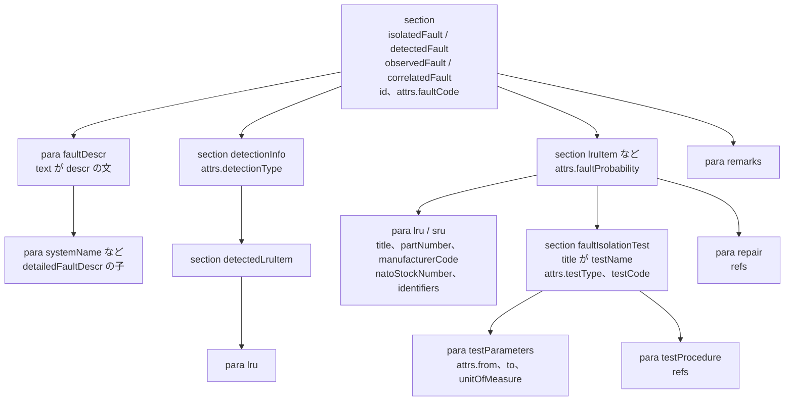
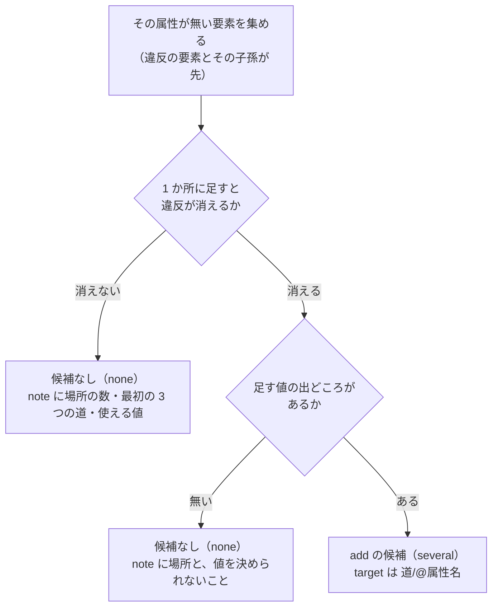

# s1000d-core が読む故障の報告・プロセスの式・回路遮断器の一覧の形

s1000d-core の `readContent` が、故障探求 DM の故障の報告（`faultReporting`）、プロセス DM の条件の式、回路遮断器の一覧（`circuitBreakerDescrGroup`）を、どの形の節点（`ContentNode`）で返すかを決める文書です。あわせて、属性が無いことが条件の BREX ルールに返す修正候補の決まりも書きます。

形は、Issue 7 の XSD（`fault.xsd`・`process.xsd`）と Bike Samples の実測から決めました（[DECISIONS.md](../DECISIONS.md) の D-31）。experiential-manual-model の形は出発点にしていません。

- 決めた日: 2026-11-16（利用者が 3 つの案を採用）
- 実装: s1000d-core の `2065390`（式）、`944209e`（BREX の候補）、`00e99b9`（故障の報告・回路遮断器）。0.12.0 として公開する予定です
- 対象は読む側だけです。新しく作る側（`DraftNode` → `buildContent`）は変えていません

## 共通の決まり

| 決まり | 内容 |
|---|---|
| 新しい `kind` を足さない | `section`・`para`・`list`・`listItem`・`sequence` を使い、元の要素は `element` で区別する |
| 属性を落とさない | 節点の項目（`id`・`applicRefId`・`securityClassification`）に写さなかった属性は、書かれた値のまま `attrs` に入れる。値は解釈しない |
| 読んでいないものは知らせる | 読まなかった要素は `notReadElements` に数える |

## プロセス DM の条件の式

| 要素 | 返す形 |
|---|---|
| `dmIf` | `kind: "if"`。式を文にしたものが `attrs.expression`。人が書いた文（`expression/@humanReadableForm`）が `question`。変数 1 つだけの式なら `attrs.variableName` も入る |
| `dmLoop` | `kind: "sequence"`・`element: "dmLoop"`。条件の式が `attrs.expression`、`humanReadableForm` があれば `attrs.humanReadableForm`。子は、前の代入（`variablePreSet`）・繰り返す `dmSeq`・後ろの代入（`assertion`） |
| `userEntry` の `variableRef` | 親の `dialog` の節点の `attrs.variableName`。子の節点にはしない |

式の文を `question` ではなく `attrs.expression` に入れる理由は 2 つあります。

- `validate` と `assertion` が、すでに式の文を `attrs.expression` に入れています。
- 書く側は `DraftNode.question` から `humanReadableForm` を作ります。core が組み立てた文を `question` に入れると、読んだ結果を下書きに使ったときに、その文が `humanReadableForm` として書き出されます。

### 式の文の書き方

式は評価しません。書かれた値と演算の名前を並べます。

| 式の中身 | 文 | 例 |
|---|---|---|
| 2 項の演算 | `左 演算 右`。入れ子は括弧でくくる | `(age greaterThanOrEqual 4) and (age lessThanOrEqual 100)` |
| 関数 | `名前(式)` | `not(level equal "experienced")` |
| 変数（`variableRef`） | 変数名 | `level` |
| 文字列・数・真偽値・集合 | `"amateur"`、`13`、`true`、`{a, b}` | |
| 適用性の条件（`assert`） | `assert(識別子 種類 "値")`。属性が無く文だけなら `assert("文")` | `assert(tourFinished condition "False")` |

文にできない式は、`dmIf`・`dmLoop` では `kind: "unknown"` の子として残し、代入・検査では `notReadElements` に `expression` と数えます。式の中の `globalPropertyRef` は、まだ文にできません。

この書き方は core が決めたもので、仕様書のプロセス DM の章は読んでいません。W-6 のときに見直します。

## 故障の報告（`faultReporting`）

| 要素 | 返す形 |
|---|---|
| `isolatedFault`・`detectedFault`・`observedFault`・`correlatedFault` | `section`。`id`、`attrs.faultCode`・`attrs.faultType` |
| `detectionInfo`・`contextAndIsolationInfo`・`isolationInfo`・`basicCorrelatedFaults`・`diagnosticProcess` | `section`。属性は `attrs` |
| `lruItem`・`detectedLruItem`・`locateAndRepairLruItem`・`sruItem`・`detectedSruItem`・`locateAndRepairSruItem` | `section`。`attrs.faultProbability` |
| `lru`・`sru` | `para`。`title` が `name`。識別子は品目（`equipment` など）と同じ項目（`partNumber`・`manufacturerCode`・`natoStockNumber`・`identifiers`、`attrs.shortName`） |
| `bitMessage`・`warningMalfunction`・`assocWarningMalfunction` | `section`。`attrs.faultCode` が `fault/@faultCode`、`refs` が `dmRef`、区分の属性は `attrs` |
| `faultIsolationTest` | `section`。`title` が `testDescr/testName`、`refs` が `testDescr/refs` |
| `faultContext`・`diagnosticsReason` | `para`。`text` が文 |
| `testParameters` | `para`。`attrs` が `from`・`to`・`unitOfMeasure` |
| `repair`・`testProcedure`・`faultIsolationRef` | `para`。`refs` が参照、`text` に `[→ DMC]` |
| `remarks` | `para`。`simplePara` が 1 つなら `text`、複数なら子の `para` |
| `detailedFaultDescr` の子（`systemName`・`faultMessageBody` など） | `faultDescr` の子の `para`。`element` が元の要素名、`functionalItemRef` は `identifiers` |
| `isolateDetectedFault`・`locateAndRepair`・`…Alts` | 節点を作らず、中身をそのまま辿る |

読んでいないものは次のとおりです。どれも `notReadElements` に数えます。

- `lru`・`sru` の 2 つ目からの `identNumber`
- 2 つ目からの `partAndSerialNumber` と、`serialNumber`
- `identNumber/refs`

Bike Samples にあるのは `detectedFault`・`isolatedFault`・`correlatedFault`・`observedFault` が 1 件ずつ（411A・412A・413A・414A）で、`sru` の系統、`warningMalfunction`、`diagnosticProcess`、`detailedFaultDescr` はありません。これらの形は XSD だけから決め、自作の XML でテストしています。

### 0.11.0 から変わる点

- `detectedFault`・`isolatedFault`・`correlatedFault` は、0.11.0 では節点を作らずに子だけを返していました。要素の `id` と `faultCode` は、読み取りの結果のどこにもありませんでした。0.12.0 では `section` の節点になり、fault の読み取りの結果の階層が 1 段増えます。
- `detectionInfo/@detectionType`、`faultIsolationTest` の `testType`・`testCode`、`testParameters` の属性も、0.11.0 では読み取りの結果にありませんでした。

## 回路遮断器の一覧（`circuitBreakerDescrGroup`）

| 要素 | 返す形 |
|---|---|
| `circuitBreakerDescrGroup`・`circuitBreakerDescrSubGroup` | `list`。`attrs` に `circuitBreakerAction`・`checkSum`。サブグループの `functionalItemRef` は `identifiers` |
| `circuitBreakerDescr` | `listItem`。`title` が `name`、`text` が場所（`circuitBreakerLocation`）、`attrs` が `circuitBreakerRef` の属性、`identifiers` が `circuitBreakerRef` と `accessPointRef`、`refs` が `internalRef` |
| `footnoteRemarks` | `listItem` の子の `para`。`refs` に脚注への参照 |
| グループの `footnote` | `list` の子の `para`。`attrs.footnoteMark` |

手順の中の一覧は手順（`step`）の子、条件（`reqCondCircuitBreaker`）の中の一覧はその条件の `para` の子です。0.11.0 にあった条件の `attrs.notRead` と、`notReadElements` の `circuitBreakerDescrGroup` は無くなりました。

## 属性が無いことが条件の BREX ルールの修正候補

対象は、禁止ルール（`allowedObjectFlag="0"`）の objectPath に `not(@a)` か `not(attribute::a)` があるものです。条件付きで禁止するルールの決まり（文書を 1 か所だけ変えて objectPath を評価し直し、違反の要素が選ばれなくなる変更だけを候補にする）を、そのまま当てはめます。

| 項目 | 内容 |
|---|---|
| 値の出どころ | XSD が列挙している値。`applicRefId` は、文書の中の `applic` の `id` |
| 確からしさ | `several`。どの値を付けるかは内容の判断なので、writer が自動で適用する `exact` にはしない |
| 候補の `target` | 違反の要素そのものなら `@属性名`、子孫なら `道/@属性名`。`applyFix` がこの形の `add` を適用する |
| 候補にしないもの | 対象そのものの識別（`dmAddress` などの下）の属性 |

Bike Samples の BREX-S1-00121（009A）は、目次の `dmRef` 82 個すべてに `applicRefId` が無く、1 か所に足しても違反が消えないので、候補なしのままです。`note` には、82 か所であること、最初の 3 つの道、文書の中の `applic` の `id` 6 個が入ります。

既定 BREX には、ほかに `dmRef[not(@referredFragment)]` と `brDecision[… not(@brDecisionIdentNumber)]` があります。どちらも値の出どころが文書の中に無いので、候補なしで、`note` に場所だけが入ります。

## Bike Samples の実測（core `00e99b9`、2026-11-16 17:55 JST）

| 測ったもの | 0.11.0 の後（`69e6bbf`） | いま |
|---|---|---|
| 知らない要素（`unknownElements`）の種類 | 35 種類（fault 23、proced 7、process 6。`name` は fault と proced の両方にある） | 0 種類 |
| `notReadElements` に数えている要素 | `globalPropertyRef` 1、`behavior` 2、`pubMedia` 2、`shortExternalPubTitle` 2 | 同じ |
| 読み取りの結果に無いテキスト節点 | 0 個 | 0 個 |
| 配布物を使う vitest | 335 件 | 339 件（VM の `/tmp/corevt`） |

`verify_csdb` の数（XSD valid 110 件、BREX の違反 18 個）と、`preliminaryRqmts` の往復の数（602 個）は、この回では測り直していません。配布物を使う vitest が同じ上限で通っているので、往復の数は増えていません。
