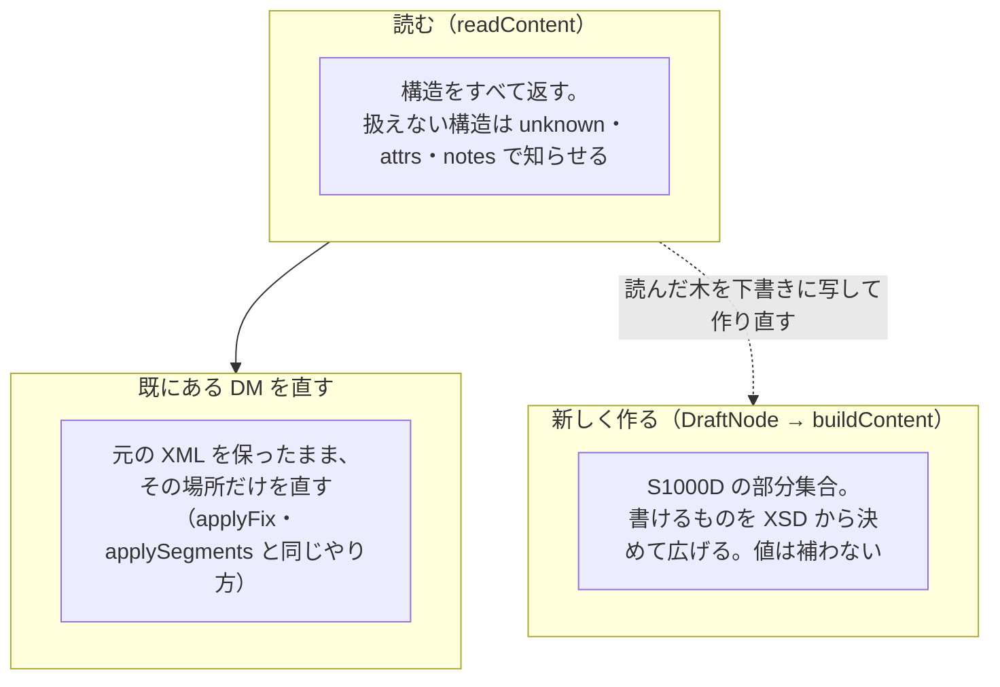

# s1000d-core の作業前の要件（`preliminaryRqmts`）の読み書きの設計

s1000d-core が、手順・故障探求のデータモジュールの `preliminaryRqmts` を読む・書くときに、S1000D のどの構造を扱い、どの構造を扱わないかを決める文書です。出発点は Issue 7 の XSD と Bike Samples の実測で、experiential-manual-model の形ではありません（D-31）。

- 作成日: 2026-11-15（JST）
- 段階: **決定済み（2026-11-15 08:26 JST、利用者が 2 点とも案を採用）**。公開の前に変える範囲（下の 1〜4 と、読んでいない要素を知らせること）と、属性の取りこぼしの修正は実装済み（core `db0fd31`・`830de9f`、未公開）
- 前提の決定: D-03（XSD を同梱しない）、D-19（決定論的に確かめられることは core が行う）、D-27（書く処理も core に置く）、D-31（core は S1000D の構造を出発点にする）
- 関連: [writer-mcp.md](./writer-mcp.md)「入力の形: DraftDataModule」、[reader-mcp.md](./reader-mcp.md)「本文の構造の返し方」。experiential-manual-model との対応は [manual-model-0.3.0.md](./manual-model-0.3.0.md)「S1000D との対応」にあり、この文書では扱いません

## この文書を書いた理由

2026-11-15 に、core の下書き（`DraftNode`）の `requirements` に人員・文書・品目を足しました（`f7104ce`）。その形は、experiential-manual-model の 7 つの区分を写せることから決めたもので、XSD の構造から決めたものではありませんでした。core は IETM / IETP の作成ツール・閲覧ソフトでも使うので、S1000D に対してどこまで扱えているかを測り、形を XSD から決め直します。

## XSD の構造（Issue 7、`proced.xsd`。`fault.xsd` も同じ）

```text
preliminaryRqmts
├─ productionMaintData *            作業の場所・所要時間など
├─ reqCondGroup                     必須
│   ├─ noConds
│   └─ reqCondNoRef | reqCondDm | reqCondPm | reqCondExternalPub | reqCondCircuitBreaker  （1 つ以上）
├─ reqPersons *
│   ├─ personnel  @numRequired      personCategory? personSkill? trade? estimatedTime?
│   └─ person     @man（必須）       personCategory? personSkill? trade? estimatedTime?
├─ reqTechInfoGroup ?
│   └─ reqTechInfo +  @reqTechInfoCategory    dmRef | pmRef | externalPubRef
├─ reqSupportEquips                 必須
│   ├─ noSupportEquips
│   └─ supportEquipDescrGroup → supportEquipDescr +  @materialUsage
│        name? shortName? 識別子 +（catalogSeqNumberRef | natoStockNumber | identNumber | toolRef | materialSetRef）
│        reqQuantity（@unitOfMeasure） remarks? | footnoteRemarks? embeddedSupportEquipDescr *
├─ reqSupplies                      必須。supplyDescr は識別子に supplyRef・supplyRqmtRef、ほかに hazards・@supplyCategory
├─ reqSpares                        必須。spareDescr は識別子に partRef・functionalItemRef
└─ reqSafety                        必須
    ├─ noSafety
    └─ safetyRqmts  @warningRefs @cautionRefs    warning * caution * note *
```

`closeRqmts` は `reqCondGroup` だけを持ちます。

`@warningRefs` / `@cautionRefs`（IDREFS）は、同じ DM の `warningsAndCautions` の `warning` / `caution`、または `warningsAndCautionsRef` の `warningRef` / `cautionRef`（別の DM への `dmRef` と識別番号）を指します。`proceduralStep` などにも同じ属性があります。

## いまの対応（2026-11-15、core `830de9f`）

「知らせる」は、中身は読まないが、あることを `DataModuleContent.notReadElements`・`notes`・節点の `attrs.notRead` で返す、という意味です。

| 構造 | 読む（`readContent`） | 下書きで表す・書く（`buildContent`） |
|---|---|---|
| `reqCondNoRef` | 子の `para` と要約の文 | 書ける（`requirements` の `text` と子の `para`） |
| `reqCond/@reqCondCategory` | `attrs.reqCondCategory` | 書けない |
| `reqCondDm`・`reqCondPm` | 子の `para`、参照は `refs` | 書ける（`para` の `refs` に `dmRef` か `pmRef` を 1 つ） |
| `reqCondExternalPub` | 子の `para`、参照は `refs` | 書けない（下書きの参照に外部の文書の種類が無い） |
| `reqCondCircuitBreaker` | 文と参照だけ。遮断器の一覧は知らせる | 書けない |
| `personnel` | `person` の節点（`count`、`text` が `trade`） | 書ける。中身の無い `personnel` も書ける |
| `person`（`@man`） | `person` の節点（`man`） | 書ける（`man` があれば `person` 要素） |
| `personCategory`・`personSkill`・`estimatedTime` | `personCategoryCode`・`skillLevelCode`・`estimatedTime`・`estimatedTimeUnit` | 書ける |
| `reqPersons/@applicRefId`（XSD では `personnel`・`person` に `applicRefId` が無く、ここに付く） | 人員の節点の `applicRefId` に写す | 書ける（同じ `applicRefId` が続く人員を 1 つの `reqPersons` にまとめる） |
| `reqTechInfo` | `document` の節点（参照は `refs`、外部の文書は題名と番号、`reqTechInfoCategory`） | 書ける。外部の文書の発行情報は書けない |
| 品目（`identNumber` を持つもの） | `equipment`・`supply`・`spare` の節点 | 書ける（名前、製造者コード、部品番号、数量、単位、補足） |
| 品目のほかの識別子（`toolRef`・`partRef`・`supplyRef`・`supplyRqmtRef`・`catalogSeqNumberRef`・`natoStockNumber`・`materialSetRef`） | 知らせる（`attrs.otherIdentifiers` に要素名） | 書けない |
| `shortName`・`@materialUsage`・`@supplyCategory` | `attrs` に読む | 書けない |
| `hazards`・`embedded…Descr`・脚注 | 知らせる | 書けない |
| `safetyRqmts` の `warning`・`caution`・`note` | 子の `admonition` | 書ける |
| `safetyRqmts` の `@warningRefs`・`@cautionRefs` | 参照先を `admonition` として返す（`attrs.referencedId`。見つからなければ `attrs.unresolved`） | 書けない |
| `productionMaintData` | 知らせる | 書けない |
| 参照（`dmRef`・`pmRef`）の版（`issueInfo`）・言語・`@applicRefId`、`dmRef` の `@referredFragment` と題名の内訳 | 参照の `issueInfo`・`language`・`applicRefId`・`fragment`・`techName`・`infoName` | 書ける |
| 参照の `behavior`・`identExtension`、外部の文書の発行情報 | 知らせる | 書けない |

経過:

- `8bdea98`: `@warningRefs` / `@cautionRefs` と条件の参照を読めるようにしました。それまでは、`safetyRqmts` が参照だけを持つ DM で、reader が安全の要件を何も返していませんでした。
- `db0fd31`: 人員の `man`・区分・技能・見積もり時間、文書の区分、条件の参照を、読む側と書く側の両方に足しました。読んでいない要素を知らせるようにしました。
- `830de9f`: 人員の適用性（`reqPersons/@applicRefId`）と、参照の版・言語・場所・適用性を、読む側と書く側の両方に足しました。それまで書く側は `personnel` に `applicRefId` を書いていて、渡されると XSD に通らない XML になっていました。

## 実測: Bike Samples を読んで書き、失われるものを数える

core の配布物のテスト（`src/content/requirements.spec.test.ts`、`S1000D_SPEC_TESTS=1`）で数えます。reader が返した `requirements` の節点を下書きに写して組み立て直し、元の `preliminaryRqmts` と要素・属性の数を比べます。値（文の中身）は比べません。

| 項目 | 最初の実測（`8bdea98`） | 形を直した後（`db0fd31`） | 属性を直した後（`830de9f`） |
|---|---|---|---|
| `preliminaryRqmts` を持つ DM | 44 件 | 44 件 | 44 件 |
| reader が `requirements` として返した DM | 41 件（残りは checklist 2 件と schedul 1 件。この種類の本文は構造化していない） | 41 件 | 41 件 |
| 要素と属性の数（41 件の合計） | 2,527 個（要素 1,660、属性 867） | 同じ | 同じ |
| 往復で失われた数 | 898 個（要素 382、属性 516）。全体の 36 % | 631 個（要素 256、属性 375）。全体の 25 % | **602 個**（要素 252、属性 350）。全体の 24 % |
| 何も失わずに往復できた DM | 3 件 | 26 件 | **26 件** |
| reader が読まず、知らせてもいない要素 | 数えていない | 0 種類 | **0 種類** |
| reader が読まず、知らせてもいない属性（構造として読む要素と、参照の中） | 数えていない | 数えていない | **0 種類** |

形を直した後は、人員（`person`・`personnel`・`personCategory`・`personSkill`・`trade`・`estimatedTime`）と文書の区分が、すべて往復できます。残りの 602 個は、品目（識別子の無い品目 12 件、入れ子の品目、`materialSetRef` など）、参照の中身（`dmRef` の版、文の中の `internalRef`）、`productionMaintData`、参照で書く安全の要件です。

reader が知らせた「読んでいない要素」は、41 件の合計で `materialSetRef` 9、`embeddedSpareDescr` 9、`productionMaintData` 5、`embeddedSupportEquipDescr` 4、`catalogSeqNumberRef` 3、`toolRef` 2、`hazards`・`supplyRef`・`supplyRqmtRef`・脚注が各 1 でした。

最初の実測で失われた 898 個の内訳です。

| まとまり | 個数 | 主なもの |
|---|---|---|
| 品目とその他 | 336 | 識別子の無い（`identNumber` 以外の識別子だけの）品目 12 件、`embedded…Descr` 13、`catalogSeqNumberRef` 6 とその属性、`materialSetRef` 9、`shortName` 8、`@materialUsage` 9、`toolRef` 4、`partRef` 3、脚注 |
| 人員 | 224 | `person` 28（`@man` 28）、`personCategory` 28、`estimatedTime` 27、`personSkill` 15、中身の無い `personnel` 10 |
| 参照 | 219 | `dmRef` 11 とその `dmCode` の属性、`internalRef` 11、`reqCondDm` 2 |
| `productionMaintData` | 61 | `zoneRef`、`workLocation`、`taskDuration`、`productItem`、`safetyInformation` |
| 参照する文書 | 47 | `@reqTechInfoCategory` 21、外部の文書の発行情報 |
| 安全の要件の参照 | 6 | `safetyRqmts` 2 と `@warningRefs`・`@cautionRefs` |
| 警告・注意の `@applicRefId` | 5 | |

このテストは、いまの数（602 個）を上限として固定しています。数が減ったら上限を下げ、増える変更は通しません。同じテストで、reader が読まずに知らせてもいない要素と属性が 0 種類であることも確かめます。

> [!NOTE]
> 往復の数は「下書きで表せない」「書けない」を合わせた数です。読む側の取りこぼしは、別のテストで 0 と確かめています。属性を調べる範囲は、reader が構造として読む要素と、参照（`dmRef`・`pmRef`）の中です。文として読む要素（`reqCond` の中、警告の本文など）の中の属性は調べていません。

## 方針: 3 つの経路を分ける（決定）



| 経路 | 求める厳密さ | いまの状態 |
|---|---|---|
| 読む | 落とさない。構造として返せないものは、あることを知らせる | `preliminaryRqmts` の要素と属性は、読むか知らせるかのどちらかになった（`db0fd31`・`830de9f`）。文として読む要素の中の属性と、ほかの要素（手順の本文など）は未確認 |
| 新しく作る | 部分集合でよい。書けないものを明記し、渡されたら入力の誤りにする。値を補わない | 守られている（識別子や数量の無い品目は `DraftInputError`） |
| 既にある DM を直す | 触っていない部分を 1 文字も変えない | core にあるのは修正候補の適用（`applyFix`）と訳文の差し戻し（`applySegments`）の 2 つ。どちらも元の XML を保つ |

点線の経路（読んだ木を下書きに写して作り直す）は、既にある DM の編集には使いません。上の実測のとおり、直した後でも 24 % が失われるからです。IETM / IETP の作成ツールで既にある DM を直すときは、3 つ目の経路を広げます（「この手順の文を変える」「この品目を足す」を、元の XML への操作として行う）。下書きの経路は、新しく作るときと、体験型マニュアルからの変換に使います。

この分け方にすると、往復で失われる数は「新しく作るときに書けない構造の数」を表す指標になり、0 にすることは目標にしません。目標にするのは、読む側の取りこぼしを 0 にすることです。

## 下書きの形の変更

`f7104ce` で足した形を、公開の前に XSD から見て直しました。1〜4 は `db0fd31` で済み、5 と 6 は次の版です。

| # | 変更 | 対応する XSD | 状態 |
|---|---|---|---|
| 1 | `person` に `man` を足す（あれば `person`、無ければ `personnel` として書く）。中身の無い `personnel` も受け取る。`man` と `count` は一緒に使えない | `person/@man`、`personnel` | 済み |
| 2 | `person` に `personCategoryCode`・`skillLevelCode`・`estimatedTime`・`estimatedTimeUnit` を足す | `personCategory`、`personSkill`、`estimatedTime` | 済み |
| 3 | `document` に `reqTechInfoCategory` を足す | `reqTechInfo/@reqTechInfoCategory` | 済み |
| 4 | 条件の `para` が `refs`（`dmRef`・`pmRef` を 1 つ）を受け取る。`closeRqmts` でも同じ | `reqCondDm`、`reqCondPm` | 済み |
| 5 | 品目の識別子を増やす（`toolRef`、`partRef`、`supplyRef`、`natoStockNumber` など） | 識別子の選択肢 | 次の版。形を決める必要がある |
| 6 | 安全の要件を参照で書く（`@warningRefs` / `@cautionRefs` と `warningsAndCautionsRef`） | 共通の警告・注意 | 次の版。DM の先頭に別の要素を足す必要があり、範囲が広い |

1〜4 をすべて入れた手順 DM と故障探求 DM を組み立て、Issue 7 の XSD で valid、既定 BREX で違反 0 件を確かめました（2026-11-15）。

項目の名前は、S1000D の属性の値をそのまま渡すもの（列挙や、プロジェクトが決めるコード）には、S1000D の属性名を使います（`personCategoryCode`、`skillLevelCode`、`reqTechInfoCategory`）。値の意味を core が解釈しないことを、名前でも示すためです。

## 決まったこと（2026-11-15 08:26 JST）

| # | 項目 | 決定 |
|---|---|---|
| 1 | 3 つの経路を分ける方針 | 読む側は落とさない、新しく作る側は明記した部分集合、既にある DM は元の XML を保って直す。下書きに写して作り直す経路を、既にある DM の編集に使わない（D-31） |
| 2 | 公開の前に変える範囲 | 1〜4 を行い、読む側の取りこぼしを知らせるようにしてから公開する。5（識別子の種類）と 6（参照で書く安全の要件）は次の版にする |

## 残っている点

| 項目 | 内容 |
|---|---|
| 文として読む要素の中の属性 | `reqCond` の中の `internalRef` の属性や、警告の本文の中の属性は、「読むか、知らせるか」を確かめる範囲に入っていない |
| 参照の場所を使う側 | `dmRef` の `fragment`（`@referredFragment`）を書けるようになったが、writer-mcp の `convert_manual` はまだ使っていない（別の DM の先頭以外の手順を指す `Step.next` を `notRepresented` に返している） |
| `preliminaryRqmts` 以外 | 同じ測り方（往復で数える、黙って落としていないかを確かめる）を、手順の本文・説明・故障探求・プロセスにはまだ当てていない |
| 既にある DM を直す経路 | 方針は決まったが、操作の種類（文を変える、品目を足す、手順を入れ替える、など）と API は未設計。IETM / IETP の作成ツールの設計のときに決める |
| checklist・schedul | `preliminaryRqmts` を持つが、この種類の本文を reader が構造化していない（Bike Samples に 3 件） |
