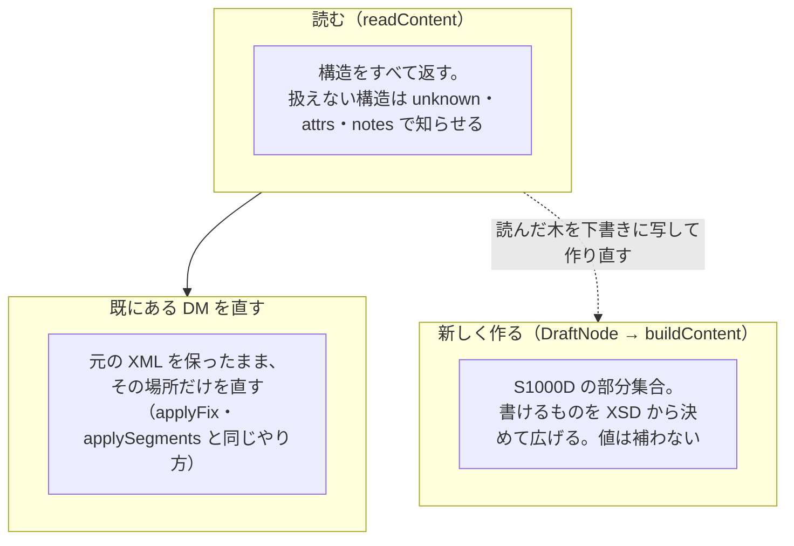

# s1000d-core の作業前の要件（`preliminaryRqmts`）の読み書きの設計

s1000d-core が、手順・故障探求のデータモジュールの `preliminaryRqmts` を読む・書くときに、S1000D のどの構造を扱い、どの構造を扱わないかを決める文書です。出発点は Issue 7 の XSD と Bike Samples の実測で、experiential-manual-model の形ではありません（D-31）。

- 作成日: 2026-11-15（JST）
- 段階: 実測と方針の案。「決めてもらうこと」の 2 点が決まってから、下書きの形を変えます
- 前提の決定: D-03（XSD を同梱しない）、D-19（決定論的に確かめられることは core が行う）、D-27（書く処理も core に置く）、D-31（core は S1000D の構造を出発点にする）
- 関連: [writer-mcp.md](./writer-mcp.md)「入力の形: DraftDataModule」、[reader-mcp.md](./reader-mcp.md)「本文の構造の返し方」。experiential-manual-model との対応は [manual-model-0.3.0.md](./manual-model-0.3.0.md)「S1000D との対応」にあり、この文書では扱いません

## この文書を書いた理由

2026-11-15 に、core の下書き（`DraftNode`）の `requirements` に人員・文書・品目を足しました（`f7104ce`）。その形は、experiential-manual-model の 7 つの区分を写せることから決めたもので、XSD の構造から決めたものではありませんでした。core は IETM / IETP の作成ツール・閲覧ソフトでも使うので、S1000D に対してどこまで扱えているかを測り、形を XSD から決め直します。

## XSD の構造（Issue 7、`proced.xsd`。`fault.xsd` も同じ）

```text
preliminaryRqmts
├─ productionMaintData *            作業の場所・所要時間など
├─ reqCondGroup                     必須
│   ├─ noConds
│   └─ reqCondNoRef | reqCondDm | reqCondPm | reqCondExternalPub | reqCondCircuitBreaker  （1 つ以上）
├─ reqPersons *
│   ├─ personnel  @numRequired      personCategory? personSkill? trade? estimatedTime?
│   └─ person     @man（必須）       personCategory? personSkill? trade? estimatedTime?
├─ reqTechInfoGroup ?
│   └─ reqTechInfo +  @reqTechInfoCategory    dmRef | pmRef | externalPubRef
├─ reqSupportEquips                 必須
│   ├─ noSupportEquips
│   └─ supportEquipDescrGroup → supportEquipDescr +  @materialUsage
│        name? shortName? 識別子 +（catalogSeqNumberRef | natoStockNumber | identNumber | toolRef | materialSetRef）
│        reqQuantity（@unitOfMeasure） remarks? | footnoteRemarks? embeddedSupportEquipDescr *
├─ reqSupplies                      必須。supplyDescr は識別子に supplyRef・supplyRqmtRef、ほかに hazards・@supplyCategory
├─ reqSpares                        必須。spareDescr は識別子に partRef・functionalItemRef
└─ reqSafety                        必須
    ├─ noSafety
    └─ safetyRqmts  @warningRefs @cautionRefs    warning * caution * note *
```

`closeRqmts` は `reqCondGroup` だけを持ちます。

`@warningRefs` / `@cautionRefs`（IDREFS）は、同じ DM の `warningsAndCautions` の `warning` / `caution`、または `warningsAndCautionsRef` の `warningRef` / `cautionRef`（別の DM への `dmRef` と識別番号）を指します。`proceduralStep` などにも同じ属性があります。

## いまの対応（2026-11-15、core `8bdea98`）

| 構造 | 読む（`readContent`） | 下書きで表す・書く（`buildContent`） |
|---|---|---|
| `reqCondNoRef` | 子の `para` と要約の文 | 書ける（`requirements` の `text` と子の `para`） |
| `reqCondDm`・`reqCondPm`・`reqCondExternalPub` | 子の `para`、参照は `refs` | **書けない**（条件の `para` は `refs` を受け取らない） |
| `reqCondCircuitBreaker` | 文と参照だけ。遮断器の一覧は読まず、`attrs.notRead` に書く | 書けない |
| `personnel` | `person` の節点（`count`、`text` が `trade`） | 書ける。ただし中身の無い `personnel` は受け取らない |
| `person`（`@man`） | `person` の節点（`attrs.man`） | **書けない**（`personnel` として書くので `@man` が落ちる） |
| `personCategory`・`personSkill`・`estimatedTime` | `attrs` に入れる | **書けない** |
| `reqTechInfo` | `document` の節点（参照は `refs`、外部の文書は題名と番号） | 書ける。`@reqTechInfoCategory` と、外部の文書の発行情報は**書けない** |
| 品目（`identNumber` を持つもの） | `equipment`・`supply`・`spare` の節点 | 書ける（名前、製造者コード、部品番号、数量、単位、補足） |
| 品目のほかの識別子（`toolRef`・`partRef`・`supplyRef`・`supplyRqmtRef`・`catalogSeqNumberRef`・`natoStockNumber`・`materialSetRef`） | あることを `attrs.otherIdentifiers` に要素名で返す。中身は読まない | **書けない** |
| `shortName`・`@materialUsage`・`@supplyCategory`・`hazards`・`embedded…Descr`・`footnote` | **読まない** | 書けない |
| `safetyRqmts` の `warning`・`caution`・`note` | 子の `admonition` | 書ける |
| `safetyRqmts` の `@warningRefs`・`@cautionRefs` | 参照先を `admonition` として返す（`attrs.referencedId`。見つからなければ `attrs.unresolved`） | **書けない** |
| `productionMaintData` | **読まない** | 書けない |
| 各要素の `@applicRefId`・`@id` | 節点の `applicRefId`・`id`（品目・人員・警告） | 品目・警告は書ける。`reqPersons`・`dmRef` の分は書けない |

`@warningRefs` / `@cautionRefs` と、条件の参照は、2026-11-15 の `8bdea98` で読めるようにしました。それまでは、`safetyRqmts` が参照だけを持つ DM で、reader が安全の要件を何も返していませんでした。

## 実測: Bike Samples を読んで書き、失われるものを数える

core の配布物のテスト（`src/content/requirements.spec.test.ts`、`S1000D_SPEC_TESTS=1`）で数えます。reader が返した `requirements` の節点を下書きに写して組み立て直し、元の `preliminaryRqmts` と要素・属性の数を比べます。値（文の中身）は比べません。

| 項目 | 2026-11-15 の実測 |
|---|---|
| `preliminaryRqmts` を持つ DM | 44 件 |
| reader が `requirements` として返した DM | 41 件（残りは checklist 2 件と schedul 1 件。この種類の本文は構造化していない） |
| 要素と属性の数（41 件の合計） | 2,527 個（要素 1,660、属性 867） |
| 往復で失われた数 | **898 個**（要素 382、属性 516）。全体の 36 % |
| 何も失わずに往復できた DM | 3 件 |

失われた 898 個の内訳です。

| まとまり | 個数 | 主なもの |
|---|---|---|
| 品目とその他 | 336 | 識別子の無い（`identNumber` 以外の識別子だけの）品目 12 件、`embedded…Descr` 13、`catalogSeqNumberRef` 6 とその属性、`materialSetRef` 9、`shortName` 8、`@materialUsage` 9、`toolRef` 4、`partRef` 3、脚注 |
| 人員 | 224 | `person` 28（`@man` 28）、`personCategory` 28、`estimatedTime` 27、`personSkill` 15、中身の無い `personnel` 10 |
| 参照 | 219 | `dmRef` 11 とその `dmCode` の属性、`internalRef` 11、`reqCondDm` 2 |
| `productionMaintData` | 61 | `zoneRef`、`workLocation`、`taskDuration`、`productItem`、`safetyInformation` |
| 参照する文書 | 47 | `@reqTechInfoCategory` 21、外部の文書の発行情報 |
| 安全の要件の参照 | 6 | `safetyRqmts` 2 と `@warningRefs`・`@cautionRefs` |
| 警告・注意の `@applicRefId` | 5 | |

このテストは 898 個を上限として固定しています。数が減ったら上限を下げ、増える変更は通しません。

> [!NOTE]
> この数は「読めない」「下書きで表せない」「書けない」を区別していません。たとえば `person/@man` は読めていますが、下書きに項目が無いので失われます。読む側だけの取りこぼし（`productionMaintData`、`shortName`、`hazards` など）を分けて数えることは、まだしていません。

## 方針の案: 3 つの経路を分ける



| 経路 | 求める厳密さ | いまの状態 |
|---|---|---|
| 読む | 落とさない。構造として返せないものは、あることを知らせる | `productionMaintData`・`shortName`・`hazards`・`embedded…Descr`・脚注を、知らせずに落としている |
| 新しく作る | 部分集合でよい。書けないものを明記し、渡されたら入力の誤りにする。値を補わない | 守られている（識別子や数量の無い品目は `DraftInputError`） |
| 既にある DM を直す | 触っていない部分を 1 文字も変えない | core にあるのは修正候補の適用（`applyFix`）と訳文の差し戻し（`applySegments`）の 2 つ。どちらも元の XML を保つ |

点線の経路（読んだ木を下書きに写して作り直す）は、既にある DM の編集には使いません。上の実測のとおり 36 % が失われるからです。IETM / IETP の作成ツールで既にある DM を直すときは、3 つ目の経路を広げます（「この手順の文を変える」「この品目を足す」を、元の XML への操作として行う）。下書きの経路は、新しく作るときと、体験型マニュアルからの変換に使います。

この分け方にすると、実測の 898 個は「新しく作るときに書けない構造の数」を表す指標になり、0 にすることは目標にしません。目標にするのは、読む側の取りこぼしを 0 にすることです。

## 公開の前に変える下書きの形の案

core は未公開（`origin/main` より 4 コミット先）なので、`f7104ce` で足した形を今なら変えられます。XSD から見て、足りない順に並べます。

| # | 変更 | 対応する XSD | 減る見込み |
|---|---|---|---|
| 1 | `person` に `man` を足す（あれば `person`、無ければ `personnel` として書く）。中身の無い `personnel` も受け取る | `person/@man`、`personnel` | 人員の 224 個のうち、要素の種類の違いと中身の無いもの |
| 2 | `person` に `personCategoryCode`・`skillLevelCode`・`estimatedTime`・`estimatedTimeUnit` を足す | `personCategory`、`personSkill`、`estimatedTime` | 人員の残り |
| 3 | `document` に `reqTechInfoCategory` を足す | `reqTechInfo/@reqTechInfoCategory` | 21 個 |
| 4 | 条件の `para` が `refs`（`dmRef`・`pmRef` を 1 つ）を受け取る | `reqCondDm`、`reqCondPm` | 参照の 219 個の一部 |
| 5 | 品目の識別子を増やす（`toolRef`、`partRef`、`supplyRef`、`natoStockNumber` など） | 識別子の選択肢 | 品目の一部。形を決める必要がある（下の 2） |
| 6 | 安全の要件を参照で書く（`@warningRefs` / `@cautionRefs` と `warningsAndCautionsRef`） | 共通の警告・注意 | 6 個。DM の先頭に別の要素を足す必要があり、範囲が広い |

項目の名前は、S1000D の属性の値をそのまま渡すもの（列挙や、プロジェクトが決めるコード）には、S1000D の属性名を使います（`personCategoryCode`、`skillLevelCode`、`reqTechInfoCategory`）。値の意味を core が解釈しないことを、名前でも示すためです。

読む側は、形を変えずに次を足します: `productionMaintData`・`shortName`・`hazards`・`embedded…Descr`・脚注があることを、節点か `notes` で返す。読む側だけの取りこぼしを数えるテストを足す。

## 決めてもらうこと

| # | 項目 | 案 |
|---|---|---|
| 1 | 3 つの経路を分ける方針 | 上のとおり。読む側は落とさない、新しく作る側は明記した部分集合、既にある DM は元の XML を保って直す。下書きに写して作り直す経路を、既にある DM の編集に使わない |
| 2 | 公開の前に変える範囲 | 1〜4 を行い、読む側の取りこぼしを知らせるようにしてから公開する。5（識別子の種類）と 6（参照で書く安全の要件）は、形の検討が要るので次の版にする |
