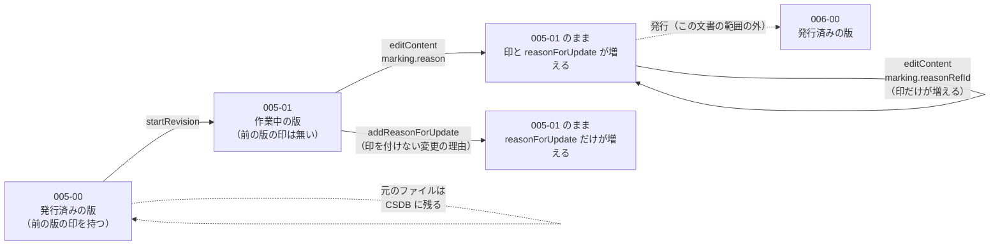

# 既にある DM の改版（層 2）

s1000d-core と s1000d-writer-mcp に、発行済みのデータモジュール（DM）を作業中の版に進め、構造を変える編集に変更の印を付ける操作を足すための設計です。

- 状態: **実装済み、公開済み**（2026-11-18）。s1000d-core 0.15.0、s1000d-writer-mcp 0.6.0、Skill `s1000d-publish` 0.4.0 として公開しました。「決めたこと」の R-1〜R-8 は、利用者が 2026-11-17 09:56 JST にすべて提案どおりと決めました（DECISIONS の D-33）。実装のときに決めた 3 つは、D-35 にあります。「残っている確認」は残っています
- 前提の決定: D-19（決定論的に確かめられることは core が行う）、D-31（既にある DM は元の XML を保ったまま直す）、D-32（構造を変える編集は層を分ける。層 1 は版も変更の印も変えない）
- 前提の設計: [core-structural-edit.md](./core-structural-edit.md)（層 1。`editContent` と `edit_data_module`）。変更の印の一般の決まり（Chap 3.9.5.2.1.1 の Para 1〜2.4.2）は、その文書の「版と変更の印の決まり」にあります。この文書には、足りなかった分だけを書きます

> [!WARNING]
> 仕様書の文章は写していません。決まりは自分の言葉で書き、章の番号を添えています。仕様書の表は、PDF から取り出した文章で読みました。Chap 3.9.5.1 の Table 3 だけは、PDF のページを画像にして目で確かめました。

## 目的

層 1 の `editContent` は、版も変更の印も変えません。発行済みの DM（`inWork` が `00`）は、利用者が明示したときだけ書き換えます。S1000D の決まりに沿って発行済みの DM を直すには、次の 2 つが足りません。

| 足りないもの | 内容 |
|---|---|
| 作業中の版を始める操作 | `inWork` を上げ、新しいファイル名で書き、前の版の変更の印を消す |
| 変更の印を付ける指定 | 足した要素・取り除く要素に `changeType`・`changeMark`・`reasonForUpdateRefIds` を付け、識別・状態部に `reasonForUpdate` を足す |

## 範囲

| 区分 | 内容 |
|---|---|
| 扱う | 作業中の版を始める操作。層 1 と同じ対象（手順、段落、警告・注意・注記、リストの項目）の insert・remove・move に変更の印を付ける指定 |
| 扱わない | 発行（`inWork` を `00` に戻し、`issueNumber` を上げる）。「決めたこと」の R-6 |
| 扱わない | 文の一部の変更（`changeInline`）。文だけを直す経路を決めるときに扱う |
| 扱わない | 表・図への変更の印（Para 2.5・2.6）。対象の節点を表の行・図に広げるときに扱う。決まりは下に書いておく |
| 扱わない | DM の削除と復帰（`issueType` の `deleted`・`rinstate-*`） |

## 仕様書と既定 BREX で確かめたこと（2026-11-17 09:22 JST）

読んだのは、Issue 7 の仕様書の Chap 3.9.5.2.1.1（変更の印）の全体（Para 1〜2.7。Para 2.5〜2.7 はこの回に読みました）、Chap 3.9.5.1 の `issueType` の説明と Table 2・Table 3、既定 BREX の BREX-S1-00013・00030〜00034・00036・00038〜00044 の `objectPath` です。XSD は `proced.xsd`（`xml_schema_flat`）を見ました。

### 1. 版と `issueType`

| 項目 | 決まり | 出どころ |
|---|---|---|
| `issueType` の値 | `new`・`changed`・`deleted`・`revised`・`status`・`rinstate-changed`・`rinstate-revised`・`rinstate-status` の 8 つ | `proced.xsd` の `issueTypeAttType`、Chap 3.9.5.1 |
| `changed` | 変更があり、変更の印で示している DM | Chap 3.9.5.1 |
| `revised` | 改訂したが、変更の印を持たない DM | Chap 3.9.5.1 |
| `status` | 識別・状態部だけを更新した DM | Chap 3.9.5.1 |
| `new` を使える版 | `issueNumber` が `000`、または `001-00` のときだけ。それ以外の版で `new` は違反。逆に、`000` と `001-00` で `new` 以外も違反 | BREX-S1-00030（機械で判定する禁止ルール。S1000D 自身の BREX の DM は除く） |
| 変更の印を持てる `issueType` | `changed`・`rinstate-changed`・`status`・`rinstate-status` だけ | BREX-S1-00036（機械で判定する）。発行済みの版（`inWork` が `00`）については BREX-S1-00032 も同じ |
| `revised` と変更の印 | `issueType` が `revised`・`rinstate-revised` の DM の内容部に、変更の印があってはならない | BREX-S1-00033（機械で判定する） |
| `reasonForUpdate` が要る DM | `issueNumber` が `000`・`001` でなく、`issueType` が `changed` でない DM に、`reasonForUpdate` が 1 つも無いと違反 | BREX-S1-00038（機械で判定する） |
| 文や要素を変えたとき | 要素全体の変更でも、文の一部の変更でも、`issueType` は `changed` にする | Chap 3.9.5.2.1.1 Para 2.4 |

> [!IMPORTANT]
> **仕様書の表と既定 BREX が食い違っています。** Chap 3.9.5.1 の Table 3 は、`001-01`・`001-02`・`001-NN`（最初の発行の後の作業中の版）の `issueType` を `new` と書いています。`002-00` で `changed`（例）になります。PDF の 421 ページを画像にして目で確かめたので、文章の取り出しの崩れではありません（2026-11-17 09:47 JST）。一方、既定 BREX の BREX-S1-00030 の `objectPath` は、`issueType="new"` で、版が `000-NN` でも `001-00` でもない DM を違反にします。`001-01` で `new` の DM は、表には合い、既定 BREX には違反します。
>
> どちらに合わせるかは、core が決められません（R-1）。`dmStatus` に `issueType` の属性を書かなければ、BREX-S1-00030 の `objectPath` はどちらの条件にも当たりません（評価フォルダーの `work/EDIT-1/` の `001-01` の DM がこの形で、BREX は `passed` でした）。ただし、これは属性が無いために条件に当たらないだけで、決まりに合っていることにはなりません。

### 2. 変更の印の一般の決まり（層 1 の文書に無かった分）

| 項目 | 決まり | 出どころ |
|---|---|---|
| `changeMark` | `1` は、変更を示す表示（変更線など）を出す意図。`0` と、属性が無いときは、出さない | Para 2.4.1 |
| `changeType` が無く `changeMark` だけがあるとき | 追加として扱われる | Para 2.4.1 |
| `modify` の要素の中 | `add`・`modify`・`delete` の印を持つ要素を含んでよい | Para 2.4.1 |
| `add`・`delete` の要素の中 | 子に印を付けなくてよい。付けても、表示する側は無視する | Para 2.4.1 |
| 同じ理由の変更が複数の要素にあるとき | どの要素も、同じ `reasonForUpdate` の `id` を指す。理由が違えば、別の `reasonForUpdate` を指す | Para 2.1.3 |
| `reasonForUpdate` の子 | `simplePara`・`simpleRefPara`。1 つの `reasonForUpdate` の中に段落を並べて、変更を 1 つずつ書き分ける使い方はしない | Para 2.2 |
| `updateReasonType` | `urt01` 編集上の変更（この理由に結び付く変更の印があってはならない）、`urt02` 技術的な変更（印が要る）、`urt03` マークアップだけの変更、`urt04` 適用性だけの変更、`urt05` 参照だけの変更。属性が無ければ、技術的な変更として扱われる。値はプロジェクトが設定できる（XSD の列挙は `urt01`〜`urt99`） | Para 2.2、`proced.xsd` |
| `updateHighlight` | `1` は、その理由をハイライトの DM に載せる | Para 2.2、BREX-S1-00039（機械では判定しない） |
| `reasonForUpdate` の位置 | `dmStatus` の子。`skillLevel` の後ろ、`productSafety`・`remarks` の前。0 個以上 | `proced.xsd` |

### 3. 警告と注意（Para 2.7）

警告（`warning`）と注意（`caution`）の変更の印は、警告・注意の全体に付けます。中の語や段落（`warningAndCautionPara`）には付けません。利用者が警告・注意を全部読む必要があるためです。

設計への影響: 警告・注意の中身を変える編集に印を付けるときは、印を付ける先が、編集した要素ではなく、それを含む `warning`・`caution` になります（`changeType="modify"`）。層 1 は警告・注意の中に節点を足せないので、最初の版でこれが起きるのは、警告・注意そのものを足す・取り除く場合だけです。

### 4. 表（Para 2.5）と図（Para 2.6）

層 2 の最初の版では扱いません。対象を広げるときのために、決まりを書いておきます。

| 対象 | 印の付け方 | プロジェクトが決めること |
|---|---|---|
| 表 | 5 通り。表の全体だけ／題名だけ／表の全体と題名／行だけ／行と題名。表と題名を別の理由で変えたときは、`table` と `title` の両方に、別の `reasonForUpdate` を指す印を付ける | どの付け方を使うか（BRDP-S1-00092） |
| 図 | 3 通り。図だけ／題名だけ／図と題名。図の題名は必須なので、題名だけを足す・取り除くことはできない（図ごと足す・取り除く） | どの付け方を使うか（BRDP-S1-00093） |
| 複数のシートを持つ図 | `figure` に印を付けたら、その中の `graphic` には付けない。シートごとに示すなら `graphic` に付け、`figure` には付けない | BREX-S1-00043（機械で判定する） |
| 取り除く表・行・題名・図 | `changeType="delete"` を付けて、要素を残す | Para 2.5・2.6 の例 |

### 5. 移動

Chap 3.9.5.2.1.1 の全体を読みましたが、要素を移したときの印の付け方は書かれていません。`changeType` の値は `add`・`modify`・`delete` の 3 つです。ほかの章にも、移動・並べ替えの印の決まりはありませんでした（2026-11-18 に仕様書の全文を語で探した結果。下の「確かめた結果」）。

## Bike Samples の実測（2026-11-17 09:21 JST、DMC 106 件。XML を直接数えた）

| 測ったもの | 値 |
|---|---|
| `dmStatus/@issueType` | `changed` 60、`status` 30、`new` 10、`revised` 3、`deleted` 3 |
| `issueType="new"` の 10 件の版 | `001-00` が 1 件、`002-00` が 9 件 |
| `reasonForUpdate/@updateReasonType` | `urt03` 97、`urt01` 19、`urt02` 4 |
| `changeType` を持つ DM | 3 件（層 1 の文書の実測。要素は `wire`・`electricalEquip`・`graphic`） |
| `inWork` が `00` でないファイル | 0 件（層 1 の文書の実測） |

`002-00` で `issueType="new"` の 9 件は、仕様書の本文（`002` からは `new` にしない。Chap 3.9.5.1）にも、BREX-S1-00030 の条件にも合いません。配布物のサンプルが、版の決まりの手本になるとは限りません。`verify_csdb` の BREX の違反（10 件の DM に 18 個）のうち、どれがこれに当たるかは確かめていません。

> [!NOTE]
> Bike Samples には、作業中の版（`inWork` が `00` でない）の DM が 1 件もありません。作業中の版を始める操作のテストは、Bike Samples の発行済みの DM から自分で作った結果を、XSD と既定 BREX で確かめる形になります。

## 設計のときの core の状態（2026-11-17、0.13.0）

> [!NOTE]
> この節は、層 2 を作る前の状態の記録です。いまの状態は、下の「読み取りに足したもの」と「実装」にあります。

| 項目 | 状態 |
|---|---|
| `editContent` | 版も変更の印も変えない。`inWork` が `00` なら `released-issue` で断る |
| `buildDataModule` の `issuePolicy` | `increment-issue`・`increment-inwork`・`keep`。新しく組み立てる DM の版を決めるだけで、既にある DM の XML は直さない |
| `applySegments` の `issueInfo` | 渡したときだけ、`issueNumber`・`inWork` を書き換える |
| `dmStatus/@issueType` | `src/write/` に、この属性を書くコードは無い（`issueType` で検索して 0 件） |
| `reasonForUpdate`・`changeType`・`changeMark` | 書くコードは無い。`src/edit/` は、`reasonForUpdateRefIds` を「`id` を指す属性」の 1 つとして見る（取り除く `id` が指されていないかの確認）ほかは、変えないことを知らせる文の中でだけ触れている |

reader の応答（2026-11-17 09:46 JST。dev の reader-mcp で、Bike Samples の `…D00-00-00-00AA-040A-A_011-00` を `section: "all"` で読んだ。この DM は、`reasonForUpdate` 1 つと、`changeType`・`changeMark`・`reasonForUpdateRefIds` を持つ `graphic` 2 つを持つ）:

| 項目 | 応答 |
|---|---|
| `dmStatus/@issueType` | 返す（`identAndStatus.issueType` が `changed`） |
| 識別・状態部の `reasonForUpdate` | 返さない（`id`・`updateReasonType`・文のどれも、応答に無い） |
| `graphic` の `changeType`・`changeMark`・`reasonForUpdateRefIds` | 返さない（図の節点の `refs` に、ICN だけが入る） |
| 返していないことの知らせ | 無い（`content.notReadElements` と `content.unknownElements` は空） |

core の `src/content/read.ts` には、`changeType`・`changeMark`・`reasonForUpdate` を読むコードがありません（検索して 0 件）。段落や手順に付いた変更の印も、同じく返らないと見ています（Bike Samples には、段落・手順に印を持つ DM が無いので、応答では確かめていません）。

> [!IMPORTANT]
> 変更の印と更新の理由は、D-31 の「読む側は落とさない」に当たらないまま残っています。層 2 では、印を付けた結果を reader で読んで確かめる手順が要るので、core の読み取り（`IdentAndStatus` に `reasonForUpdate`、`ContentNode` と `ContentRef` に変更の印）を先に足します。Skill `s1000d-review` が変更の印を見られないことも、同じ原因です。

## 読み取りに足したもの（2026-11-17 10:50 JST。core 0.14.0、reader-mcp 0.13.0 として公開済み）

上の「先に足す」分を実装しました。返す形は、XSD（`changeAttGroup`、`reasonForUpdateElemType`）と Bike Samples の実測から案を作り、利用者が 2026-11-17 10:40 JST ごろに決めました（DECISIONS の D-34）。値は書かれたまま返し、意味は付けません。

| 返す場所 | 形 | 元の XML |
|---|---|---|
| `IdentAndStatus.reasonForUpdates[]` | `id`・`updateReasonType`・`updateHighlight`・`applicRefId`、そのほかの属性（`attrs`）、段落の文（`paragraphs[]`）。1 つも無ければ項目が無い | `dmStatus/reasonForUpdate`。子は `simplePara` か `simpleRefPara` |
| `ContentNode.change`・`ContentRef.change` | `changeType`・`changeMark`・`reasonForUpdateRefIds`（空白で分けた配列）。3 つとも無ければ付かない | その節点・参照の要素自身の属性 |
| `DataModuleContent.changeMarks[]` | `element`・`path`・`line`・`column` と、上の 3 つの属性。文書の順。無ければ空の配列 | 3 つの属性のどれかを持つ要素すべてと、`changeInline` |

節点と一覧の両方に返す理由は、印を持てる要素の多くが節点にならないことと、Bike Samples の印のほとんどが本文を構造化して読まない DM にあることです。

| 確かめたこと | 値 | 確かめ方 |
|---|---|---|
| 印の 3 つの属性を持てる要素の型 | `proced.xsd` は 233 のうち 136、`descript.xsd` は 183 のうち 91、`process.xsd` は 276 のうち 149、`fault.xsd` は 305 のうち 191、`pm.xsd` は 140 のうち 65 | Issue 7 の XSD で、`changeAttGroup` を参照する `complexType` を数えた |
| 節点にならないが印を持てる要素の例 | `title`、表の `row`、`dmRef`・`internalRef`（参照になる）、手順の `text` にまとめる `para`、行内の `changeInline` | 同じ XSD |
| Bike Samples の `reasonForUpdate` | 97 件に 124 個。すべて `dmStatus` の直下。`id` は 123 個、`updateReasonType` は 120 個（`urt03` 97・`urt01` 19・`urt02` 4）、`updateHighlight` は 1 個。子は `simplePara` 1 つが 119 個、2 つが 4 個、`simpleRefPara` 1 つが 1 個 | DMC・PMC 110 件の XML を直接数えた |
| Bike Samples の変更の印 | 3 件に 14 個。`wrngdata` の DM 2 件に `wire` 10・`electricalEquip` 2、`descript` の DM 1 件に `graphic` 2。14 個とも 3 つの属性をすべて持つ。`changeInline` は 0 個 | 同上 |

> [!NOTE]
> 利用者に形を確かめたときの問いに、印を持つ要素を「13 個」と書きましたが、正しくは 14 個です（`wrngdata` の 12 個と `graphic` の 2 個）。選択肢の内容と理由には影響しません。

読んでいないものは 1 つあります。パブリケーションモジュールの `pmStatus/reasonForUpdate` です（`IdentAndStatus` は DM の識別・状態部だけを読みます。Bike Samples の PMC 4 件に `reasonForUpdate` はありません）。PM の中の変更の印は `changeMarks[]` に入ります。

確かめた結果:

| 対象 | 結果 |
|---|---|
| core の vitest（クラウド側、配布物なし） | 321 件が通った（配布物を使う 46 件はスキップ）。足したテストは 5 件 |
| core の vitest（Mac 側の VM、`S1000D_SPEC_TESTS=1`） | 367 件が通った（スキップなし）。足した配布物のテスト 3 件は、元の文字列を正規表現で数えた数と比べる（`reasonForUpdate` 124 個・97 件、印 14 個・3 件、段落が 2 つ以上の手順 11 個・7 件） |
| reader-mcp（パッチを当てて VM でビルドし、stdio で `read_data_module` を呼んだ） | `…D00-00-00-00AA-040A-A` で、`identAndStatus.reasonForUpdates` 1 件、図の参照 2 つの `change`、`content.changeMarks` 2 件が返った。`wrngdata` の `…057A-A` は `structured: false` のまま `changeMarks` 10 件が返った |

## 実装（2026-11-18）

「決めたこと」の R-1〜R-8 と、「実装のときに決めたこと」の 3 つを、次の版で公開しました。設計のときに「案」として書いていた節を、実装の結果に書き直してあります。

| 公開したもの | 版 | 入ったもの |
|---|---|---|
| s1000d-core | 0.15.0 | `startRevision`、`editContent` の `options.marking`、`addReasonForUpdate`、開始タグの中の属性の範囲を求める関数（`src/xml/ranges.ts` の `scanAttributes`・`setAttributeSplice`・`removeAttributeSplice`・`attributeInsertPosition`・`escapeAttributeValue`） |
| s1000d-writer-mcp | 0.6.0 | `start_revision`、`add_reason_for_update`、`edit_data_module` の `marking`。ツールは 9 つ |
| Skill `s1000d-publish` | 0.4.0 | `references/edit.md` の E1 の分け直し、E1a、「変更の印を付けるかを確かめる」、E3 の「変更の印」、E7 |

### 版の流れ

`inWork` は、`startRevision` で 1 度だけ上げます。編集のたびには上げません（R-7）。

### 操作 1: 作業中の版を始める（`startRevision`）

| 項目 | 実装 |
|---|---|
| 入力 | DM の XML と `issueType`（`changed`・`revised`・`status`。元の `issueNumber` が `001` のときだけ `new` も）。`issueType` は必須で、core は決めない（R-1） |
| 断る場合（`refusals[].reason`） | `already-in-work`（`inWork` が `00` でない）、`deleted-issue`（`issueType` が `deleted`。復帰は範囲の外）、`issue-type-input-error`（`issueType` が無い、または受け付けられない。`001` でない版の `new` を含む）、`id-referenced`（取り除く `changeType="delete"` の要素の `id` を、残る部分が指している）、`no-issue-info`、`xml-not-well-formed`、`ranges-unavailable`、`internal-mismatch` |
| `issueInfo` | `issueNumber` はそのまま、`inWork` を `01` にする |
| `issueType` | 入力の値にする |
| 前の版の変更の印 | `changeType`・`changeMark`・`reasonForUpdateRefIds` の属性を取り除く。`changeInline` は、中身を残してタグだけを取り除く。`changeType="delete"` の要素は取り除く（R-2） |
| 前の版の `reasonForUpdate` | すべて取り除く（R-2） |
| 結果 | `started`、`xml`、`refusals[]`、`previous`（元の版）、`issueInfo`、`issueType`、`fileName`、`removed`（`markedElements`・`changeInline`・`reasonForUpdate` の数と、`deletedElements[]`）、`notes` |
| ファイル名 | DM のときだけ、作業中の版の名前（`…_005-01_EN-US.XML`）を `fileName` に返す。core はファイルを書かない。元の版は、その版の印を持ったまま CSDB に残る（Para 2.1.1） |
| `new` を選んだとき | 受け付けるのは、元の `issueNumber` が `001` のときだけ。`notes` に、既定 BREX の BREX-S1-00030 に違反することを書く |
| `revised`・`status` を選んだとき | `reasonForUpdate` が 1 つも無い文書になる。`issueNumber` が `000`・`001` でなければ、既定 BREX の BREX-S1-00038 に違反する。`notes` で知らせる。`startRevision` は理由を受け取らないので、続けて `addReasonForUpdate` を呼ぶ |
| 文字列の保ち方 | 層 1 と同じ。属性を取り除く・書き換える範囲だけを書き換える |
| 変えないもの | `issueDate`、`qualityAssurance`、本文の文と構造 |
| PM | PM の XML でも動く（Bike Samples の PMC 4 件で始められた）。`fileName` は返さない |

### 操作 2: 変更の印を付ける指定（`editContent` の `options.marking`）

渡さなければ、層 1 と同じ動き（印を付けない）です。

| 項目 | 実装 |
|---|---|
| `marking.reason` | 新しい `reasonForUpdate` 1 つ分。`text`（`simplePara` の文）と `updateReasonType` は必須（R-4）。`updateHighlight` と `id` は省略できる。`id` を省略すると、文書に無い値（`rfu-0001` の形）を作る（R-5） |
| `marking.reasonRefId` | 識別・状態部に既にある `reasonForUpdate` の `id`。印はそれを指し、識別・状態部は変えない。`reason` と `reasonRefId` は、どちらか一方だけを渡す（D-35） |
| `marking.changeMark` | `"1"` か `"0"`。必須（R-5） |
| 断る場合 | `released-issue`（`inWork` が `00`。`allowReleasedIssue` があっても断る）、`issue-type-not-markable`（`issueType` が `changed`・`status`・`rinstate-changed`・`rinstate-status` でない。BREX-S1-00036 に当たる結果を作らない）、`editorial-reason`（`updateReasonType` が `urt01`、または `reasonRefId` の指す `reasonForUpdate` が `urt01`。Para 2.2）、`marking-input-error`（`marking` の形が受け付けられない。`reasonRefId` の `id` が識別・状態部に無い場合を含む） |
| `insert` | 足した要素に `changeType="add"` と `changeMark`・`reasonForUpdateRefIds` を付ける。子には付けない |
| `remove` | 要素を取り除かず、`changeType="delete"` と `changeMark`・`reasonForUpdateRefIds` を付けて残す（結果の `changes[].kept` が `true`）。その要素（子孫を含む）の `id` を指す参照が残っていれば、層 1 と同じに `id-referenced` で断る（Para 2.4.1、BREX-S1-00041・00042）。既に `changeType="delete"` を持つ要素は `already-marked-deleted` で断る |
| `remove` の例外 | 取り除く要素が、この作業中の版で足したもの（`changeType="add"` を持つ）なら、印を付けずに取り除く。印は前の発行済みの版からの差を表すので、前の版に無かった要素は、取り除けば差が無くなる（Para 2.1.1） |
| `move` | 同じ親の中だけを受け付け、親に `changeType="modify"` を付ける（R-3）。親が変わる移動は `move-across-parents`、印の属性を持てない親（`description`・`procedure` など）の中の移動は `parent-not-markable` で断る。親が既に `modify` の印を持つときは、`changeType`・`changeMark` を変えず、`reasonForUpdateRefIds` に今回の理由の `id` を足す |
| `add`・`delete` の要素の中への編集 | 印を付けない（親の印が含む。Para 2.4.1）。`changeType` が無く `changeMark` だけを持つ要素も、追加として扱い、その中への編集には印を付けない |
| 置き換え | 同じ呼び出しで、remove（`delete` の印を付けて残す）と、その要素の前後への insert を受け付ける。置き換えを 1 回の呼び出し（＝ 1 つの `reasonForUpdate`）で書ける |
| `reasonForUpdate` | `marking.reason` のときは、印を 1 つでも付けたら、`dmStatus` の中の XSD が決める位置（`productSafety`・`remarks` の前）に 1 つ足す。同じ呼び出しの印は、すべてそれを指す。理由が違う編集は、呼び出しを分ける |
| 結果 | `reasonForUpdate`（`id` と、足したときに `true`、既にあったものを指したときに `false` になる `added`）と、`changes[].mark`（印を付けた要素、`changeType`、指した理由の `id`） |
| 警告・注意 | 印は `warning`・`caution` の全体に付く（Para 2.7）。対象は警告・注意そのものの insert・remove だけなので、上の決まりのとおりになる |

### 操作 3: 更新の理由だけを足す（`addReasonForUpdate`）

設計のときには無く、実装のときに足しました（D-35）。R-4 の「`reasonForUpdate` だけを足す入口を別に用意するかは、実装のときに決める」の結果です。

| 項目 | 実装 |
|---|---|
| 入力 | DM の XML と、理由 1 つ（`text` と `updateReasonType` は必須。`urt01` も受け付ける。`updateHighlight` と `id` は省略できる） |
| 行うこと | `dmStatus` の中の XSD が決める位置（`productSafety`・`remarks` の前）に、`reasonForUpdate` を 1 つ足す。本文には触らず、変更の印も付けない |
| 断る場合 | `released-issue`（`inWork` が `00`）、`reason-input-error`、`id-duplicate`、`no-status-element`、`xml-not-well-formed`、`ranges-unavailable`、`internal-mismatch` |
| 結果 | `added`、`xml`、`refusals[]`、`reasonForUpdate`（`id`・`updateReasonType`・`updateHighlight`）、`notes` |

3 つの入口の使い分けです。

| 入口 | 本文の変更の印 | 識別・状態部の `reasonForUpdate` | 使う場面 |
|---|---|---|---|
| `editContent` の `marking.reason` | 付ける | 1 つ足す | その理由による最初の編集 |
| `editContent` の `marking.reasonRefId` | 付ける | 変えない（既にあるものを指す） | 同じ理由による 2 回目からの編集 |
| `addReasonForUpdate` | 付けない | 1 つ足す | 編集上の変更（`urt01`）。`issueType` が `revised`・`status` の版 |

### writer-mcp（0.6.0）

| ツール | 動き |
|---|---|
| `start_revision`（新しいツール） | 検証 → core の `startRevision` → `reason` があれば `addReasonForUpdate` → 検証し直す。`write: true` のときは、新しいファイル名で書く（`path` を渡したときは同じフォルダー、`xml` を渡したときは CSDB の書き込み先）。同じ名前があれば `write-conflict`。元のファイルは変えない。理由を足せないときは、版も始めない。XSD のエラーが増えた結果と、取り除いた `id` をほかの DM・PM が指している結果は書かない |
| `add_reason_for_update`（新しいツール） | 検証 → core の `addReasonForUpdate` → 検証し直す。`write: true` のときは、`path` のファイルを上書きする |
| `edit_data_module` の `marking` | core の `editContent` にそのまま渡す。応答に `reasonForUpdate` と `changes[].mark` を返す。`_notes` に、次の同じ理由の編集では `marking.reasonRefId` を使うことを書く。`marking` を渡したときは、`allowReleasedIssue: true` があっても、発行済みの版を断る |

core の `notes` と `refusals[].message` は、core の関数名（`startRevision`・`addReasonForUpdate`・`editContent`）で書いてあります。writer-mcp は、応答に入れるときにツールの名前（`start_revision`・`add_reason_for_update`・`edit_data_module`）に読み替えます。

### Skill `s1000d-publish`（0.4.0）

`references/edit.md` に入れた手順です。Skill は、`issueType`・理由の文・`updateReasonType`・`changeMark` のどれも決めず、利用者に聞きます。

| 段階 | 行うこと |
|---|---|
| E1 | 発行済みの版（`inWork` が `00`）のとき、「作業中の版を始めて、決まりに沿って直す」「版を変えずに書き換える」「やめる」の 3 つから、利用者に選んでもらう |
| E1a | `start_revision` で作業中の版を始める。`revised`・`status` で発行番号が `002` 以降のときは、理由も聞いて `reason` に渡す。書いた後は、新しいファイルを reader で読み直す |
| 変更の印を付けるかを確かめる | 変更の種類を聞く。印で示す変更は `marking` を渡す。編集上の変更（`urt01`）は `marking` を渡さずに編集し、理由を E7 で足す |
| E3 の「変更の印」 | その理由による最初の編集は `marking.reason`、2 回目からは `marking.reasonRefId` |
| E7 | `add_reason_for_update` で、変更の印を付けない変更の理由を足す |

## 決めたこと（2026-11-17 09:56 JST、利用者の決定）

R-1〜R-8 のすべてを、「決定」の列のとおりに決めました（提案のまま）。上の「実装」の節は、この決定のとおりに作った結果です。R-3 の「`descript.xsd` で確かめる」と、R-4 の「実装のときに決める」の結果は、下の「確かめた結果」と「実装のときに決めたこと」にあります。

| # | 項目 | 選択肢 | 決定 |
|---|---|---|---|
| R-1 | 作業中の版を始めるときの `issueType` | A: 入力で必ず受け取る（`changed`・`revised`・`status`）／B: 変えず、最初に印を付けたときに `changed` にする | A。変更の種類は書き手が知っていて、core は決められない。`001-00`（`new`）から始めるときだけは、仕様書の Table 3（`new` のまま）と既定 BREX の BREX-S1-00030（`new` は違反）が食い違うので、`new` のままにする値も入力で選べるようにし、選んだ結果が既定 BREX に違反することを応答で知らせる。`002` 以降の版から始めるときは、食い違いは無い |
| R-2 | 前の版の印を、いつ、どこまで消すか | A: 作業中の版を始めるときに、印の属性・`changeInline` のタグ・`reasonForUpdate` を消し、`changeType="delete"` の要素は取り除く／B: 属性と `reasonForUpdate` だけを消し、`delete` の要素は残して知らせる／C: 発行のときに消す | A。ただし、`delete` の要素を取り除くことは、読んだ範囲の仕様書に明記されていない（「前の版で示した変更は、版を上げるときに消す」という決まりからの解釈）。取り除く要素の `id` を指す参照が残っていれば断る |
| R-3 | `move` の変更の印（層 1 の文書の 3-3） | A: 印を付ける編集では `move` を断る／B: 同じ親の中の移動は、親の要素に `changeType="modify"` を付ける。親が変わる移動は断る（利用者が remove と insert で指定する）／C: 元の場所に `delete` の印を付けた写しを残し、行き先に `add` で足す | B。仕様書に移動の決まりは無い。C は、同じ `id` を持つ要素が 2 つになり、XSD の ID の重複になる（元の側の `id` を外すと、参照の行き先が変わる）。B の親（`mainProcedure`・`proceduralStep`・`sequentialList`・`randomList`）は、`proced.xsd` で変更の印の属性を持てる。`levelledPara` が持てるかは `descript.xsd` で確かめる |
| R-4 | 技術的な変更か、編集上の変更か | A: `updateReasonType` を必須の入力にする／B: 省略を許し、省略時は属性を書かない（仕様書では技術的な変更として扱われる） | A。値を補わない（D-31）。編集上の変更（`urt01`）は、`marking` を渡さずに層 1 の動きで編集し、`reasonForUpdate` だけを足す入口を別に用意するかは、実装のときに決める |
| R-5 | `changeMark` と `reasonForUpdate/@id` の既定 | A: どちらも必須の入力／B: `changeMark` は必須、`id` は省略時に core が文書に無い値を作る（`rfu-0001` の形） | B。`id` は文書の中の結び付けにだけ使う値で、書き手が意味を持たせない。`changeMark` は、表示するかどうかをプロジェクトが決める（BREX-S1-00044 は機械で判定しないルール） |
| R-6 | 発行の操作（`inWork` を `00` に戻し、`issueNumber` を上げる）を層 2 に入れるか | 入れる／入れない | 入れない。`issueDate`、`qualityAssurance`、DML の更新が関わり、CSDB の運用（版・状態・権限）の設計になる |
| R-7 | 作業中の版の間、編集のたびに `inWork` を上げるか | A: 上げない（`start_revision` の 1 度だけ）／B: `edit_data_module` の `write: true` のたびに上げ、新しいファイルを書く | A。B は、1 つの改版でファイルが編集の回数だけ増える。作業の途中の保存の単位は、CSDB の運用が決める |
| R-8 | 表・図の印（Para 2.5・2.6）をいつ扱うか | 層 2 の最初の版に入れる／対象の節点を表の行・図に広げるときに扱う | 広げるときに扱う。付け方（BRDP-S1-00092・00093）は、入力で選んでもらう |

## 実装のときに決めたこと（2026-11-18、利用者の決定。DECISIONS の D-35）

| 決めた時刻（JST） | 項目 | 決定 | 背景と動き |
|---|---|---|---|
| 10:21 | 既にある `reasonForUpdate` を指す入口 | `marking` は、`reason`（新しい `reasonForUpdate` を足す）と `reasonRefId`（識別・状態部に既にある `reasonForUpdate` の `id`）の、どちらか一方だけを受け取る | 決める前は、`marking` を渡した呼び出しのたびに `reasonForUpdate` が 1 つ増えた。同じ理由の変更は同じ `reasonForUpdate` を指す、という決まり（Chap 3.9.5.2.1.1 Para 2.1.3）に沿うには、2 回目からの呼び出しで既にある `id` を指せる必要がある |
| 10:40 | 印を付けずに `reasonForUpdate` だけを足す入口 | core に `addReasonForUpdate` を足す | R-4 で残していた項目。編集上の変更（`urt01`）のほかに、`issueType` を `revised`・`status` にして始めた作業中の版でも要る（前の版の `reasonForUpdate` をすべて取り除くので、BREX-S1-00038 の条件に当たる） |
| 10:57 | writer-mcp の入口の形 | `start_revision` の入力で理由（`reason`）を受け取り、理由だけを足すツール（`add_reason_for_update`）も別に作る（案 C） | `start_revision` は、`reason` を渡すと同じ呼び出しで理由を 1 つ足す（足せないときは、版も始めない）。`issueType` が `revised`・`status` の版を始めるときに使う。編集上の変更（`urt01`）の理由は、編集の後に `add_reason_for_update` で足す |

## 設計と違う点、設計に無かった点

| 項目 | 内容 |
|---|---|
| 印を付けて残す要素の前後への insert | 同じ呼び出しで、remove（`delete` の印を付けて残す）と、その要素の前後への insert を受け付ける。手順の置き換えを 1 回の呼び出し（＝ 1 つの `reasonForUpdate`）で書くためである |
| 既に `modify` の印を持つ親の中の move | 親の `changeType`・`changeMark` は変えず、`reasonForUpdateRefIds` に今回の理由の `id` を足す |
| 既に `changeType="delete"` を持つ要素の remove | `already-marked-deleted` で断る |
| `changeType` が無く `changeMark` だけを持つ要素 | 追加として扱う（Para 2.4.1）。その中への編集には印を付けない |
| `startRevision` の `new` | 元の `issueNumber` が `001` のときだけ受け付ける。結果の `notes` に、BREX-S1-00030 に違反することを書く |
| `startRevision` と PM | PM でも動く。ファイル名（`fileName`）は DM のときだけ返す |
| 説明 DM のトップレベルの段落の並べ替え | `description`（トップレベルの `levelledPara`・`para` の親）は印の属性を持てないので、`marking` があると `parent-not-markable` で断る。remove と insert で書いてもらう |

## 確かめた結果（2026-11-18）

設計のときに「確かめること」としていた 6 つのうち、3 つを確かめました。

| 項目 | 結果 |
|---|---|
| Chap 3.5（データモジュールの更新） | 全体（Para 1〜2.3.3.5、3 ページ）を読んだ。作業中の版を始めるときの `issueDate`・`qualityAssurance` の扱いも、`delete` の印の要素を次の版でどうするかも、書かれていない。書かれているのは、発行のたびに `issueNumber` を 1 つ上げること（Para 2.3.1）と、作業の途中を `inWork` を上げて示すこと（Para 2.3.2）だけである。**R-2 の「`delete` の要素を取り除く」は、解釈のまま**である |
| 手順の並べ替えの記述 | 仕様書の全文から、並べ替え・移動を表す語（reorder・rearrange など 6 つ）を探した。変更の印に関わる記述は無かった（当たった 3 か所は、SCORM の設問の並べ替え、点検の割り当て、リンクの行き先の話） |
| `descript.xsd` | `levelledPara`・`para`・`note`・`warning`・`caution`・`sequentialList`・`randomList`・`listItem` は、変更の印の属性を持てる。`description` と `content` は持てない。`proced.xsd` でも、`mainProcedure`・`proceduralStep` は持て、`procedure` は持てない |

## 残っている確認

| 項目 | 内容 |
|---|---|
| Bike Samples の `002-00` で `new` の 9 件 | BREX-S1-00030 の違反として `verify_csdb` に出ているか |
| 仕様書の Table 3 と BREX-S1-00030 の食い違い | 仕様書のほかの版（Issue 6 など）の同じ表と既定 BREX に、同じ食い違いがあるか |
| `buildDataModule` と `issueType` | `issuePolicy` で版を上げた DM に `issueType` を書いていない。`002-00` 以降の DM が既定 BREX に通るかを確かめる（この文書の範囲の外だが、同じ決まりに関わる） |
| 説明 DM の `levelledPara` の中の move | 自作の DM でも Bike Samples でも確かめていない |
| 配布物を使うテストの move | 配布物を使うテストの 3 つ目は、move を呼んでいない（move は、自作の DM のテストと、Bike Samples の `…00AA-121A-A` の 1 件で確かめた） |
| Skill の手順 | 手順どおりに LLM が動くかは、試していない。手順は、writer-mcp を stdio で呼んだ応答の形を見てから書いた |
| Desktop 経由で呼んでいない場合 | `start_revision` に `reason` を渡す場合、`issueType` が `revised`・`status` の場合、断る場合（`released-issue`・`write-conflict` など）。自作のテストと、Mac 側の VM の stdio では確かめた |

## テストと確認の結果（2026-11-18）

詳しい記録は [notes/tm-eval-handoff-8.md](../notes/tm-eval-handoff-8.md) にあります。

| 種類 | 結果 |
|---|---|
| core の vitest | 公開の前に、利用者が Mac で `S1000D_SPEC_TESTS=1 npm test` を実行し、387 件が通った（11:23 JST、スキップなし）。足したテストは、自作の DM が 16 件（`src/revision/revision.test.ts`）、配布物を使うものが 4 件（`src/revision/revision.spec.test.ts`。core の CHANGELOG の「3 件」は、4 件目を足す前の数） |
| 配布物（Bike Samples の 110 件。DMC 106 件・PMC 4 件）で作業中の版を始めた（`issueType: "changed"`） | 107 件で始められた。断ったのは、`issueType` が `deleted` の DMC 3 件。取り除いた `reasonForUpdate` は 120 個、印の属性を取り除いた要素は 14 個、`changeInline` と `changeType="delete"` の要素は 0 個。DMC のファイル名は、どれも `_NNN-00_` が `_NNN-01_` になった |
| 作業中の版にした DMC 103 件 | XSD のエラーも、版と印に関わる既定 BREX のルール（BREX-S1-00030・00032・00033・00036・00038）の違反も、元の版より増えなかった |
| 手順 DM で、印を付けて手順を足し、次の手順に `delete` の印を付けた | XSD のエラーも、上の 5 つのルールの違反も増えなかった |
| `issueType: "status"` で始めた作業中の版（DMC を 5 件に 1 件の割合で取った） | `issueNumber` が `002` 以降のものは BREX-S1-00038 の違反になり、`000`・`001` のものはならなかった。`addReasonForUpdate` で `urt01` の理由を 1 つ足した後は、どれも BREX-S1-00038 の違反が無くなり、XSD のエラーは増えなかった |
| writer-mcp の vitest | 公開の前に、利用者が Mac で `npm ci` と `S1000D_SPEC_TESTS=1 npm test` を実行し、62 件が通った（12:00 JST） |
| Desktop 経由（`s1000d-writer-dev` と plugin 版。12:22 JST） | Bike Samples の写しの `S1000DBIKE-AAA-D00-00-00-00AA-121A-A_012-00` に、`start_revision`（`changed`、`write: true`）→ `edit_data_module`（remove と、その隣への insert。`marking.reason`）→ `edit_data_module`（同じ親の中の move。`marking.reasonRefId`）→ `add_reason_for_update`（`urt01`）の順に呼んだ。dev と plugin で、4 回とも同じ応答だった。XSD は `valid`、BREX は `passed` |
| reader で読み直した | `s1000d-reader-dev` で、書かれた `…_012-01` を読んだ。`issueInfo` は `012-01`、`issueType` は `changed`、`reasonForUpdates` は 2 件（`rfu-0001`・`urt02`、`rfu-0002`・`urt01`）、`content.changeMarks` は 3 件（`modify`・`delete`・`add`。どれも `rfu-0001` を指す）だった |
| 元のファイル | 発行済みの版のファイル（`…_012-00`）は、編集の後も元のファイルと同じだった（`cmp`） |

## 分かったことと、決めていないこと

| 項目 | 内容 | 扱い |
|---|---|---|
| `start_revision` の `_notes` | 「元の版は変えない」という内容の文が 2 つ並ぶ（writer-mcp が足す文と、core の `notes` の文） | 未着手。core の文を応答に入れないか、writer-mcp の文を短くする |
| outline の `textLocations` | reader の `section: "outline"` と `includeLocation: true` の組では、`textLocations` が付かない | 決めていない。案は、説明文と `_notes` を「`content`・`all` のときだけ」と直す |
| PM の `reasonForUpdate` | 読み取り（`IdentAndStatus`）は、`pmStatus/reasonForUpdate` を返さない | 決めていない（7 回目の引き継ぎから残っている） |
