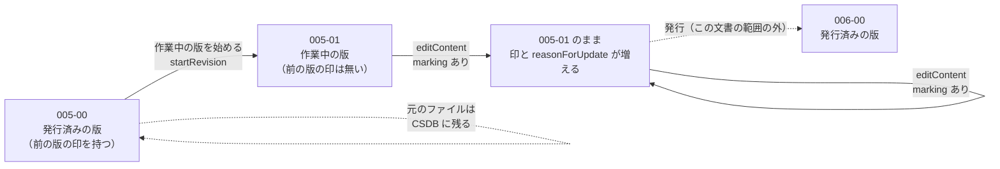

# 既にある DM の改版（層 2）（案）

s1000d-core と s1000d-writer-mcp に、発行済みのデータモジュール（DM）を作業中の版に進め、構造を変える編集に変更の印を付ける操作を足すための設計です。

- 状態: **案**（2026-11-17 09:25 JST）。実装していません。「決めること」は、どれも利用者の決定を待っています
- 前提の決定: D-19（決定論的に確かめられることは core が行う）、D-31（既にある DM は元の XML を保ったまま直す）、D-32（構造を変える編集は層を分ける。層 1 は版も変更の印も変えない）
- 前提の設計: [core-structural-edit.md](./core-structural-edit.md)（層 1。`editContent` と `edit_data_module`）。変更の印の一般の決まり（Chap 3.9.5.2.1.1 の Para 1〜2.4.2）は、その文書の「版と変更の印の決まり」にあります。この文書には、足りなかった分だけを書きます

> [!WARNING]
> 仕様書の文章は写していません。決まりは自分の言葉で書き、章の番号を添えています。仕様書の表は、PDF から取り出した文章で読みました。Chap 3.9.5.1 の Table 3 だけは、PDF のページを画像にして目で確かめました。

## 目的

層 1 の `editContent` は、版も変更の印も変えません。発行済みの DM（`inWork` が `00`）は、利用者が明示したときだけ書き換えます。S1000D の決まりに沿って発行済みの DM を直すには、次の 2 つが足りません。

| 足りないもの | 内容 |
|---|---|
| 作業中の版を始める操作 | `inWork` を上げ、新しいファイル名で書き、前の版の変更の印を消す |
| 変更の印を付ける指定 | 足した要素・取り除く要素に `changeType`・`changeMark`・`reasonForUpdateRefIds` を付け、識別・状態部に `reasonForUpdate` を足す |

## 範囲

| 区分 | 内容 |
|---|---|
| 扱う | 作業中の版を始める操作。層 1 と同じ対象（手順、段落、警告・注意・注記、リストの項目）の insert・remove・move に変更の印を付ける指定 |
| 扱わない | 発行（`inWork` を `00` に戻し、`issueNumber` を上げる）。「決めること」の R-6 |
| 扱わない | 文の一部の変更（`changeInline`）。文だけを直す経路を決めるときに扱う |
| 扱わない | 表・図への変更の印（Para 2.5・2.6）。対象の節点を表の行・図に広げるときに扱う。決まりは下に書いておく |
| 扱わない | DM の削除と復帰（`issueType` の `deleted`・`rinstate-*`） |

## 仕様書と既定 BREX で確かめたこと（2026-11-17 09:22 JST）

読んだのは、Issue 7 の仕様書の Chap 3.9.5.2.1.1（変更の印）の全体（Para 1〜2.7。Para 2.5〜2.7 はこの回に読みました）、Chap 3.9.5.1 の `issueType` の説明と Table 2・Table 3、既定 BREX の BREX-S1-00013・00030〜00034・00036・00038〜00044 の `objectPath` です。XSD は `proced.xsd`（`xml_schema_flat`）を見ました。

### 1. 版と `issueType`

| 項目 | 決まり | 出どころ |
|---|---|---|
| `issueType` の値 | `new`・`changed`・`deleted`・`revised`・`status`・`rinstate-changed`・`rinstate-revised`・`rinstate-status` の 8 つ | `proced.xsd` の `issueTypeAttType`、Chap 3.9.5.1 |
| `changed` | 変更があり、変更の印で示している DM | Chap 3.9.5.1 |
| `revised` | 改訂したが、変更の印を持たない DM | Chap 3.9.5.1 |
| `status` | 識別・状態部だけを更新した DM | Chap 3.9.5.1 |
| `new` を使える版 | `issueNumber` が `000`、または `001-00` のときだけ。それ以外の版で `new` は違反。逆に、`000` と `001-00` で `new` 以外も違反 | BREX-S1-00030（機械で判定する禁止ルール。S1000D 自身の BREX の DM は除く） |
| 変更の印を持てる `issueType` | `changed`・`rinstate-changed`・`status`・`rinstate-status` だけ | BREX-S1-00036（機械で判定する）。発行済みの版（`inWork` が `00`）については BREX-S1-00032 も同じ |
| `revised` と変更の印 | `issueType` が `revised`・`rinstate-revised` の DM の内容部に、変更の印があってはならない | BREX-S1-00033（機械で判定する） |
| `reasonForUpdate` が要る DM | `issueNumber` が `000`・`001` でなく、`issueType` が `changed` でない DM に、`reasonForUpdate` が 1 つも無いと違反 | BREX-S1-00038（機械で判定する） |
| 文や要素を変えたとき | 要素全体の変更でも、文の一部の変更でも、`issueType` は `changed` にする | Chap 3.9.5.2.1.1 Para 2.4 |

> [!IMPORTANT]
> **仕様書の表と既定 BREX が食い違っています。** Chap 3.9.5.1 の Table 3 は、`001-01`・`001-02`・`001-NN`（最初の発行の後の作業中の版）の `issueType` を `new` と書いています。`002-00` で `changed`（例）になります。PDF の 421 ページを画像にして目で確かめたので、文章の取り出しの崩れではありません（2026-11-17 09:47 JST）。一方、既定 BREX の BREX-S1-00030 の `objectPath` は、`issueType="new"` で、版が `000-NN` でも `001-00` でもない DM を違反にします。`001-01` で `new` の DM は、表には合い、既定 BREX には違反します。
>
> どちらに合わせるかは、core が決められません（R-1）。`dmStatus` に `issueType` の属性を書かなければ、BREX-S1-00030 の `objectPath` はどちらの条件にも当たりません（評価フォルダーの `work/EDIT-1/` の `001-01` の DM がこの形で、BREX は `passed` でした）。ただし、これは属性が無いために条件に当たらないだけで、決まりに合っていることにはなりません。

### 2. 変更の印の一般の決まり（層 1 の文書に無かった分）

| 項目 | 決まり | 出どころ |
|---|---|---|
| `changeMark` | `1` は、変更を示す表示（変更線など）を出す意図。`0` と、属性が無いときは、出さない | Para 2.4.1 |
| `changeType` が無く `changeMark` だけがあるとき | 追加として扱われる | Para 2.4.1 |
| `modify` の要素の中 | `add`・`modify`・`delete` の印を持つ要素を含んでよい | Para 2.4.1 |
| `add`・`delete` の要素の中 | 子に印を付けなくてよい。付けても、表示する側は無視する | Para 2.4.1 |
| 同じ理由の変更が複数の要素にあるとき | どの要素も、同じ `reasonForUpdate` の `id` を指す。理由が違えば、別の `reasonForUpdate` を指す | Para 2.1.3 |
| `reasonForUpdate` の子 | `simplePara`・`simpleRefPara`。1 つの `reasonForUpdate` の中に段落を並べて、変更を 1 つずつ書き分ける使い方はしない | Para 2.2 |
| `updateReasonType` | `urt01` 編集上の変更（この理由に結び付く変更の印があってはならない）、`urt02` 技術的な変更（印が要る）、`urt03` マークアップだけの変更、`urt04` 適用性だけの変更、`urt05` 参照だけの変更。属性が無ければ、技術的な変更として扱われる。値はプロジェクトが設定できる（XSD の列挙は `urt01`〜`urt99`） | Para 2.2、`proced.xsd` |
| `updateHighlight` | `1` は、その理由をハイライトの DM に載せる | Para 2.2、BREX-S1-00039（機械では判定しない） |
| `reasonForUpdate` の位置 | `dmStatus` の子。`skillLevel` の後ろ、`productSafety`・`remarks` の前。0 個以上 | `proced.xsd` |

### 3. 警告と注意（Para 2.7）

警告（`warning`）と注意（`caution`）の変更の印は、警告・注意の全体に付けます。中の語や段落（`warningAndCautionPara`）には付けません。利用者が警告・注意を全部読む必要があるためです。

設計への影響: 警告・注意の中身を変える編集に印を付けるときは、印を付ける先が、編集した要素ではなく、それを含む `warning`・`caution` になります（`changeType="modify"`）。層 1 は警告・注意の中に節点を足せないので、最初の版でこれが起きるのは、警告・注意そのものを足す・取り除く場合だけです。

### 4. 表（Para 2.5）と図（Para 2.6）

層 2 の最初の版では扱いません。対象を広げるときのために、決まりを書いておきます。

| 対象 | 印の付け方 | プロジェクトが決めること |
|---|---|---|
| 表 | 5 通り。表の全体だけ／題名だけ／表の全体と題名／行だけ／行と題名。表と題名を別の理由で変えたときは、`table` と `title` の両方に、別の `reasonForUpdate` を指す印を付ける | どの付け方を使うか（BRDP-S1-00092） |
| 図 | 3 通り。図だけ／題名だけ／図と題名。図の題名は必須なので、題名だけを足す・取り除くことはできない（図ごと足す・取り除く） | どの付け方を使うか（BRDP-S1-00093） |
| 複数のシートを持つ図 | `figure` に印を付けたら、その中の `graphic` には付けない。シートごとに示すなら `graphic` に付け、`figure` には付けない | BREX-S1-00043（機械で判定する） |
| 取り除く表・行・題名・図 | `changeType="delete"` を付けて、要素を残す | Para 2.5・2.6 の例 |

### 5. 移動

Chap 3.9.5.2.1.1 の全体を読みましたが、要素を移したときの印の付け方は書かれていません。`changeType` の値は `add`・`modify`・`delete` の 3 つです。手順の並べ替えについての記述が、ほかの章（手順 DM の章など）にあるかは確かめていません。

## Bike Samples の実測（2026-11-17 09:21 JST、DMC 106 件。XML を直接数えた）

| 測ったもの | 値 |
|---|---|
| `dmStatus/@issueType` | `changed` 60、`status` 30、`new` 10、`revised` 3、`deleted` 3 |
| `issueType="new"` の 10 件の版 | `001-00` が 1 件、`002-00` が 9 件 |
| `reasonForUpdate/@updateReasonType` | `urt03` 97、`urt01` 19、`urt02` 4 |
| `changeType` を持つ DM | 3 件（層 1 の文書の実測。要素は `wire`・`electricalEquip`・`graphic`） |
| `inWork` が `00` でないファイル | 0 件（層 1 の文書の実測） |

`002-00` で `issueType="new"` の 9 件は、仕様書の本文（`002` からは `new` にしない。Chap 3.9.5.1）にも、BREX-S1-00030 の条件にも合いません。配布物のサンプルが、版の決まりの手本になるとは限りません。`verify_csdb` の BREX の違反（10 件の DM に 18 個）のうち、どれがこれに当たるかは確かめていません。

> [!NOTE]
> Bike Samples には、作業中の版（`inWork` が `00` でない）の DM が 1 件もありません。作業中の版を始める操作のテストは、Bike Samples の発行済みの DM から自分で作った結果を、XSD と既定 BREX で確かめる形になります。

## いまの core の状態（2026-11-17、0.13.0）

| 項目 | 状態 |
|---|---|
| `editContent` | 版も変更の印も変えない。`inWork` が `00` なら `released-issue` で断る |
| `buildDataModule` の `issuePolicy` | `increment-issue`・`increment-inwork`・`keep`。新しく組み立てる DM の版を決めるだけで、既にある DM の XML は直さない |
| `applySegments` の `issueInfo` | 渡したときだけ、`issueNumber`・`inWork` を書き換える |
| `dmStatus/@issueType` | `src/write/` に、この属性を書くコードは無い（`issueType` で検索して 0 件） |
| `reasonForUpdate`・`changeType`・`changeMark` | 書くコードは無い。`src/edit/` は、`reasonForUpdateRefIds` を「`id` を指す属性」の 1 つとして見る（取り除く `id` が指されていないかの確認）ほかは、変えないことを知らせる文の中でだけ触れている |

reader の応答（2026-11-17 09:46 JST。dev の reader-mcp で、Bike Samples の `…D00-00-00-00AA-040A-A_011-00` を `section: "all"` で読んだ。この DM は、`reasonForUpdate` 1 つと、`changeType`・`changeMark`・`reasonForUpdateRefIds` を持つ `graphic` 2 つを持つ）:

| 項目 | 応答 |
|---|---|
| `dmStatus/@issueType` | 返す（`identAndStatus.issueType` が `changed`） |
| 識別・状態部の `reasonForUpdate` | 返さない（`id`・`updateReasonType`・文のどれも、応答に無い） |
| `graphic` の `changeType`・`changeMark`・`reasonForUpdateRefIds` | 返さない（図の節点の `refs` に、ICN だけが入る） |
| 返していないことの知らせ | 無い（`content.notReadElements` と `content.unknownElements` は空） |

core の `src/content/read.ts` には、`changeType`・`changeMark`・`reasonForUpdate` を読むコードがありません（検索して 0 件）。段落や手順に付いた変更の印も、同じく返らないと見ています（Bike Samples には、段落・手順に印を持つ DM が無いので、応答では確かめていません）。

> [!IMPORTANT]
> 変更の印と更新の理由は、D-31 の「読む側は落とさない」に当たらないまま残っています。層 2 では、印を付けた結果を reader で読んで確かめる手順が要るので、core の読み取り（`IdentAndStatus` に `reasonForUpdate`、`ContentNode` と `ContentRef` に変更の印）を先に足します。Skill `s1000d-review` が変更の印を見られないことも、同じ原因です。

## 案

### 版の流れ

層 2 の間、`inWork` は作業中の版を始めるときに 1 度だけ上げます。編集のたびに `inWork` を上げるかどうかは、R-7 で決めます。

### 操作 1: 作業中の版を始める（仮称 `startRevision`）

| 項目 | 案 |
|---|---|
| 入力 | DM の XML、`issueType`（`changed`・`revised`・`status` のどれか。`001-00` から始めるときは `new` も。必須。core は決めない。R-1） |
| 断る場合 | `inWork` が `00` でない（既に作業中の版）。`issueType` が `deleted`（復帰は範囲の外） |
| `issueInfo` | `issueNumber` はそのまま、`inWork` を `01` にする |
| `issueType` | 入力の値にする |
| 前の版の変更の印 | 内容部と識別・状態部から、`changeType`・`changeMark`・`reasonForUpdateRefIds` の属性を取り除く。`changeInline` は、中身を残してタグだけを取り除く。`changeType="delete"` の要素の扱いは R-2 |
| 前の版の `reasonForUpdate` | 取り除く（R-2 と一緒に決める） |
| ファイル名 | 新しい版の名前（`…_005-01_EN-US.XML`）を返す。元のファイルは変えない（前の版は、その版の印を持ったまま CSDB に残る。Para 2.1.1） |
| 文字列の保ち方 | 層 1 と同じ。属性を取り除く・書き換える範囲だけを書き換える。開始タグの中の属性を 1 つ書き換える操作は、要素の範囲の関数（`src/xml/ranges.ts`）に足す |
| 変えないもの | `issueDate`、`qualityAssurance`、本文の文と構造 |

### 操作 2: `editContent` に変更の印を付ける指定（仮称 `marking`）

`EditContentOptions` に `marking` を足します。渡さなければ、層 1 と同じ動き（印を付けない）です。

| 項目 | 案 |
|---|---|
| `marking.reason` | `reasonForUpdate` 1 つ分。`text`（`simplePara` の文。必須）、`updateReasonType`（必須。R-4）、`updateHighlight`、`id`（省略時の扱いは R-5） |
| `marking.changeMark` | `"1"` か `"0"`（R-5） |
| 断る場合 | `inWork` が `00`（作業中の版を先に始める）。`issueType` が `changed`・`rinstate-changed`・`status`・`rinstate-status` でない（BREX-S1-00036 に当たる結果を作らない）。`updateReasonType` が `urt01`（編集上の変更に印は付けない。Para 2.2） |
| `insert` | 足した要素に `changeType="add"` と `changeMark`・`reasonForUpdateRefIds` を付ける。子には付けない |
| `remove` | 要素を取り除かず、`changeType="delete"` と `changeMark`・`reasonForUpdateRefIds` を付けて残す。その要素（子孫を含む）の `id` を指す参照が残っていれば、層 1 と同じに `id-referenced` で断る（Para 2.4.1、BREX-S1-00041・00042） |
| `remove` の例外 | 取り除く要素が、この作業中の版で足したもの（`changeType="add"` を持つ）なら、印を付けずに取り除く。印は前の発行済みの版からの差を表すので、前の版に無かった要素は、取り除けば差が無くなる（Para 2.1.1） |
| `add`・`delete` の要素の中への編集 | 印を付けない（親の印が含む。Para 2.4.1） |
| `move` | R-3 |
| `reasonForUpdate` | `dmStatus` の中の、XSD が決める位置に 1 つ足す。同じ呼び出しの編集は、すべてこの 1 つを指す。理由が違う編集は、呼び出しを分ける |
| 警告・注意 | 印は `warning`・`caution` の全体に付く（Para 2.7）。最初の版の対象では、警告・注意そのものの insert・remove だけなので、上の決まりのとおりになる |

### writer-mcp

| 項目 | 案 |
|---|---|
| 作業中の版を始める | 新しいツール（仮称 `start_revision`）。`path`・`issueType`・`write`。`write: true` で、新しい版のファイルを CSDB に書く（同じ名前があれば `write-conflict`）。元のファイルは変えない。書く前後に検証し、XSD のエラーが増えたら書かない |
| 変更の印 | `edit_data_module` の入力に `marking` を足す。`marking` を渡したときは、`allowReleasedIssue: true` があっても、発行済みの版を断る |
| 応答 | `changes[]` に、付けた印（要素の場所、`changeType`、指した `reasonForUpdate` の `id`）を入れる |
| Skill | `s1000d-publish` の `references/edit.md` の E1 を分ける。発行済みの版のとき、「版を変えずに書き換える（層 1）」「作業中の版を始めて、変更の印を付ける（層 2）」「やめる」を利用者に聞く。技術的な変更か編集上の変更かも、利用者に聞く（Skill は決めない） |

## 決めること

| # | 項目 | 選択肢 | 提案 |
|---|---|---|---|
| R-1 | 作業中の版を始めるときの `issueType` | A: 入力で必ず受け取る（`changed`・`revised`・`status`）／B: 変えず、最初に印を付けたときに `changed` にする | A。変更の種類は書き手が知っていて、core は決められない。`001-00`（`new`）から始めるときだけは、仕様書の Table 3（`new` のまま）と既定 BREX の BREX-S1-00030（`new` は違反）が食い違うので、`new` のままにする値も入力で選べるようにし、選んだ結果が既定 BREX に違反することを応答で知らせる。`002` 以降の版から始めるときは、食い違いは無い |
| R-2 | 前の版の印を、いつ、どこまで消すか | A: 作業中の版を始めるときに、印の属性・`changeInline` のタグ・`reasonForUpdate` を消し、`changeType="delete"` の要素は取り除く／B: 属性と `reasonForUpdate` だけを消し、`delete` の要素は残して知らせる／C: 発行のときに消す | A。ただし、`delete` の要素を取り除くことは、読んだ範囲の仕様書に明記されていない（「前の版で示した変更は、版を上げるときに消す」という決まりからの解釈）。取り除く要素の `id` を指す参照が残っていれば断る |
| R-3 | `move` の変更の印（層 1 の文書の 3-3） | A: 印を付ける編集では `move` を断る／B: 同じ親の中の移動は、親の要素に `changeType="modify"` を付ける。親が変わる移動は断る（利用者が remove と insert で指定する）／C: 元の場所に `delete` の印を付けた写しを残し、行き先に `add` で足す | B。仕様書に移動の決まりは無い。C は、同じ `id` を持つ要素が 2 つになり、XSD の ID の重複になる（元の側の `id` を外すと、参照の行き先が変わる）。B の親（`mainProcedure`・`proceduralStep`・`sequentialList`・`randomList`）は、`proced.xsd` で変更の印の属性を持てる。`levelledPara` が持てるかは `descript.xsd` で確かめる |
| R-4 | 技術的な変更か、編集上の変更か | A: `updateReasonType` を必須の入力にする／B: 省略を許し、省略時は属性を書かない（仕様書では技術的な変更として扱われる） | A。値を補わない（D-31）。編集上の変更（`urt01`）は、`marking` を渡さずに層 1 の動きで編集し、`reasonForUpdate` だけを足す入口を別に用意するかは、実装のときに決める |
| R-5 | `changeMark` と `reasonForUpdate/@id` の既定 | A: どちらも必須の入力／B: `changeMark` は必須、`id` は省略時に core が文書に無い値を作る（`rfu-0001` の形） | B。`id` は文書の中の結び付けにだけ使う値で、書き手が意味を持たせない。`changeMark` は、表示するかどうかをプロジェクトが決める（BREX-S1-00044 は機械で判定しないルール） |
| R-6 | 発行の操作（`inWork` を `00` に戻し、`issueNumber` を上げる）を層 2 に入れるか | 入れる／入れない | 入れない。`issueDate`、`qualityAssurance`、DML の更新が関わり、CSDB の運用（版・状態・権限）の設計になる |
| R-7 | 作業中の版の間、編集のたびに `inWork` を上げるか | A: 上げない（`start_revision` の 1 度だけ）／B: `edit_data_module` の `write: true` のたびに上げ、新しいファイルを書く | A。B は、1 つの改版でファイルが編集の回数だけ増える。作業の途中の保存の単位は、CSDB の運用が決める |
| R-8 | 表・図の印（Para 2.5・2.6）をいつ扱うか | 層 2 の最初の版に入れる／対象の節点を表の行・図に広げるときに扱う | 広げるときに扱う。付け方（BRDP-S1-00092・00093）は、入力で選んでもらう |

## 確かめること（未読・未測）

| 項目 | 内容 |
|---|---|
| Chap 3.5（データモジュールの更新） | 層 1 の設計のときに Para 2.3.1 を読んだ。作業中の版を始めるときに `issueDate` と `qualityAssurance` をどうするか、`delete` の印の要素を次の版でどうするかの記述があるかを、読み直して確かめる |
| 手順の並べ替えの記述 | 手順 DM の章など、Chap 3.9.5.2.1.1 のほかに、移動・並べ替えの印についての記述があるか |
| `descript.xsd` | `levelledPara`・`para` の親になる要素が、変更の印の属性を持てるか |
| Bike Samples の `002-00` で `new` の 9 件 | BREX-S1-00030 の違反として `verify_csdb` に出ているか |
| 仕様書の Table 3 と BREX-S1-00030 の食い違い | 仕様書のほかの版（Issue 6 など）の同じ表と既定 BREX に、同じ食い違いがあるか |
| `buildDataModule` と `issueType` | `issuePolicy` で版を上げた DM に `issueType` を書いていない。`002-00` 以降の DM が既定 BREX に通るかを確かめる（この文書の範囲の外だが、同じ決まりに関わる） |

## テスト（案）

| 種類 | 内容 |
|---|---|
| 自作の DM | 変更の印と `reasonForUpdate` を持つ発行済みの DM から作業中の版を始め、印が無くなり、触っていない範囲が元の文字列と一致することを確かめる |
| 配布物（Bike Samples） | `changeType` を持つ 3 件と、`reasonForUpdate` を持つ 97 件で作業中の版を始め、結果が XSD で `valid` のままであること、既定 BREX の違反が増えないことを確かめる |
| 配布物（Bike Samples） | 手順 DM で作業中の版を始めた後に、`marking` 付きで手順を足す・取り除く編集を行い、XSD で `valid`、既定 BREX の BREX-S1-00030・00032・00033・00036・00038 に当たらないことを確かめる |
| plugin 経由 | 層 1 と同じに、Skill の手順どおりに 1 件を通す。自作のテストと Bike Samples だけで済ませない |
