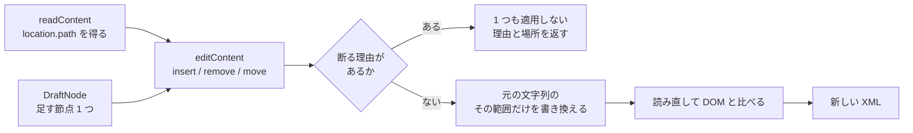

# 既にある DM の構造を変える編集

s1000d-core に、CSDB にあるデータモジュール（DM）の手順を足す・段落を削る・順を入れ替える操作を足すための設計です。

- 状態: **層 1 は公開済み**（2026-11-17。core 0.13.0、writer-mcp 0.5.1、reader-mcp 0.12.0、Skill `s1000d-publish` 0.3.1）。「決めること」の 1・2・4・5 は 2026-11-17 03:54 JST に、3-1・3-2 は 03:59 JST に、利用者が提案どおりと決めました。3-3 は層 2 の設計のときに決めます。実装で案から変えた点は「実装の結果」に、公開の後に分かった制約は「手順の段落に場所が付かない」にあります
- 層 2（改版）の設計: [core-revision.md](./core-revision.md)
- 前提の決定: D-19（決定論的に確かめられることは core が行う）、D-27（書く処理も core に置く）、D-31（既にある DM は元の XML を保ったまま直す。読んだ木を下書きに写して作り直さない）
- 関連: [core-preliminary-rqmts.md](./core-preliminary-rqmts.md) の「3 つの経路」、[writer-mcp.md](./writer-mcp.md) の `apply_fixes`

## 目的

D-31 で、既にある DM の編集は「元の XML への操作」として行うと決めました。いま core にある操作は次の 2 つで、どちらも要素を足したり削ったりする編集には使えません。

| 操作 | できること | できないこと |
|---|---|---|
| `applyFix` | 検証で見つかった問題に、core が決めた候補を適用する | 利用者が決めた内容の追加・削除 |
| `applySegments` | 文を訳文に差し替える | 要素の追加・削除・移動 |

この文書は、3 つ目の操作（仮称 `editContent`）の形を決めます。

## 範囲

| 区分 | 内容 |
|---|---|
| 扱う | 既にある DM の本文に、節点を足す（insert）、節点を削る（remove）、節点を移す（move） |
| 扱わない | 文だけを直す編集（`applySegments` を同じ言語で使う経路。版と変更の印の扱いを確かめていないので、別に決める） |
| 扱わない | 検証の問題の修正（`applyFix`）、新しい DM の作成（`buildDataModule`） |
| 扱わない | 識別・状態部（`identAndStatusSection`）の編集。版の更新は「決めること 3」 |

## いまの core の実測（2026-11-17）

### 1. `applyFix` と `applySegments` が保っているもの

どちらも、`@xmldom/xmldom` で読み、DOM を変え、文書要素の全体を `XMLSerializer` で文字列に戻します。文書要素より前（XML 宣言、DOCTYPE の内部サブセット）は、元の文字列をそのまま付け直します（`src/xml/serialize.ts` の `serializeKeepingProlog`）。

Bike Samples の DMC 106 件と PMC 4 件を、何も変えずに読んで `serializeKeepingProlog` で戻し、元の文字列と比べました。

| 測ったもの | 値 |
|---|---|
| 元と同じ文字列に戻ったファイル | 110 件のうち 0 件 |
| `diff` で元の側から消える行 | 91,215 行のうち 26,258 行（29 %） |

確かめた原因は、開始タグの属性の並べ方です。Bike Samples は属性を 1 行に 1 つずつ書いていて、xmldom は属性の間の改行を空白 1 つにします。ほかの原因（空要素のタグの書き方、文字参照など）の内訳は数えていません。

> [!IMPORTANT]
> いまの 2 つの操作は、要素・属性・文は保ちますが、文字列は保ちません。Bike Samples の書き方の DM では、属性を 1 つ直すだけで、ファイルの行の約 3 割が変わります。Git の差分やレビューで、直した場所が見つけにくくなります。

### 2. 設計に使える既存の部品

| 部品 | 場所 | 使い道 |
|---|---|---|
| `ContentNode.location`（`path`・`line`・`column`） | `src/content/types.ts` | 編集する場所を指す。core の `readContent` が返す `location.path` をそのまま渡せる。reader-mcp の `read_data_module` は、`includeLocation: true` を渡したときだけ応答に `location` を入れる（reader-mcp 0.12.0。下の「reader-mcp の `includeLocation`」） |
| `Writer` の `para`・`proceduralStep`・`admonition`・`listEl`・`table`・`figure` | `src/write/content/common.ts` | 足す節点（`DraftNode`）から要素を組み立てる |
| `XsdIndex.allowedChildren` | `src/fix/xsd-index.ts` | その親に、その要素を、その位置に置けるかを確かめる |

### 3. 変更の印（XSD で確かめたこと）

Issue 7 の `proced.xsd` に、次の定義があります。core には、これらを読む・書くコードがありません（`src/content/read.ts`・`src/write/build.ts`・`src/write/content/common.ts` を `changeMark`・`changeType`・`reasonForUpdate` で検索して 0 件）。

| 定義 | 内容 |
|---|---|
| `changeAttGroup` | 属性 `changeType`（`add`・`delete`・`modify`）、`changeMark`、`reasonForUpdateRefIds`（IDREFS） |
| `reasonForUpdate` | `id`・`updateReasonType`・`updateHighlight` の属性と、`simplePara` を持つ要素 |

### 4. 版と変更の印の決まり（Issue 7 の仕様書で確かめたこと、2026-11-17 04:05 JST）

読んだのは、Chap 3.5（データモジュールの更新）、Chap 3.9.5.1 の `issueInfo` の説明、Chap 3.9.5.2.1.1（変更の印）の Para 1〜2.4.2、既定 BREX の BREX-S1-00013・00036・00038〜00044 です。表・図・警告と注意の特別な決まり（Chap 3.9.5.2.1.1 の Para 2.5〜2.7）は、このときは見出しだけを見て、中身は読んでいません（2026-11-17 09:22 JST に読み、[core-revision.md](./core-revision.md) に書きました）。

| 項目 | 仕様書の決まり | 出どころ |
|---|---|---|
| 発行済みの版 | `inWork` は `00`。発行のたびに `issueNumber` を 1 つ上げる | Chap 3.5 Para 2.3.1、Chap 3.9.5.1 |
| 作業中の版 | 発行済みの DM を直し始めると、`issueNumber` はそのままで `inWork` が `01` になる。発行していない DM を変えるたびに `inWork` を上げる | Chap 3.9.5.1 の `issueInfo` の例 |
| 印を付けてよい DM | `issueType` が `changed`・`rinstate-changed`・`status`・`rinstate-status` のものだけ。`new` の DM には付けない | BREX-S1-00036（機械で判定する禁止ルール） |
| 印を付ける変更 | 技術的な変更だけ。編集上の変更（言い回しの直しなど）には付けない | Chap 3.9.5.2.1.1 Para 2.1.1、BREX-S1-00044（`allowedObjectFlag="2"` のルール。違反を機械では判定しない） |
| 印の基準 | 前の版（`issueNumber`）からの変更に付ける。`inWork` の間の変更には付けない。次の版に上げるときは、前の版の印を消す | 同 Para 2.1.1 |
| 理由との結び付け | 印を付けた要素は、識別・状態部の `reasonForUpdate` を `reasonForUpdateRefIds` で指す | 同 Para 2.1.2〜2.1.3 |
| 足した要素 | `changeType="add"`。子の要素には付けなくてよい | 同 Para 2.4.1 |
| 削った要素 | `changeType="delete"` を付ける（仕様書の例は、`table`・`row`・`title` に付けて要素を残している）。その要素への参照が残っていてはならない | 同 Para 2.4.1、BREX-S1-00041・00042（`allowedObjectFlag="2"` のルール。違反を機械では判定しない） |
| 直した要素 | 要素全体は `changeType="modify"`。文の一部は `changeInline`（要素全体の追加・変更には使わない） | 同 Para 2.4.1〜2.4.2、BREX-S1-00040 |
| 移した要素 | `changeType` の値は `add`・`modify`・`delete` の 3 つで、移動を表す値は無い。読んだ範囲に、移動の印の付け方は書かれていない | `proced.xsd`、同 Para 2.4.1 |
| プロジェクトが決めること | 理由の文を定型にするか、作業中に `reasonForUpdate` を使うか、製品の構成で理由を分けるか | BRDP-S1-00089〜00091 |

Bike Samples の DMC 106 件の実測は次のとおりです。

| 測ったもの | 値 |
|---|---|
| `changeType` を持つ DM | 3 件（要素は 14 個: `wire` 10、`electricalEquip` 2、`graphic` 2。値は `add` 11、`modify` 3） |
| `changeInline` | 0 個 |
| `reasonForUpdate` | 97 件に 124 個 |
| `inWork` が `00` でないファイル | 0 件（すべて発行済みの版） |

設計への影響は 3 つあります。

1. **「削る」に 2 つの形がある。** 要素を取り除く形と、`changeType="delete"` を付けて残す形です。どちらにするかは、DM が発行済みかどうかと、変更が技術的かどうかで決まります。技術的かどうかは書き手の判断で、core は決められません。
2. **発行済みの DM（`inWork` が `00`）を、版を変えずに書き換えるのは、仕様書の版の決まりに合わない。** ファイル名にも版が入っている（`…_005-00_EN-US.XML`）ので、直した結果は `…_005-01_…` という別のファイルになります。
3. **移動の印は、core が決められない。** 仕様書に付け方が無いので、印を付ける編集では `move` を断るか、利用者に付け方を選んでもらう必要があります。

## 案

### 操作

| 操作 | 入力 | 動き |
|---|---|---|
| `insert` | 基準の節点の `path`、位置（`before`・`after`・`first-child`・`last-child`）、足す節点（`DraftNode` 1 つ） | `Writer` で要素を組み立て、その位置に入れる |
| `remove` | 削る節点の `path` | その要素を、子孫ごと取り除く |
| `move` | 移す節点の `path`、行き先の `path` と位置 | 要素を、中身を変えずに行き先へ移す |

節点 1 つを別の内容に置き換える操作（replace）は、最初の版に入れません。置き換えは、reader が読んでいない属性や下書きに書けない構造を落とすので、D-31 でやめた「作り直す」と同じ結果になるためです。

### 決まり

| 項目 | 決まり |
|---|---|
| 場所の指し方 | `edits[]` の `path` は、すべて編集の前の文書の `location.path` で書く。core は最初に全部の場所を見つけてから適用する（前の編集で番号がずれることを、呼ぶ側が計算しなくてよい） |
| 全部か無しか | 1 つでも断る理由があれば、1 つも適用しない。断った編集ごとに、理由と場所を返す |
| 足す節点 | `DraftNode` で渡す。XML の文字列は受け取らない（LLM が XML を書かない、という Skill の原則と同じ）。書ける構造は `buildDataModule` と同じ部分集合 |
| 値を補わない | 足す節点に `id` が無ければ、`id` を付けない。検証を通すための要素も足さない |
| XSD の確認 | 親がその要素をその位置に受け取れるかを `XsdIndex` で確かめる。XSD が無ければ確かめずに適用し、`notes` に書く |
| 適用の後の検証 | core の `editContent` は検証しない。writer-mcp のツールが、`apply_fixes` と同じように検証し直して `verification` を返す |

### 断る理由

| 理由 | 起きるとき |
|---|---|
| `location-not-found`・`location-ambiguous` | `path` が 0 個か 2 個以上の節点を選ぶ |
| `not-allowed-here` | XSD で、その親がその要素をその位置に受け取れない |
| `parent-would-be-invalid` | 削ると、親が XSD の求める子を失う（例: 手順が 1 つしか無い `mainProcedure` から、その手順を削る） |
| `id-referenced` | 削る節点（子孫を含む）の `id` を、残る部分の `internalRef` などが指している。指している場所の `path` を返す |
| `id-duplicate` | 足す節点の `id` が、文書に既にある |
| `unsupported-node` | 最初の版の対象でない種類の節点 |
| `move-into-self` | 移す節点の中に、行き先がある |

別の DM からの参照（`dmRef/@referredFragment` が、削る節点の `id` を指している場合）は、core の `editContent` では確かめません。DM 1 件の文字列だけを受け取る関数だからです。writer-mcp のツールが CSDB を調べて、応答で知らせます。

### 対象の節点（最初の版）

| 対象 | S1000D の要素 | 理由 |
|---|---|---|
| 手順 | `proceduralStep` | 依頼の例（手順を足す、入れ替える）の中心 |
| 段落 | `para`、`levelledPara` の中の段落 | 依頼の例（段落を削る） |
| 警告・注意・注記 | `warning`・`caution`・`note` | 手順の前に足す依頼が多いと見込む |
| リストの項目 | `listItem` | 段落と同じ頻度で直す |

表の行、図、`preliminaryRqmts` の品目、プロセス DM と故障探求 DM の節点は、次の版にします。

### 文字列の保ち方

「いまの core の実測」の 1 のとおり、DOM を直列化し直す方法では、触っていない行も変わります。構造を変える編集では、次の方法を提案します。

1. xmldom が返す要素の開始位置（行と列）から、元の文字列の中の位置を求める
2. 開始タグから対応する終了タグまでを小さな走査器でたどり、要素の範囲（開始と終了の位置）を求める。コメント、CDATA、処理命令は読み飛ばす
3. 編集は、元の文字列の範囲に対して行う

| 操作 | 文字列への操作 |
|---|---|
| `insert` | 組み立てた要素を直列化し、基準の要素の前後に入れる。字下げは、基準の要素の行頭の空白を写す |
| `remove` | 要素の範囲と、その前の空白（行頭から要素まで）を削る |
| `move` | 要素の範囲の文字列を切り取り、行き先に入れる。**移した要素の中身は 1 文字も変わらない** |

安全のために、文字列を書き換えた結果を読み直し、DOM で同じ操作をした結果と節点ごとに比べます。違っていたら適用せず、`internal-mismatch` で断ります。

### テスト

| 種類 | 内容 |
|---|---|
| 自作の DM | 属性を複数行に書いた DM で insert・remove・move を行い、編集した範囲の外が元の文字列と一致することを確かめる |
| 配布物（Bike Samples） | 対象の要素すべてで、走査器が求めた範囲の文字列を読むと、xmldom の同じ節点と同じ要素になることを確かめる |
| 配布物（Bike Samples） | 手順 DM の全件で、最後の手順を先頭に移し、元の位置に戻すと、元の文字列に戻ることを確かめる |

### 公開の形と順序

| 順 | 作るもの | 内容 |
|---|---|---|
| 1 | core: 要素の範囲を求める走査器 | 配布物のテストで、範囲の対応を固定する |
| 2 | core: `editContent` の `remove` と `move` | 足す節点の組み立てが要らないので先に作る |
| 3 | core: `insert` | `Writer` を、文書の一部を組み立てる用途で使えるようにする |
| 4 | writer-mcp: ツール（仮称 `edit_data_module`） | `write: false` が既定。変わった範囲、検証の結果、別の DM からの参照を返す |
| 5 | Skill | `s1000d-publish` の「CSDB にある DM を直したいと頼まれたとき」に行を足すか、別の Skill にする |

## 決めること

| # | 項目 | 選択肢 | 提案 |
|---|---|---|---|
| 1 | 文字列の保ち方 | A: いまと同じ（文書要素の全体を直列化し直す）／B: 編集した範囲だけを書き換える | B。D-31 の「触っていない部分を 1 文字も変えない」に、文字列として届くのは B だけ |
| 2 | 最初の版の対象 | 上の 4 種類（手順、段落、警告・注意・注記、リストの項目）／もっと狭く（手順だけ）／もっと広く（表の行、品目も） | 上の 4 種類 |
| 3 | 版と変更の印 | A: `editContent` は版も変更の印も変えない（`apply_fixes` と同じ）／B: 最初の版から `changeType`・`changeMark`・`reasonForUpdate` を書く | 下の「決めること 3 の見直し」。2026-11-17 03:54 JST に利用者は A を採用したが、仕様書を読んでから進めると決めたので、読んだ結果で提案を分け直した |
| 4 | replace を入れるか | 入れない／入れる | 入れない（作り直しと同じ結果になる） |
| 5 | `applyFix`・`applySegments` を B に寄せるか | 寄せる／寄せない／`editContent` の後で決める | `editContent` の後で決める。走査器ができてから、2 つの操作の差分がどれだけ減るかを測って判断する |

### 決めること 3 の見直し（仕様書を読んだ後）

版と変更の印を、2 つの層に分けて作る案です。

| 層 | 内容 | 仕様書に合う使い方 |
|---|---|---|
| 1. 構造の編集（この文書の `editContent`） | insert・remove・move。版も印も変えない。`remove` は要素を取り除く | 印を付けてはならない DM（`issueType` が `new` のもの、まだ発行していないもの）と、編集上の変更 |
| 2. 改版（別の設計文書にする） | 作業中の版を始める操作（`inWork` を上げ、新しいファイル名で書き、前の版の印を消す）と、`editContent` に印を付ける指定を足す（insert は `add`、remove は `delete` を付けて残す、`reasonForUpdate` を足して結ぶ） | 発行済みの DM への技術的な変更 |

層 1 だけの間に、発行済みの DM を渡されたときの扱いを決める必要があります。

| # | 項目 | 選択肢 | 提案 |
|---|---|---|---|
| 3-1 | 層を分けて、層 1 から作るか | 分ける／層 2 まで一度に設計してから作る | 分ける。層 1 の部品（要素の範囲を求める走査器、XSD の確認、`id` の確認）は層 2 でもそのまま使う |
| 3-2 | 層 1 だけの間、`inWork` が `00` の DM を渡されたとき | A: core は適用し、writer-mcp が応答の `notes` で「発行済みの版を、版を変えずに書き換えた。版と変更の印は変えていない」と知らせる／B: writer-mcp が断る（`write: false` の確認だけ許す）／C: 利用者が明示したときだけ適用する（入力に `allowReleasedIssue: true` のような項目） | C。黙って書き換えると、仕様書の版の決まりに合わない DM が CSDB に残る。試作や練習では書き換えたい場合があるので、断り切らない |
| 3-3 | 層 2 での `move` の印 | A: 印を付ける編集では `move` を断る／B: 利用者に選んでもらう（親に `modify`、または元の場所に `delete` と行き先に `add`） | 層 2 の設計のときに決める。それまでに、Chap 3.9.5.2.1.1 の Para 2.5〜2.7 と、手順の並べ替えについての記述がほかの章に無いかを確かめる |

## 実装の結果（2026-11-17 04:30 JST）

「公開の形と順序」の 1〜3（core の分）を実装しました。場所は `src/xml/ranges.ts` と `src/edit/` です。

### 案から変えた点

| 項目 | 案 | 実装 | 理由 |
|---|---|---|---|
| 要素の範囲と DOM の対応 | xmldom が返す行と列から位置を求める | 文書要素から数えた子要素の番号で対応を取る（`rangeOfElement`）。行と列は使わない | タブや CRLF の数え方に頼らずに済む。要素の名前と数が合わない文書は `ranges-unavailable` で断る |
| `allowReleasedIssue` の置き場所 | writer-mcp の入力 | core の `EditContentOptions`。writer-mcp はそのまま渡す | 決定論的に確かめられることは core が行う（D-19） |
| `not-allowed-here` | その親がその要素をその位置に受け取れないとき | 親がその名前の子を取れないとき（`XsdIndex.allowedChildren`）。位置の順序は確かめない | `XsdIndex` は、子の名前の集まりしか返さない。内容モデルの順序は分からない |
| `parent-would-be-invalid` | 削ると親が XSD の求める子を失うとき | 実装していない | 同じ理由。適用の後の XSD の検証で見つかる |
| 足した理由 | — | `released-issue`・`ranges-unavailable`・`unsupported-destination`・`draft-input-error`・`conflicting-edits`・`not-an-element`・`xpath-error` | 実装で必要になった |
| 足す要素の字下げ | 基準の要素の行頭の空白だけを写す | 子が要素だけの要素は、1 行に 1 つずつ字下げして書く。文を含む要素は 1 行で書く | 手順を 1 行に書くと読みにくい |

> [!IMPORTANT]
> XSD の内容モデルの順序（例: `proceduralStep` の中では、警告・注意が段落より前）を core は確かめません。順序の誤りは、writer-mcp の `edit_data_module` が適用の後の XSD の検証で見つけ、その結果を書き込みません（下の「writer-mcp の `edit_data_module`」）。

### 足せる場所と節点

| 基準の親（要素） | 足せる節点（`DraftNode.kind`） |
|---|---|
| `mainProcedure` | `step` |
| `proceduralStep` | `step`・`para`・`admonition`（ほかは最初の版の対象外） |
| `description`・`levelledPara` | `para`・`admonition` |
| `listItem` | `para`・`admonition`（`note` だけ） |
| `sequentialList`・`randomList` | `listItem` |

足せるのは、手順 DM と説明 DM だけです。`warning`・`caution`・`note` の中には足せません（中の段落の要素名が `warningAndCautionPara`・`notePara` で、下書きの `para` と対応しないため）。

### 実測（Bike Samples、core 0.13.0）

| 測ったもの | 値 |
|---|---|
| 要素の範囲が DOM と対応したファイル | 110 件のうち 110 件 |
| 対象の要素を 1 つ取り除く編集（各ファイルで、種類ごとに最初・中央・最後の 1 つ） | すべて、適用できたか `id-referenced` で断ったかのどちらか。`internal-mismatch` は 0 件 |
| トップレベルの手順が 2 つ以上ある手順 DM | 39 件 |
| 最後の手順を 1 つ前の要素の前に移して戻すと、元の文字列と同じになった DM | 39 件のうち 37 件。残りの 2 件は、2 つの要素の間にコメントがあり、コメントの位置だけが入れ替わる（行の集まりは同じ） |
| 最初の手順の後ろに手順を足す | 手順 DM 39 件のすべてで、足した 3 行のほかは元の文字列と同じ（core 0.13.0 で直した後の値。直す前は、`content` の先頭に `refs` などがある DM への `insert` をすべて断っていた。DM の種類を、`content` の最初の子要素だけで決めていたため） |
| vitest | 配布物を使わないもの 316 件（43 件はスキップ）。配布物を使うものは 359 件のうち 351 件を確かめた（`src/write/schema.test.ts` の 8 件は、VM に `schema` フォルダーを写し忘れて実行できなかった。1 つ前の実行では通っている） |

## writer-mcp の `edit_data_module`（writer-mcp 0.5.0・0.5.1）

決定（利用者）:

| 日時（JST） | 決定 |
|---|---|
| 2026-11-17 04:48 | 編集の前には無かった XSD のエラーが出たら、`write: true` でも書き込まず、増えたエラーを返す（案 A） |
| 2026-11-17 09:15 ごろ | 編集で無くなった `id` を、CSDB のほかの DM・PM の `dmRef/@referredFragment` が指しているときは、`referencedFromOtherObjects[]` に返して書き込まない（実装で決めていた動きを、そのまま採用） |

| 項目 | 内容 |
|---|---|
| 入力 | `path` か `xml`、`edits[]`（`op`・`at`・`to`・`position`・`node`）、`allowReleasedIssue`、`write`、`overwrite`、`allowInvalid`、`includeXml`、`csdbDirs`、`product`、`maxFixes` |
| 場所の得方 | `edits[]` の `at`・`to` には、reader-mcp の `read_data_module` を `includeLocation: true` で呼んだ応答の `location.path` を写す |
| 流れ | 検証 → core の `editContent`（XSD の定義を必ず渡す）→ 検証し直す → 増えた XSD のエラーと、ほかのオブジェクトからの参照を調べる → 書き込む |
| `newSchemaErrors[]` | 編集の前には無かった XSD のエラー。文章ごとに数え、増えた分だけ返す（行番号は編集でずれるので比べない）。1 つでもあれば書き込まない（`writeSkipped.reason` は `new-schema-errors`） |
| `referencedFromOtherObjects[]` | 編集で無くなった `id` を、CSDB のほかの DM・PM の `dmRef/@referredFragment` が指している場所。1 つでもあれば書き込まない（`writeSkipped.reason` は `referenced-from-other-objects`） |
| `fixes[]` | 編集の前からあった問題への修正候補だけを載せる。編集で増えた XSD のエラーへの候補は載せない（0.5.1。0.5.0 は載せて `apply_fixes` を案内していたが、その結果は書き込まれないので `apply_fixes` には渡せない）。増えたエラーがあるときの `_notes` は、位置か編集を変えて `edit_data_module` を呼び直すことを書く |
| `includeXml` | `false` で、応答に XML を入れない。既定は、`write` が `false` のとき `true`、`write` が `true` のとき `false`（0.5.1。`convert_manual` と同じ） |
| `allowInvalid` | 元から XSD に合わない文書を書くときだけ効く。増えたエラーがある結果は、これを付けても書かない |
| 書き込む先 | `path` を渡したときは、そのファイルに上書きする（版を変えないので、ファイル名は変わらない） |

XSD のエラーが増える編集を、Bike Samples の手順 DM 2 件で確かめました（編集の前は、どちらもエラー 0 個）。

| 種類 | 編集の例 | libxml2 の応答（要約） |
|---|---|---|
| 親が求める子が無くなる | トップレベルの手順をすべて取り除く／手順のただ 1 つの段落を取り除く／リストの項目をすべて取り除く | `mainProcedure`・`proceduralStep`・`randomList` に、子が足りない |
| 並びの順が合わない | 警告を手順の最後の子として足す／段落を警告の前に移す／入れ子の手順を段落の前に足す | `warning`（または `proceduralStep`）はここに置けない |
| 親がその要素を取れない | `note` を `mainProcedure` の直下に移す | core に XSD の定義を渡していれば、適用の前に `not-allowed-here` で断る |

存在しない `id` を指す `applicRefId` を持つ段落を足しても、XSD のエラーは増えませんでした。libxml2 の XSD の検証は、IDREF の行き先があるかを報告していません。参照の検証で見つかるかは確かめていません。

Bike Samples の手順 DM（`…DA1-10-00-00AA-251A-A`）に、配布物の XSD と既定 BREX を使って `edit_data_module` を呼んだ結果（1 回 0.1〜0.3 秒）:

| 編集 | 結果 |
|---|---|
| `allowReleasedIssue` なし | `released-issue` で断る |
| 最初の手順の後ろに手順を足す | XSD `valid`、BREX `passed`、参照 `resolved` |
| 警告を最後の子として足す（`write: true`） | `newSchemaErrors` 1 個。書き込まない |
| 警告を最初の子として足す | XSD `valid`、BREX `passed` |
| トップレベルの手順 2 つを入れ替える | XSD `valid`、BREX `passed` |

## reader-mcp の `includeLocation`（reader-mcp 0.12.0）

`read_data_module` に `includeLocation: true` を渡すと、本文（`content.blocks`）と概要（`content.outline`）の各節点に、`location`（`path`・`line`・`column`）が付きます。既定は `false` で、応答は 0.11.1 までと変わりません。

> [!IMPORTANT]
> reader-mcp は、0.11.1 まで応答から `location` を外していました。この文書、writer-mcp の説明文、Skill の手順は「`read_data_module` の応答の `location.path` を写す」と書いていましたが、その値を得る手段がありませんでした。core の型（`ContentNode.location`）だけを根拠にして、reader の実際の応答を確かめていなかったためです。plugin 経由で Skill の手順を通したときに見つかり、reader-mcp 0.12.0 と `s1000d-publish` 0.3.1 で直しました。

## Skill（`s1000d-publish` 0.3.0・0.3.1）

決定（利用者、2026-11-17）: 手順は `s1000d-publish` に書く（別の Skill にしない）。

手順は `skills/s1000d-publish/references/edit.md` にあります。SKILL.md の「CSDB にある DM を直したいと頼まれたとき」から来ます。

| 段階 | 行うこと |
|---|---|
| E1 | 何を変えるかを利用者に確かめ、reader で `issueInfo` の `inWork` を見る。`00`（発行済みの版）なら、版も変更の印も変わらないことを伝えて、どうするかを聞く。`allowReleasedIssue: true` は、利用者が明示したときだけ渡す |
| E2 | reader の `read_data_module` を `includeLocation: true` で呼び、節点の `location.path` を写す。path を自分で組み立てない |
| E3 | `edits[]` を組む。path は、すべて編集の前の文書のもの。`id` を作らない。XML を書かない |
| E4 | `write` なしで呼び、`applied`・`refusals[]`・`newSchemaErrors[]`・`referencedFromOtherObjects[]` の順に読む。増えたエラーがあれば、位置か編集を変えて、元の文書に対して呼び直す（`apply_fixes` には渡さない） |
| E5 | 変わる場所、検証状態、版と変更の印を変えていないことを利用者に示して、確認を得る |
| E6 | `write: true` で呼び、verify の `verify_data_module` で確かめて報告する |

## plugin 経由の確認（2026-11-17 09:00 JST）

評価フォルダーの `work/EDIT-1/` に、手順 DM を作業中の版（`001-01`）にして写し、公開した plugin（reader-mcp 0.12.0、writer-mcp 0.5.1、verify-mcp 0.8.1、`s1000d-publish` 0.3.1）で Skill の手順どおりに進めました。

| 手順 | 結果 |
|---|---|
| reader の `includeLocation: true` | 節点に `location.path` が付いた |
| `edit_data_module`（注意を取り除き、2 つ目の手順を 1 つ目の前に移す。`write` なし） | `applied: true`。`refusals`・`newSchemaErrors`・`referencedFromOtherObjects` は空 |
| 同じ編集を `write: true` | `written` にファイルのパス。XSD `valid`、BREX `passed` |
| `verify_data_module` | XSD `valid`。参照は、図のファイルが無いための未解決が 1 つ（編集の前からある） |
| 元のファイルとの `diff` | 2 回の編集を通して、足した手順の 3 行だけが違う |

確かめていないこと:

- `referencedFromOtherObjects[]` が返る場合を、plugin 経由では呼んでいない（writer-mcp の自作のテストでは通っている）
- Skill の手順どおりに LLM が動くかは、上の 1 件（作業中の版への remove と move）しか試していない。発行済みの版を渡されたときに利用者に聞くか、`newSchemaErrors[]` が返ったときに呼び直すかは、Skill では試していない

## 手順の段落に場所が付かない（公開の後に分かった制約）

reader（core の `readContent`）は、手順（`proceduralStep`）の直下にある、子の節点を持たない段落（`para`）を、すべて手順の節点の `text` に空白でつないで返し、子の節点から外します（`src/content/read.ts` の `case 'step'`）。最初の段落だけではありません。これらの段落には節点が無いので、`includeLocation: true` でも `location` が付きません。

| 測ったもの（Bike Samples の DMC 106 件。2026-11-17 09:12 JST に、XML を直接数えた） | 値 |
|---|---|
| `proceduralStep` | 340 個 |
| 直下の `para`（中にリストを持たないもの）が 1 つ | 312 個 |
| 同じく 2 つ以上 | 11 個（7 件の DM） |
| 同じく 0 個 | 17 個 |

いまの影響:

| できないこと | できること |
|---|---|
| 手順の `text` になった段落だけを取り除く・移す（path を得られない） | その段落の前後に足す（手順の節点を基準にして `first-child`・`last-child` を使うか、隣の節点を基準にする） |

決定（利用者、2026-11-17 09:15 JST ごろ）: `includeLocation: true` のときだけ、手順の節点に `textLocations[]` を添える。`text` にまとめた段落ごとの `location`（`path`・`line`・`column`）を、並びの順に入れる。既定の応答（`includeLocation` なし）は変えない。最初の段落 1 つ分だけを返す案（`textLocation`）は、段落が 2 つ以上ある手順で 2 つ目からを指せないので採らなかった。

> [!NOTE]
> `textLocations[]` は、まだ実装していません。core の `ContentNode` に足し、reader-mcp が `includeLocation: true` のときに応答へ入れ、`s1000d-publish` の `references/edit.md` の E2 を直します。手順のほかに、子の段落を `text` にまとめている節点があるかは、実装のときに `src/content/read.ts` で確かめます。

## 残っている点

| 項目 | 内容 |
|---|---|
| 走査器 | 済み。コメント・CDATA・処理命令と、属性の値の中の `>` を読み飛ばす（`src/xml/ranges.ts`）。Bike Samples の 110 件すべてで、範囲が DOM と対応した |
| 字下げ | 済み。「実装の結果」の「足す要素の字下げ」のとおり |
| `applyFix`・`applySegments` を同じ方法に寄せるか | 未決定（「決めること」の 5）。要素の範囲の関数ができたので、2 つの操作の差分がどれだけ減るかを測ってから決める |
| 対象の節点を広げる | 表の行、図、`preliminaryRqmts` の品目、プロセス DM・故障探求 DM の節点は、次の版 |
| 同じ言語のまま文だけを直す経路 | `applySegments` を同じ言語で使う経路。版と変更の印の扱いを確かめていない。層 2 の設計の後に決める |
| 改行の種類 | 元の文字列が CRLF のときに、足す要素の改行を合わせるかどうか。Bike Samples の改行の種類は数えていない |
| 手順の番号 | S1000D の `proceduralStep` は番号の属性を持たないので、移しても番号を書き換える必要は無い。本文の文が「手順 3 を参照」のように番号を書いている場合は、core では直せない |
