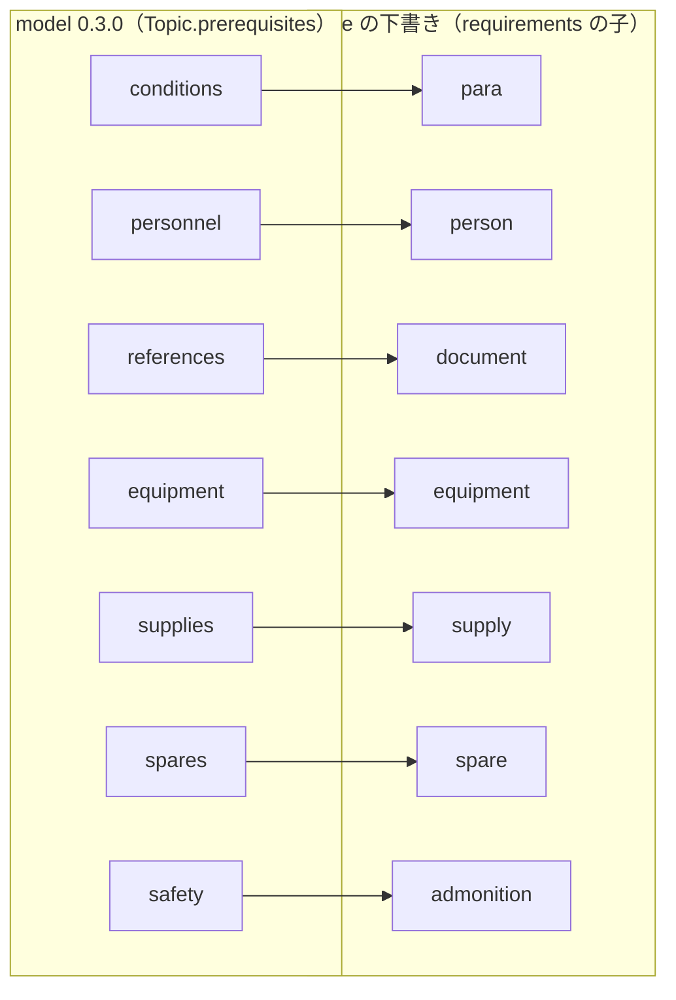

# experiential-manual-model 0.3.0 の設計（作業前の要件と、ホットスポットの説明）

体験型マニュアルの手順に「作業前の要件」と「作業全体にかかる警告」を置けるようにし、ホットスポットの名前と説明を分けるための設計です。実在の技術マニュアルを使った確認（[notes/tm-eval-requests.md](../notes/tm-eval-requests.md)）の要望 M-1・M-2・M-3 と、それを S1000D に写すときの対応（W-1・W-2）を扱います。

- 作成日: 2026-11-15（JST）、更新: 同日 09:10 JST 頃（D-31 に合わせて、core の形の説明を core の設計文書に移した）
- 段階: **決定済み（2026-11-15 07:59 JST、利用者が 4 点すべてに同意）**。model は実装済み（`e0ca740`、未公開）。変換関数（writer-mcp）は未着手
- 前提の決定: D-01（フィールド名に S1000D の語を使わない）、D-09（S1000D との対応は writer の変換関数に集める）、D-31（core の形は S1000D の構造から決め、model の都合で決めない）
- 前の版の設計: [manual-model.md](./manual-model.md)
- 扱わないもの: M-4 以降（文中の参照、複数の操作対象、呼んで戻る遷移、故障探求の 3 段など）。別に設計します

> [!IMPORTANT]
> この文書が決めるのは、experiential-manual-model の形と、それを core の下書きに写すときの対応だけです。s1000d-core の下書きと読み取りの形（`requirements` の子の節点と項目）は、[core-preliminary-rqmts.md](./core-preliminary-rqmts.md) が正です。最初はこの文書の中で core の形も決めていましたが、D-31 で分けました。

## 何が足りなかったか

| 元の文書にあるもの | 0.2.0 での書き方 | 起きたこと |
|---|---|---|
| 作業の冒頭の要件（試験器材、工具、材料、人員、参照、機材の状態） | 別の説明 Topic の表 | 手順からたどれない。S1000D では手順 DM の `preliminaryRqmts` がすべて「なし」になる（R2） |
| 手順 1 より前の、作業全体にかかる警告 | 同じ説明 Topic の注意書き | 手順の画面に出ない。S1000D では `reqSafety` が `noSafety` になる（R2） |
| 図の引き出し線の番号、部品の名前、その説明 | `Hotspot.label` に「番号 名前 — 説明」をまとめて書いた | writer が `label` に「を押す」を付けるので、文が崩れる（R1） |

見本（76 か所のホットスポット）では、`label` に「 — 」で説明を続けたものが 62 か所、番号で始まるものが 52 か所あります。

## model 0.3.0 の型（実装済み: `e0ca740`）

すべて任意の項目です。0.2.0 の JSON は、そのまま 0.3.0 として読めます。model は S1000D に準じる厳密さを求めません。区分を 7 つにしたのは、S1000D に写しやすいからで、S1000D の構造をそのまま持つためではありません。

```ts
export interface Topic {
  // …0.2.0 の項目…
  /** 作業前の要件。kind が procedure / troubleshooting の Topic で使う */
  prerequisites?: Prerequisites;
}

export interface Prerequisites {
  conditions?: PrerequisiteCondition[]; // 機材の状態など、作業を始める条件
  personnel?: PersonnelRequirement[];   // 必要な人員
  references?: DocumentReference[];     // 参照する文書
  equipment?: RequiredItem[];           // 試験器材・工具
  supplies?: RequiredItem[];            // 材料・消耗品
  spares?: RequiredItem[];              // 交換する部品（予備品）
  safety?: Admonition[];                // 作業全体にかかる警告・注意・備考
}

export interface PrerequisiteCondition { text: string; topicRef?: string }
export interface PersonnelRequirement { role: string; count?: number }
export interface DocumentReference { title: string; code?: string; topicRef?: string }
export interface RequiredItem {
  name: string;
  quantity?: string;
  unit?: string;
  partNumber?: string;
  manufacturerCode?: string;
  note?: string;
}

export interface Hotspot {
  // …0.2.0 の項目…
  label?: string;        // 名前だけを書く
  description?: string;  // 説明
  callout?: string;      // 図の引き出し線の番号・記号
}
```

`validateManual` に足した検査:

| 検査 | 結果 |
|---|---|
| `prerequisites` の形（必須の項目、型、`count` が 1 以上の整数、`safety` の `level`） | エラー |
| `conditions[].topicRef`・`references[].topicRef` が Topic の id でない | エラー |
| `prerequisites` が説明・画面の流れの Topic にある | 警告（表示する場所が無い） |

## S1000D に写すときの対応（writer-mcp の変換関数が使う。model には入れない）

core の下書きは、core `830de9f` の形です（[core-preliminary-rqmts.md](./core-preliminary-rqmts.md)）。model が持たない項目（人員の `man`・区分・技能・見積もり時間、文書の区分、参照の版と言語など）は、変換関数からは渡しません。

| model 0.3.0 | core の下書き（`requirements` の子） | S1000D |
|---|---|---|
| `prerequisites.safety` | `admonition` | `reqSafety/safetyRqmts` の `warning`・`caution`・`note` |
| `prerequisites.conditions`（`topicRef` 無し） | `para`（`text`） | `reqCondNoRef/reqCond` |
| `prerequisites.conditions`（`topicRef` あり） | `para`（`text` と、`refs` にその Topic の DM への `dmRef`） | `reqCondDm`（`reqCond` ＋ `dmRef`） |
| `prerequisites.personnel` | `person`（`text` が役割、`count` が人数） | `reqPersons/personnel`（`trade`、`@numRequired`） |
| `prerequisites.references`（`topicRef` あり） | `document`（`refs` に `dmRef`） | `reqTechInfo/dmRef` |
| `prerequisites.references`（`topicRef` 無し） | `document`（`title` が題名、`text` が番号） | `reqTechInfo/externalPubRef` |
| `prerequisites.equipment`・`supplies`・`spares` | `equipment`・`supply`・`spare`（`title` が名前、`manufacturerCode`、`partNumber`、`quantity`、`unit`、`text` が補足） | `supportEquipDescr`・`supplyDescr`・`spareDescr` |
| `Hotspot.label` | — | 画面の手順の文（「〈名前〉を押す。」） |
| `Hotspot.description` | — | 画面の手順の文の後ろに、別の文として書く |
| `Hotspot.callout` | — | 画面の手順の文の先頭に書く。対応する属性は未確認 |

器材・材料・予備品の品目は、S1000D では名前だけでは書けません（識別子が 1 つ以上と `reqQuantity` が要る）。core は `manufacturerCode` か `quantity` が無い品目を `DraftInputError` にするので、変換関数はそのような品目を core に渡さず、`notRepresented` に件数と場所を返します（下の決定 2）。見本の題材には、部品番号と製造者コードが書いてある品目と、消耗品の一覧の品目番号だけを指す品目の両方があります。



この矢印（変換関数）が、まだ実装していない部分です。core の下書きから `preliminaryRqmts` を書く部分は実装済みです。

## 決まったこと（2026-11-15 07:59 JST）

| # | 項目 | 決定 |
|---|---|---|
| 1 | 作業全体にかかる警告の置き場所 | `prerequisites.safety` の 1 か所にする。`Topic.admonitions` は足さない。説明の Topic は `blocks` に、画面の流れは `Screen.admonitions` に注意書きを置けるので、Topic 全体の警告が要るのは手順と困ったときだけであり、それは「安全の要件」と同じものだから |
| 2 | 識別子（製造者コード）や数量の無い品目 | S1000D の品目としては書かず、`convert_manual` の `notRepresented` に件数と場所を返す。検証を通すために値を補うことはしない |
| 3 | フィールド名 | `Topic.prerequisites` と、その下の `conditions`・`personnel`・`references`・`equipment`・`supplies`・`spares`・`safety`。ホットスポットは `description` と `callout` |
| 4 | core の下書きに足す形 | 最初の決定は、節点の種類 5 つ（`person`・`document`・`equipment`・`supply`・`spare`）と、項目 5 つ（`count`・`quantity`・`unit`・`partNumber`・`manufacturerCode`）。**その後、D-31 に沿って XSD から見直し、項目を足した**（[core-preliminary-rqmts.md](./core-preliminary-rqmts.md)）。節点の種類は変わっていない |

## 製品への影響

| 製品 | 変更 |
|---|---|
| Experiential Manual Editor | 手順と困ったときの編集画面に、作業前の要件の入力欄（7 つの区分）を足す。ホットスポットの入力欄を「名前」「説明」「番号」に分ける |
| player（体験の表示、エクスポートした HTML） | 手順の先頭に、安全の要件と作業前の要件を表示する。ホットスポットは名前と説明を分けて表示する |
| 見本（TM の評価フォルダー） | 3 つの説明 Topic（「〜の前に」）の表と注意書きを、手順の `prerequisites` に移す。`label` を「番号・名前・説明」に分ける。`src/build.mts` で機械的に分けられる |

## 作業の順

| 順 | 作業 | 置き場所 | 状態 |
|---|---|---|---|
| 1 | 型・JSON Schema・`validateManual`・券売機の例・README・CHANGELOG | `lib/experiential-manual-model` | 済み（`e0ca740`、`package.json` は 0.3.0。未公開） |
| 2 | core の下書きと読み取りに、作業前の要件の節点と項目を足す | `lib/s1000d-core` | 済み（`118fd99`〜`830de9f`。版は 0.8.3 のまま、未公開）。設計は core-preliminary-rqmts.md |
| 3 | 変換関数: `prerequisites` を `requirements` に写す（W-1）。画面の手順の文を名前だけから作る（W-2） | `mcp/s1000d-writer-mcp` | 未着手。model 0.3.0 と core の公開が先（writer-mcp は npm の版に依存する） |
| 4 | 見本を 0.3.0 に書き直し、変換し直して、R1 と R2 が消えることを確かめる | 評価フォルダー | 未着手 |
| 5 | editor と player の対応 | `webapps/experiential-manual-editor` | 未着手 |

## 残っている点

| 項目 | 内容 |
|---|---|
| `Hotspot.callout` | S1000D の `hotspot` のどの属性に当たるかが未確認。W-4（hotspot を下書きに足す）のときに、仕様書の図とホットスポットの章で確かめる |
| 品目の識別子 | model の `RequiredItem` は、製造者コードと部品番号だけを持つ。工具番号（`toolRef`）などは持たない。core が識別子の種類を増やしたとき（次の版）に、model に足すかを決める |
