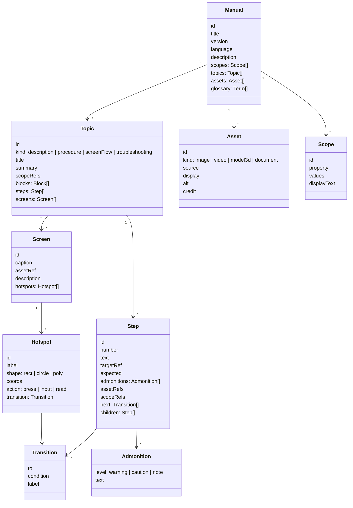
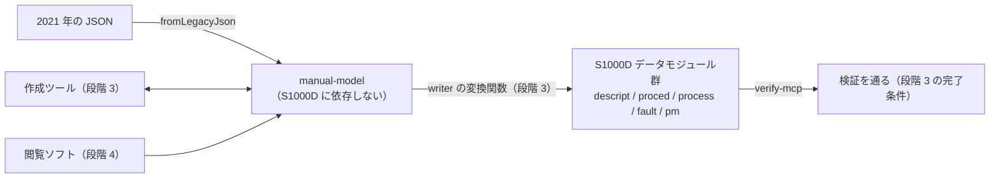

# experiential-manual-model（共通データモデル）の設計

一般向けの作成ツール・閲覧ソフトと、S1000D への入出力（writer）が共有する、S1000D に依存しない体験型操作マニュアルのデータモデルです。この文書では「manual-model」と略します。2021 年の作品 `experience_based_operation_explanation` の JSON を出発点にし、S1000D のデータモジュールへ変換できるだけの情報を持たせます。

- 作成日: 2026-10-24（JST）
- 段階: 2（[ROADMAP.md](../ROADMAP.md)「段階 2 の作業」）
- 前提の決定: D-01（一般向けの製品に S1000D の名前を付けない）、D-09（S1000D との対応は共通データモデルと変換関数に集める）
- 置き場所: npm `@shuji-bonji/experiential-manual-model`、GitHub `shuji-bonji/experiential-manual-model`、ローカル `s1000d-stack/lib/experiential-manual-model`（U-04 で 2026-10-24 に確定。D-05 の表も合わせる）
- 依存: 実行時の依存は無し。TypeScript の型と JSON Schema、検証関数だけを持つ。**s1000d-core には依存しない**（ROADMAP「全体像」）

## 守ること

| 守ること | 理由 |
|---|---|
| S1000D の語（DMC、データモジュール、BREX、ICN、適用性）をフィールド名に使わない | 一般の利用者が S1000D を知らなくても作れるようにする（D-01）。S1000D との対応は writer の変換関数に置く |
| 2021 年の JSON（`displayAreas` / `screens` / `buttons`）を読み込める | 既存の作品のデータを捨てない。`fromLegacyJson()` を用意する |
| 内部 ID・情報の種類・操作の種類・遷移の条件・適用範囲・注意・版を最初から持つ | S1000D へ出力するときに後から足せない情報（background.md「設計のヒント」）。画面には見せず、作成ツールが自動で付ける |
| 図の原本と表示用の変換物を分けて持つ | 3D（JT・PRC）はブラウザーで直接表示できないため、表示用の glTF などを別に持つ（background.md） |
| AI が無くても読める・書ける | D-09。JSON Schema で検証でき、閲覧ソフトは JSON を読むだけで動く |

## モデル

### 各型の説明

| 型 | 内容 | 2021 年の JSON との対応 |
|---|---|---|
| `Manual` | マニュアル 1 冊。`id` は作成ツールが付ける（UUID）。`version` は `{ number, date, note }`。`language` は BCP 47（`ja`、`en-US`） | `JSON.json` 1 ファイル |
| `Topic` | 1 つの話題。`kind` が `screenFlow` なら `screens` を、`procedure` なら `steps` を、`description` なら `blocks` を主に使う。`troubleshooting` は `steps` に `question` / `answers` を持つ | `displayAreas[]` の 1 件（`titleID` → `id`、`title`、`description` → `summary`） |
| `Block` | 説明文の構造。`{ kind: 'section' | 'para' | 'list' | 'table' | 'figure' | 'admonition', id, title, text, items, assetRef, children }` | （無し） |
| `Step` | 手順の 1 段。`number` は保存せず表示時に組み立てる（`1`、`1.1`）。`targetRef` は操作対象（`Hotspot.id` か部品の `id`）。`expected` は操作後に起きること。`children` で入れ子 | `screens[]` の 1 件（`caption` → 表示用、`description` → `text`、`supplementaryExplanation` → `admonitions[{level:'note'}]`） |
| `Screen` | 画面（スクリーンショット）1 枚と、その上の操作できる場所 | `screens[]` の 1 件（`screenId` → `id`、`imageUrl` → `assetRef`） |
| `Hotspot` | 画面上の操作できる領域。`coords` は `shape` ごとに `rect: [x1,y1,x2,y2]`、`circle: [cx,cy,r]`、`poly: [x1,y1,…]`（HTML の `<area>` と同じ書き方）。`action` は操作の種類 | `buttons[]` の 1 件（`name` → `label`、`shape`、`coords`、`screenTransitionDestination` → `transition.to`） |
| `Transition` | 遷移。`to` は `Screen.id` または `Step.id`。`condition` は文（例: 「残高が不足しているとき」）と、将来の機械判定用の `{ property, values }`（省略可） | `screenTransitionDestination` |
| `Asset` | 素材。`source` が原本（`{ path, mediaType, hash }`）、`display` が表示用の変換物（省略可。3D の glTF、動画のサムネイル）。`kind: 'model3d'` の `source` は JT・PRC・X3D など形式を問わない | `imageUrl` |
| `Scope` | 適用範囲。「この機種」「この版の画面」のような、どの利用者に当てはまるかの条件。`property`（例: `model`）と `values`（例: `["MV-50", "MV-60"]`）、人が読む `displayText`。`Topic` / `Step` / `Block` が `scopeRefs` で参照する | （無し。2021 年の作品は 1 機種のみ） |
| `Admonition` | 注意書き。`level` は 3 段階に固定し、S1000D の `warning` / `caution` / `note` に 1 対 1 で対応させる | `supplementaryExplanation` |
| `Term` | 用語と説明。閲覧ソフトの用語集と、S1000D の `definitionList` に使う | （無し） |

### 2021 年の JSON で足りなかったもの（追加する理由）

| 不足 | 追加 |
|---|---|
| `coords` の意味が `shape` ごとに文書化されていない（`rect` に 5 つ目の値がある） | `shape` ごとの配列の長さを JSON Schema で固定する。`fromLegacyJson()` は 5 つ目の値を捨てて `_warnings` に書く |
| `screenId` と `screenID` の表記ゆれ | `fromLegacyJson()` が両方を読む |
| 遷移に条件が無い（ボタンを押せば必ず同じ画面） | `Transition.condition` |
| 注意書きの種類が無い | `Admonition.level` |
| 版・言語・適用範囲が無い | `Manual.version` / `language`、`Scope` |
| 図の原本と表示用の区別が無い | `Asset.source` / `display` |

## S1000D との対応（writer が使う。manual-model には入れない）

変換は段階 3 の s1000d-writer-mcp に置きます（D-09）。ここでは、モデルが S1000D への出力に足りることを確かめるための対応表だけを記録します。

| manual-model | S1000D（Issue 7） | 補足 |
|---|---|---|
| `Manual` | パブリケーションモジュール（`pm`）＋ CSDB | `Topic` ごとに 1 データモジュール。`Manual.id` と `Topic.id` から DMC を**自動で採番**する（モデル識別コード・SNS は writer の設定で与える） |
| `Topic(kind: description)` ＋ `blocks` | `descript`（`levelledPara`） | `Block.kind` → `levelledPara` / `para` / `figure` / `table` / `note` 系 |
| `Topic(kind: procedure)` ＋ `steps` | `proced`（`proceduralStep` の入れ子） | `Step.expected` は手順の文の末尾、または `note` |
| `Topic(kind: screenFlow)` ＋ `screens` ＋ `Hotspot.transition` | `process`（`dmNode` / `dmIf` / `dmSeq`）＋ 画面ごとの `proced` または `descript` | 2021 年の作品の中心。`Transition.condition` が `dmIf` の条件になる |
| `Topic(kind: troubleshooting)` | `fault`（`isolationStepQuestion` / `isolationStepAnswer`） | |
| `Screen` ＋ `Asset` | `figure/graphic`（ICN）、`hotspot` | `Hotspot.id` → `hotspot/@applicationStructureIdent`。これを一致させると、2D のリンクの仕組みが 3D にもそのまま使える（background.md「設計のヒント」） |
| `Asset(kind: model3d)` | `multimedia/multimediaObject`（ICN、形式は BREX の `notationRule` が決める） | writer は brex-mcp の `list_notations` の結果で形式を選ぶ |
| `Asset.source` | ICN の原本。ICN は writer が架空の MIC・CAGE で採番（試作） | `Asset.display` は S1000D には出さない（閲覧ソフト専用） |
| `Scope` | `applic`（`assert` / `evaluate`）＋ ACT の `productAttribute` | `Scope.property` → `applicPropertyIdent`、`values` → `applicPropertyValues`（`|` 区切り） |
| `Admonition` | `warning` / `caution` / `note` | 1 対 1 |
| `Manual.version` | `issueInfo`、`issueDate` | |
| `Manual.language` | `language/@languageIsoCode` / `@countryIsoCode` | BCP 47 を 2 つの属性に分ける |
| `Term` | `definitionList` | |

## パッケージの中身

| ファイル | 内容 |
|---|---|
| `src/types.ts` | 上の型。JSDoc に日本語の説明 |
| `schema/manual.schema.json` | JSON Schema（draft 2020-12）。型から生成せず手で書き、テストで型と一致することを確かめる（生成ツールへの依存を増やさないため） |
| `src/validate.ts` | `validateManual(json)`: JSON Schema による形の検査に加え、`id` の一意性、`transition.to` / `targetRef` / `assetRef` / `scopeRefs` の参照先の存在、`Screen` から到達できない `Screen`（遷移の孤立）を検査する。結果は `{ ok, errors[], warnings[] }`。依存を増やさないよう、Schema の検査は `ajv` を使わず必要な範囲を自前で書くか、`ajv` を devDependency に留めてテストだけで使うかを実装時に決める |
| `src/legacy.ts` | `fromLegacyJson(json)`: 2021 年の JSON を読む。表記ゆれ（`screenId` / `screenID`）と `coords` の余分な値を吸収し、`_warnings` に書く |
| `src/number.ts` | `Step` の番号（`1`、`1.1`）と `Topic` の順序の組み立て |
| `examples/kenbaiki.manual.json` | 券売機の例を manual-model で書き直したもの（段階 3 の完了条件「券売機の例を共通データモデル経由で S1000D に出力し、verify を通る」の入力。ライセンスは MIT、D-11） |

## テスト

| 内容 |
|---|
| `examples/kenbaiki.manual.json` が `validateManual` を通る |
| 2021 年の `JSON.json`（GitHub から取得して `__fixtures__` に置く。自作なのでコミットできる）が `fromLegacyJson` で読め、`validateManual` を通る。警告に `coords` の余分な値が出る |
| 参照切れ（存在しない `transition.to`）、`id` の重複、到達できない `Screen` を検出する |
| JSON Schema と `types.ts` の一致（Schema の `required` と型の必須プロパティが同じこと） |

## 確定が要ること

| 項目 | 内容 |
|---|---|
| ~~U-04~~ | **確定（2026-10-24）**: `@shuji-bonji/experiential-manual-model`。`manual-model` だけでは IETM や S1000D 一般のモデルと受け取られるため、「体験型」を表す `experiential` を入れた |
| `Scope` の表現力 | 最初は `property` と `values` の列挙だけにし、`and` / `or` の組み合わせは `Transition.condition` と同じく文で持つ。S1000D の `evaluate` に相当する入れ子が要るかは、作成ツールの試作（段階 3）で判断する |
| `Block.table` の形 | 最初は行×列の文字列配列。結合セルは持たない |
