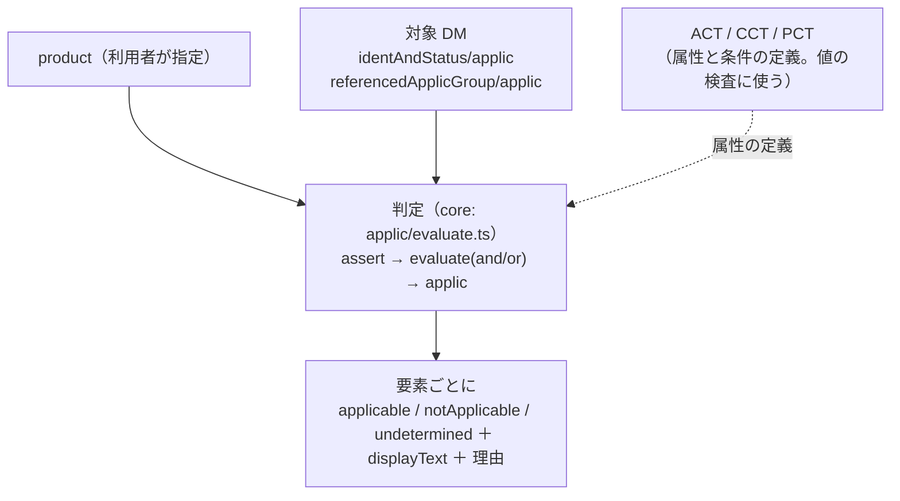

# s1000d-reader-mcp の設計

LLM が S1000D のデータモジュールの本文・参照・適用性を、版と検証状態の付いた形で読むための MCP サーバーです。適用性の判定は reader が済ませ、LLM には判定結果だけを渡します（段階 2 の完了条件）。

- 作成日: 2026-10-24（JST）
- 段階: 2（[ROADMAP.md](../ROADMAP.md)「段階 2 の作業」）
- 前提の決定: D-09・D-10・D-12・D-13・D-15、[verify-mcp.md](./verify-mcp.md) の `VerificationStatus`
- 置き場所: `shuji-bonji/s1000d-reader-mcp`、npm `@shuji-bonji/s1000d-reader-mcp`、ローカル `s1000d-stack/mcp/s1000d-reader-mcp`（D-05）

## しないこと

| しないこと | 理由 |
|---|---|
| 適用性の式（`assert` / `evaluate`）を LLM に渡して判定させない | 判定は reader が行う。LLM に渡すのは `applicable` / `notApplicable` / `undetermined` と、人が読む `displayText` だけ |
| 検証状態を省かない | 応答の `verification` は必ず付ける。XSD が無ければ `schema-not-found`、省いたなら `not-run` と書く。「検証していない」ことを黙って通さない |
| 要約・翻訳をしない | 本文は構造を保って返す。要約は LLM の側で行う。要約させたいときの材料（見出しの階層、手順の番号、警告の種類）を落とさない |
| 仕様書・XSD・公式サンプルを同梱しない | D-03 |
| S1000D の版を 1 つに決め打ちしない | `issue` を `schemaLocation` から推定して応答に入れる。最初の対象は Issue 7 で、Issue 4.2 は U-07 |

## 応答の共通部分

すべてのツールの応答に次の 3 つを入れます。

```ts
{
  target: { dmCode, issueInfo, language, issue: "7", schemaName: "proced", path },
  verification: VerificationStatus,   // verify-mcp と同じ型（core）
  _notes: string[]                    // 読み方の注意（XSD 未検証、未解決の参照、判定できなかった適用性など）
}
```

`verification` は core の同じ関数（`verifyDataModule()`、仮称）で作ります。XSD 検証は `S1000D_SPEC_DIR` が設定されていれば毎回行います（`libxml2-wasm` は検証器を使い回せば 1 件あたり数ミリ秒で、応答の遅れになりません。U-08 の実測）。BREX の照合は既定では行わず（1 件あたり 0.1 秒前後かかり、読むたびに要る情報ではないため）、`verify: "full"` を指定したときだけ行います。既定の `verification.brex.state` は `not-run` です。

## ツール案

| ツール | 入力 | 返すもの |
|---|---|---|
| `list_data_modules` | `csdbDirs`、`filter`（`modelIdentCode` / `systemCode` / `infoCode` / `schemaName` / `text`（techName・infoName の部分一致））、`include`（DMC のほか PMC / DML / DDN / IMF / UPF）、`offset`、`limit` | オブジェクトごとに DMC の各部、`techName` / `infoName`、`issueInfo`、`language`、`schemaName`、`issue`、`applicDisplayText`、パス。件数の集計（`schemaName` 別） |
| `read_data_module` | `path` または `dmc`（CSDB から探す）、`csdbDirs`、`product`（適用性の判定に使う製品属性。後述）、`section`（`identAndStatus` / `content` / `all`。既定 `all`）、`verify`（`schema` / `full` / `none`。既定 `schema`） | 識別・状態部（core の `IdentAndStatus`）、本文の構造（後述）、`applicability`（判定の一覧）、`references`（本文中の `dmRef` / `pmRef` / ICN の一覧と解決先）、`verification` |
| `read_publication_module` | `path` または `pmc`、`csdbDirs`、`product`、`depth` | `pmEntry` の木（題名、`dmRef` ごとに解決したデータモジュールの `techName` / `infoName` / 版 / パス、適用性の判定）。目次として使う |
| `resolve_reference` | `dmRef` / `pmRef` / `icn` のいずれか 1 つ（文字列）、`csdbDirs` | 見つかったファイルのパス、版、題名。ICN は DOCTYPE の宣言を持つデータモジュールの `path` を併せて渡したときに、宣言のファイル名まで解決する |
| `describe_applicability` | `path` または `dmc`、`csdbDirs` | その DM が参照する ACT・CCT・PCT の場所と、使える製品属性（`productAttribute/@id`、`valuePattern`、取り得る値）・条件（`condType` / `cond`）の一覧。DM 内の `applic` 文の一覧（`id`、`displayText`）。LLM が利用者に「どの機種・構成ですか」と聞くための材料 |
| `read_icn_metadata` | `path` または `icn`、`csdbDirs` | ICN メタデータファイル（`icnMetadataFile`、Issue 7 の `icnmetadata.xsd`）の内容（作成者、元 CAD、版、機密区分など）。Bike Samples に 3 件ある |

## 本文の構造の返し方

内容部は XML をそのまま返さず、データモジュールの種類ごとに読み取り部分を 1 つ作り、出力を共通の形に揃えます（background.md「change-request-locator から取り入れたい設計」）。

| 種類（`schemaName`） | 読み取る要素 | 共通の形 |
|---|---|---|
| `descript` | `levelledPara`（入れ子）、`title`、`para`、`figure`、`table`、`note` / `caution` / `warning` | `blocks[]`: `{ kind: 'section' | 'para' | 'figure' | 'table' | 'admonition' | 'list', id, title, text, children, applicRefId, applicability }` |
| `proced` | `preliminaryRqmts`（必要な道具・消耗品・安全）、`mainProcedure/proceduralStep`（入れ子）、`closeRqmts` | `requirements`、`steps[]`: `{ id, number（1, 1.1 のように組み立てる）, text, admonitions, figures, children, applicRefId, applicability }`、`closeRequirements` |
| `process` | `dmNode` / `dmSeq` / `dmIf` の分岐 | `flow`: 分岐を `{ kind: 'sequence' | 'if', condition（displayText）, branches }` で表す。2021 年の作品の `buttons` と遷移先に対応する（background.md の対応表） |
| `fault` | `isolationProcedure` の `isolationStep` / `isolationStepQuestion` / `isolationStepAnswer` | `steps[]` に `question` と `answers[]`（遷移先の step id）を足す |
| `comrep`、`ipd`、`crew`、`schedul`、`wrngdata`、`learning` など | 最初は識別・状態部と `title` の一覧だけ返し、`content.raw` を省く | `blocks` は空で `_notes` に「この種類の本文はまだ構造化していない」と書く |
| `pm` | `pmEntry`（入れ子）と `dmRef` | `read_publication_module` で扱う |
| `brex` | — | brex-mcp の `explain_brex` に任せる。`_notes` にその旨を書く |

Bike Samples の内訳（proced 39、comrep 15、descript 14、learning 5、fault 5、pm 4 ほか）から、最初に構造化するのは `descript`・`proced`・`process`・`fault`・`pm` の 5 種です。

本文中の参照は `references[]` に集め、`dmRef` は CSDB から解決した `techName` / `infoName` / 版を添えます（LLM が DMC だけを見て中身を推測しないようにするため）。図は `figure/graphic/@infoEntityIdent` → DOCTYPE の `ENTITY` 宣言 → ファイル名まで解決し、`hotspot` があれば `applicationStructureIdent` と `id` を返します（段階 4 の閲覧ソフトで 3D のノード名と対応付ける。background.md「設計のヒント」）。

## 適用性の判定

### 入力: `product`

```ts
product?: {
  /** ACT の productAttribute/@id → 値。例: { model: "Brook trekker", version: "Mk9" } */
  attributes?: Record<string, string>;
  /** CCT の cond/@id → 値。例: { "SB-S001": "true" } */
  conditions?: Record<string, string>;
}
```

### 判定の規則

Bike Samples の実測（`assert` 627 件、`evaluate andOr="and"` 320 件・`"or"` 86 件、ACT 3・CCT 1・PCT 1、`applicRefId` を持つ DM 23 件）を根拠に、次の範囲を実装します。

| 要素・属性 | 判定 |
|---|---|
| `assert/@applicPropertyIdent`、`@applicPropertyType`（`prodattr` / `condition`）、`@applicPropertyValues` | `product` の該当する値が `applicPropertyValues` に合えば真。値の書き方は単一値、`|` 区切りの列挙、`~` の範囲（Chap 3.9.5.3。BREX の `valueAllowed` の範囲と同じ書式なので、core の `matchesRange` を再利用する） |
| `evaluate/@andOr` | 子の `assert` / `evaluate` を `and` / `or` で結ぶ |
| `applic/@id` と `@applicRefId` | 要素の `applicRefId` → `referencedApplicGroup/applic` を探し、無ければ識別・状態部の `applic`（DM 全体の適用性）を使う |
| 判定できない | `product` に該当する属性・条件が無い、`applicPropertyValues` の書式が読めない、参照先の `applic` が無い → `undetermined` と理由 |



### 出力の形

- `product` を渡したとき: 各ブロック・手順に `applicability: { state: 'applicable' | 'notApplicable' | 'undetermined', displayText, reason? }` を付けます。`notApplicable` の要素は既定で **残して印を付けます**（`omitNotApplicable: true` で省けます）。省いたときは `_notes` に省いた件数を書きます。
- `product` を渡さないとき: `applicability.state` はすべて `undetermined`、`reason: "product not given"` とし、`displayText` だけを添えます。`assert` の中身は返しません。`_notes` に「`describe_applicability` で属性を調べ、`product` を渡すと判定できる」と書きます。
- 判定の論理は core（`src/applic/`）に置き、reader と段階 3 の writer（出力時に適用性を付ける）で共有します。

## s1000d-core への追加（reader のために）

| 追加 | 内容 | 置き場所 |
|---|---|---|
| CSDB オブジェクトの列挙 | いまの `listDataModules` は `DMC-*.xml` だけを拾う。PMC・DML・DDN・IMF・UPF も拾う `listCsdbObjects` と、PMC のファイル名の分解 `parsePmcFileName` を足す | `src/csdb.ts` |
| 本文の読み取り | `descript` / `proced` / `process` / `fault` / `pm` の 5 種の読み取りと共通の形 | `src/content/` |
| 適用性 | ACT・CCT・PCT の読み取り（`productAttribute`、`condType` / `cond`）、`assert` / `evaluate` の評価 | `src/applic/` |
| 検証状態 | `VerificationStatus` の型と `verifyDataModule()`（verify-mcp と共有） | `src/verify/`（[verify-mcp.md](./verify-mcp.md)） |

## Issue 4.2 と IMF（U-07 への材料）

- IMF（ICN メタデータファイル、`icnmetadata.xsd`）は Issue 7 の配布物にも入っていて、Bike Samples に 3 件あります（`IMF-C0419-S1000D0360-001-01_003-00.XML` ほか）。「Issue 4.2 以降の IMF を reader の対象に含めるか」は、Issue 7 の対象として最初から `read_icn_metadata` で含める、と判断できます。
- Issue 4.2 の対応は、`descript` / `proced` の要素名が Issue 7 と大きく変わらないことを 4.2 の XSD で確かめてから、`issue` ごとに読み取り部分を分ける（`src/content/<issue>/`）か 1 つで済ませるかを決めます。4.2 の XSD は `specs/s1000d/issue-4.2/` に利用者が展開します（D-06）。

## テスト

| 種類 | 内容 |
|---|---|
| 自作データ（CI で常に） | 券売機の説明 DM の `levelledPara` が `blocks` の木になること。自作の手順 DM（新規に作る。`proceduralStep` の入れ子と `warning` を含む）で `steps[].number` が `1`、`1.1` の形になること。自作の ACT と `applicRefId` 付きの DM で、`product` を変えると `applicable` / `notApplicable` が切り替わり、`product` 無しで `undetermined` になること |
| 配布物（`S1000D_SPEC_TESTS=1`） | Bike Samples の `proced` 39 件・`descript` 14 件が例外なく読めること。`PMC-S1000DBIKE-B6865-EPWG1-00_006-00_EN-US.XML` の `pmEntry` の `dmRef` がすべて解決できること。`assert` 627 件の `applicPropertyValues` がすべて構文解析できること |
| MCP の層 | `InMemoryTransport` のテストと stdio の実機確認 |

## 確定が要ること

| 項目 | 内容 |
|---|---|
| ~~既定の `verify`~~ | **確定（2026-10-24、D-18）**: 既定は `schema`（XSD だけ）。BREX は `full` のときだけ。reader は verify-mcp に委譲せず、core の `verifyDataModule()` を自分で呼ぶ |
| ~~`notApplicable` の既定~~ | **確定（2026-10-24、D-18）**: 残して印を付ける。`omitNotApplicable: true` で省ける |
| U-07 | Issue 4.2 の着手時期。reader の 5 種の読み取りが Issue 7 で動いた後に判断する |
