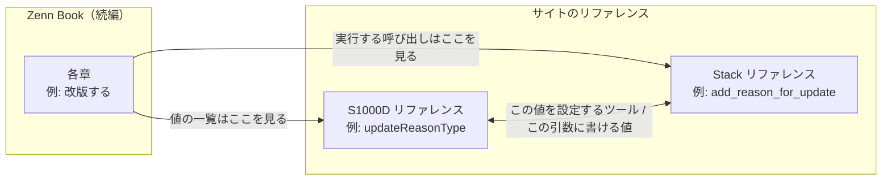
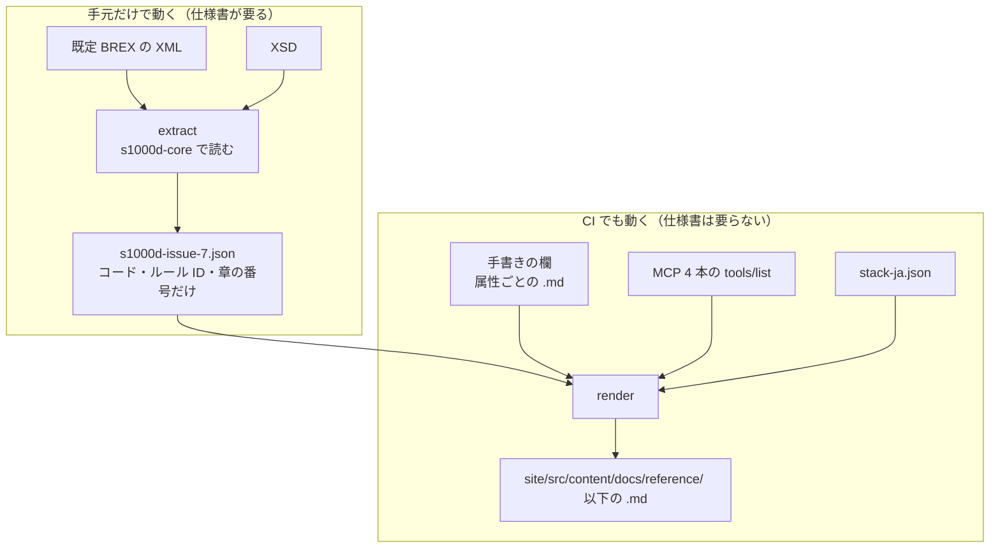

# サイトのリファレンス（S1000D リファレンスと Stack リファレンス）

s1000d-stack のサイトに、S1000D の属性と値を引くページと、MCP のツールを引くページを足すための設計です。S1000D のデータモジュール（DM）を作る人と、S1000D を処理するコードを書く人が、属性名・値・ツール名から 1 ページで答えにたどり着けるようにします。

- 状態: **提案（未実装）**。2026-11-22 に書きました。「決めること」の SR-1〜SR-9 は、まだ決まっていません
- 前提の決定: D-02（商標の注記）、D-03（仕様書・スキーマ・公式サンプルを同梱しない）、D-22（英語をルートにし、日本語を `/ja/` で提供する）、D-36（続編は Zenn Book、リファレンスはサイト）
- 対応する Issue: Stack リファレンスは #9、S1000D リファレンスは #11、続編の Zenn Book は #10

> [!WARNING]
> 仕様書と既定 BREX の文章は写しません。値の意味と使い方は自分の言葉で書き、章と表の番号を添えます。この文書の見本も同じ書き方です。

## 目的

| 足りないもの | 内容 |
|---|---|
| 属性と値を引くページ | 「`updateReasonType` に書ける値は何か、どの値をいつ選ぶか」に、日本語と英語で答えるページ。いまのサイトは概念の説明（「S1000D を知る」の 6 ページ）だけで、値を引けない |
| ツールを引くページ | MCP のツール 1 つについて、引数・応答・使う場面を示すページ。いまは MCP サーバーごとに 1 ページで、ツールは表の 1 行で説明している |

きっかけは、検索サービスの AI が返した `updateReasonType` の説明を、既定 BREX と照合した結果です（2026-11-20）。値のコードは合っていましたが、意味が 2 か所ずれていました。

| 値 | 検索サービスの AI の説明 | 既定 BREX（BREX-S1-00242）で確かめた内容 |
|---|---|---|
| `urt01` | 技術的な意味合いが変わらない変更 | 内容は変わっているが、技術的には重要でないと判断した変更 |
| `urt05` | 参照先の DM や外部文書の識別子が変わった | 参照している側の構造の一意識別子が変わった |

出典は文書共有サイトにある写しと米海軍の資料でした。公式サイト（s1000d.org）のメニューには、チュートリアルや教育用の文書がありません（2026-11-21 に確認）。

## 範囲

| 区分 | 内容 |
|---|---|
| 扱う | S1000D リファレンス（属性 1 つを 1 ページ）、Stack リファレンス（ツール 1 つを 1 ページ）、2 つを作るスクリプト |
| 扱わない | 続編の Zenn Book の本文。章立ては Issue #10 で決める |
| 扱わない | 要素（`dmodule`、`proceduralStep` など）のページ。Issue #11 は要素も挙げているが、属性のページを作ってから判断する（SR-1） |
| 扱わない | Issue 7 以外の版。U-07 で Issue 4.2 に対応するときに足す |
| 扱わない | Skill のページの作り直しと、s1000d-core の関数のページ。Issue #9 は Skill も挙げていて、題は「各部品」である。最初は MCP のツールだけにする（SR-9） |

> [!NOTE]
> Issue #11 は、生成の元に「既定 BREX とデータ辞書」を挙げています。この設計では、データ辞書を 3 つの用途に分けて扱います。
>
> - **機械で取り出す値**（属性が付く要素、型、列挙）は、XML Schema Package の `xml_schema_flat/` の XSD から取ります。データ辞書の `xml_schema_flat/` は表示用の写しで、33 本すべてが XML Schema Package のものと差分があるため使いません（[notes/background.md](../notes/background.md) の「XSD の写しについて」）。
> - **要素名・属性名の意味**は、データ辞書で調べ、自分の言葉で説明を書きます。データ辞書の説明の文は仕様書の文章なので、ページには写しません。
> - **読者を正式な定義へ案内するリンク**は、オンラインのデータ辞書の属性のページに張ります（下の「オンラインのデータ辞書へのリンク」）。

## 3 つの置き場所（D-36）

置き場所は、内容が変わる頻度で分けます。

| 置き場所 | 内容 | 変わる頻度 |
|---|---|---|
| Zenn Book（「S1000D入門」の続編） | S1000D の決まり、自作の DM の例、確かめる観点。章の順に読む | Issue が変わるまで変わらない |
| サイトの S1000D リファレンス | 属性と値、章と表の番号、値の選び方 | 既定 BREX から作り直せば済む |
| サイトの Stack リファレンス | ツール名・引数・応答 | MCP の版が上がるたびに変わる |

Zenn Book には、値の一覧とツールの引数を書きません。リンクにしておけば、MCP の版が上がっても本を直さずに済みます。

## 実測（2026-11-22）

Issue 7 の既定 BREX（`DMC-S1000D-J-04-10-0301-00A-022A-D_001-00_EN-US.XML`）を数えた結果です。

| 項目 | 件数 |
|---|---|
| `structureObjectRule` | 274 |
| そのうち `objectValue` を持つもの | 96 |
| `objectValue` の合計 | 1,443（`single` 1,338、`range` 81、`pattern` 24） |
| `objectPath` が `//@属性名` の形のルール | 93（属性も 93 種類） |
| そのうち `objectValue` を持つもの | 90 |
| 説明の文が空の `objectValue` | 94 |
| `objectUse` に章の番号（`Chap …`）があるルール | 274（すべて） |
| `contextRules` | 7（共通 1、スキーマ別 6: comment / ddn / dml / icnmetadata / pm / update） |

> [!NOTE]
> `single` の件数は、[notes/background.md](../notes/background.md) では 1,340 と書いてあります。今回の数え方（XML の `objectValue` 要素を `valueForm` ごとに数える）では 1,338 でした。差の 2 件の理由は調べていません。

属性の値は、既定 BREX だけでは決まりません。XSD と突き合わせた例です（`proced.xsd`）。

| 属性 | XSD の定め | 既定 BREX の定め |
|---|---|---|
| `updateReasonType` | 列挙。`urt01`〜`urt99` の 99 個 | `urt01`〜`urt05` と `urt51~urt99` だけを許す |
| `updateHighlight` | パターン `[01]` | ルールなし |
| `changeMark` | パターン `[01]` | ルールなし |
| `changeType` | 列挙 `add` / `delete` / `modify` | ルールなし |
| `issueType` | 列挙 `new` / `changed` / `deleted` / `revised` / `status` / `rinstate-changed` / `rinstate-revised` / `rinstate-status` | 値の一覧のルールなし（ほかの属性との組み合わせのルールはある。例: BREX-S1-00038） |

`updateReasonType` は、XSD では書けるのに既定 BREX では許されない値があります。リファレンスのページは、XSD の定めと既定 BREX の定めを別の欄に分けて示す必要があります。

Stack 側の件数です。

| 対象 | 件数 |
|---|---|
| MCP サーバー | 4（brex 0.6.4、verify 0.8.1、reader 0.13.0、writer 0.6.0） |
| ツール | 27（brex 5、verify 7、reader 6、writer 9） |
| Skill | 4 |

## S1000D リファレンス

### ページの単位と URL

属性 1 つを 1 ページにします（SR-1）。URL は版を含めます（SR-7）。

| 言語 | URL |
|---|---|
| 英語 | `/s1000d-stack/reference/s1000d/issue-7/update-reason-type/` |
| 日本語 | `/s1000d-stack/ja/reference/s1000d/issue-7/update-reason-type/` |

ページの題名は属性名そのもの（`updateReasonType`）にします。U-06 で確かめたとおり、Pagefind は見出しにある語を検索で返しやすいためです。

### 1 ページの構成

| 欄 | 内容 | 作り方 |
|---|---|---|
| 注記 | Issue 7 の内容であること、ASD とは無関係であること、正式な定義は仕様書の該当章にあること | 生成（全ページ共通） |
| 何を表すか | 属性の役割を 1〜2 文で | 手書き |
| 付く要素 | この属性を持つ要素と、スキーマの名前 | 生成（XSD） |
| XSD の定め | 型の名前、列挙またはパターン | 生成（XSD） |
| 既定 BREX の定め | ルール ID、`allowedObjectFlag`、値のコード、`valueForm`、`valueTailoring`、文脈（スキーマ名） | 生成（既定 BREX） |
| 値の意味 | 値ごとの説明 | 手書き |
| 値の選び方 | 場面ごとに、どの値を選ぶか | 手書き |
| 関連する決まり | ほかの属性との組み合わせのルール（ルール ID と章の番号） | 手書き |
| Stack での扱い | 読むツール・書くツールへのリンク | 手書き（ツール名は生成物と照合する） |
| 出典 | 章と表の番号、オンラインのデータ辞書の属性のページへのリンク | 生成（番号は `objectUse` から取り出す。リンクは属性名から組み立てる） |

手書きの欄が空のページは、「何を表すか」から「Stack での扱い」までの見出しを出さず、生成した欄だけのページにします。

### オンラインのデータ辞書へのリンク

公式サイトの「Data Dictionaries」のページ（`https://s1000d.org/?page_id=1003`）は、版ごとのオンラインのデータ辞書にリンクしています。リファレンスの各ページの出典には、その属性のページへのリンクを置きます。

| 項目 | 内容 |
|---|---|
| リンクの形 | `https://users.s1000d.org/S1000D_DD_7/Files/attributes/<属性名>.xml` |
| 例 | `https://users.s1000d.org/S1000D_DD_7/Files/attributes/updateReasonType.xml` |
| 版 | Issue 4.0、4.1、4.2、5.0、6、7（`S1000D_DD_4.0`〜`S1000D_DD_7`） |
| ログイン | 要らない（2026-11-22 に、ログインなしで 200 が返ることを確かめた） |

- **表示の確認**: 2026-11-22 に、利用者が Issue 6 と Issue 7 で表示されることをブラウザーで確かめました。
- **初回の表示は遅い**: 属性の XML は 5 行（176 バイト）で、説明の本文を持ちません。ブラウザーが `../xsl/datadict.xsl` を読み、XSLT が定義のファイルを読んで表示を組み立てます。サーバーの応答は 1 件 0.5〜0.75 秒ですが、フレームの中の表示には時間がかかります。一度読み込んだあとは、すぐに表示されます。
- **もう 1 つのホスト**: `https://dd.s1000d.us`（Issue 7 は `/dd70`）も同じ内容を配信しています（トップと属性の XML の大きさが一致）。Issue 6-01・6-02 と単位のページもあります。運営者がページに書かれていないので、リンク先には公式サイトが案内している `users.s1000d.org` を使います。
- **利用条件**: 配布物のデータ辞書の `README.txt` の LICENSE の節は、著作権の表示と免責だけで、外部からのリンクについての記載はありません。
- **件数**（配布物の Issue 7）: `Files/attributes/` に属性のファイルが 523、`Files/elements/` に要素のファイルが 1,398 あります。既定 BREX が値を定めている属性（90）より多いので、リンクは既定 BREX に無い属性にも張れます。
- **要素のページ**: `Files/elements/<要素名>.xml` の形です（`reasonForUpdate.xml` で 200 を確かめた）。要素のページを作るとき（SR-1）に使います。

### 見本: `updateReasonType`（日本語）

> [!NOTE]
> このページは Issue 7 の内容です。S1000D Stack は ASD とは無関係です。正式な定義は、仕様書の Chap 3.9.6.1（Table 82）を見てください。

**何を表すか**

DM を改版したときに、更新の理由（`reasonForUpdate`）がどの種類の変更かを示します。

**付く要素**

`reasonForUpdate`（DM の `dmStatus` の中、パブリケーションモジュールの `pmStatus` の中）

**XSD の定め**

型は `updateReasonTypeAttType` で、値は `urt01`〜`urt99` の列挙です。

**既定 BREX の定め**（BREX-S1-00242、`allowedObjectFlag` は `2`、文脈はすべてのスキーマ）

| 値 | 形 | 下位の BREX での調整 |
|---|---|---|
| `urt01`〜`urt05` | `single` | `lexical` |
| `urt51~urt99` | `range` | `restrictable` |

`urt06`〜`urt50` は、XSD では書けますが、既定 BREX では許されません。

**値の意味**

| 値 | 意味 |
|---|---|
| `urt01` | 編集上の変更。内容は変わっているが、技術的には重要でないと判断した変更 |
| `urt02` | 技術的な変更。内容が変わっていて、見直しが必要な変更 |
| `urt03` | マークアップだけの変更 |
| `urt04` | 適用性だけの変更 |
| `urt05` | 参照している側の構造の一意識別子の変更 |
| `urt51`〜`urt99` | プロジェクトが意味を決める値 |

**値の選び方**

| 場面 | 値 |
|---|---|
| 誤字を直した。手順の意味は変わらない | `urt01` |
| 手順を足した、締め付けの値を変えた | `urt02` |
| 要素の入れ子や属性だけを直した。表示される文は変わらない | `urt03` |
| 対象の機種を足した | `urt04` |

**関連する決まり**

- `urt01` の理由には、変更の印（`changeType`・`changeMark`）を結び付けません（Chap 3.9.5.2.1.1 の Para 2.2）。
- `updateReasonType` を書かない `reasonForUpdate` は、技術的な変更として扱われます（同じ Para 2.2）。
- 同じ理由による変更は、同じ `reasonForUpdate` を指します（Chap 3.9.5.2.1.1 の Para 2.1.3）。
- `issueType` が `revised`・`status` の版は、`issueNumber` が `000`・`001` でなければ、`reasonForUpdate` が要ります（BREX-S1-00038）。

**Stack での扱い**

| 操作 | ツール |
|---|---|
| 読む | reader の `read_data_module`（`reasonForUpdates[]` の `updateReasonType`） |
| 理由だけを足す | writer の `add_reason_for_update` |
| 作業中の版を始めるときに足す | writer の `start_revision`（`reason`） |
| 変更の印と一緒に足す | writer の `edit_data_module`（`marking.reason`） |
| 値を確かめる | brex の `lookup_value`（`target: "updateReasonType"`） |

Stack のツールは、`updateReasonType` の値を選びません。利用者が決めた値を受け取ります（D-35）。

**出典**

- 仕様書の Chap 3.9.6.1（Table 82）、Chap 3.9.5.2.1.1
- [S1000D Issue 7 のデータ辞書: `updateReasonType`](https://users.s1000d.org/S1000D_DD_7/Files/attributes/updateReasonType.xml)（初回の表示には時間がかかります）

### 最初に手書きの欄を書く属性（SR-8）

DM の作成と改版で、writer と reader が実際に扱う属性から書きます。

| 順 | 属性 | 理由 |
|---|---|---|
| 1 | `updateReasonType`、`updateHighlight`、`changeType`、`changeMark`、`reasonForUpdateRefIds`、`issueType` | 改版（D-33〜D-35）で値を利用者に聞く属性 |
| 2 | `issueNumber`、`inWork`、`securityClassification`、`languageIsoCode`、`countryIsoCode` | 識別・状態部で必ず書く属性 |
| 3 | `infoCode`、`infoCodeVariant`、`itemLocationCode` | 採番の規則（`allocation`）で利用者に聞く属性 |
| 4 | `internalRefTargetType`、`emphasisType`、`listItemPrefix` | 本文の節点に付く属性 |

残りの属性は、生成した欄だけのページを先に置きます（SR-3 が決まってから）。

## Stack リファレンス

### ページの単位と URL

ツール 1 つを 1 ページにします。

| 言語 | URL |
|---|---|
| 英語 | `/s1000d-stack/reference/stack/writer/add-reason-for-update/` |
| 日本語 | `/s1000d-stack/ja/reference/stack/writer/add-reason-for-update/` |

### 1 ページの構成

| 欄 | 内容 | 作り方 |
|---|---|---|
| 版 | このページを作った MCP の版 | 生成（`package.json`） |
| 説明 | `tools/list` の応答の `description` | 英語は生成、日本語は手書きの訳（SR-5） |
| 引数 | `inputSchema` の `properties` を表にしたもの（名前・型・必須かどうか・説明） | 生成 |
| 注釈 | `annotations`（`readOnlyHint` など）。`tools/list` の応答にあるときだけ出す | 生成 |
| 応答の例 | 自作の CSDB（券売機）で実行した応答 | 手書き（実行結果を貼る） |
| 使う場面 | どの Skill のどの手順で呼ぶか | 手書き |
| 関連する属性 | S1000D リファレンスへのリンク | 手書き |

いまの `mcp/*.md`（MCP サーバーごとの 1 ページ）は、方針・設定・流れの図を持つ概要のページとして残します。「できること」の表のツール名を、ツールのページへのリンクにします（SR-6）。

### 日本語の説明（SR-5）

`tools/list` の `description` は英語です。日本語のページの説明は、訳を 1 つのファイル（`site/src/data/reference/stack-ja.json`）に、ツール名と英語の `description` のハッシュを付けて持ちます。`description` が変わるとハッシュが合わなくなり、`--check` が「訳が古い」と報告します。いまの `site/scripts/check-i18n.mjs` と同じ考え方です。

## 生成の仕組み

スクリプトは `scripts/generate-reference.mjs` の 1 本にします。`scripts/generate-stack.mjs` と同じく、依存なし（Node 20 以上）で、`--check` を持たせます。

| 段 | 入力 | 出力 | 動く場所 |
|---|---|---|---|
| `extract` | `S1000D_SPEC_DIR` の下の既定 BREX と XSD | `site/src/data/reference/s1000d-issue-7.json` | 手元だけ。仕様書が無ければ、何もせずに理由を出して終わる |
| `render` | 上の JSON、手書きの欄、MCP の `tools/list` | `site/src/content/docs/reference/` と `ja/reference/` の `.md` | 手元と CI |
| `--check` | 同じ | 生成し直した結果と、コミットしてある `.md` の差。差があれば exit 1 | CI（`stack-check.yml` に足す） |

- **CI には仕様書がありません。** `deploy.yml` は `npm ci` と `npm run build` だけを行います。このため、`extract` の出力（JSON）と `render` の出力（`.md`）は、どちらもコミットします（SR-2）。
- **手書きの欄は上書きしません。** 属性ごとに `site/src/reference-notes/s1000d/<属性名>.ja.md` と `.en.md` を置き、`render` が生成した欄と合わせて 1 ページにします。生成物の `.md` を直接直す運用にはしません。
- **MCP の `tools/list` は、各 MCP の `dist/index.js` を stdio で起動して取ります。** 手元では `mcp/` の作業コピー、CI では npm の公開版を使います。
- **サイドバーは `autogenerate` にします。** `astro.config.mjs` の `sidebar` に `reference/s1000d` と `reference/stack` の 2 つの区分を足し、ページの一覧は Starlight に作らせます。

### `s1000d-issue-7.json` に入れるものと入れないもの

| 区分 | 項目 |
|---|---|
| 入れる | 属性名、付く要素とスキーマの名前、XSD の型の名前、列挙の値、パターン |
| 入れる | ルール ID、`objectPath`、`allowedObjectFlag`、値のコード、`valueForm`、`valueTailoring`、文脈 |
| 入れる | `objectUse` から取り出した章と表の番号（`Chap 3.9.6.1`、`Table 82`） |
| 入れない | `objectUse` の文、`objectValue` の説明の文、XSD の `xs:documentation` の文 |

## 仕様書の扱い（D-03 との関係）

D-03 は、仕様書・スキーマ・公式サンプルの再配布と、翻訳・翻案をしないと決めています。リファレンスは次のように作ります。

- 値の意味と選び方は、自分の言葉で書きます。既定 BREX の英文を訳して並べる書き方はしません。
- 値のコード、ルール ID、章と表の番号は、事実の記載と出典の表示として載せます。
- 既定 BREX と XSD の文章は、JSON にもページにも入れません。

> [!IMPORTANT]
> 値のコードを 90 属性・1,443 件まとめて載せることが利用条件に触れないかは、確かめていません（SR-3、未決事項 U-11）。この判断は法律の専門家の領分で、設計では決められません。決まるまでは、手書きの欄を書いた属性のページだけを公開します。そのページでは、値のコードは自分の説明の中で使う語として現れます。

## 表示と商標（D-02）

- 区分の名前は「S1000D reference (unofficial)」「S1000D リファレンス（非公式）」にします（SR-4）。
- すべてのページの先頭に、Issue の番号、ASD とは無関係であること、正式な定義は仕様書にあることを書きます。
- ASD のロゴと書体は使いません。

## 決めること

| ID | 内容 | 提案 |
|---|---|---|
| SR-1 | S1000D リファレンスのページの単位 | 属性 1 つを 1 ページ。要素のページは作らない |
| SR-2 | 生成物の置き方 | JSON と `.md` をコミットする。ビルドのときに生成する方式は、CI に仕様書が無いので採らない |
| SR-3 | 値のコードをまとめて載せる範囲 | 手書きの欄を書いた属性だけを先に公開する。残りは U-11 が決まってから |
| SR-4 | 区分の名前 | 「S1000D リファレンス（非公式）」 |
| SR-5 | 日本語の Stack リファレンスの説明 | 手書きの訳を 1 つのファイルに持ち、英語の `description` のハッシュで古さを検出する |
| SR-6 | いまの `mcp/*.md` との関係 | 概要のページとして残し、表のツール名をツールのページへのリンクにする |
| SR-7 | URL に版を入れるか | 入れる（`issue-7`）。あとから入れると、公開済みの URL が変わる |
| SR-8 | 最初に手書きの欄を書く属性 | 上の表の順 1〜4（17 属性） |
| SR-9 | Stack リファレンスに入れる部品（Issue #9 の「各部品」の範囲） | 最初は MCP のツール 27 個だけ。Skill は、いまの 1 Skill 1 ページを Stack リファレンスの区分から指す。s1000d-core の関数は、型定義から作る別の仕組みが要るので、別の Issue に分ける |

## 作業の順

| 順 | 作業 | 終わりの条件 |
|---|---|---|
| 1 | `updateReasonType` のページを、日本語と英語で手で書いて公開する | サイトで表示され、Pagefind で `updateReasonType` を検索すると出る |
| 2 | Stack リファレンスの `render` と `--check` を作り、27 ツールのページを生成する | `--check` が CI で通る。`mcp/*.md` の表からリンクが張られている |
| 3 | `extract` を作り、順 1 の 6 属性のページを、生成した欄と手書きの欄を合わせた形に置き換える | 順 1 で手で書いたページと、生成したページの内容が一致する |
| 4 | 順 2〜4 の属性の手書きの欄を書く | 17 属性のページが日本語と英語で揃う |
| 5 | U-11 が決まったら、残りの属性のページを生成する | — |

順 1 を先にするのは、ページの形を 1 つ公開してから、生成の仕組みをその形に合わせるためです。順 2 を順 3 より先にするのは、Stack リファレンスには仕様書の扱いの問題が無く、すぐに公開できるためです。

## 確かめ方

| 確かめること | 方法 |
|---|---|
| 生成した値が既定 BREX と一致する | 17 属性について、brex の `lookup_value` の応答とページの表を突き合わせる |
| 生成物に仕様書の文章が入っていない | JSON と `.md` を、既定 BREX の `objectUse`・`objectValue` の文で検索し、一致が無いことを確かめる（`extract` のテストにする） |
| ツールのページが実際のツールと一致する | `--check` を CI で実行する |
| 日本語と英語のページが揃っている | `site/scripts/check-i18n.mjs` の対象に `reference/` を足す |
| 仕様書が無い環境で `render` が動く | `S1000D_SPEC_DIR` を外して `render` と `npm run build` を実行する |
