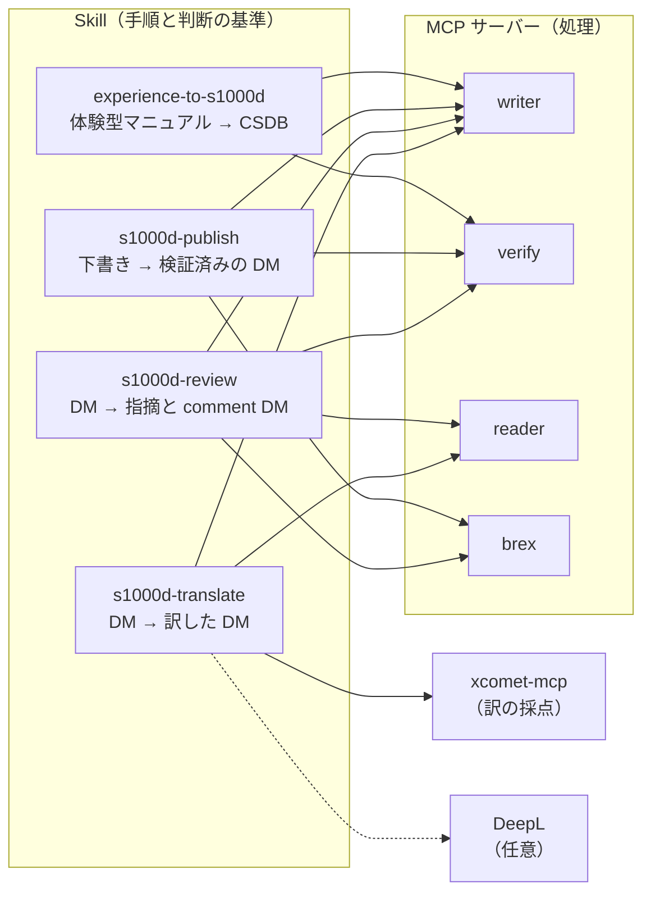
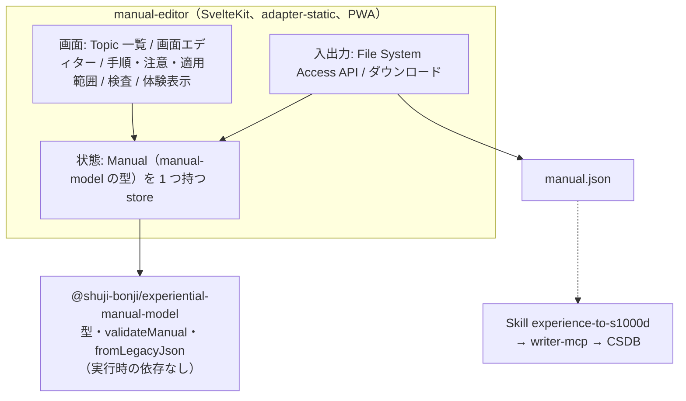

# Skill 4 つと作成ツールの試作（段階 3 の作業 8）の設計

LLM が S1000D の MCP サーバー 4 本（brex・verify・reader・writer）を、決まった順番と判断の基準で使えるようにする Skill 4 つと、体験型マニュアルを人が作るための作成ツールの試作を定めます。Skill は「手順と判断の基準」を持ち、処理は持ちません。作成ツールは AI が無くても動きます（D-09）。

- 作成日: 2026-10-28（JST）
- 段階: 3 の作業 8（[ROADMAP.md](../ROADMAP.md)「段階 3 の作業」）
- 前提の決定: D-01（一般向けの製品に S1000D の名前を付けない）、D-09（専門家エージェントと製品を並行して作る。製品は AI が無くても動く）、D-19（決定論的に確かめられることは core が行い、LLM は文章の生成と説明に限る）、D-27（writer の処理は core に置く）
- 前提の設計: [writer-mcp.md](./writer-mcp.md)「Skill との関係」、[agent-platform.md](./agent-platform.md)「製品に組み込むときの境界」（段階 3 の Skill は、製品にエージェントを組み込むときの手順の見本になる）、[manual-model.md](./manual-model.md)
- 手本: pdf-agent-stack の `skill/pdf-trust-skill`（Skill 1 つにリポジトリ 1 つ、`skills/<名前>/SKILL.md` ＋ `references/`、`evals/trigger-eval.json`、タグ push で `.plugin` を作る `release.yml`、`plugin.json` の `dependencies`）

## 決めること（この文書で提案し、利用者が決める）

| ID | 内容 | 提案 |
|---|---|---|
| U-09 | Skill のリポジトリ名の規則 | リポジトリは `shuji-bonji/<名前>-skill`、plugin 名とフォルダー名は `<名前>`（pdf-trust-skill・houki-research-skill と同じ）。ローカルは `s1000d-stack/skill/<名前>-skill`（hub の `.gitignore` で除外済み）。名前は下の 4 つ |
| U-09（続き） | 4 つ目の Skill の名前 | `s1000d-translate` |
| U-10 | 作成ツール（と段階 4 の簡易 Web マニュアル）の技術 | SvelteKit ＋ PWA（`adapter-static`）。利用者が習得中で、静的サイトとして GitHub Pages に置け、オフラインでも動く |
| U-05 | 作成ツールの製品名 | 試作の間は仮称 `manual-editor`（`stack.json` に既にある名前）。製品名は試作を見てから決める |

> [!NOTE]
> 1 つ目の Skill の名前は ROADMAP のとおり `experience-to-s1000d` にします。D-01 は「一般向けの製品に S1000D の名前を付けない」で、Skill は S1000D を扱う道具の側なので、名前に S1000D が入って構いません。

## Skill 4 つの全体像



4 つとも、次の共通の原則を `SKILL.md` の冒頭に書きます（pdf family の「中核原則」と同じ置き方）。

1. **XML を書かない。** XML は writer が組み立てる。Skill の手順にも、LLM が XML を書く工程を置かない。
2. **判定はサーバーが下し、Skill は説明する。** XSD・BREX・参照・適用性の判定、修正の候補、照合の結果は MCP の応答をそのまま根拠にする。Skill は応答を読んで利用者に説明し、次の操作を決めるだけで、判定を上書きしない（D-19）。
3. **候補の外の値を使わない。** 修正は `fixes[]` の候補から選ぶ。`confidence: none` のときと、`valueForm` が `range` / `pattern` のときは利用者に聞く。
4. **書き込む前に確かめる。** `write: true` は利用者が書き込み先を確認してからにする。
5. **検証状態を必ず報告に書く。** `schema-not-found` と `not-run` を「合格」と書かない。S1000D への準拠は判定しない。
6. **前提の MCP が無いときは止まる。** 必須の MCP が接続されていなければ、その旨と接続の方法を伝えて止まる。任意の MCP が無いときは、報告の該当項目に「未実施（ツール未接続）」と書く。

## 1. experience-to-s1000d

体験型マニュアル（experiential-manual-model の JSON）を、S1000D の CSDB（DM・PM・ICN の原本）に変換します。段階 3 の完了条件（券売機の例を S1000D に出力し verify を通る）を、利用者が自分のマニュアルで行うための手順です。

| 項目 | 内容 |
|---|---|
| 必須の MCP | writer（`convert_manual`、`apply_fixes`）、verify（`verify_csdb`） |
| 任意の MCP | brex（`list_notations`。図の形式を BREX で確かめる）、reader（変換結果を読んで見せる） |
| 発火の例 | 「この体験型マニュアルを S1000D にして」「manual.json を DM に変換」「券売機のマニュアルを CSDB に出力して」 |

手順:

1. **入力の確認**: マニュアルの JSON のパスと、出力先の CSDB のフォルダーを確かめる。manual-model の `validateManual` 相当の検査は `convert_manual` が行うので、Skill は行わない。
2. **採番の規則を決める**（`references/allocation.md`）: モデル識別コード、システム差異コード、SNS、種類ごとの情報コード（`infoCodeByKind`）、CAGE コードを**利用者に聞く**。情報コードの既定は無い（D-27）。試作なら券売機の例の値を見本として示し、「実納品では登録したコードを使う」と添える。
3. **台帳の置き場所を決める**: 前回の `ledger` があれば渡す（同じ Topic に同じ DMC が付く）。無ければ新規。応答の `ledger` はマニュアルの隣（`<manual>.ledger.json`）に保存するよう提案する。
4. **まず書かずに変換する**（`write: false`）: `convert_manual` の結果を読み、DM の一覧（種類・DMC・題名）、`verification` の集計、`notRepresented`（ホットスポットの座標など、DM で表せなかったもの）、残った `fixes[]` を報告する。
5. **残った修正を片付ける**: `several` は候補を示して利用者に選んでもらい、`apply_fixes` に渡す。`none` は理由（`note`）を伝えて利用者に聞く。
6. **書き込む**: 利用者が確認したら `write: true` で書き、`verify_csdb` で CSDB 全体を確かめる。

報告（`Conversion Report`）: 入力、採番の規則、DM と PM の一覧、検証状態の集計、自動で直したもの（`appliedFixes[]`）、利用者が選んだもの、表せなかったもの、書き込んだファイル、台帳の保存先。

## 2. s1000d-publish

構造化した下書きから DM を 1 件ずつ作り、検証を通して CSDB に入れます。体験型マニュアルを経由しない、技術文書の書き手向けの手順です。

| 項目 | 内容 |
|---|---|
| 必須の MCP | writer（`build_data_module`、`apply_fixes`）、verify（`verify_data_module`、`reconcile_dml`） |
| 任意の MCP | brex（`explain_brex`。プロジェクトの BREX の決まりを書き手に説明する）、reader（既存の DM を読んで書き直す） |
| 発火の例 | 「この手順を S1000D の手順 DM にして」「仕様メモから説明 DM を作って」「この DM を書き直して版を上げて」 |

手順:

1. **種類を決める**: 利用者の材料が説明（descript）・手順（proced）・故障探求（fault）・プロセス（process）のどれかを決める。迷うときは利用者に聞く（種類の意味は `references/kinds.md`）。
2. **プロジェクトの決まりを読む**: brex-mcp があれば `explain_brex` でプロジェクトの BREX を読み、書き手が守る決まり（使えない要素、許可値）を要約する。
3. **下書きを作る**: 材料から `DraftDataModule` の木を作る。題名・段落・手順・警告・表・参照だけを書き、DMC・ICN・BREX の参照は書かない。既存の DM を書き直すときは reader の `read_data_module` で読み、同じ語彙の木として直す。
4. **組み立てと検証**: `build_data_module`（`write: false`）。`input-error` なら `path` の箇所を直して呼び直す。残った `fixes[]` は experience-to-s1000d の手順 5 と同じに扱う。
5. **書き込みと DML の照合**: 確認後に `write: true`。DML があれば `reconcile_dml` で、新しい DM が DML に載っているか（`notListed`）を確かめて報告する。DML の作成・更新は writer にまだ無いので、載っていなければ利用者に伝える。

## 3. s1000d-review

既存の DM をレビューし、指摘を comment DM として CSDB に残します。CSDB の中でレビューは comment DM で回ります（agent-platform.md）。

| 項目 | 内容 |
|---|---|
| 必須の MCP | reader（`read_data_module`。`section: "outline"` で当たりを付ける）、verify（`suggest_fixes`） |
| 任意の MCP | brex（違反したルールの説明）、writer（`create_comment`。無ければ指摘を文章で返すだけ） |
| 発火の例 | 「この DM をレビューして」「CSDB の手順 DM を見直してコメントを残して」「STE に沿っているか見て」 |

レビューの観点を 3 つに分け、どの観点の指摘かを必ず書き分けます。

| 観点 | 根拠 | 確からしさ |
|---|---|---|
| 機械で判定できること | verify の `suggest_fixes`（XSD・BREX・参照・適用性） | サーバーの判定。そのまま指摘にする |
| BREX の nonContextRules（機械で判定できない取り決め） | brex の `explain_brex` / `check_against_brex` の手動確認の一覧 | LLM が本文と照らした所見。「確認してください」と書く |
| 文章（STE・用語） | 利用者が渡した用語集・書き方の決まり（`references/style.md`） | LLM の所見。用語集の該当行を引用する |

STE（ASD-STE100）の辞書は同梱しません（agent-platform.md）。利用者が用語集のファイル（CSV・Markdown・JSON）のパスを渡したときだけ、その中の語を照合します。渡されなければ文章の観点は「用語集なし」として、一般的な読みやすさの所見に留めることを報告に書きます。

手順:

1. 対象の DM（またはフォルダー）を確かめる。複数なら reader の `list_data_modules` で一覧にし、範囲を利用者と決める。
2. `read_data_module` を `section: "outline"` で呼び、大きさ（`size`）と機密区分（`securityClassification`）を見てから本文を読む。機密区分が付いた DM は、本文を引用する前に利用者に確かめる。
3. 3 つの観点で指摘を集める。
4. **指摘の一覧を利用者に見せ、comment DM にするものを選んでもらう。**
5. writer があれば `create_comment` で comment DM を作る（`commentType` / `commentPriorityCode` は利用者のプロジェクトの決まりで選ぶ。意味はサーバーが付けないので、`references/comment.md` に「決まりが無ければ利用者に聞く」と書く）。`write: true` は確認後。

報告（`Review Report`）: 対象、観点ごとの指摘（場所・根拠・確からしさ）、comment DM にしたもの、しなかったもの、用語集の有無、検証状態。

## 4. s1000d-translate

DM を別の言語に訳し、同じ DMC で言語だけ違う DM を作ります。

| 項目 | 内容 |
|---|---|
| 必須の MCP | writer（`extract_segments`、`apply_segments`） |
| 任意の MCP | xcomet-mcp（`xcomet_batch_evaluate`。訳の採点）、DeepL（訳の比較・用語集）、reader（訳した DM を読んで見せる） |
| 発火の例 | 「この DM を英語にして」「CSDB の日本語 DM を en-US 版にして」「翻訳して xcomet で採点して」 |

手順:

1. **訳先の言語と用語集を確かめる**: `languageIsoCode` / `countryIsoCode`（例: `en` / `US`）。利用者の用語集（DeepL の用語集、またはファイル）があれば使う。
2. **文を取り出す**: `extract_segments`。`context`（節の題名・手順の番号）を訳の手がかりにする。プレースホルダー `{1}` `{2}` は訳文に同じ数だけ残す。
3. **訳す**: LLM が訳す。DeepL があれば同じ文を DeepL でも訳す。
4. **採点する**（xcomet-mcp があるとき）: 訳文を `xcomet_batch_evaluate` で採点し、低い文は DeepL の訳と比べて採用を決める。得点の閾値は `references/scoring.md` に置き、hub の i18n の運用（notes/i18n-trial.md）と揃える。
5. **差し戻す**: `apply_segments`（`write: false`）。`unapplied[]`（プレースホルダーの欠け、知らない `id`）があれば直して呼び直す。`skeleton-mismatch` なら、取り出した後に DM が変わったので手順 2 からやり直す。
6. **書き込む**: 確認後に `write: true`。

報告（`Translation Report`）: 対象と訳先、文の件数、採点の分布と低得点の文、DeepL と比べて差し替えた文、差し戻せなかった文、検証状態。

## リポジトリの形（4 つ共通）

```text
<名前>-skill/
├── .claude-plugin/plugin.json      # name: <名前>、dependencies: 必須の MCP の plugin 名
├── skills/<名前>/
│   ├── SKILL.md                     # frontmatter の description に発火の例を入れる
│   └── references/*.md              # 判断の基準（採番、種類、STE、採点など）
├── evals/trigger-eval.json          # 発火する／しない問い合わせ 各 10 件前後
├── .github/workflows/release.yml    # タグ push で .plugin を作り GitHub Release に置く
├── README.md / README.ja.md         # 英語がルート（D-22）
├── CHANGELOG.md / LICENSE
```

- `plugin.json` の `dependencies` は plugin 名（`s1000d-writer-mcp` など）で書く。
- claude-plugins の category `s1000d` に 4 件を足す。marketplace の版を上げる。
- サイトに「Skill」の章（D-20。Skill ごとに 1 ページ、日英）を足す。
- `SKILL.md` の文は日本語で書く（pdf family と同じ）。`description` は発火の判定に使われるので、日本語の発火の例を入れる。

## 5. 作成ツールの試作（manual-editor、仮称）

体験型マニュアルを、人が画面の上で作るためのツールです。2021 年の作品（スクリーンショットにリンクを付けた体験型の操作説明）を、編集画面付きで作り直す最初の版です。

### できること（試作の範囲）

| 機能 | 内容 |
|---|---|
| 開く・保存する | manual-model の JSON を開く・保存する（ファイルの読み書き。ブラウザーの File System Access API、無ければダウンロード） |
| 2021 年の JSON を読む | `fromLegacyJson`（manual-model）で読み込む |
| Topic と画面の一覧 | Topic の追加・並べ替え、Topic ごとの画面（スクリーンショット）の追加 |
| ホットスポットを描く | 画面の上で矩形・円をドラッグして描き、ラベルと操作の種類（押す・入力・読む）と遷移先の画面を付ける |
| 手順・注意・適用範囲 | 手順の文、注意書き（warning / caution / note）、適用範囲（`Scope`）を入力欄で付ける |
| 検査 | `validateManual`（manual-model）の結果を一覧で出す（参照切れ・到達できない画面） |
| 体験表示 | 作った画面遷移を、利用者がボタンを押して進める表示で試す（2021 年の作品と同じ体験） |

### しないこと（試作の範囲外）

- S1000D への出力は、作成ツールの中では行いません。作成ツールは manual-model の JSON を保存し、S1000D への変換は Skill `experience-to-s1000d`（writer-mcp）か、writer の変換関数を使う別の CLI で行います。core はブラウザーで動かす前提で作っていない（`node:fs` を使う部分がある）ため、ブラウザーへの同梱は試作の後で判断します。
- AI の支援（WebMCP）は段階 4 の閲覧ソフトの条件で、試作には入れません。D-09 のとおり、AI が無くても動く形を先に作ります。
- ログイン・共有・サーバー側の保存は持ちません。

### 構成（U-10 の提案どおり SvelteKit ＋ PWA のとき）



- 置き場所: `s1000d-stack/app/manual-editor`（D-05、hub の `.gitignore` で除外済み）。リポジトリは `shuji-bonji/manual-editor`（Private で開始）。
- 配備: GitHub Pages（静的）。PWA なのでオフラインで動き、画像はブラウザーの中だけで扱います。
- テスト: 状態の操作（ホットスポットの追加・遷移の付け替え・Topic の削除で参照が切れたときの検査）を Vitest で、画面の主な流れを Playwright で 1 本。

## 作業の順序

| 順 | 作業 | 置き場所 |
|---|---|---|
| 8-1 | U-09・U-10・U-05 を決め、DECISIONS に書く | docs/ |
| 8-2 | `experience-to-s1000d` と `s1000d-publish`（writer の Skill 2 つ）。発火の評価（`trigger-eval.json`）と、券売機の例で手順を 1 回通す | skill/ |
| 8-3 | `s1000d-review` と `s1000d-translate` | skill/ |
| 8-4 | 公開（GitHub Release の `.plugin`、claude-plugins の category `s1000d`）、サイトの Skill の章（日英） | skill/、claude-plugins、hub |
| 8-5 | manual-editor の試作（上の「できること」）。券売機の例 `kenbaiki.manual.json` を開いて編集し、保存した JSON を `experience-to-s1000d` で S1000D にして verify を通す | app/manual-editor |

8-2〜8-3 と 8-5 は並行できます。8-5 の完了で、段階 3 の「作成ツールの試作」が揃います。

## 確定が要ること

| 項目 | 内容 | 提案 |
|---|---|---|
| GitHub のリポジトリ | `experience-to-s1000d-skill`・`s1000d-publish-skill`・`s1000d-review-skill`・`s1000d-translate-skill`・`manual-editor` の 5 つ | 利用者が Private で作る（これまでと同じ）。中身はチャットで作る |
| 用語集の形式 | s1000d-review と s1000d-translate が読む用語集 | 最初は 2 列（原語・訳語、または語・使ってよいか）の CSV か Markdown の表。DeepL の用語集があればそれも読む |
| xcomet の閾値 | s1000d-translate の低得点の線 | hub の i18n の運用（notes/i18n-trial.md）と同じ値から始める |
| ブラウザーでの S1000D 出力 | 作成ツールに writer の変換を同梱するか | 試作では同梱しない。必要になったら core の `node:fs` を使う部分を分ける |
