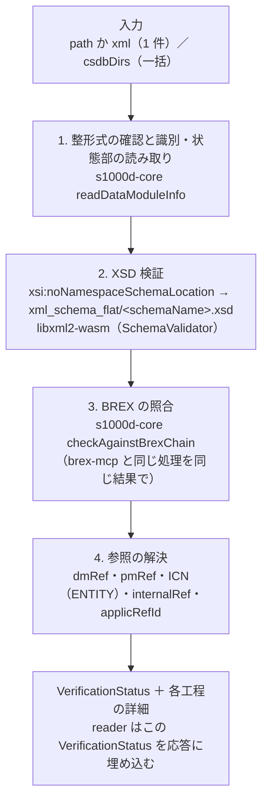
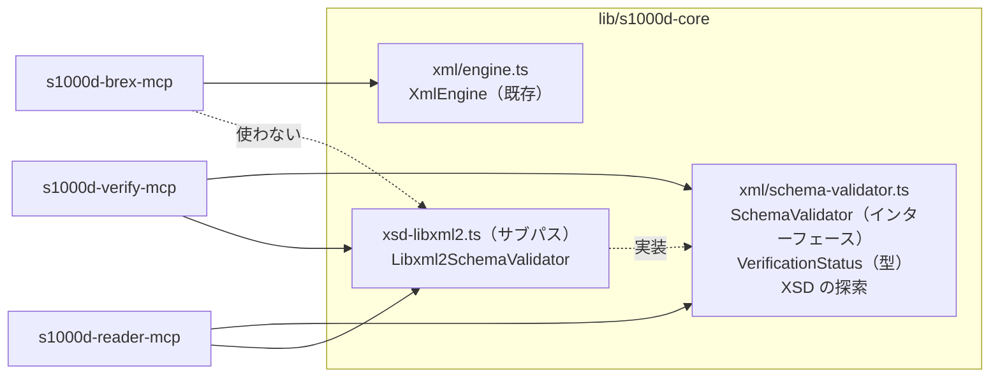

# s1000d-verify-mcp の設計

LLM がデータモジュールの「検証状態」を根拠付きで知るための MCP サーバーです。XSD 検証（`libxml2-wasm`、D-15）、BREX の照合（s1000d-core の呼び出し、D-10）、参照の解決の 3 つを行い、結果を reader が引用できる 1 つの形（`VerificationStatus`）にまとめて返します。

- 作成日: 2026-10-24（JST）
- 段階: 2（[ROADMAP.md](../ROADMAP.md)「段階 2 の作業」）
- 前提の決定: D-09・D-10・D-12・D-13・D-15
- 置き場所: `shuji-bonji/s1000d-verify-mcp`、npm `@shuji-bonji/s1000d-verify-mcp`、ローカル `s1000d-stack/mcp/s1000d-verify-mcp`（D-05）

## しないこと

brex-mcp と同じく、`initialize` の `instructions` に先に書きます（D-13、shuji-mcp-patterns §G）。

| しないこと | 理由 |
|---|---|
| S1000D 準拠を判定しない | XSD と BREX の機械判定に通っても、nonContextRules と人が読むビジネスルール文書が残る。応答に `conformant` のような 1 つの真偽値は置かない |
| 重大度（`brsl01`〜`brsl99`）を解釈しない | 意味はプロジェクトが決める（Chap 3.9.6.1） |
| 仕様書・XSD・既定 BREX を同梱しない | D-03。XSD は利用者が置いた `S1000D_SPEC_DIR` の下の `xml_schema_flat/` から探す |
| XSD が見つからないときに XSD 検証を省いて「合格」と言わない | `schema.state` を `schema-not-found` にして返す。brex-mcp の「XSD 未検証」と同じ扱い |
| 内容を読んで要約しない | 本文の読み取りは reader の仕事。verify は検証結果だけを返す |

## 全体の流れ



工程 2 で XSD に違反があっても工程 3・4 は続けます。XSD の誤りが BREX の違反を生むことがあるため、応答の `_notes` に「XSD に違反があるので BREX の結果は参考」と書きます。

## ツール案

| ツール | 入力 | 返すもの |
|---|---|---|
| `verify_data_module` | `path` または `xml`（5 MB まで）、`csdbDirs`、`skip`（`schema` / `brex` / `references` のうち省く工程）、`product`（適用性の判定に使う製品属性。省略可） | `verification`（`VerificationStatus`）、`schema`（XSD 違反の一覧）、`brex`（brex-mcp の `check_against_brex` と同じ形）、`references`（未解決の参照の一覧）、`_notes` |
| `validate_schema` | `path` または `xml`、`issue`（XSD の版を明示したいとき。省略時は `schemaLocation` から推定） | `schema`: `state`、`issue`、`schemaName`、`xsdPath`、`errors[]`（`message` / `line` / `column` / `level` / `xpath`）、`validator`（`libxml2-wasm` の版と同梱 libxml2 の版） |
| `check_references` | `path` または `xml`、`csdbDirs`、`kinds`（`dmRef` / `pmRef` / `icn` / `internal` / `applic`） | 参照ごとに `kind`、`target`（DMC・PMC・ICN・id）、`resolved`（見つかったファイルのパスと版）、`location`（XPath と行）。見つからないものは `unresolved[]` |
| `verify_csdb` | `csdbDirs`、`include`（`DMC` / `PMC` / `DML` / `DDN` / `IMF` / `UPF`。既定は DMC と PMC）、`limit`、`offset`、`skip`、`reportPath`（JSON を書き出す先。省略時は書き出さない） | オブジェクトごとの `VerificationStatus` の一覧と件数の集計（適合・XSD 違反・BREX 違反・未解決参照・読めなかったもの） |
| `list_schemas` | （なし） | `S1000D_SPEC_DIR` の下で見つかった `xml_schema_flat/` の一覧（パス、推定した版、XSD の数、`brex.xsd` の有無）。`S1000D_SPEC_DIR` が未設定なら、その旨と置き方の説明 |

`verify_data_module` が主で、他の 4 つはその工程を 1 つずつ呼ぶためのものです。brex-mcp の `check_against_brex` は verify-mcp に持ち込まず、BREX の詳細（ルールの説明や値の意味）が要るときは brex-mcp を使うよう `instructions` に書きます。

## 応答の形: `VerificationStatus`

reader が「このデータモジュールはどこまで確認済みか」を応答に必ず含めるための共通の形です（段階 2 の完了条件）。型は s1000d-core に置き、verify-mcp と reader-mcp が同じ定義を使います（D-09「解釈を 1 か所に集める」）。

```ts
export interface VerificationStatus {
  /** 検証した対象 */
  target: { dmCode?: DmCode; issueInfo?: IssueInfo; schemaName?: string; issue?: string; path?: string };
  wellFormed: boolean;
  schema: {
    state: 'valid' | 'invalid' | 'schema-not-found' | 'not-run';
    issue?: string;        // XSD の版（"7" など）。schemaLocation からの推定
    xsdPath?: string;
    errorCount?: number;
    validator?: string;    // 例: "libxml2-wasm 0.7.2 (libxml2 2.14.0)"
    reason?: string;       // schema-not-found / not-run の理由
  };
  brex: {
    state: 'passed' | 'violations' | 'incomplete' | 'not-run';
    layers: number;        // 照合した BREX の層の数
    violationCount: number;
    unresolved: string[];  // 見つからなかった BREX の DMC
    manualChecks: number;  // nonContextRules の数（人が確認する項目）
    skippedRules: number;  // XPath を評価できなかったルールの数
  };
  references: {
    state: 'resolved' | 'unresolved' | 'not-run';
    checked: number;
    unresolvedCount: number;
  };
  checkedAt: string;       // ISO 8601（JST のオフセット付き）
}
```

状態の決め方:

| 項目 | 値 | 条件 |
|---|---|---|
| `schema.state` | `valid` | XSD を見つけて検証し、違反が 0 |
| | `invalid` | 違反が 1 つ以上 |
| | `schema-not-found` | `S1000D_SPEC_DIR` が未設定、`xml_schema_flat/` が無い、`schemaLocation` から XSD の名前を得られない、版が合う XSD が無い |
| | `not-run` | `skip` で省いた |
| `brex.state` | `passed` | すべての層で違反 0、評価できなかったルール 0、未解決の BREX 0（core の `BrexCheckReport.passed` と同じ） |
| | `violations` | 違反が 1 つ以上 |
| | `incomplete` | 違反は 0 だが、未解決の BREX か評価できなかったルールがある |
| `references.state` | `resolved` / `unresolved` | 未解決が 0 か 1 以上か |

`passed` は「BREX の機械で判定できるルールに違反が無い」だけを意味し、`manualChecks` が 0 でない限り人の確認が残ることを `_notes` に毎回書きます。

## 工程の詳細

### 2. XSD 検証

- XSD の場所: `S1000D_SPEC_DIR` の下を再帰的に探し、`brex.xsd` を含む `xml_schema_flat/` フォルダーを候補にします（利用者が内側の zip をどの名前で展開しても見つかるようにするため。background.md「MCP が探すべきもの」）。候補が複数（Issue 7 と 4.2 を並べて置いた場合）なら、対象の `schemaLocation` から得た版（`S1000D_7` → `7`）とフォルダーのパスに含まれる版の表記（`Issue 7`、`4-2`、`4.2`）を突き合わせて選びます。選べないときは `schema-not-found` にし、`list_schemas` で候補を見せます。配布物の `xml_schema_cat/catalog.xml` は `rewritePrefix` を利用者が書き換える前提のものなので使いません。
- 対象の XSD は `schemaLocation` の末尾のファイル名（`descript.xsd` など）で決めます。`parseSchemaLocation` の `schemaName` を使います。
- `xs:import`（`xml.xsd` / `xlink.xsd` / `rdf.xsd`）の解決は、`xml_schema_flat/` 内の全 XSD を `XmlBufferInputProvider` に登録して行います（U-08 の比較結果）。この API は `@alpha` 表記なので、`SchemaValidator` の実装の中だけで使います。
- 検証器は XSD のファイルごとに 1 つ作って使い回し、対象の `XmlDocument` は検証のたびに `dispose()` します（D-15）。検証器はサーバーの終了時に `dispose()` します。
- 違反は `XmlValidateError.details[]` の `message` / `line` / `col` / `level` と、得られれば `xpath` をそのまま返します。文章は libxml2 のもので、翻訳しません。
- DOCTYPE の内部サブセット（`ENTITY` / `NOTATION`）は libxml2 が読めます（Bike Samples 31 件で確認済み）。宣言の列挙は引き続き s1000d-core（`@xmldom/xmldom`）が行います。

### 3. BREX の照合

- s1000d-core の `checkAgainstBrexChain(xml, resolver, { extraLayers })` を呼ぶだけにします。解決器は `createDirectoryBrexResolver([...csdbDirs, S1000D_CSDB_DIR, S1000D_SPEC_DIR])` です。brex-mcp の `services/brex-locator.ts` にある探索の手順（既定 BREX を `DMC-S1000D-*-04-10-0301-00A-022A-D*.XML` で探し、中身の DMC が一致するものを優先する）は、2 つの MCP で重複させず、s1000d-core に移して両方から呼びます（段階 2 の作業 1）。
- 応答の `brex` は brex-mcp の `check_against_brex` と同じ形（`layers[]`、`unresolvedBrex`、`passed`）にし、利用者が 2 つの MCP の結果を見比べられるようにします。

### 4. 参照の解決

| 種類 | 読む場所 | 解決の方法 |
|---|---|---|
| `dmRef` | `dmRef/dmRefIdent/dmCode`（`issueInfo` と `language` があれば併せて） | s1000d-core の `listDataModules` と `findDataModule` で CSDB から探す。`issueInfo` が指定されていれば版の一致も確かめ、違えば `resolved` に見つかった版を入れて `issueMismatch: true` を付ける |
| `pmRef` | `pmRef/pmRefIdent/pmCode` | ファイル名 `PMC-<modelIdentCode>-<pmIssuer>-<pmNumber>-<pmVolume>_…` で探す。core に `parsePmcFileName` を足す |
| ICN | `graphic/@infoEntityIdent`、`multimediaObject/@infoEntityIdent` と、DOCTYPE の `<!ENTITY name SYSTEM "file" NDATA notation>` | 実体名 → 宣言のファイル名 → CSDB のフォルダーに同名のファイルがあるか。宣言が無い実体名は `unresolved`（`reason: "no ENTITY declaration"`） |
| 内部参照 | `internalRef/@internalRefId` | 同じ文書内に同じ `@id` があるか（XSD の `xs:ID` / `xs:IDREF` では検査されないため） |
| 適用性の参照 | `@applicRefId` → `referencedApplicGroup/applic/@id`、`applicCrossRefTableRef`、`condCrossRefTableRef`、`productCrossRefTableRef` | 文書内の id と、ACT・CCT・PCT のデータモジュールが CSDB にあるか |

適用性の **評価**（この製品に当てはまるか）は reader の仕事で、verify は参照が解決できるかだけを見ます（[reader-mcp.md](./reader-mcp.md)）。

## `SchemaValidator` と `libxml2-wasm` の置き場所（提案）

handoff の論点 (c) です。選択肢を比べ、**インターフェースと型は s1000d-core、`libxml2-wasm` の実装も s1000d-core のサブパス `@shuji-bonji/s1000d-core/xsd-libxml2`（`libxml2-wasm` は任意の peerDependency）** にします。**2026-10-24 に D-17 として確定しました。**

| 案 | 内容 | 利点 | 欠点 |
|---|---|---|---|
| A | インターフェースも実装も verify-mcp に置く | core が純粋な JS のまま | reader も「検証状態」を返すために XSD 検証が要る。reader が verify を呼ぶ手段は MCP には無いので、reader にも実装を複製することになる（D-10 で避けた「同じ処理を 2 か所に書く」） |
| B | インターフェース・型・XSD の探索は core の本体、`libxml2-wasm` の実装は core のサブパス `xsd-libxml2`。`libxml2-wasm` は `peerDependencies`（`peerDependenciesMeta` で optional） | 実装が 1 か所。brex-mcp は `libxml2-wasm` を入れずに済む。`VerificationStatus` の型を core に置けるので reader と verify で同じ形になる | core のテストに `libxml2-wasm` が devDependency として入る。サブパスの `exports` の設定が要る |
| C | 新しいパッケージ `@shuji-bonji/s1000d-xsd` | core が純粋な JS のまま、実装も 1 か所 | リポジトリと npm パッケージが 1 つ増え、公開の手順（D-14）も 1 つ増える。中身はインターフェース 1 つと実装 1 つで小さい |

B を提案する理由は、D-15 が「`XmlEngine`（D-12）と同じく 1 つのインターフェースの後ろに置く」と書いており、`XmlEngine` は core の `src/xml/engine.ts` にあるためです。core が大きくなったときに C に分ける、という D-10 の末尾と同じ逃げ道を残します。



インターフェースの案:

```ts
export interface SchemaValidator {
  /** XSD を読み込み、使い回せる検証器を返す。失敗は SchemaLoadError */
  load(xsdPath: string): Promise<LoadedSchema>;
  /** すべての検証器を破棄する（サーバーの終了時） */
  dispose(): void;
}
export interface LoadedSchema {
  xsdPath: string;
  validate(xml: string, options?: { url?: string }): SchemaValidationResult;
  dispose(): void;
}
export interface SchemaValidationResult {
  valid: boolean;
  errors: Array<{ message: string; line?: number; column?: number; level?: string; xpath?: string }>;
  validator: string; // 実装名と版
}
```

## 環境変数と設定

brex-mcp と同じ名前を使います（`config.ts` を同じ形で書く）。

| 変数 | 内容 |
|---|---|
| `S1000D_SPEC_DIR` | 利用者が入手した配布物を展開したフォルダー。XSD と既定 BREX をここから探す |
| `S1000D_CSDB_DIR` | プロジェクトの CSDB。`path.delimiter` 区切りで複数 |

上限は `maxInlineXmlBytes`（5 MB）、`verify_csdb` の 1 回の件数（既定 100、最大 1,000）、XSD 違反の 1 件あたりの返却数（既定 100）です。

## テスト

| 種類 | 内容 |
|---|---|
| 自作データ（CI で常に） | 券売機の説明 DM（`__fixtures__/kenbaiki-descript.xml`）を、自作の最小 XSD ではなく **XSD 無しの状態**で検証して `schema-not-found` になること。意図的に壊した DM（未知の要素、型違反）で XSD 違反の行番号が返ること（XSD はテスト内で生成した小さな自作スキーマを使う）。参照の解決で、存在する `dmRef` と存在しない `dmRef`、宣言の無い ICN が正しく分かれること |
| 配布物（`S1000D_SPEC_TESTS=1` のときだけ） | Bike Samples のデータモジュール 106 件が XSD に適合すること（U-08 の実測と一致）。`verify_csdb` の集計が 106 件・XSD 違反 0 になること。既定 BREX への違反 55 件が brex-mcp と同じ数になること |
| MCP の層 | brex-mcp と同じく `InMemoryTransport` でツールを呼ぶテストと、stdio の実機確認 |

## 段階 2 の他の部品との関係

- reader-mcp は `verify_data_module` を呼ぶのではなく、core の同じ関数（`verifyDataModule()`、仮称）を呼んで `VerificationStatus` を作り、応答に埋め込みます。詳細は [reader-mcp.md](./reader-mcp.md)。
- 段階 3 の Skill `s1000d-review` は、verify-mcp の `verify_csdb` を最初に呼び、違反の説明に brex-mcp の `explain_brex` を使う手順になる見込みです。

## 確定が要ること

| 項目 | 内容 | 期限 |
|---|---|---|
| ~~D-17 候補~~ | **確定（2026-10-24、D-17）**: `SchemaValidator` と `libxml2-wasm` の実装の置き場所は上の案 B | — |
| core の版 | 段階 2 の変更（`SchemaValidator`、`VerificationStatus`、参照の解決、BREX の探索の移動）で core を 0.2.0 にする。brex-mcp の依存は `^0.2.0` に上げる | core の変更をまとめるとき |
| U-03 | 2 つ目の MCP（verify-mcp）がテストで自作データを使い始めるので、自作サンプルデータの共有パッケージへの切り出しをこのときに判断する | verify-mcp のテストを書くとき |
