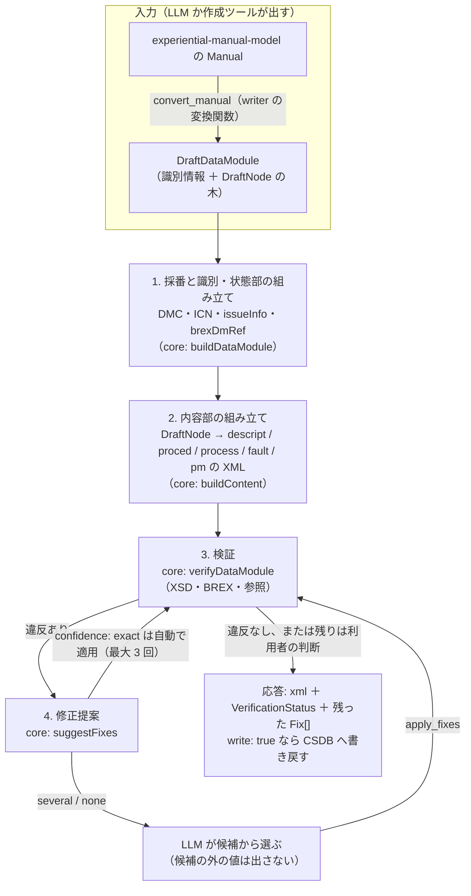
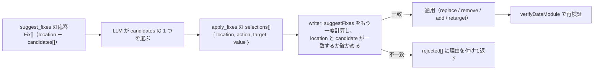
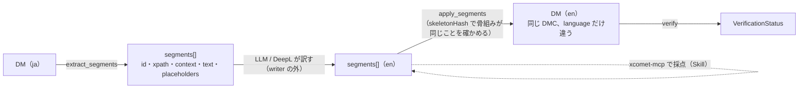

# s1000d-writer-mcp の設計

LLM に XML を書かせずに、S1000D のデータモジュールを作り、直し、翻訳用に文を出し入れするための MCP サーバーです。LLM が出すのは「題名・段落・手順・参照先の DMC」のような構造化された入力で、XML はこのサーバーが組み立てます。組み立てた XML は必ず verify（core の `verifyDataModule`）に通し、通らなければ `suggestFixes` の候補で直す「生成 → 検証 → 修正」を繰り返します。

- 作成日: 2026-10-28（JST）
- 段階: 3（[ROADMAP.md](../ROADMAP.md)「段階」の表。完了の条件は「券売機の例を共通データモデル経由で S1000D に出力し、verify を通る」）
- 前提の決定: D-03（仕様書・XSD を同梱しない）、D-09（S1000D との対応は変換関数に集める）、D-10・D-17（処理は core に置く）、D-13（MCP SDK v2）、D-19（決定論的に確かめられることは core が行い、LLM は文章の生成と説明に限る）
- 前提の設計: [agent-platform.md](./agent-platform.md)「LLM 活用時の注意点」の「段階 3 の writer は LLM に XML を書かせない」、[manual-model.md](./manual-model.md)「S1000D との対応（writer が使う）」
- 置き場所: `shuji-bonji/s1000d-writer-mcp`（GitHub に作成済み、中身は空）、npm `@shuji-bonji/s1000d-writer-mcp`、ローカル `s1000d-stack/mcp/s1000d-writer-mcp`（D-05）
- 依存: `@shuji-bonji/s1000d-core`（XML の組み立て・検証・修正の処理）と `@shuji-bonji/experiential-manual-model`（共通データモデルの型。変換関数はこの MCP に置く）。core は manual-model に依存させない（ROADMAP「全体像」の矢印のとおり）

## しないこと

brex-mcp・verify-mcp・reader-mcp と同じく、`initialize` の `instructions` に先に書きます（D-13、shuji-mcp-patterns §G）。

| しないこと | 理由 |
|---|---|
| LLM が書いた XML 文字列を受け取らない | 入力は構造化された木（下の `DraftNode`）に限る。XML を受け取ると「LLM に XML を書かせない」境界が崩れ、スキーマ準拠と参照の整合を保証できない（agent-platform.md） |
| 候補の外の値で直さない | `apply_fixes` は `suggestFixes` が返した候補と一致する選択だけを受け付ける。一致しない値は適用せずに `rejected` として返す（D-19 の境界を機械的に守る） |
| 検証を省いて書き戻さない | 組み立てた XML は必ず `verifyDataModule` に通し、応答に `VerificationStatus` を付ける。XSD が無いときは `schema-not-found` のまま返し、「適合」とは言わない |
| 既定では CSDB に書き込まない | 応答に XML を返すだけにし、書き込みは `write: true` と書き込める置き場所（下の `WritableCsdbSource`）を指定したときだけ行う。製品の CSDB を黙って変えないため |
| S1000D 準拠を判定しない、重大度を解釈しない | verify-mcp と同じ。`commentPriorityCode`・`commentType`・`issueType` も列挙のまま渡し、意味を付けない |
| 翻訳をしない、訳の品質を採点しない | `extract_segments` / `apply_segments` は文を出し入れするだけ。翻訳は LLM や DeepL が行い、採点は xcomet-mcp と組み合わせる（Skill の仕事） |
| 図の中身を作らない、STE の辞書を持たない | 図は ICN の参照と原本のファイル名だけを扱う。STE（ASD-STE100）は利用条件が要るため、用語集は利用者のものを Skill から参照する（agent-platform.md） |
| 仕様書・XSD・既定 BREX を同梱しない | D-03。XSD・既定 BREX は `S1000D_SPEC_DIR`（無ければ設定ファイル、D-25）から読む |

## 全体の流れ



工程 3 と 4 は verify-mcp と同じ core の関数を呼びます（D-10・D-17）。writer-mcp は verify-mcp を呼べない（MCP 同士は呼び合えない。D-18 と同じ理由）ので、同じ関数を自分で呼び、応答の検証状態は verify-mcp と同じ形・同じ結果になります。

## 入力の形: `DraftDataModule`

LLM と作成ツールが出す入力です。reader-mcp が返す `ContentNode` の木（core `src/content/types.ts`）と同じ語彙を使います。LLM は reader で読んだ形をそのまま書き戻せ、writer は reader が知らない構造を受け取りません。

```ts
export interface DraftDataModule {
  /** DMC を自分で指定するか、採番の規則（下の allocation）に任せるかのどちらか */
  dmCode?: DmCode;
  /** 採番に使う識別子。dmCode を省いたときに要る。同じ sourceId には同じ DMC を返す */
  sourceId?: string;
  /** データモジュールの種類。schemaName（descript.xsd など）を決める */
  kind: 'descript' | 'proced' | 'process' | 'fault' | 'pm';
  language: { languageIsoCode: string; countryIsoCode: string };
  issueInfo?: IssueInfo;             // 省略時は 001-00（新規）か、既存の版 +1（上書き）
  issueDate?: string;                // YYYY-MM-DD。省略時は今日（JST ではなく実行環境の日付。応答に書く）
  title: { techName: string; infoName?: string };
  securityClassification: string;    // 列挙のまま。省略を許さない（agent-platform.md「機密区分を必ず付ける」）
  responsiblePartnerCompany?: string;
  originator?: string;
  applic?: DraftApplic;              // 省略時は applic 要素を置かず、BREX が要求すれば missing で返る
  brexDmRef?: DmCode;                // 省略時は allocation.brexDmRef（無ければ既定 BREX）
  body: DraftNode[];
}

/** ContentNode の書き込み用の部分集合。location・attrs・unknown は受け取らない */
export interface DraftNode {
  kind: 'section' | 'para' | 'list' | 'listItem' | 'definition' | 'table' | 'figure'
      | 'admonition' | 'step' | 'requirements' | 'sequence' | 'if' | 'dialog' | 'entry';
  id?: string;
  title?: string;
  text?: string;                     // 参照は text に埋め込まず refs に書く
  level?: 'warning' | 'caution' | 'note';
  ordered?: boolean;
  rows?: string[][];
  question?: string;
  choices?: Array<{ text: string; next: string }>;   // next は同じ DM の step の id
  applicRefId?: string;
  securityClassification?: string;
  refs?: DraftRef[];
  children?: DraftNode[];
}

export interface DraftRef {
  kind: 'dmRef' | 'pmRef' | 'internalRef' | 'graphic' | 'multimedia';
  /** dmRef / pmRef は DMC・PMC、internalRef は同じ DM の id、graphic / multimedia は ICN か assetId */
  target: string;
  title?: string;
}
```

`kind` ごとに受け付ける `DraftNode.kind` を固定し、合わないものは XML を組み立てる前に `input-error` として返します（例: `descript` に `step` は置けない、`fault` の `step` には `question` か `text` のどちらかが要る）。この検査は XSD 検証の前の、入力の形の検査です。XSD 検証の代わりではありません。

> [!NOTE]
> `text` に `[→ …]` の形で参照を埋め込む reader の書き方は、writer では受け取りません。reader は人と LLM が読む向けに埋め込み、writer は参照先を機械で解決するため `refs` に分けます。`text` の中の `<` と `&` はそのまま文字として扱い、writer が実体参照に変えます。インライン要素（`emphasis`・`acronym`・`quantity` など）は最初の版では作りません（下の「確定が要ること」）。

## 採番と識別・状態部: `allocation`

DMC・ICN・`brexDmRef`・`issueInfo` は LLM ではなく writer が付けます（agent-platform.md）。規則は入力の `allocation` で与えます。

```ts
export interface Allocation {
  modelIdentCode: string;            // 例: 'KENBAIKI'（試作では架空のコード）
  systemDiffCode: string;            // 例: 'A'
  /** sourceId（Topic.id など）→ SNS と情報コードの対応。無い sourceId は rules で決める */
  map?: Record<string, Partial<DmCode>>;
  rules: {
    sns: { systemCode: string; subSystemCode: string; subSubSystemCode: string; assyCode: string };
    disassyCode?: string; disassyCodeVariant?: string;
    /** kind ごとの情報コード。既定は無く、省略すると input-error（情報コードの意味はプロジェクトが決める） */
    infoCodeByKind: Partial<Record<DraftDataModule['kind'], { infoCode: string; infoCodeVariant: string }>>;
    itemLocationCode: string;
  };
  icn: { cageCode: string; /** 次に使う連番。応答に次の値を返す */ next: number };
  brexDmRef?: DmCode;
  /** 既に使った DMC・ICN。CSDB から集めるか、前回の応答の ledger をそのまま渡す */
  ledger?: Record<string, string>;   // sourceId → DMC / assetId → ICN
}
```

- **writer は状態を持ちません。** `ledger` は入力で受け取り、応答で返します。同じ `sourceId` を 2 回出したら同じ DMC を返し、再変換で DMC が変わらないようにします。台帳の保管は呼び出す側（Skill か作成ツール）の仕事です。製品に組み込むときに、製品の採番の仕組みに置き換えられるようにするためです。
- `ledger` に無く `map` にも無い `sourceId` は、`rules` の SNS と `infoCodeByKind` から DMC を組み立て、`disassyCode` を連番で埋めます（同じ SNS・情報コードの DM が CSDB にあれば、その次の番号）。
- ICN は Issue 7 の CAGE 書式で `ICN-<cageCode>-<連番 5 桁>-<issue>-<security>` の形にし、試作では架空の CAGE で採番します（background.md「設計のヒント」。学習サイトには「実納品では登録が前提」と書く）。
- `issueInfo` は、`write: true` で同じ DMC が CSDB にあれば `issueNumber` を 1 上げて `inWork` を `00` にし、無ければ `001-00` にします。版の上げ方（`inWork` を使う運用）はプロジェクトの決まりなので、`issuePolicy: 'increment-issue' | 'increment-inwork' | 'keep'` で切り替えられるようにします。
- `brexDmRef` は入力 → `allocation.brexDmRef` → 既定 BREX（core `findDefaultBrex`）の順で決め、どれを使ったかを応答の `_notes` に書きます。

## ツール案

| ツール | 入力 | 返すもの |
|---|---|---|
| `build_data_module` | `draft`（`DraftDataModule`）、`allocation`、`csdbDirs`（参照の解決と採番の台帳に使う）、`write`（既定 false）、`maxFixRounds`（既定 3）、`product`（適用性の判定に使う。省略可） | `xml`、`fileName`（`DMC-….XML`）、`dmCode`、`verification`（`VerificationStatus`）、`appliedFixes[]`（自動で適用した `exact` の候補）、`fixes[]`（残った `several` / `none`）、`ledger`、`written`（書き込んだパス。`write: true` のとき）、`_notes` |
| `convert_manual` | `manual`（experiential-manual-model の JSON）か `manualPath`、`allocation`、`csdbDirs`、`write`、`topics`（変換する `Topic.id` の一覧。省略で全部）、`language`（省略時は `Manual.language`） | `dataModules[]`（`build_data_module` の応答と同じ形を Topic ごとに）、`publicationModule`（PM の XML と `verification`）、`assets[]`（`Asset.id` → ICN とコピー元のパス。原本のコピーは `write: true` のときだけ）、`ledger`、`summary`（件数と検証状態の集計）、`_notes` |
| `apply_fixes` | `path` または `xml`、`csdbDirs`、`selections[]`（`{ location, action, target?, value? }`。`suggest_fixes` の `Fix.location` と `candidates[]` の 1 つを写したもの）、`write` | `xml`、`applied[]`、`rejected[]`（候補と一致しなかった選択と理由）、`verification`（適用後に再検証）、`fixes[]`（残り）、`_notes` |
| `create_comment` | `refs[]`（`dmRef` / `pmRef` / `dmlRef` / `ddnRef` の対象と版）、`commentType`（`q` / `i` / `r`）、`commentPriorityCode`（`cp01`〜`cp99`）、`title`、`paragraphs[]`（`simplePara` の文）、`originator`（`enterpriseCode` と `enterpriseName`）、`senderIdent`、`modelIdentCode`、`securityClassification`、`seqNumber`（省略時は CSDB の同じ年の次の番号）、`responseType`（省略可）、`csdbDirs`、`write` | `xml`、`fileName`、`commentCode`、`verification`（`comment.xsd` で検証、BREX の `rulesContext` に comment があれば照合）、`_notes` |
| `extract_segments` | `path` または `xml`、`include`（`title` / `para` / `step` / `admonition` / `table` / `caption`。既定は全部）、`maxSegments` | `dmCode`、`language`、`skeletonHash`、`segments[]`（`{ id, xpath, element, context, text, placeholders[] }`）、`counts`、`_notes` |
| `apply_segments` | `path` または `xml`、`skeletonHash`、`segments[]`（`{ id, text }`。訳した文）、`language`（訳先）、`issueInfo`（省略時は元と同じ）、`write` | `xml`、`fileName`（`language` だけ違う）、`verification`、`unapplied[]`（`id` が無い、プレースホルダーが欠けた文）、`_notes` |

`build_data_module` が主で、`convert_manual` はそれを Topic ごとに呼ぶものです。`apply_fixes` は verify-mcp の `suggest_fixes` の続きで、`suggest_fixes` の候補を writer 側でもう一度計算し、一致した選択だけを適用します。brex-mcp・verify-mcp・reader-mcp の機能は持ち込まず、`instructions` に「BREX の説明は brex-mcp、検証の詳細は verify-mcp、読むのは reader-mcp」と書きます。

### `convert_manual` の対応

manual-model.md「S1000D との対応」の表をそのまま実装します。要点だけ再掲します。

| manual-model | 出力 | 補足 |
|---|---|---|
| `Manual` | `pm` 1 件 ＋ `Topic` ごとに DM 1 件 | `pmEntry` の並びは `Manual.topics` の順。PMC は `allocation` と同じ規則（`pmIssuer` は `icn.cageCode`、`pmNumber` は `Manual.id` から） |
| `Topic(kind: description)` ＋ `blocks` | `descript` | `Block.kind` を `DraftNode.kind` にそのまま写す |
| `Topic(kind: procedure)` ＋ `steps` | `proced` | `Step.children` を `step` の入れ子に、`Step.expected` を手順の文の末尾に、`Step.admonitions` を手順の前の `admonition` に |
| `Topic(kind: screenFlow)` ＋ `screens` ＋ `Hotspot.transition` | `process`（`dmNode` / `dmIf` / `dmSeq`）＋ 画面ごとの `proced` | 2021 年の作品の中心。`Transition.condition` の文を `dmIf` の条件に。`Hotspot.id` を `hotspot/@applicationStructureIdent` に写す |
| `Topic(kind: troubleshooting)` | `fault` | `Step.question` / `answers` を `isolationStepQuestion` / `isolationStepAnswer` に |
| `Asset` | ICN（`figure/graphic` か `multimedia`） | `Asset.source` を原本に、`Asset.display` は出さない。`multimedia` の形式は brex-mcp と同じ core の関数で BREX の NOTATION を読んで選ぶ |
| `Scope` | `applic` ＋ ACT の `productAttribute` | `Scope.property` → `applicPropertyIdent`、`values` → `applicPropertyValues`。ACT は無ければ 1 件作る |
| `Admonition` / `Term` / `Manual.version` / `Manual.language` | `warning` / `caution` / `note`、`definitionList`、`issueInfo`・`issueDate`、`language` | 1 対 1 |

変換関数は writer-mcp のパッケージに置き（`src/convert/manual-to-draft.ts`）、MCP を介さずライブラリとしても呼べるようにします。作成ツール（段階 3 の試作）はこの関数を直接使い、MCP は LLM 向けの入口です。

### `apply_fixes` の受け付け方



- `provide`（文書ではなく製品の値を与える候補）は文書を変えないので、`apply_fixes` では受け付けず、`product` に渡すよう案内します。
- `valueForm` が `range` / `pattern` の候補は、`value` がその範囲・正規表現に合うことを確かめて適用します。合わなければ `rejected`。
- 適用は core の `applyFix(xml, fix, candidate)` で行い、DOM の操作（`@xmldom/xmldom`、D-12）で属性・要素を直して直列化します。元の XML の宣言・DOCTYPE（ICN の `ENTITY` / `NOTATION` 宣言）・空白は保ちます。`add` で要素を足すときの位置は XSD の定義（core `XsdIndex`）から親の子要素の順序を読んで決めます。

### `create_comment`

Issue 7 の `comment.xsd` の構造（2026-10-28 に XSD を読んで確認）に沿って組み立てます。

| 要素 | 入力 | 補足 |
|---|---|---|
| `commentIdent/commentCode` | `modelIdentCode`・`senderIdent`・`yearOfDataIssue`（今年）・`seqNumber`・`commentType` | 5 つとも必須の属性。`commentType` は `q` / `i` / `r` の列挙（意味は付けない） |
| `commentAddressItems` | `title`（省略可）・`issueDate`・`originator`（`dispatchAddress`） | |
| `commentStatus` | `securityClassification`・`commentPriority/@commentPriorityCode`・`commentRefs`・`brexDmRef`・`commentResponse/@responseType`（省略可） | `commentRefs` は `refs[]` が空なら `noReferences` |
| `commentContent` | `paragraphs[]` → `simplePara`（1 つ以上） | `attachmentRef` は最初の版では作らない |

レビューの結果を comment DM にするのは Skill（`s1000d-review`）の手順です。writer は「verify-mcp の `suggest_fixes` の `Fix` を `paragraphs[]` に写す」ような解釈をせず、文はそのまま受け取ります。

### `extract_segments` / `apply_segments`



- 対象は人が読む文だけです。`dmTitle`（`techName` / `infoName`）、`para`・`simplePara`、手順の文、`warning` / `caution` / `note` の文、表のセル、図の `title`。属性値・DMC・ICN・`applic` の式・`id` は出しません。
- インライン要素（`emphasis`・`internalRef`・`dmRef`・`acronym` など）は `{1}`・`{2}` のプレースホルダーに置き換え、`placeholders[]` に元の要素を残します。`apply_segments` はプレースホルダーの数と番号が揃っていることを確かめ、揃わない文は `unapplied[]` に入れて元の文を残します。
- `id` は `xpath` から作る安定した文字列（`p-0012` のような連番ではなく、XPath の短縮形）にし、`skeletonHash` は文を空にした XML のハッシュです。元の DM が変わっていれば `apply_segments` は `skeleton-mismatch` で止まります。
- 訳した DM は同じ DMC で `language` だけ変え、`issueInfo` は元と同じにします（言語違いの DM は DMC が同じで `language` だけ違う。agent-platform.md）。

## 書き戻し: `WritableCsdbSource`

core の `CsdbSource` は `list()` と `readText()` だけです（読む側の設計）。writer のために書き込みを足します。

```ts
export interface WritableCsdbSource extends CsdbSource {
  /** 置き場所の中の識別子（CsdbObject.path）と中身を受け取り、書き込んだ識別子を返す */
  writeText(path: string, text: string): string;
  /** ICN の原本など、文字列でないファイル */
  writeBytes(path: string, bytes: Uint8Array): string;
}
```

- `DirectoryCsdbSource` と `MemoryCsdbSource` に実装を足します。既存の `CsdbSource` は変えません（agent-platform.md「小。既存 API は変えない」と同じ扱い）。
- 同期のままにします（`CsdbSource` を同期にした理由と同じ。非同期にしか書けない製品は、応答の `xml` を受け取って自分で書く）。`write: false` が既定なので、製品側は書き込みの実装を持たなくても writer を使えます。
- 書き込む前に同じ `path` があれば、`overwrite: true` が無い限り `write-conflict` で止めます。
- 書き込みは検証の後です。`verification.schema.state` が `invalid` のときも `allowInvalid: true` が無ければ書きません（`schema-not-found` は書きます。XSD が無い環境を止めないため。`_notes` に書く）。

## s1000d-core への追加（writer のために）

D-10・D-17 と同じく、処理は core に置き、writer-mcp はそれを呼ぶだけにします。

| 追加 | 置き場所 | 内容 |
|---|---|---|
| `buildDataModule(draft, allocation, index)` | `src/write/build.ts` | 識別・状態部と内容部を組み立てて XML 文字列を返す。`DraftDataModule` の形の検査（`kind` ごとの `DraftNode.kind`）を含む |
| `buildContent(kind, body)` | `src/write/content/*.ts` | `descript` / `proced` / `process` / `fault` / `pm` の 5 つ。reader の `src/content/read.ts` と対になる（読んで書き戻すと同じ木になることをテストで固定） |
| `allocateDmc` / `allocateIcn` / `allocatePmc` | `src/write/allocate.ts` | `Allocation` と `ledger` から採番する。CSDB の既存の番号は `CsdbIndex` から読む |
| `applyFix(xml, fix, candidate)` | `src/fix/apply.ts` | `Fix` の候補を DOM で適用する。`add` の位置は `XsdIndex` から |
| `buildComment(input, index)` | `src/write/comment.ts` | comment DM の組み立て |
| `extractSegments` / `applySegments` | `src/segments/` | 文の抜き出しと差し戻し |
| `WritableCsdbSource` と 2 つの実装 | `src/csdb-source.ts` | 上の節 |
| `DraftDataModule` / `DraftNode` / `Allocation` の型と JSON Schema | `src/write/types.ts`、`schema/draft.schema.json` | MCP のツールの `inputSchema` にそのまま使う（`fromJsonSchema`、D-13） |

> [!IMPORTANT]
> core はこれで「読む」と「書く」の両方を持つことになり、大きくなります。D-10 の末尾のとおり、大きくなったら `@shuji-bonji/s1000d-build`（仮）に分けます。最初から分けないのは、`buildContent` が reader の `ContentNode` の型と `XsdIndex`・`CsdbIndex` を共有するためです。分けるときも MCP 側に処理を持たせません。

## Skill との関係

段階 3 の Skill 3 つ（ROADMAP）は、この MCP のツールをどう組み合わせるかの手順です。writer に入れない判断（STE の用語集、訳の採点、レビューの文章）は Skill に置きます。

| Skill | 使うツール | writer に入れないもの |
|---|---|---|
| `experience-to-s1000d` | `convert_manual` → 残った `fixes[]` を `apply_fixes` で → verify-mcp `verify_csdb` で全体を確認 | `allocation` の決め方（モデル識別コード・SNS・情報コード）。Skill が利用者に聞く |
| `s1000d-publish` | `build_data_module` / `apply_fixes` → verify-mcp `reconcile_dml`（DML との照合） | DML・DDN の生成（段階 3 では作らない。必要になったら writer に足す） |
| `s1000d-review` | reader-mcp で読む → verify-mcp `suggest_fixes` → 指摘を `create_comment` に | STE の用語集（利用者のファイルを参照）、指摘の文章、`commentPriorityCode` の選び方 |

翻訳の手順（`extract_segments` → 訳す → xcomet-mcp → `apply_segments`）は 3 つの Skill のどれにも入らないので、4 つ目の Skill（`s1000d-translate`。名前は U-09 と一緒に決める）にします。

## 環境変数と設定

brex-mcp・verify-mcp・reader-mcp と同じです。`S1000D_SPEC_DIR`（XSD・既定 BREX）と `S1000D_CSDB_DIR`（`csdbDirs` の既定）を読み、無ければ設定ファイル `~/.config/s1000d-stack/config.json`（D-25、core `resolveStackConfig`）を読みます。`--http`（段階 2.5 の作業 4）も同じ `src/http.ts` を写します。writer 固有の設定（`allocation`）は環境変数や設定ファイルに置かず、呼び出しごとに渡します（writer は状態を持たない）。

## テスト

| 内容 | 置き場所 |
|---|---|
| 自作の `DraftDataModule`（券売機の説明・手順・画面遷移・故障探求の 4 種と PM）から XML を組み立て、自作 XSD と自作 BREX で `verifyDataModule` が `valid` になる | core `src/write/*.test.ts` |
| reader の `readContent` で読んだ `ContentNode` を `DraftNode` に写して `buildContent` に通し、もう一度読むと同じ木になる（往復） | core |
| `examples/kenbaiki.manual.json`（manual-model）を `convert_manual` に通し、Issue 7 の XSD と既定 BREX で全 DM と PM が通る（`S1000D_SPEC_TESTS=1`。**段階 3 の完了条件**） | writer-mcp `tests/spec.test.ts` |
| 改変した Bike Samples の DM（`securityClassification` の列挙違反など）で `suggest_fixes` → `apply_fixes` が `exact` を適用し、候補の外の値を `rejected` にする | core `src/fix/apply.test.ts`、writer-mcp |
| `create_comment` の XML が `comment.xsd` に通る（自作 XSD と Issue 7 の両方） | core、writer-mcp |
| Bike Samples の DM で `extract_segments` → 文をそのまま `apply_segments` → 元と同じ XML（空白を除く）になる。プレースホルダーを欠いた文が `unapplied` になる。`skeletonHash` が合わないと止まる | core `src/segments/*.test.ts` |
| `WritableCsdbSource`: `write: false` では何も書かない、`write: true` で `DMC-….XML` と ICN の原本が書かれる、同じ `path` は `write-conflict` | core、writer-mcp |
| InMemoryTransport で 6 ツールの `tools/list` と `tools/call`、`--http` の 7 件（他の MCP と同じ） | writer-mcp |

## 作業（段階 3。writer に関する分）

| 順 | 作業 | 置き場所 |
|---|---|---|
| 1 | core に `DraftDataModule` / `DraftNode` / `Allocation` の型と JSON Schema、`allocateDmc` / `allocateIcn` / `allocatePmc`、`buildDataModule` と `buildContent`（5 種）、往復のテスト | lib/s1000d-core（`src/write/`） |
| 2 | core に `applyFix` と `WritableCsdbSource`。core の minor を上げて公開 | lib/s1000d-core（`src/fix/apply.ts`、`src/csdb-source.ts`） |
| 3 | writer-mcp を作る: `build_data_module` / `apply_fixes` の 2 ツールと `instructions`、`--http`、設定ファイル、テスト。brex-mcp の依存を core の新しい minor に揃える（handoff の注記） | mcp/s1000d-writer-mcp |
| 4 | writer-mcp に `convert_manual`（manual-model → `DraftDataModule` の変換関数を含む）。券売機の例で Issue 7 の XSD・既定 BREX を通す（完了条件） | mcp/s1000d-writer-mcp（`src/convert/`） |
| 5 | core に `buildComment`、writer-mcp に `create_comment` | lib/s1000d-core、mcp/s1000d-writer-mcp |
| 6 | core に `extractSegments` / `applySegments`、writer-mcp に `extract_segments` / `apply_segments` | lib/s1000d-core（`src/segments/`）、mcp/s1000d-writer-mcp |
| 7 | 公開（npm → MCP Registry → claude-plugins。D-14・D-23）、`-dev` 版の登録（D-24）、サイトに `mcp/writer-mcp.md`（日英）、hub の README・`stack.json`・`guide/architecture.md` | mcp/s1000d-writer-mcp、hub |
| 8 | Skill 4 つ（`experience-to-s1000d` / `s1000d-publish` / `s1000d-review` / `s1000d-translate`）と作成ツールの試作。設計は別の文書にする | skill/、app/ |

作業 1〜3 で「生成 → 検証 → 修正」が回り、作業 4 で完了条件を満たします。5・6 は agent-platform.md「組み込みに要る広げ方」の残り（comment DM、翻訳向けの API）です。

## 確定が要ること

| 項目 | 内容 | 提案 |
|---|---|---|
| 処理の置き場所 | `buildContent` などを core に置くか、最初から別パッケージにするか | core に置き、大きくなったら分ける（上の IMPORTANT）。決めたら D-27 として DECISIONS.md に書く |
| 情報コードの既定 | `infoCodeByKind` に既定を持たせるか | 持たせない。情報コードの意味は仕様書の情報コードの章を読んでから付ける（background.md の読解結果に足す）。券売機の例の値は Skill `experience-to-s1000d` の設定例として置く |
| インライン要素 | `emphasis`・`acronym`・`quantity` などを `DraftNode.text` の中でどう表すか | 最初の版では作らない。要るときは `text` に軽い記法（例: `*強調*`）を足すのではなく、`DraftNode` に `inline` の木を足す（LLM に記法を覚えさせない） |
| comment DM のファイル名 | `COM-…` の書式 | 仕様書のファイル名の章を読んでから固定する。core の `classifyCsdbFileName` に comment を足す |
| `issuePolicy` の既定 | 上書きのとき `issueNumber` を上げるか `inWork` を上げるか | 既定は `increment-issue`。プロジェクトの運用で変える |
| 非同期の `CsdbSource` | 製品のデータベースに書き戻すときに要るか | 段階 3 では同期のまま。製品側は `xml` を受け取って自分で書く。要ると分かったら `CsdbSource` と一緒に変える（agent-platform.md の判断と同じ） |
| U-09 | Skill のリポジトリ名の規則と、4 つ目の Skill（`s1000d-translate`）の名前 | 作業 8 の前に決める |
| U-03 | 自作サンプルデータの共有パッケージ | writer のテストが 4 種の DM と PM を自作するので、ここで core・verify・reader・writer の 4 つが同じデータを使うことになる。作業 1 のときに判断する |

## 実装の記録（2026-10-28）

core 0.8.0（未公開）と writer-mcp 0.1.0（未公開）として、「作業（段階 3）」の 1〜6 を同日に実装しました。実装は Sonnet のサブエージェントに分担させ、テストと設計との照合はチャット側で行いました。設計と違えた点と、実装で分かったことを記録します。

### core（0.8.0）

| 項目 | 実装 | 設計との違い |
|---|---|---|
| `src/write/` | `buildDataModule` / `buildContent`（5 種）/ `allocateDmc` / `allocateIcn` / `allocatePmc`、`DraftInputError`、`schema/draft.schema.json`（`@shuji-bonji/s1000d-core/schema/draft.schema.json` で読める。`exports` に追加）。自作 59 件・配布物 10 件 | `DraftDataModule.pmCode?`（pm のとき）、`DraftRef.multimediaType?`、`choices[].next` を任意に（process の dialog は使わない。fault では実行時に必須）。`responsiblePartnerCompany` / `originator` は `@enterpriseCode` で、省略時は `allocation.icn.cageCode`。`BuildResult` に `kind` / `pmCode` / `issueInfo` / `icns` / `icnNext`。`BuildOptions` に `index` / `specDirs` / `defaultBrexRef` / `issuePolicy` / `now` / `graphicFormat` / `assetFormats`（graphic の既定は PNG、multimedia は既定なし） |
| XSD の要求で決まった組み立て方 | proced / fault の `preliminaryRqmts`（reqCondGroup → reqSupportEquips → reqSupplies → reqSpares → reqSafety が必須）と `closeRqmts` は、入力に無い項目を `noConds` / `noSupportEquips` などで埋める。`dmStatus` は `applic` と `qualityAssurance` が必須で、`qualityAssurance` は `unverified`。`applic` を省くと XSD に落ちる（notes に書く）。`dmIdent` は dmCode → language → issueInfo、`dmRefIdent` は dmCode → issueInfo → language。裸の `list` は `para` で包む。`dmIf` は `expression` が必須なので、`if` の `id` を真偽値の変数として宣言し `question` を `humanReadableForm` に入れる | 設計の「`applic` 省略時は置かない」は、XSD で落ちることが分かった。`convert_manual` は `Scope` から必ず作る |
| `src/fix/apply.ts` | `applyFix` / `applyFixes`。`options.verify`（`VerifyResult`）か `options.offered`（`Fix[]`）で候補を計算し直して照合し、一致しない選択は `candidate-not-offered`。理由は他に `value-not-allowed` / `location-not-found` / `location-ambiguous` / `value-required` / `unsupported-candidate` / `provide-is-not-a-document-change`。`add` の位置は `XsdIndex.allowedChildren` の順。宣言と DOCTYPE は元の文字列から付け直す。22 件 | 開始タグの中の属性の空白は 1 つに揃う（設計の「空白は保つ」には届かない）。ICN の DOCTYPE を書き換える候補は `unsupported-candidate`。`verify` も `offered` も渡さないと渡された `fix` の候補とだけ照合するので、**writer は必ず `offered` を渡す** |
| `WritableCsdbSource` | `writeText` / `writeBytes`、`isWritableCsdbSource`、`CsdbWriteConflictError`（`code: 'write-conflict'`）。Directory は最初のフォルダーに `wx` で書く。10 件 | 設計どおり |
| `src/comment/` | `buildComment`、`formatCommentCode` / `parseCommentCode` / `formatCommentFileName` / `parseCommentFileName`、`CommentInputError`。`classifyCsdbFileName` が `COM-` を `comment` として拾う。自作 29 件・配布物 2 件（本物の `comment.xsd` で valid、既定 BREX の comment の層で違反 0） | 置き場所は `src/write/comment.ts` ではなく `src/comment/`。`originator.address`（`city`・`country`）は XSD で必須なので入力でも必須。`enterpriseCode` は `comment.xsd` の `enterprise` に属性が無いので出さない。`brexDmRef` が決まらないときは入力の誤り。ファイル名 `COM-<MIC>-<送り手>-<年>-<連番>-<種類>_<言語>-<国>.XML` はデータ辞書の見本 1 件（`COM-AJ-I9034-2006-00365-R_SX-US.XML`）からの推定で、`_<issue>-<inWork>` は付けない（`commentIdent` に `issueInfo` が無い）。連番は `commentType` を区別せず通しで数える |
| `src/segments/` | `extractSegments` / `applySegments`、`SkeletonMismatchError`。対象は title / caption / para / step / admonition / table の 6 種（Bike Samples 106 件で 4,367 文）。`id` は XPath の各段の短縮名（例 `d.lp2.p1`）。13 件（Bike Samples の往復と、訳文を入れた後の XSD 適合を含む） | `Segment.category`、`UnappliedReason` に `duplicate-id`、`counts` は種類ごとの件数。プレースホルダーは要素まるごと（`{1}…{/1}` の対にはしない。インライン要素の中の文は訳の対象にならず、件数を `notes` に出す） |
| BREX の連鎖 | `readBrexDmRefOf` が `dmStatus` / `pmStatus` / `commentStatus` を読み、`checkAgainstBrexChain` と `verifyDataModule` が PM・comment でも連鎖をたどる。`VerificationStatus.target` に `pmCode` / `commentCode`。10 件 | 設計に無かった修正。これまで PM・comment では BREX の層が 0 件になっていた |

### writer-mcp（0.1.0）

| 項目 | 実装 |
|---|---|
| 構成 | reader-mcp と同じ（SDK v2、`--http`、設定ファイル、plugin.json / server.json、CI / publish）。`src/services/pipeline.ts`（組み立て → 検証 → `exact` の自動適用 → 再検証、`OverlayCsdbSource`、書き込み）、`src/tools/`、`src/convert/manual-to-draft.ts`（`@shuji-bonji/s1000d-writer-mcp/convert` からも使える）。自作 36 件・配布物 2 件 |
| 完了条件 | `examples/kenbaiki.manual.json` → `convert_manual` → DM 9 件 ＋ PM 1 件が Issue 7 の XSD で `valid`、既定 BREX の違反 0、未解決の参照 0、自動修正 0 件。**段階 3 の完了条件を満たした**（Skill と作成ツールの試作は残る） |
| 変換 | DM 間の参照は先に全 DMC を台帳で割り当ててから下書きを作る。検証は、CSDB に今回作った DM と原本の ICN を重ねた `OverlayCsdbSource` の上で行う（書き込み前でも参照が解決する）。画面遷移は process 1 件 ＋ 画面ごとの proced（sourceId は `<topic.id>/<screen.id>`）。`dmIf` の条件変数は `cond<n>`。`Scope` は同じ `property` の値を `\|`、別の `property` を `and` でつなぐ。用語集の DM は全件変換のときだけ作る。ホットスポットの座標は `DraftNode` で表せないので `notRepresented` に件数で返す |
| 設計との違い | ACT は作らない（core に ACT 用の kind が無い。README に明記）。`convert_manual` の DM の版は `Manual.version` から決める。同じ版を `write: true` で 2 回書いても上書きしない。台帳を渡さずに同じ `sourceId` で呼ぶと、CSDB に同じ DMC があるため分解コードが進む（同じ DMC を保つには台帳を渡す） |
| 入力の誤り | `DraftInputError` / `CommentInputError` は `isError` ではなく `error: { code: 'input-error', path, detail }` で返す |

### 「確定が要ること」の結果

| 項目 | 結果 |
|---|---|
| 処理の置き場所 | core に置いた（D-27） |
| 情報コードの既定 | 持たせない（D-27）。券売機の例の値（descript 040 / proced 520 / process 130 / fault 411）は core の `src/__fixtures__/kenbaiki-drafts.ts` と writer-mcp のテストにある試作用の値で、意味は持たせていない |
| インライン要素 | 作っていない（`DraftNode.text` は文字だけ） |
| comment DM のファイル名 | 上の表のとおり推定。仕様書のファイル名の章で確かめる項目として残す |
| `issuePolicy` の既定 | `increment-issue` |
| 非同期の `CsdbSource` | 同期のまま |
| U-09 / U-03 | 未決のまま。U-03 の出発点は `kenbaiki-drafts.ts` |
