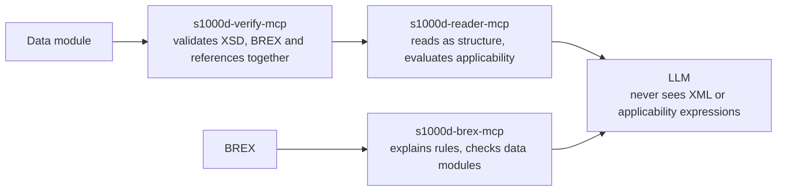

s1000d-stack is a set of tools that lets an LLM read technical documents written in S1000D® (data modules) correctly, check them against the business rules agreed for a project (BREX, Business Rules Exchange), and create them. The MCP servers and the shared library come first; the authoring tool and the viewer for experiential manuals are built on top of them.

## Who it is for

| Role | Problem | What this stack does |
| --- | --- | --- |
| Suppliers delivering parts to foreign aircraft manufacturers or defence programs | The customer hands over a BREX, but it is a list of XPath expressions and allowed values, and it is hard to tell what it actually requires | Lists every BREX rule as target, whether it may be used, allowed values and their meaning |
| Technical publication companies | Before delivery, they want to confirm that the data modules they produced follow the customer's business rules | Checks data modules against the BREX chain and reports each violation with its location |
| People starting to learn S1000D | Material in Japanese is scarce, and the specification is 3,700 pages long | Use this site to understand how S1000D works, then check your own data modules against the default BREX |

## What it does

- **Reads a BREX.** Lists the rules of the BREX data module you were given as plain sentences that say what is required of each element. It can also look up the meaning of attribute values and SNS (standard numbering system) codes.
- **Checks data modules.** Checks a data module against each layer of the BREX chain (project → organisation → S1000D default BREX) and returns every violation with its location (XPath and line number), value, rule ID and severity level.
- **Validates, then reads.** Combines the XSD, BREX and reference results into a single verification status, then passes the data module to the LLM as a structure of headings, steps, warnings and illustrations. Which product the content applies to (applicability) is evaluated by the server, and only the result is passed on.

## What it does not do

- **It does not include the S1000D specification, XML schemas, default BREX or official samples.** Their terms of use do not grant redistribution, so you obtain them from s1000d.org yourself and point an environment variable at the files (see [Specification files and trademarks](/s1000d-stack/guide/license/)).
- **It does not summarise or translate.** Its job is to hand the LLM everything it needs to write a summary or an answer — headings, step numbers, warning types, reference targets, verification status — without omitting anything.
- **It does not show the LLM XML or applicability expressions.** The server reads the structure and evaluates the expressions; the LLM receives the results.
- **It is not an official or certified ASD tool.** This is a personal project and is not affiliated with ASD.

## How to read this site

| Section | What it explains | Subject |
| --- | --- | --- |
| Guide | Where this stack fits, how to set it up, its components and stages, and how the specification files are handled | s1000d-stack |
| Understanding S1000D | How the S1000D specification works, limited to what you need to use the stack | S1000D, data modules, BREX |
| MCP servers | Each server's configuration, tools, response shape and limitations | Each MCP server |
| Libraries | The functions of the shared libraries and the design decisions behind them | Each library |
| Use cases | Which tools to combine in which situation, one case per page | The user |

In the articles under "Understanding S1000D", the body text explains only the S1000D specification; how this stack handles it is kept in a separate "In this stack" section at the end of the article. Where the body text must mention the stack, it is limited to a single sentence that begins with "In this stack".

:::tip[Where to go next]
See [Getting started](/s1000d-stack/guide/getting-started/) to set it up, [Architecture and stages](/s1000d-stack/guide/architecture/) for the components and stages, and [Use cases](/s1000d-stack/use-cases/) for the situations it is used in.
:::
