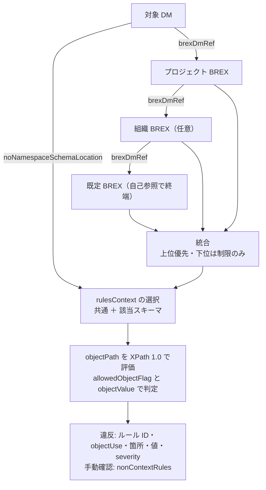

# 調査メモ: IETM・S1000D・BREX と既存のツール

2026-10-21〜23（JST）に調べた内容の要約です。新しいチャットや作業者に経緯を引き継ぐためのもので、仕様書の記述そのものではありません。仕様の正確な内容は、入手した仕様書で確認してください。

## IETM と S1000D の関係

- **IETM**（Interactive Electronic Technical Manual）は、整備員や操作員が画面上で対話的に使う電子技術マニュアルの総称です。1992 年に米国防総省が 3 つの規格（MIL-M-87268 / MIL-D-87269 / MIL-Q-87270）を発行し、機能の段階を Class 0〜5 で分類しました。現在はクラスではなく機能マトリクスで要件を定めます。
- **S1000D** は、技術文書の元データを作成・管理・交換するための国際仕様です。欧州の ASD が始め、現在は ASD・AIA・A4A（旧 ATA）の共同で保守されています。仕様書と XML スキーマは公式サイトから無償で入手できます。
- 両者の関係: IETM は「利用者が画面で使う成果物」、S1000D は「その元データの作り方の決まり」です。S1000D は出力先を IETP（対話型の技術文書群）と呼び、IETM は通常その中の個々のマニュアルを指します。米国防総省は 2005 年に S1000D を採用しています。

### 2021 年の作品との対応

| experience_based_operation_explanation | S1000D |
|---|---|
| 画像、テキスト | 図、データモジュールの内容部 |
| `screenId` | DMC（データモジュールコード） |
| `buttons` と遷移先 | プロセスデータモジュール |
| `displayAreas` | パブリケーションモジュール |
| `JSON.json` 1 ファイル | CSDB（共通ソースデータベース） |
| `index.html` と JavaScript | IETM（閲覧ソフト） |

## S1000D の主な概念

| 概念 | 内容 |
|---|---|
| データモジュール | それ単体で完結する最小の情報単位。識別・状態部と内容部を持つ XML。種類は説明・手順・故障情報・部品情報・BREX など |
| DMC | データモジュールを一意に識別するコード。モデル識別、システム番号、情報コードなどで構成される |
| CSDB | データモジュールを格納・管理する場所。S1000D はその機能を定義するが、特定のソフトウェアは定めない |
| パブリケーションモジュール | どのデータモジュールをどの順に並べるかを定める XML。出版物の目次に当たる |
| 適用性 | どの機種・構成に当てはまるかの情報。相互参照表（ACT など）も別のデータモジュールとして持つ。データモジュール全体にも、要素単位にも付けられる |
| ICN | 図や動画など、データモジュールから参照される素材の識別番号。詳細は「図・3D・ICN」の節 |

## BREX

- BREX（Business Rules Exchange）は**データモジュールの種類の 1 つ**です。プロジェクトで合意したビジネスルールのうち、機械で検査できるもの（要素・属性の使用可否、許可する値、システム番号の体系など）と、文章で書かれた取り決めを XML で持ちます。
- 各データモジュールは識別・状態部で、従うべき BREX の DMC を参照します（`brexDmRef`）。BREX 自身も上位の BREX を参照でき、S1000D 既定のもの → 業界・組織のもの → プロジェクトのもの、と重ねて使われます。
- BREX の内容部に入るルールの種類は、ROADMAP の「BREX のルールの種類」にまとめています。XPath で指した要素の使用可否と許可値（contextRules）、文章で書かれた取り決め（nonContextRules）、システム番号の体系（snsRules）、使ってよい図・マルチメディアの形式（notationRuleList）です。
- 要素名は 2026-10-23 に Issue 7 の `brex.xsd` と既定 BREX の実物で確認しました（名前の確認であり、仕様書の章の読解は作業 3 で行います）。
  - `brex.xsd` が定義する要素: `contextRules` / `structureObjectRuleGroup` / `structureObjectRule` / `objectPath` / `objectUse` / `objectValue` / `nonContextRules` / `nonContextRule` / `snsRules` / `snsDescr` / `notationRuleList` / `notationRule` / `notationName`、識別・状態部の `brexDmRef`
  - 既定 BREX（`DMC-S1000D-J-04-10-0301-00A-022A-D`、約 340 KB）に実際に入っているもの: `structureObjectRule` 274 件（`objectPath` の属性は `allowedObjectFlag`）、`objectValue` 1,445 件（属性は `valueAllowed`・`valueForm`・`valueTailoring`）、各ルールに `brDecisionRef`（ビジネスルール決定点への参照）、`nonContextRule` 1 件。`snsRules` と `notationRuleList` は既定 BREX には無く、プロジェクトの BREX で使う要素です
  - 既定 BREX の `brexDmRef` は自分自身（modelIdentCode `S1000D`、systemDiffCode `J`、infoCode `022`）を指しています。連鎖の終端はここです
  - 既定 BREX の DOCTYPE は `<!DOCTYPE dmodule [ ]>` で空ですが、Bike Samples のデータモジュール 31 件は DOCTYPE に `<!ENTITY ...>` 宣言を持ちます。パーサーは内部 DTD サブセットを扱える必要があります（U-08）
  - `xsi:noNamespaceSchemaLocation` の値は `http://www.s1000d.org/S1000D_7/xml_schema_flat/<種類>.xsd` の形で、`S1000D_7` の部分が版の判別に使えます
- ビジネスルールのうち、XPath で機械的に判定できるのは contextRules に書けるものだけです。判断を伴う取り決めは、BREX の nonContextRules に文章として入るものと、BREX の外の人が読むビジネスルール文書に書かれるものの両方があります。技術マニュアル制作会社の寄稿では、ビジネスルールの数は 450 を超えるとされています。
- LLM が資料を参照するには BREX だけでは足りません。本文・参照・適用性を扱う reader と組み合わせる必要があります。
- 表記について: 法人カードの Brex と取り違えられないよう、初出では「BREX（Business Rules Exchange）」と書きます（D-01）。

## 図・3D・ICN

2026-10-23 のチャット「S1000D画像・3Dモデルの扱い」で調べた内容です。仕様書の原文で確認していない部分を含みます。

- データモジュールの XML には図の中身は入らず、ICN（Information Control Number）で参照するだけです。実際のファイル名と形式は、DOCTYPE の `ENTITY` 宣言と `NOTATION` 宣言（内部 DTD サブセット）で対応付けます。
- 2D の図は `<figure>` / `<graphic>` で参照し、`<hotspot>` の `applicationStructureIdent` に図ファイルの中の部品の識別名を書きます。本文や部品リストから図の中の部品へリンクするときに、この対応を使います。2D では WebCGM が主に使われ、Issue 6 で SVG のプロファイルが定義されています。
- 3D・動画は `<multimedia>` / `<multimediaObject>` で参照します。3D の形式は S1000D が 1 つに決めておらず、プロジェクトの BREX（notationRule）で決めます。実務では JT、PRC、U3D、X3D、ベンダー独自形式が使われています。
- STEP（ISO 10303）は図の形式としては使われません。AP242 は図を作るときの上流の CAD データ、AP239（PLCS）は S3000L などの後方支援データの背景にある規格です。CAD と S1000D をつなぐ要は、部品表・部品リストの項目番号・`applicationStructureIdent` の 3 つの対応です。
- ICN は S1000D 自身が書式を定めるもので、ISO や IEC の規格ではありません。書式は MIC（NSPA に登録）を基にしたものと、CAGE コード（各国のコード化局が発行）を基にしたものの 2 種類があり、版数・機密区分の桁数は Issue 4.x の前後で異なります。Issue 4.2 以降は ICN メタデータファイル（IMF）で作成者や元 CAD などを記録できます。
- 試作では架空の MIC・CAGE コードで ICN を作れ、スキーマの検証も通ります。実際の納品物として ICN を発行するには、MIC の登録と NCAGE コードの取得が前提です。

## 設計のヒント

これまでのチャットで出た、計画書の本文には収まらない設計上の指針です。該当する段階で取り込みます。

| 内容 | 反映先 | 出どころ |
|---|---|---|
| 3D の形式は BREX の notationRule で決まる。MCP や Skill は形式を決め打ちせず、BREX が許可している NOTATION の一覧を読む | brex-mcp の `list_notations`（段階 1） | 3D チャット |
| ICN は 2 書式で桁数が Issue によって異なる。DMC と並んで ICN の分解を持つ | s1000d-core（段階 1 の作業 5） | 3D チャット |
| `<hotspot>` の `applicationStructureIdent` と 3D モデルのノード名を一致させれば、2D のリンクの仕組みが 3D にもそのまま使える | manual-model の「操作対象の ID」を hotspot の ID に写像できる設計にする（段階 2） | 3D チャット |
| ブラウザーは JT や PRC を直接表示できない。three.js などで表示するなら表示用の glTF を変換して作る工程が要る。glTF は S1000D 上の位置付けが未定なので、ICN の原本と表示用の変換物を分けて持つ | 閲覧ソフトの設計（段階 4） | 3D チャット |
| 試作の ICN は架空の MIC・CAGE で採番する。学習サイトでは「実納品では登録が前提」と説明する | テストデータ（作業 7）、学習サイト | 3D チャット |
| Issue 4.2 以降の ICN メタデータファイル（IMF）を reader の対象に含めるか | U-07 と一緒に判断 | 3D チャット |
| reader の応答には対象データモジュールの版と検証状態を必ず含める。適用性の評価は LLM にさせず、reader が済ませてから渡す | 段階 2 の完了条件 | DITA との比較のチャット |
| 一般向けの製品の内部は共通データモデルにし、S1000D への入出力は変換関数に集める。DITA への出力が必要になれば変換関数を 1 つ足す | D-09 | DITA との比較のチャット |
| 一般向けの段階で内部 ID・情報の種類・操作の種類・遷移の条件・適用範囲・注意・版を持たせておく。S1000D を意識させない画面にして、内部で自動付与する | manual-model の設計（段階 2） | 計画を立てたチャット |
| 形式ごとに読み取り部分を 1 つ作り、出力を共通形式に揃える。LLM を使わない基準版を先に作る。点数ではなく「可能性が高い」「確認すべき」の段階で示す。評価用データを調整に使わない | reader と Skill の設計 | change-request-locator |

## 仕様書の展開後のファイル構成（Issue 7）

2026-10-23 に `s1000d-stack/specs/s1000d/issue-7/` へ展開して記録したものです（パスとファイル名だけ。内容は写していません）。brex-mcp の README に「利用者が置くべき構成」として書く元になります。

配布 zip（`S1000D Issue 7.zip`、約 63 MB）の直下には仕様書本体の PDF 1 つと、入れ子の zip が 10 本入っています。利用者が自分で展開する前提なので、MCP は内側の zip のフォルダー名を決め打ちせず、`S1000D_SPEC_DIR` の下を探して見つける作りにします。ここでは内側の zip を、接頭辞 `S1000D Issue 7 ` を除いた小文字ハイフン区切りのフォルダー名で展開しました。

| 展開先 | 元の zip | 中身（ファイル数） |
|---|---|---|
| `S1000D Issue 7.pdf` | — | 仕様書本体。3,700 ページ。冒頭の 3 ページが利用条件のデータモジュール（`S1000D-A-00-00-0000-00A-021A-D`） |
| `default-brex/` | Default BREX | `DMC-S1000D-J-04-10-0301-00A-022A-D_001-00_EN-US.XML` と同名の `.HTML`、`S1000D.svg`（3） |
| `xml-schema-package/S1000D Issue 7 XML Schema Package/` | XML Schema Package | `xml_schema_flat/*.xsd`（データモジュールの種類ごと。`brex.xsd`、`descript.xsd`、`proced.xsd`、`pm.xsd`、`icnmetadata.xsd` など 31）、`xml_schema_cat/catalog.xml`、`notations/notations.xml`（`<notation>` 121 件）、`ent/*.ent`（ISO 文字実体）、`lom_schema/`（SCORM 用）（71） |
| `bike-samples/S1000D Issue 7 Bike Samples/` | Bike Samples | 自転車のサンプル CSDB。DMC 106（`S1000DBIKE` 80、`S1000DLIGHTING` 22、`BRAKE` 4）、PMC 4、DDN 1、UPF 1、IMF 1、ICN 62（CGM 40、PNG 11、JPG 8、SVG 5、GIF 1）、PDF 1（184） |
| `data-dictionary/data_dictionary_7/` | Data Dictionary | `Index.html` と `Files/` 以下に要素・属性の定義（xml 2,846、xsd 90、png 67、xsl 18、html 8）（3,050） |
| `business-rules-template/` | Business Rules Template | `DMC-S1000D-J-04-10-0100-00A-024A-D_001-00_EN-US.XML` と `.pdf`（ビジネスルール文書の雛形）（2） |
| `business-rules-decision-point-index/` | Business Rules Decision Point Index | `S1000D Issue 7 BRDP Index.xlsx`（1） |
| `example-sns/` | Example SNS | `DMC-AE-A-08-03-0100`〜`1800-00A-040A-A` の PDF 18 本（SNS の例）（18） |
| `front-matter-samples/S1000D_7_FM-Samples/` | Front Matter Samples | データモジュール・図・パブリケーションモジュールの例と `.docx`（44） |
| `functionality-matrix/` | Functionality Matrix | `S1000D Issue 7 Functionality Matrix.xls`（1） |
| `unit-of-measure/` | Unit of Measure | `S1000DUnits.xml`、`Units.xsd`、`Units.xsl`、`DocumentInfo.xsd`（4） |

MCP が探すべきもの:

- 既定 BREX: ファイル名が `DMC-S1000D-*-022A-D_*.XML` に一致する XML
- XSD: `xml_schema_flat/` フォルダー（`brex.xsd` が存在することで判別）
- 使える NOTATION の一覧: `notations/notations.xml`
- 要素の定義（`explain_brex` で要素の説明を補うときの候補）: `data_dictionary_7/Files/`

## BREX の章（Issue 7 Chap 4.10.2〜4.10.3）の読解結果

2026-10-23 に PDF の p.2110〜2143（Chap 4.10.2 BREX data module、4.10.2.1 SNS rules、4.10.2.2 Context related rules、4.10.2.3 Context independent rules、4.10.2.4 Coding BREX data modules、4.10.3 Default BREX data module）を読みました。関連する Chap 4.10.1（ビジネスルール文書）の `brSeverityLevel` の定義も確認しました。以下は照合処理の実装に必要な点の要約で、仕様書の記述そのものではありません。

### 構造と意味

| 要素・属性 | 仕様書の定め | 照合処理での扱い |
|---|---|---|
| `<brex>` | `<commonInfo>`、`<snsRules>`、`<contextRules>`（繰り返し可）、`<nonContextRules>` を持つ。属性 `defaultBrSeverityLevel` | 4 つのブロックに分けて読む |
| `<contextRules rulesContext="…">` | `rulesContext` は対象スキーマの URL（例: `http://www.s1000d.org/S1000D_7/xml_schema_flat/comment.xsd`）。省略時はすべてのスキーマに共通。スキーマ固有のルールは共通ルールを上書きし、かつ共通ルールの真の制限でなければならない | 対象データモジュールの `xsi:noNamespaceSchemaLocation` と `rulesContext` を突き合わせ、共通ブロック ＋ 該当スキーマのブロックを適用する。既定 BREX では共通 1 ＋ スキーマ別 6（comment / ddn / dml / icnmetadata / pm / update） |
| `<structureObjectRule>` | `<brDecisionRef>`、`<objectPath>`、`<objectUse>`、`<objectValue>`（繰り返し可）。属性 `brSeverityLevel` | 1 件 = 1 ルール |
| `<objectPath allowedObjectFlag="…">` | XPath でルールの対象を指す。`0` = 使ってはならない、`1` = 必ず含める、`2` = 任意（使うなら仕様とスキーマどおりに）。XPath の版は BRDP-S1-00576 でプロジェクトが決める | `0`: XPath の結果が空でなければ違反。`1`: 結果が空なら違反。`2`: 結果があれば `objectValue` と照合。XPath は `not(…)` のような真偽値を返す式も書かれる（仕様書の例）ので、結果が節点集合か真偽値かを両方扱う |
| `<objectValue valueForm="…" valueAllowed="…" valueTailoring="…">` | `valueForm`: `single` / `range` / `pattern`。`valueAllowed`: 値、範囲（書式は Chap 3.9.5.3 の適用性の範囲表記。例 `000~022`）、またはパターン（XML Schema Part 2 の正規表現）。`valueTailoring`: `restrictable` / `lexical` / `closed`（既定）で下位 BREX による調整の可否 | 対象の値が、並んだ `objectValue` のどれか 1 つに合えば適合。`pattern` は XSD 正規表現なので JavaScript の正規表現へ変換が要る（全体一致、`\i` `\c` などの文字クラス）。既定 BREX では single 1,340・range 81・pattern 24 |
| `<objectUse>` | 人が読む説明。`<refs>` を含められる | `explain_brex` と違反報告の本文に使う |
| `<brDecisionRef brDecisionIdentNumber="…">` | ビジネスルール決定への参照。既定 BREX では `BREX-S1-NNNNN`（S1000D が付番、版が変わっても番号は変わらない）。プロジェクトの番号体系は BRDP-S1-00566 で決める | ルール ID として報告に載せる |
| `brSeverityLevel` | `brsl01`〜`brsl99`。意味はプロジェクトが Chap 3.9.6.1 の設定可能値として決める | 報告にそのまま載せる。意味の解釈はしない |
| `<notationRuleList>` › `<notationRule>` › `<notationName allowedNotationFlag="…">` | **`<contextRules>` の子**（`<structureObjectRuleGroup>` の兄弟）。`rulesContext` 無しの `<contextRules>` 内に置けば基本セット、スキーマ指定の `<contextRules>` 内なら そのスキーマでの再定義または除外。`1` = 許可、`0` = その文脈では禁止 | `list_notations` は「基本セット」と「スキーマ別の差分」を分けて返す |
| `<snsRules>` › `<snsDescr>` › `<snsSystem>` / `<snsSubSystem>` / `<snsSubSubSystem>` / `<snsAssy>` | `<snsCode>` と `<snsTitle>` の階層 | `lookup_sns` の元データ |
| `<nonContextRules>` › `<nonContextRule>` | スキーマや要素に結び付けられないプロジェクト固有の規則。`<brDecisionRef>` と `<simplePara>`。一般的なコメントに使ってはならない | 手動確認の項目として返す |

### 階層（レイヤー）の規則

- すべてのデータモジュールは **ちょうど 1 つ**の BREX を `brexDmRef` で参照する。その BREX がさらに上位の BREX を参照し、連鎖は必ず S1000D 既定 BREX で終わる。既定 BREX は自分自身を参照する。
- 下位の BREX は上位の BREX の**制限しかできない**（上位が A〜M を許すなら、下位は A〜H に絞れるが N を許せない）。
- 下位は上位のルールを繰り返す必要がない。したがって**完全なルール集合を得るには連鎖全体を読み込む**必要がある。
- 矛盾があるときは**上位の BREX が優先**する。矛盾の検出手順は Chap 7.9（Business rules processing）にある（未読。作業 6 の前に読む）。

### BREX の DMC の規則（Chap 4.10.2.4）

- 情報コードは `022`、アイテムロケーションコードは `D`。
- 製品全体のルールなら SNS はすべて 0（`00-00-00` / `00-00-0000`）、組立コードは `00` または `0000`。
- 複数の BREX を製品レベルで持つときは分解コード `NN` を `00` から連番にする。システム単位の BREX はシステムコード `SS` を入れる。
- 1 つの CSDB オブジェクトが参照できる BREX は 1 つだけ。

### 既定 BREX（Chap 4.10.3）

- 内容は、設定可能属性の既定の値集合（Chap 3.9.6.1）、許可する情報コード（Chap 8.4.1）、許可する学習コード（Chap 8.5.1・8.5.2）、スキーマで表せない規則の集まり。
- DMC は `S1000D-Y-04-10-0301-00A-022A-D` で、`Y` のシステム差異コードが仕様書の版ごとに変わる。**仕様書本文は Issue 7 を「I」としているが、同梱の既定 BREX ファイルの実際の値は「J」**。MCP は既定 BREX の DMC のこの桁を決め打ちにせず、ファイル名の `DMC-S1000D-*-04-10-0301-00A-022A-D` で探す。
- 既定 BREX の `objectPath` は `//dml[descendant-or-self::dmlIdent[child::dmlCode[attribute::dmlType!="s"]] and …]` のように軸と述語を多用した XPath 1.0 で書かれている。XPath 1.0 を完全に実装したエンジンが必要（U-08）。

### 実装への示唆

### Chap 7.9（Business rules processing）の読解結果

2026-10-23 に PDF の p.3246〜3247 を読みました。

- ビジネスルールの作成・保守は本来は人の作業で、BREX に書かれたものは自動処理の対象になり得る。
- 検査ツールは少なくとも「BREX のルールを読み、検査に向いた形に変換する」「対象 DM（と同じ BREX を参照する DM）を変換したルールで検査する」の 2 段階で動く。
- **階層の BREX は各層に個別に照合し、どの層にも失敗が無いときだけ合格**。層の統合や矛盾の解決は検査ツールの責務ではない（矛盾を起こさないのは BREX を書く側の責務。Chap 2.5.1）。
- 「関連するルール」とは、破ると DM が無効になる重大度のルールを指す。重大度の意味はプロジェクトが決める。
- 対象 DM が明示的に参照していない BREX に照合してもよい（同じ手順が使える）。
- s1000d-core の `checkAgainstBrexChain` はこの方針どおり、各層を個別に照合し、`extraLayers` で参照していない BREX も加えられる。

### 実装で分かった配布物の性質（2026-10-23）

| 事実 | 影響 |
|---|---|
| 既定 BREX のシステム差異コードは、仕様書本文「I」、同梱ファイル「J」、データ辞書の見本（`data_dictionary_7/Files/samples/`）の中身「X」と 3 つが食い違う | 既定 BREX の探索は DMC の決め打ちをせず、「中身の DMC がファイル名と一致し、自分自身を参照する」ものを優先する |
| データ辞書の見本にはファイル名の DMC と中身の DMC が違うものがあり、連鎖の解決で拾うと「J を探す → X が返る → X の親は J」の循環になる | 連鎖の解決は訪れた参照を記録し、解決器は中身の DMC が一致するファイルを優先する。これを入れる前は 1 DM あたり 16 層まで照合して 137 秒かかり、入れた後は 117 DM で 10 秒 |
| Front Matter Samples とビジネスルール文書の雛形は、古い版の既定 BREX（S1000D-F、S1000D-H）を参照している | Issue 7 の配布物だけでは未解決になる。古い版を利用者が別に入手して `S1000D_CSDB_DIR` に置けば解決できる |
| Bike Samples 105 件を「自転車 BREX → 既定 BREX」の 2 層に照合すると、既定 BREX への違反が合計 55 件出る | 公式サンプルでも既定 BREX をすべて満たしてはいない。既定 BREX 側の厳しさ（例: `issueType` と `reasonForUpdate` の整合）かサンプル側の不備かは未調査。学習サイトで「既定 BREX は公式サンプルにも違反を出す」と書く材料になる |
| 既定 BREX の `objectValue` には説明文（本文）が空のものがある（`securityClassification` の値など） | `lookup_value` の `meaning` が空配列になることがある。値の意味は仕様書の Chap 3.9.6.1 を参照させる |

### サイトの生成と検索（2026-10-24）

- Astro 7.4 ＋ Starlight 0.42。Astro 7 は Node 22.23.4 以上を要求する（22.22 では起動しない）。GitHub Pages の deploy は Node 24 で動かす。
- Mermaid は `astro-mermaid`（クライアント側で描画、テーマ追従）。Starlight より前に integrations に置く必要がある。
- Pagefind の日本語検索は、単語単位では期待どおり。複合語はそのままだと同じつながりのページしか返らない（U-06 の注記）。
- GitHub Pages は、Free プランの Private リポジトリでは有効にできない（`actions/configure-pages` が `Get Pages site failed … Not Found` で止まる）。hub が Private の間は `deploy.yml` を `workflow_dispatch` だけにし、`cd site && npm run build && npm run preview` で確認する。
- テーマは `starlight-theme-rapide`（D-07 追記）。検討した候補は D-07 を参照。

## 利用条件（Issue 7）の確認結果

2026-10-23 に、Issue 7 の PDF 冒頭の `S1000D-A-00-00-0000-00A-021A-D`（2025-07-28 付）を全文読みました。D-03 の判断は変わりません。要点は次のとおりです（私的な要約であり、法的な判断ではありません）。

| 条項 | 内容 | s1000d-stack への影響 |
|---|---|---|
| 1 Copyright | 著作権法で明示的に許される場合か、出版者の書面による許可がある場合を除き、複製・送信を認めない。S1000D™ は ASD の商標、S1000D® は EU の登録商標 | D-02 のとおり |
| 2 License to use | 条件を守る限り、利用・技術情報の製造・訓練の提供について非独占的な許諾を与える | ツールを作って提供することは許諾の範囲内 |
| 3 Special usage rights | 仕様書の複製・公開を無償で認める相手は 8 区分（ASD 加盟団体の会員企業、AIA・A4A の会員、ICCAIA の会員、それらの顧客である航空会社・軍、加盟国の国防省、NATO 機関、加盟国の大学・研究機関）に限られる | 個人の開発者は含まれない。**再配布の許可は無い**（U-02 の答え） |
| 4.1 Definitions | 「S1000D™ suite of information」は仕様書、例（XML インスタンス・PDF・スタイルシート）、XML スキーマ、ダウンロードページのその他のソフトウェア・情報を含む | XSD・Bike Samples・データ辞書も同じ条件 |
| 4.3 Intellectual property rights | 明示的に与えた権利以外はすべて留保 | 再配布は与えられていない |
| 4.4 No modifications | 仕様書で明示的に認めている場合を除き、改変・翻案・翻訳を禁止。ビジネスルールの追加は可 | 学習サイトで章を翻訳しない（D-03）。自作 BREX は「ビジネスルールの追加」に当たる |
| 4.8 Governing law | スウェーデン法。紛争はストックホルム商業会議所の仲裁 | — |

解説のための短い引用は、条項 1 が除外している「著作権法で明示的に許される場合」（日本では引用の規定）に当たると考えますが、学習サイトでは引用を最小限にし、出典を明記します。

## 日本での状況

| 事例 | 内容 |
|---|---|
| 三菱リージョナルジェット（MRJ） | 2009 年に Saab が技術文書の作成を受注し、2011 年に MRJ 専用の S1000D 作成システムの構築を追加受注した。供給企業には S1000D 4.0.1 と MRJ 用のビジネスルールが要求された。事業は 2023 年に中止 |
| 中央図研（日本航空宇宙工業会 会報 2025 年 2 月） | 航空宇宙・防衛分野で S1000D の本格的な国内導入が進んでいるとし、国内の航空機部品メーカーからの依頼が増えていると述べている |
| 富士ゼロックス（2021 年 1 月） | 日本企業として初めて、S1000D 準拠の作成・管理・配信ソフトウェアの販売ライセンス契約を結んだ |
| 防衛省の公開資料 | 取扱説明書・技術指令書・PDF 化の調達が中心で、IETM の記述は見当たらない |
| 用語 | 「電子技術マニュアル」は事業者による訳語で、定着した訳語は無い。「電子マニュアル」は PDF なども含む広い意味で使われる |

想定される国内の利用者は、海外の機体メーカーや防衛事業に納める部品メーカーと、その制作を受託する技術マニュアル制作会社です。

## 既存のツール

| 名前 | 内容 | 本プロジェクトとの関係 |
|---|---|---|
| [i2oss/s1000d-mcp](https://github.com/i2oss/s1000d-mcp) | Python の MCP サーバー。自作のサブセット XSD による検証、参照切れの検出、雛形生成、適用性の照合、修正案の提示の 5 ツールを持つ。BREX は扱わない。早期開発段階（スター 0、リリース無し）。コードの更新は 2026 年 7 月頃で止まり、その後は Issue #3（2026-09-29）が立っているだけ | 依存しない。参照・適用性の実装の参考にする |
| [i2oss/change-request-locator](https://github.com/i2oss/change-request-locator) | 変更要求がマニュアルのどこに影響するかを、直接の箇所と波及先に分けて示す RAG の試作。最初の題材は FAA の PDF で、次に S1000D を予定。s1000d-mcp の [Issue #3](https://github.com/i2oss/s1000d-mcp/issues/3) はこのためのサブセット XSD の拡張で、BREX は対象外と明記 | 競合しない。reader の上に「影響箇所の特定」の Skill を載せる際の参考になる |
| s1kd-tools | S1000D を扱うコマンドラインツール群。BREX による検査（`s1kd-brexcheck`）を含むと記憶している | 着手前にライセンスと対応版を確認する |
| Oxygen XML の S1000D フレームワーク | スキーマを同梱せず、利用者が公式サイトから入手して置く方式 | 仕様書の扱いの手本 |

### change-request-locator から取り入れたい設計

- 形式ごとに読み取り部分を 1 つ作り、出力を共通形式に揃える
- LLM を使わない基準版を先に作り、LLM を使う手順はそれを上回ることを確かめてから加える
- 検索の点数を出さず、「可能性が高い」「確認すべき」の段階で示す
- 評価用のデータを調整に使わない

## 参照した資料

- [S1000D 公式サイト](https://s1000d.org/) / [Terms of Use](https://s1000d.org/?page_id=108) / [Downloads](https://users.s1000d.org/Default.aspx)
- [Interactive electronic technical manual - Wikipedia](https://en.wikipedia.org/wiki/Interactive_electronic_technical_manual)
- [S1000D - Wikipedia](https://en.wikipedia.org/wiki/S1000D)
- [Getting Started with S1000D - NSWC Carderock](https://www.navsea.navy.mil/Home/Warfare-Centers/NSWC-Carderock/Resources/Technical-Information-Systems/S1000D-Info-Center/Getting-Started-with-S1000D-Introduction/)
- [The Key Role of BREX in S1000D Projects - O'Neil](https://www.oneil.com/the-key-role-of-brex-in-s1000d-projects/)
- [Saab receives additional order from Mitsubishi Aircraft Corporation - Airframer](https://www.airframer.com/news/release/13776)
- [LMI Aerospace signs up for CORENA Hosting Services for MRJ - Airframer](https://www.airframer.com/news/release/17998)
- [日本航空宇宙工業会 会報 2025 年 2 月 寸言（中央図研）](https://www.sjac.or.jp/pdf/publication/backnumber/202502/20250201.pdf)
- [富士ゼロックス プレスリリース 2021 年 1 月](https://kyodonewsprwire.jp/release/202101210025)
- [S1000D Framework License Agreement - Oxygen XML](https://www.oxygenxml.com/addons/oxygenxml.s1000d.framework_license.html)
- [Material for MkDocs のリリースノート（保守終了の告知）](https://releasebot.io/updates/squidfunk/mkdocs-material)
- 図・3D・ICN: [PTC Windchill Help Center – S1000D Solution: Illustrations](https://support.ptc.com/help/wnc/r11.2.0.0/en/Windchill_Help_Center/s1000d_solution_illustrations.html) / [同 – Information Control Numbers (ICN)](https://support.ptc.com/help/wnc/r11.2.0.0/en/Windchill_Help_Center/s1000d_solution_type_of_icn.html) / [IETF draft-rushing-s1000d-urn](https://datatracker.ietf.org/doc/html/draft-rushing-s1000d-urn) / [Web3D Consortium – X3D with S1000D](https://web3d.org/pipermail/x3d-public_web3d.org/2018-August/009343.html) / [PDF Association – 3D formats](https://pdfa.org/resource/3d-formats/)
- XML ライブラリ（U-08）: [libxml2-wasm](https://github.com/jameslan/libxml2-wasm) / [xmllint-wasm](https://github.com/notengrafik/xmllint-wasm) / [libxmljs2 README](https://cdn.jsdelivr.net/npm/libxmljs2@0.37.0/README.md) / [libxml2 が保守されなくなったという報道](https://www.linux.org/threads/linuxiac-libxml2-becomes-officially-unmaintained-after-maintainer-steps-down.59832/latest)
- 学習用: [Zenn Book「IETM入門 — 概念から S1000D まで」](https://zenn.dev/shuji_bonji/books/ietm-overview)
