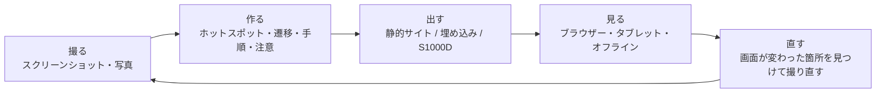
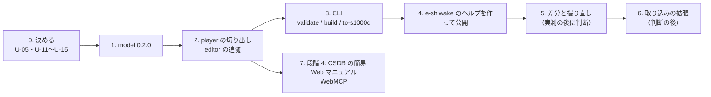

# 作成ツールと閲覧ソフトの検討（experiential-manual-model を土台にする）

体験型操作マニュアルの作成ツールと閲覧ソフトについて、「何を作るべきか」を決めるための検討メモです。段階 3 の試作 manual-editor で分かったことと、段階 4 の予定（閲覧ソフト、S1000D の CSDB を表示する簡易 Web マニュアル）を踏まえ、ツールの候補・構成・実例・決めることを整理します。実装の順序はこの文書で決めず、末尾の「決めること」を利用者が判断してから ROADMAP に書きます。

- 作成日: 2026-11-07（JST）
- 前提の決定: D-01（一般向けの製品に S1000D の名前を付けない）、D-09（製品は AI が無くても動く。S1000D との対応は共通データモデルと変換関数に集める）、D-19（組み込み基盤。製品はその最初の利用者）、D-28（SvelteKit ＋ PWA）
- 前提の設計: [design/manual-model.md](../design/manual-model.md)、[design/skills-and-editor.md](../design/skills-and-editor.md)「5. 作成ツールの試作」、[design/agent-platform.md](../design/agent-platform.md)「参照実装」
- 現状: `@shuji-bonji/experiential-manual-model` 0.1.0（npm 公開済み）、`app/manual-editor` 0.1.0（Private の試作）、writer-mcp `convert_manual` と Skill `experience-to-s1000d`（公開済み）

> [!IMPORTANT]
> **2026-11-07 の追記（D-29）**: この検討の後、製品を 2 つの別プロジェクト（体験型マニュアル、IETM / IETP）に分け、s1000d-stack は基盤に専念することを決めました。本文の 4 節の候補 7（CSDB の簡易 Web マニュアル）と 8（WebMCP）は IETM / IETP プロジェクトへ、1〜6 は体験型マニュアルプロジェクトへ移ります。10 節の U-14 は「IETM / IETP 側が player の表示部品に npm で依存する。逆変換は作らない」で決まりとし、U-15 は CLI に置くことで決まりとします。残りの決めること（U-05・U-11・U-12・U-13・U-16）は体験型マニュアルプロジェクトに引き継ぎます。「題材が画面の操作に偏る」という見立ては、`Screen` の画像がスクリーンショットである必要はなく（操作パネルの写真・分解図でもよい）、偏りは名前と作成ツールの動線の問題に収まると改めました。

## 1. 今あるものと、足りないもの

| 部品 | 状態 | 分かったこと |
|---|---|---|
| experiential-manual-model 0.1.0 | 型 10 種、JSON Schema、`validateManual`、`fromLegacyJson`、`numberSteps`、券売機の例 | 試作で 2 点が足りなかった。`Asset` に画像の元の大きさ（幅・高さ）が無い。`AssetFile.path` がファイル名と data URL の両方を担っている |
| manual-editor 0.1.0（試作） | 開く・保存、2021 年の JSON の読み込み、Topic 一覧、画面エディター（矩形・円）、手順・注意・適用範囲、検査、体験表示、Undo/Redo、`localStorage` の下書き。Svelte 5、Vitest 32 件、build 392 KB | 見送り: 説明 Block の編集、故障探求の行き先、多角形、ホットスポットの移動・変形、英語の文言、Playwright。体験表示（`Player.svelte`）がエディターの中にあり、閲覧ソフトから使えない |
| writer-mcp `convert_manual` ＋ Skill | 券売機の例が DM 9 件 ＋ PM 1 件で XSD valid・BREX 違反 0 | S1000D への出口は揃っている。入口（マニュアルを作る側）がまだ試作 |
| 2021 年の作品 | 5 話題・79 画面・212 ボタン。スクリーンショットは手で撮って手で座標を付けた | 画面を撮って座標を付ける作業が、作る側の時間の大半を占めていた |

試作で確かめたのは「manual-model の JSON を画面の上で編集できること」です。まだ決めていないのは、**誰が、どの画面を、どう撮って、どこに置いて、誰に見せるか**です。ツールの形はここで決まります。

## 2. 利用者と場面

| 区分 | 利用者 | 題材の例 | 求めること |
|---|---|---|---|
| A | Web アプリの開発者・サポート担当 | 自社サービスのヘルプ（e-shiwake のヘルプが手元の実例） | アプリの画面が変わったときに追随しやすい。ヘルプのページに埋め込める。個人情報の部分を隠せる |
| B | 機器の操作説明を作る担当 | 券売機、複合機、保守モードの画面 | 撮影した写真も使える。オフラインで見られる。タブレットで見られる。版を管理できる |
| C | 社内の研修・業務マニュアルの担当 | 基幹システムの操作 | データを社外に出さない（ブラウザーの中だけで完結する）。手順の番号。PDF の併用 |
| D | S1000D の納品が要る技術文書の制作者 | 部品メーカーの整備手順 | 適用範囲と注意の区別。S1000D への出力。変更の追跡 |

A〜C が一般向け（D-01 の「S1000D の名前を付けない」側）、D が産業向けです。D は Skill と writer で既に通り道があるので、ツールの設計は **A を最初の利用者**にして進めるのが実物で確かめやすいと考えます（手元に e-shiwake があり、スクリーンショットの権利の問題が無く、実際の利用者がいる）。

4 区分に共通する負担は「画面が変わったときの作り直し」です。2021 年の作品でも、利用者が保守している Web サイトでも、作る時間より直す時間が長くなっています。この負担を減らす機能（4 節の「差分」「取り込み」）が、既存ツールとの違いになります。

## 3. 作業の流れとツールの置き場所



| 工程 | 今の試作 | 候補のツール |
|---|---|---|
| 撮る | 手で撮った画像をアップロードする | 取り込み（4 節 2） |
| 作る | manual-editor | 作成ツール（4 節 1） |
| 出す | JSON を保存するだけ。S1000D は Skill に渡す | CLI の `build` / `to-s1000d`（4 節 4・5） |
| 見る | エディターの中の体験表示だけ | 閲覧部品と公開（4 節 3・4） |
| 直す | 無し | 差分と撮り直し（4 節 6） |

## 4. 候補のツール

| # | 候補 | 何をするか | 位置づけ |
|---|---|---|---|
| 1 | **作成ツール（manual-editor を育てる）** | 試作の見送り分（ホットスポットの移動・変形、多角形、説明 Block、故障探求の行き先、英語の文言）を足す。model 0.2.0（6 節）に追随する | 必ず作る。試作が土台 |
| 2 | **取り込み（Web アプリの操作の記録）** | ブラウザー拡張（Manifest V3）で、Web アプリを操作しながら「クリックした要素の矩形 → `Hotspot.coords`」「クリック後の画面 → 次の `Screen`」「遷移 → `Transition`」を自動で作る。Playwright のスクリプトから同じものを作る版も考えられる（開発者向け。CI で撮り直せる） | 他のツールとの違いになる。利用者の技量（Chrome 拡張、Playwright）に合う。ただし作成ツールと閲覧部品の後 |
| 3 | **閲覧部品（player）** | エディターの `Player.svelte` を切り出し、Svelte のコンポーネントと Web Components（`<experiential-manual src="manual.json">`）の 2 つの形で配布する。Svelte 以外のサイト（Astro の学習サイト、e-shiwake のヘルプ）にも置ける | 必ず作る。作成ツールの体験表示・閲覧ソフト・埋め込みで同じ部品を使う |
| 4 | **公開（静的サイトに束ねる）** | JSON と画像を 1 つのフォルダーにまとめ、閲覧部品を含む `index.html` を出す。GitHub Pages や自社サイトのサブフォルダーに置ける。PWA にしてオフラインで見られる | 必ず作る。CLI の `build` として実装する |
| 5 | **CLI** | `validate`（`validateManual`）、`build`（4）、`to-s1000d`（writer の `convertManual` を呼ぶ。Node で動くので core の `node:fs` の問題が無い）、`import-legacy`（`fromLegacyJson`）、`diff`（6） | 必ず作る。「ブラウザーでの S1000D 出力」（skills-and-editor.md の未決）は、CLI に置くことで解決する |
| 6 | **差分と撮り直し** | 画面の `hash` を比べて「変わった Screen」を一覧にする。Playwright で撮り直し、座標がずれたホットスポットを警告する | A の利用者が最も困る箇所。2 の後、または 2 の一部として |
| 7 | **S1000D の CSDB を表示する簡易 Web マニュアル** | 段階 4 の参照実装（agent-platform.md）。core の `ContentNode` を HTML にする。manual-model とは別の入力 | 別のアプリとして作る。注意書き・手順の表示部品だけを 3 と共有する |
| 8 | **AI の支援（WebMCP）** | 閲覧ソフトで「この操作をしたい」に対して該当の Screen へ案内する。作成ツールで手順の文の下書きを出す | 段階 4 の条件。1〜6 が揃ってから |

### 最初に作るもの

- **3（閲覧部品）→ 1（作成ツールの追随）→ 5・4（CLI の `validate` / `build` / `to-s1000d`）** の順に作ると、「作る → 出す → 見る」が 1 本つながり、2 節の A の実例（e-shiwake のヘルプ）を公開できます。
- 2（取り込み）と 6（差分）は、実例を 1 つ公開して「直す」工程の負担を実測してから作るかを決めます。
- 7 は manual-model とは入力が違うので、3 の表示部品ができた後に別のアプリとして始めます。

## 5. 構成案

```mermaid
flowchart TB
  subgraph Lib["lib/"]
    M["experiential-manual-model<br/>型・Schema・validate・legacy"]
    PL["experiential-manual-player（仮）<br/>Svelte 5 のコンポーネント<br/>＋ Web Components のビルド"]
  end
  subgraph Cli["cli/"]
    CL["experiential-manual-cli（仮）<br/>validate / build / to-s1000d / import-legacy / diff"]
  end
  subgraph App["app/"]
    ED["manual-editor<br/>作成ツール"]
    CP["manual-capture（仮）<br/>Chrome 拡張（後回し）"]
    WM["s1000d-web-manual（仮）<br/>CSDB の簡易 Web マニュアル（段階 4）"]
  end
  CORE["s1000d-core（write）"]
  PL --> M
  ED --> M & PL
  CL --> M & PL
  CL -. to-s1000d .-> CORE
  CP -. manual.json .-> ED
  WM --> CORE
  WM -. 表示部品だけ .-> PL
```

| パッケージ（仮称） | 置き場所 | 実行時の依存 | 配布 |
|---|---|---|---|
| experiential-manual-model | `lib/`（既存） | 無し | npm（既存） |
| experiential-manual-player | `lib/` | model、svelte（peer） | npm。`dist/` に Svelte 用と `custom-element` 用の 2 つのビルド |
| experiential-manual-cli | `cli/`（hub の `.gitignore` に追加） | model、player、`@shuji-bonji/s1000d-core`（`to-s1000d` だけ。任意の依存にする） | npm（`npx`） |
| manual-editor | `app/`（既存） | model、player | GitHub Pages（PWA） |
| manual-capture | `app/` | model | Chrome Web Store または `.zip`（後回し） |
| s1000d-web-manual | `app/` | core、player の表示部品 | GitHub Pages（デモ）、製品に組み込む見本 |

- 名前は U-05（製品名）が決まったら、`<製品名>-editor` / `<製品名>-player` / `<製品名>-cli` のように同じ語を頭に付けます。npm のスコープは `@shuji-bonji` のままにします。
- player を Svelte のコンポーネントとして公開する理由は、エディターの体験表示と閲覧ソフトで同じ描画（ホットスポットの当たり判定、画像の拡大縮小、注意書きの表示）を 1 か所に置くためです。Web Components のビルドは、Svelte を使わないサイトへの埋め込み用です。

## 6. モデルへの要望（experiential-manual-model 0.2.0）

試作と 4 節の候補から、モデルに足すものです。S1000D の語は使いません（D-01）。

| 追加 | 理由 | 使う候補 |
|---|---|---|
| `AssetFile.width` / `height` | 画像の元の大きさが無いと、表示の縮尺に合わせてホットスポットの座標を変換できない | 1・3 |
| `AssetFile.data`（data URL）を `path` から分ける | 今は `path` がファイル名と data URL の両方を担っていて、`validateManual` で区別できない | 1・4 |
| `Screen.capture`（任意）: `{ url, viewport: { width, height }, capturedAt }` | 取り込みと撮り直しに、どの URL をどの大きさで撮ったかが要る | 2・6 |
| `Hotspot.capture`（任意）: `{ selector }` | 撮り直したときに同じ要素を探して座標を直すための手がかり（CSS セレクター） | 2・6 |
| `Admonition.title`（任意） | 注意書きに見出しを付ける要望が実例で出る可能性がある | 1 |

多言語は、`Manual.language` が 1 冊に 1 つの今の形のままにし、訳は同じ `id` を持つ別の JSON として持ちます（S1000D の「DMC が同じで言語だけ違う DM」と同じ考え方で、`convert_manual` にそのまま渡せる）。CLI の `translate`（DeepL・xcomet）は要望が出てから考えます。

## 7. 既存のツールとの位置づけ

2026 年 6 月までの知識に基づく整理です。価格や最新の機能は変わっている可能性があるので、着手前に確かめます。

| 種類 | 例 | 得意なこと | このスタックとの違い |
|---|---|---|---|
| Web 操作の自動記録（SaaS） | Scribe、Tango、iorad | ブラウザー拡張で操作を記録し、手順書やガイドを自動生成する | データが各社のサービスの中に閉じている。オフラインや自社サイトへの静的配信は限られる。S1000D への出口は無い |
| e ラーニングのシミュレーション作成 | Articulate Storyline、Adobe Captivate | 画面のシミュレーションを作り、SCORM で LMS に載せる | デスクトップ製品で、データ形式は各社のもの |
| 撮影・注釈 | Snagit | スクリーンショットと注釈 | 遷移やホットスポットは持たない |

このスタックの位置づけは次の 3 点です。(1) データが公開された JSON（manual-model）で、どのツールでも読める。(2) 静的ファイルだけで配信でき、オフラインで動き、サーバーに何も送らない。(3) 同じデータを S1000D に出せる。4 節の 2（取り込み）を作ると (1) と組み合わさって、SaaS のツールと比べられる形になります。

## 8. 実例の選定

| 候補 | 利点 | 難点 | 用途 |
|---|---|---|---|
| **e-shiwake のヘルプ** | 利用者自身のアプリで、スクリーンショットの権利の問題が無い。実際の利用者がいる。アプリが更新されるので「直す」工程を実測できる | 画面が多い。会計データが写るので、個人情報を隠す機能（画像のマスク）が先に要る可能性がある | 本番の実例。公開先は e-shiwake のサイト |
| manual-editor 自身の操作説明 | 自分のツールを自分のツールで説明できる（デモになる）。GitHub Pages に置ける | 画面がまだ変わる | デモ。学習サイトの「ユースケース」から参照する |
| 券売機の例（既存） | S1000D の完了条件に使っている。架空のデータで公開できる | 2021 年の作品の作り直しなので、新しい機能の題材にはならない | S1000D 出力の回帰テスト用に維持する |
| 保守モードの画面（利用者の過去の経験） | 区分 B の実例の手がかりになる | 実物は出せない。架空の機器を作る必要がある | 区分 B の設計の参考に留める |

提案: **e-shiwake のヘルプを本番の実例**、**manual-editor 自身をデモの実例**にし、券売機は回帰テストに残します。

### 8-2. 機器の扱いを題材にする実例（2026-11-08 追記）

画面だけの実例（e-shiwake）に加えて、機器の操作・整備を題材にした実例が要ります。権利の軽さと、Topic の 4 種を試せるかで比べました。

| 候補 | ライセンス | 向く理由 | 難点 | 扱い |
|---|---|---|---|---|
| **Raspberry Pi**（機材を確保し、写真と画面を自分で撮る） | 自分の写真・スクリーンショット。MIT で同梱できる。公式ドキュメント（[raspberrypi/documentation](https://github.com/raspberrypi/documentation)）は CC BY-SA 4.0 で、文の参考にできる（写真は自分で撮る） | 1 冊で Topic の 4 種と適用範囲を全部試せる。組み立て（`procedure`、写真の上のホットスポット、静電気の `caution`）、Raspberry Pi Imager の初期設定（`screenFlow`、Wi-Fi を使うかの `condition` 付き分岐）、GPIO の 40 ピン（`description` ＋ `read` のホットスポット。1 枚の写真に 40 個の領域を置くので editor の多角形・選択・複製の操作が試される）、起動しないとき（`troubleshooting`。公式ドキュメントの LED の点滅回数と原因の表を問いと答えの木に写す）、`Scope`（Pi 4 / Pi 5 / Zero 2 W で電源・ピン配置・LED の意味が違う） | 撮影の手間 | **同梱する見本**。S1000D に変換して IETM / IETP 側の閲覧ソフトでも表示し、2 つのプロジェクトをつなぐ共通の題材にする |
| 米国政府の公的文書（FAA『Aviation Maintenance Technician Handbook』FAA-H-8083-30B / -31 / -32、米軍の TM、NASA） | 米連邦政府の職員が職務で作った著作物はパブリックドメイン。請負業者が作った部分・第三者の写真が混ざることがあるので冒頭の権利表示を確かめる。米軍の TM は Distribution Statement A（公開配布を承認）のものだけ | 整備手順と線画が多い。TM の故障探求の表は `troubleshooting` にそのまま写せる。英語なので `s1000d-translate` の題材にもなる | 英語。線画が中心で写真が少ない。一次配布元（`faa.gov` の Handbooks & Manuals のページ、公文書館）から取る | **IETM / IETP 側の題材**。体験型マニュアル側では故障探求の見本に使える（[ietp-kickoff.md](./ietp-kickoff.md)「テストデータ」） |
| iFixit のガイド | [CC BY-NC-SA 3.0](https://www.ifixit.com/Info/Licensing)。投稿者が著作権を保持。AI の学習に使うことは利用規約違反と明記 | 「手順 1 件 ＝ 写真 1〜3 枚 ＋ 箇条書き」の構造が `Step` ＋ `assetRefs` にそのまま写せる。箇条書きの種別（caution / note）が `Admonition.level` に対応。[API v2.0](https://www.ifixit.com/api/2.0/doc/) でガイドの JSON を取れる | NC・SA なので MIT のサンプル（D-11）には入れられない。写真の上のホットスポットの座標は無い（色付きの印を画像に焼き込む方式） | **CLI の `import-ifixit`**（取り込み機能は MIT のコード、データは利用者の手元だけ）。`Asset.credit` と `Manual.description` に出典とライセンスを自動で書く。API の利用条件（公開ガイドの読み取りに鍵が要るか、取得の頻度）は着手前にブラウザーで確認する。後回し |
| 自分で撮る自転車の整備 | 自分の写真。MIT | S1000D の公式サンプル（Bike Samples）と同じ題材なので、変換した DM を公式サンプルの DM と見比べられる（データは使わず構成だけ参考にする。D-03） | Raspberry Pi より撮影の手間が多く、画面が無い | 「Bike Samples と見比べる」目的に限って後回し |

題材の組み合わせ（2026-11-08 時点の案）:

| 役 | 題材 | ライセンス | プロジェクト |
|---|---|---|---|
| 画面だけ | e-shiwake のヘルプ | 自作 | 体験型マニュアル（本番） |
| 機器 ＋ 画面（同梱する見本） | Raspberry Pi（自分で撮る） | MIT | 体験型マニュアル → S1000D に変換して IETP でも表示 |
| 整備の手順 | FAA ハンドブックの 1 章 | パブリックドメイン | IETM / IETP |
| 故障探求の量 | 米軍 TM の故障探求の表 | パブリックドメイン（Distribution A） | IETM / IETP |
| 手順の量（取り込み） | iFixit | CC BY-NC-SA。同梱しない | 体験型マニュアルの `import-ifixit`（後回し） |

## 9. 進め方（案）



| 順 | 作業 | 完了の条件 |
|---|---|---|
| 1 | model 0.2.0（6 節）。`validateManual` と Schema を更新し、券売機の例と 2021 年の JSON のテストを通す | npm 0.2.0 |
| 2 | player を `lib/` に切り出し、Svelte 用と Web Components 用の 2 つをビルドする。editor の体験表示を player に置き換える。見送り分のうちホットスポットの移動・変形と多角形を足す | editor のテストが通り、`<experiential-manual>` を Astro の学習サイトのページに置いて券売機の例が動く |
| 3 | CLI。`build` で出た静的フォルダーを GitHub Pages に置き、`to-s1000d` で券売機の例が Skill と同じ結果（DM 9 件 ＋ PM 1 件、XSD valid）になる | npm 公開 |
| 4 | e-shiwake のヘルプを作る。必要なら画像のマスク機能を editor に足す | e-shiwake のサイトから閲覧できる |
| 5・6 | 4 の運用で「直す」工程にかかった時間を記録し、差分と取り込みを作るかを決める | ROADMAP に判断を書く |
| 7 | 段階 4 | agent-platform.md の完了条件 |

## 10. 決めること

| ID | 内容 | 提案 |
|---|---|---|
| U-05 | 製品名 | 一般の利用者向けの語を 1 つ決め、editor / player / cli に同じ語を頭に付ける。実例を公開する前（9 節の 4）までに決める |
| U-11 | 取り込みのブラウザー拡張を作るか、作るならいつか | 9 節の 4 の実測の後に決める。作る場合は Chrome 拡張（Manifest V3）を先にし、Playwright 版は開発者向けの付属にする |
| U-12 | player の配布の形 | Svelte 5 のコンポーネント（npm）＋ Web Components のビルドの 2 つ。どちらも同じリポジトリから出す |
| U-13 | 実例 | e-shiwake のヘルプ（本番）と manual-editor 自身（デモ） |
| U-14 | S1000D の簡易 Web マニュアルと閲覧部品の共有範囲 | 注意書き・手順・図の表示部品だけを共有する。manual-model への逆変換（S1000D → manual-model）は作らない |
| U-15 | S1000D への変換をどこに置くか | CLI（Node）に置く。editor には同梱しない。skills-and-editor.md の「ブラウザーでの S1000D 出力」はこれで閉じる |
| U-16 | 画像のマスク（個人情報を隠す） | e-shiwake の画面を撮るときに要るかを確かめてから、editor に足すかを決める |
