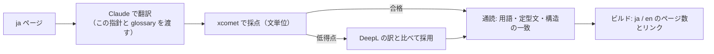

# 英語版の書き方の指針

サイト（`site/src/content/docs/` 直下 = 英語）と各リポジトリの `README.md`（英語）を、日本語版（`ja/`、`README.ja.md`）から作るときの指針です。一次執筆は日本語で、英語は翻訳先です。

## 守ること

1. **日本語版から訳す。仕様書の英文は開かない。** 英語にすると仕様書の文言に近づきやすいので、D-03（仕様書を翻訳しない）は英語で強く効きます。用語は [glossary.md](./glossary.md) の仕様書の語を使ってよいが、文は自分の文にする。
2. **構造を揃える。** 見出し・表・図・note の数と順序を日本語版と同じにする。1 対 1 で対応しない段落を作らない（後で差分を取れるようにするため）。
3. **識別子はそのまま。** 要素名・属性名・関数名・環境変数・ファイル名・DMC・npm 名は訳さない。バッククォートも日本語版と同じ位置に置く。
4. **Mermaid のラベルは訳す。** ノード id は変えない。` ` の位置は英語の長さに合わせて直してよい。
5. **定型文は glossary.md の文字列をそのまま使う。** 商標注記、配布物の非同梱、BREX の初出表記 `BREX (Business Rules Exchange)`。
6. **S1000D® の ® は各ページの最初の 1 回だけ**（title と description を除く本文の初出）。以後は S1000D。
7. **「このスタックでは」の節は `In this stack` の見出しにする**（D-20 の書き分けは英語でも同じ）。
8. **日本固有の内容は残し、読者を海外に置き換えない。** 「日本での状況」は "S1000D in Japan" として残す。MRJ の例も残す。
9. **数字・版・件数は日本語版の実数をそのまま。** 訳の過程で丸めない。

## 文体

- 現在形、能動態。主語はツール名か the server / the library。"we" は使わない。
- 1 文 1 事。日本語の 1 文が長ければ 2 文に分けてよいが、情報を足さない・落とさない。
- 見出しは文ではなく名詞句（"Reading a BREX"、"In this stack"）。
- 「〜できます」は can、「〜します」は現在形の動詞。「〜してください」は命令形。
- 断定を避ける日本語（「〜と考えられます」）は "appears to"、「調べきれていません」は "has not been investigated" のように、確信の度合いを保つ。

## 作業の手順

英語の訳は、ページごとに別の短い会話かサブエージェントで行う（長い会話では文脈の再送が無駄になる）。
