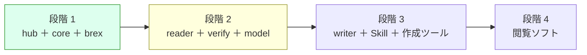

# 引き継ぎメモ（2026-10-26 00:40 JST 時点）

新しいチャットで s1000d-stack の作業を続けるための要約です。経緯の詳細は [ROADMAP.md](../ROADMAP.md)・[DECISIONS.md](../DECISIONS.md)・[background.md](./background.md) にあり、このメモはそれらへの入口です。

> [!IMPORTANT]
> 作業の前提は次の 3 つです。
> 1. DECISIONS.md の決定事項（D-01〜D-19）は覆さない。変える必要があると判断したときは、理由を挙げて先に相談する。
> 2. S1000D の仕様書・XSD・既定 BREX・公式サンプルは、どのリポジトリにも npm パッケージにもコミットしない（D-03）。置き場所は `s1000d-stack/specs/s1000d/`（git 管理外、D-06）。
> 3. `docs/` の文書（ROADMAP・DECISIONS・notes/background・notes/handoff・design/ の 4 本）は、ローカル `s1000d-stack/docs/` と claude.ai Project「S1000D Stack」のナレッジの両方に同じ内容を置く。片方だけ直さない。

## いまどこにいるか



**段階 1 は 2026-10-24 に完了し、段階 2 の設計を同日に書きました。** 設計は `docs/design/` の 3 文書（[verify-mcp.md](../design/verify-mcp.md)、[reader-mcp.md](../design/reader-mcp.md)、[manual-model.md](../design/manual-model.md)）で、作業の順序は ROADMAP「段階 2 の作業」の表（作業 1〜10）にあります。設計で出た 3 つの判断は同日に確定しました（D-17: XSD 検証の置き場所、D-18: reader の検証の既定、U-04: パッケージ名 `@shuji-bonji/experiential-manual-model`）。実装は作業 1〜8 が済み（段階 2 の 3 部品 verify-mcp・reader-mcp・experiential-manual-model がすべて動く状態）、core 0.2.0 は npm に公開済みです（2026-10-25）。作業 9（サイト）も済み、残りは作業 10（公開）で、手順は下の「次にやること」にチェックリストで書いてあります。**2026-10-25 に次の目標を「CSDB 製品に組み込める基盤」と決め（D-19）、段階 2.5（修正提案・`CsdbSource`・HTTP transport・DML/DDN・概要モード・機密区分）を ROADMAP に足しました。LLM 活用時の注意点 5 つへの対応と、段階 4 の最初の成果物にする簡易な技術マニュアルの Web システム（基盤の参照実装、技術は U-10）も同じ設計文書に記録してあります。設計は design/agent-platform.md。**

## リポジトリの状態

| リポジトリ | 公開 | npm | 状態 |
|---|---|---|---|
| [shuji-bonji/s1000d-core](https://github.com/shuji-bonji/s1000d-core) | Public | `@shuji-bonji/s1000d-core` **0.2.0**（2026-10-25、タグ push → `publish.yml`） | 公開は `docs/RELEASE.md` の手順（`npm version` でタグを付けて push）。0.2.0 の後に `a0e9eb6`（`findSchemaDirs` のデータ辞書除外）と vitest 4 への更新が未公開で、0.2.1 の材料 |
| [shuji-bonji/s1000d-brex-mcp](https://github.com/shuji-bonji/s1000d-brex-mcp) | Private | 未公開 | core `^0.2.0` を参照し、BREX の探索は core の `locateBrex` に任せた（`edfe6e2`、push 済み）。npm 公開は D-16 のとおり段階 2 が揃った時点 |
| [shuji-bonji/s1000d-verify-mcp](https://github.com/shuji-bonji/s1000d-verify-mcp) | Private | 未公開 | 最初の実装を push 済み（`686fb58`）。5 ツール、テスト 13＋5 件、stdio の実機確認済み |
| [shuji-bonji/s1000d-stack](https://github.com/shuji-bonji/s1000d-stack)（hub） | Private | — | README・`stack.json`・`scripts/generate-stack.mjs`・`site/`・`.github/workflows/`（`deploy.yml` は手動実行のみ、`stack-check.yml` は毎日）・`docs/` をコミット・push 済み（2026-10-24）。`docs/`・サイト・REGISTRY の変更を 2026-10-25 夜にチャットからコミット済み（2026-10-25 深夜の 3 件 `e981c5f` 以降は push 未）。**git のコミットはチャットから行ってよい**（2026-10-24 に利用者が指示。接続フォルダーの削除の許可を得れば git のロックファイルも消せる）。署名は利用者が後で付け直す |
| [shuji-bonji/s1000d-reader-mcp](https://github.com/shuji-bonji/s1000d-reader-mcp) | Private | 未公開 | 最初の実装を push 済み（`6e567c7`）。6 ツール、テスト 14＋5 件、stdio の実機確認済み |
| [shuji-bonji/experiential-manual-model](https://github.com/shuji-bonji/experiential-manual-model) | Private | 未公開 | 最初の実装を push 済み（`09f9d2c`） |
| `shuji-bonji/s1000d-writer-mcp` | Private | 未公開 | GitHub に作成済み、中身は空（段階 3） |

ローカルの配置は `/Users/bonji/workspace/shuji-bonji/s1000d-stack/` の下に `lib/s1000d-core`、`mcp/s1000d-brex-mcp`、`mcp/s1000d-verify-mcp`、`mcp/s1000d-reader-mcp`、`lib/experiential-manual-model`、`specs/s1000d/`（いずれも hub の `.gitignore` で除外）です。

## 動かし方（確認用）

```sh
# core（配布物に対するテストも含める場合）
cd lib/s1000d-core && npm test
S1000D_SPEC_TESTS=1 npm test          # 既定: ../../specs/s1000d/issue-7

# brex-mcp
cd mcp/s1000d-brex-mcp && npm test
S1000D_SPEC_DIR=../../specs/s1000d/issue-7 npm start   # stdio で起動

# verify-mcp（配布物のテストは約 20 秒）、reader-mcp も同じ
cd mcp/s1000d-verify-mcp && npm test
S1000D_SPEC_TESTS=1 npm test
cd mcp/s1000d-reader-mcp && npm test

# experiential-manual-model（配布物を使わない）
cd lib/experiential-manual-model && npm test

# サイト（Node 22.23.4 以上）
cd site && npm run build && npm run preview
```

> [!TIP]
> チャットから開発機に接続した Linux VM（aarch64）では、**Mac の `node_modules` を使わない**。`node_modules` は 1 つのフォルダーを 2 つの OS で見ることになり、npm が OS に合うネイティブモジュール（rolldown の binding）だけを残すため、片方で `npm install` するともう片方が壊れる（2026-10-25 に判明。WebAssembly 版の binding への切り替えも、他のパッケージが要求する別の版の `@emnapi/*` と衝突して動かなかった）。VM では `~/vmrun.sh <s1000d-stack からの相対パス> <コマンド>` を使う。リポジトリを `~/vm/s1000d-stack/` に rsync（`node_modules`・`dist`・`.git` を除く）して `npm ci` し、そこでコマンドを実行する。`specs/` は Mac 側へのシンボリックリンクなので配布物のテストも動く。例: `S1000D_SPEC_TESTS=1 ~/vmrun.sh lib/s1000d-core npx vitest --run`、`~/vmrun.sh site npm run build`。`~/vmrun.sh` は VM のホームにあり、セッションをまたいで残らないことがあるので、無ければ下の内容で作り直す。
>
> ```sh
> #!/usr/bin/env bash
> set -euo pipefail
> REL="$1"; shift
> SRC="$HOME/mnt/s1000d-stack/$REL"; DST="$HOME/vm/s1000d-stack/$REL"
> mkdir -p "$DST"
> rsync -a --delete --exclude node_modules --exclude dist --exclude .git --exclude '.astro' "$SRC/" "$DST/"
> ln -sfn "$HOME/mnt/s1000d-stack/specs" "$HOME/vm/s1000d-stack/specs"
> cd "$DST"
> if [ ! -d node_modules ] || [ ! -f node_modules/.lock-hash ] || [ "$(md5sum package-lock.json | cut -d' ' -f1)" != "$(cat node_modules/.lock-hash)" ]; then
>   npx -y npm@12 ci --no-audit --no-fund >/dev/null 2>&1 || npx -y npm@12 install --no-audit --no-fund >/dev/null
>   md5sum package-lock.json | cut -d' ' -f1 > node_modules/.lock-hash
> fi
> exec "$@"
> ```
>
> VM の npm は 10.9.9 で、Mac の npm 12 が書いた lock を読めず `Cannot read properties of null (reading 'edgesOut')` で失敗することがあるので、npm は `npx -y npm@12` で呼ぶ。

## 次にやること: 作業 10（公開、D-16）

段階 2 の実装とサイトは揃っているので、次のチャットの仕事は**公開**です。利用者がやること（GitHub・npm の操作）と、チャットでやること（ファイルの追加・書き換え）を分けて書きます。順番は上から。

### 10-0 前提（利用者。チャットを始める前に）

- [ ] hub の未 push のコミット（3 件: `e981c5f`・`ea24872`・このメモの更新）に署名し直して push する
- [ ] `site` と 5 リポジトリで `npm install` を 1 回ずつ実行する（VM 側の作業で Mac の `node_modules` が一時的に壊れたため。手順は上の TIP）
- [ ] サイトの新しい 3 ページ（`guide/applicability.md`、`mcp/verify-mcp.md`、`mcp/reader-mcp.md`）を通読し、直したい箇所があれば新しいチャットの最初に伝える

### 10-1 公開用のファイルを 4 リポジトリに足す（チャット）

brex-mcp・verify-mcp・reader-mcp・experiential-manual-model に、core と同じ形で次を足す。core の実物は `lib/s1000d-core/.github/workflows/publish.yml` と `lib/s1000d-core/docs/RELEASE.md`。

- [ ] `.github/workflows/publish.yml`（タグ `v*` の push で test → publish。publish は Node 24・`permissions: id-token: write`・`npm publish --provenance --access public`。Trusted Publisher 前提で Secrets のトークンは使わない。package.json の version とタグの一致を確かめる step も同じ）
- [ ] `docs/RELEASE.md`（`npm version patch|minor` → `git push --follow-tags` の手順。初回だけ手動 `npm publish --access public` が要ることを明記）
- [ ] `package.json` の `files`・`repository`・`publishConfig` を core と揃える（`engines` は各リポジトリの現状のまま。core と experiential-manual-model は `>=20`、MCP 3 つは `>=22`）
- [ ] 各 README の先頭の「npm 未公開（開発中）」の note を消す
- [ ] 各 CHANGELOG の「未リリース」を `0.1.0` に切る（日付は公開日の JST）

### 10-2 GitHub と npm の操作（利用者）

- [ ] hub `s1000d-stack` を Public にし、Settings → Pages の Source を **GitHub Actions** にする
- [ ] brex-mcp・verify-mcp・reader-mcp・experiential-manual-model を Public にする
- [ ] 4 パッケージを初回だけ手動で公開する: 各リポジトリで `npm run build && npm publish --access public`（D-14。順番は experiential-manual-model → brex-mcp → verify-mcp → reader-mcp。MCP 3 つは core `^0.2.0` を使うので core は公開済みでよい）
- [ ] npm 側で 4 パッケージに Trusted Publisher（GitHub Actions、リポジトリ名と `publish.yml`）を登録する
- [ ] 公開できたことを `npm view @shuji-bonji/<name> version` で確認し、チャットに伝える

### 10-3 サイトと hub の仕上げ（チャット。10-2 の後）

- [ ] `.github/workflows/deploy.yml` の push トリガー（`main` への push で配備）を戻す。いまは `workflow_dispatch` のみ
- [ ] `site/src/content/docs/guide/getting-started.md`・`mcp/brex-mcp.md`・`mcp/verify-mcp.md`・`mcp/reader-mcp.md` の「npm 未公開（開発中）」の note を消し、`npx @shuji-bonji/...` の手順が実物と合うことを確かめる
- [ ] `scripts/generate-stack.mjs` の REGISTRY で 4 つの `status` を `released` にし、`node scripts/generate-stack.mjs` で `stack.json` と README を再生成する
- [ ] `~/vmrun.sh site npm run build` でサイトが通ることを確かめる（13 ページ、内部リンク切れ無し）
- [ ] ROADMAP「段階 2 の作業」の進捗の行で作業 10 を「済み」にし、段階 2 の完了日（JST）を書く。DECISIONS の D-16 に公開日を追記する。このメモの「リポジトリの状態」の表を Public / npm 版に更新する
- [ ] hub をコミットする（署名は利用者）。push で `deploy.yml` が走り、GitHub Pages に配備される

### 10-4 公開後の確認（利用者）

- [ ] GitHub Pages の URL でサイトが開き、ヘッダーの GitHub リンクが `shuji-bonji/s1000d-stack` を指す
- [ ] `stack-check.yml`（毎日）が緑になる
- [ ] Claude Desktop などから `npx -y @shuji-bonji/s1000d-brex-mcp` で起動できる（`S1000D_SPEC_DIR` を付けて）

### その後の候補

1. **段階 2.5 の作業 1〜2**（core `suggestFixes()` と verify-mcp `suggest_fixes`）。設計は design/agent-platform.md「修正提案の設計」。作業 10 と並行できる。
2. **core 0.2.1 の公開**（利用者、急がない）: `findSchemaDirs` のデータ辞書除外と vitest 4 への更新。手順は `lib/s1000d-core/docs/RELEASE.md`（`npm version patch`）。verify-mcp と reader-mcp は自分でも同じ除外をしているので、0.2.0 のままでも動く。

## 新しいチャットの最初に読むもの

1. ROADMAP.md（全体像と進捗。段階 2 の作業の表）
2. DECISIONS.md（D-01〜D-19 と未決 U-03・U-05・U-07・U-09・U-10）
3. notes/background.md（仕様書の読解結果、配布物のファイル構成、設計のヒント）
4. このメモ
5. design/ の 4 文書（着手する作業に応じて。agent-platform.md が次の目標）
6. notes/site-review.md（サイト通読用の照合シート。通読は 2026-10-24 に完了。記述の根拠を探すときに参照）

> [!NOTE]
> 文章は GitHub のアラート記法（`> [!NOTE]` など）を使い、日付は JST で書きます。既定 BREX の DMC は `S1000D-Y-04-10-0301-00A-022A-D` で、システム差異コード（Y）が配布物のファイル名・仕様書本文・データ辞書で食い違うため、コードでは決め打ちしていません。
