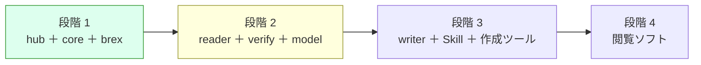

# 引き継ぎメモ（2026-10-25 22:40 JST 時点）

新しいチャットで s1000d-stack の作業を続けるための要約です。経緯の詳細は [ROADMAP.md](../ROADMAP.md)・[DECISIONS.md](../DECISIONS.md)・[background.md](./background.md) にあり、このメモはそれらへの入口です。

> [!IMPORTANT]
> 作業の前提は次の 3 つです。
> 1. DECISIONS.md の決定事項（D-01〜D-18）は覆さない。変える必要があると判断したときは、理由を挙げて先に相談する。
> 2. S1000D の仕様書・XSD・既定 BREX・公式サンプルは、どのリポジトリにも npm パッケージにもコミットしない（D-03）。置き場所は `s1000d-stack/specs/s1000d/`（git 管理外、D-06）。
> 3. `docs/` の文書（ROADMAP・DECISIONS・notes/background・notes/handoff・design/ の 3 本）は、ローカル `s1000d-stack/docs/` と claude.ai Project「S1000D Stack」のナレッジの両方に同じ内容を置く。片方だけ直さない。

## いまどこにいるか



**段階 1 は 2026-10-24 に完了し、段階 2 の設計を同日に書きました。** 設計は `docs/design/` の 3 文書（[verify-mcp.md](../design/verify-mcp.md)、[reader-mcp.md](../design/reader-mcp.md)、[manual-model.md](../design/manual-model.md)）で、作業の順序は ROADMAP「段階 2 の作業」の表（作業 1〜10）にあります。設計で出た 3 つの判断は同日に確定しました（D-17: XSD 検証の置き場所、D-18: reader の検証の既定、U-04: パッケージ名 `@shuji-bonji/experiential-manual-model`）。実装は作業 1〜8 が済み（段階 2 の 3 部品 verify-mcp・reader-mcp・experiential-manual-model がすべて動く状態）、core 0.2.0 は npm に公開済みです（2026-10-25）。作業 9（サイト）も済み、残りは作業 10（公開）です。

## リポジトリの状態

| リポジトリ | 公開 | npm | 状態 |
|---|---|---|---|
| [shuji-bonji/s1000d-core](https://github.com/shuji-bonji/s1000d-core) | Public | `@shuji-bonji/s1000d-core` **0.2.0**（2026-10-25、タグ push → `publish.yml`） | 公開は `docs/RELEASE.md` の手順（`npm version` でタグを付けて push）。0.2.0 の後に `a0e9eb6`（`findSchemaDirs` のデータ辞書除外）と vitest 4 への更新が未公開で、0.2.1 の材料 |
| [shuji-bonji/s1000d-brex-mcp](https://github.com/shuji-bonji/s1000d-brex-mcp) | Private | 未公開 | core `^0.2.0` を参照し、BREX の探索は core の `locateBrex` に任せた（`edfe6e2`、push 済み）。npm 公開は D-16 のとおり段階 2 が揃った時点 |
| [shuji-bonji/s1000d-verify-mcp](https://github.com/shuji-bonji/s1000d-verify-mcp) | Private | 未公開 | 最初の実装を push 済み（`686fb58`）。5 ツール、テスト 13＋5 件、stdio の実機確認済み |
| [shuji-bonji/s1000d-stack](https://github.com/shuji-bonji/s1000d-stack)（hub） | Private | — | README・`stack.json`・`scripts/generate-stack.mjs`・`site/`・`.github/workflows/`（`deploy.yml` は手動実行のみ、`stack-check.yml` は毎日）・`docs/` をコミット・push 済み（2026-10-24）。`docs/` の変更は 2026-10-24 夜にチャットからコミット済み（push は未）。**git のコミットはチャットから行ってよい**（2026-10-24 に利用者が指示。接続フォルダーの削除の許可を得れば git のロックファイルも消せる）。署名は利用者が後で付け直す |
| [shuji-bonji/s1000d-reader-mcp](https://github.com/shuji-bonji/s1000d-reader-mcp) | Private | 未公開 | 最初の実装を push 済み（`6e567c7`）。6 ツール、テスト 14＋5 件、stdio の実機確認済み |
| [shuji-bonji/experiential-manual-model](https://github.com/shuji-bonji/experiential-manual-model) | Private | 未公開 | 最初の実装を push 済み（`09f9d2c`） |
| `shuji-bonji/s1000d-writer-mcp` | Private | 未公開 | GitHub に作成済み、中身は空（段階 3） |

ローカルの配置は `/Users/bonji/workspace/shuji-bonji/s1000d-stack/` の下に `lib/s1000d-core`、`mcp/s1000d-brex-mcp`、`mcp/s1000d-verify-mcp`、`mcp/s1000d-reader-mcp`、`lib/experiential-manual-model`、`specs/s1000d/`（いずれも hub の `.gitignore` で除外）です。

## 動かし方（確認用）

```sh
# core（配布物に対するテストも含める場合）
cd lib/s1000d-core && npm test
S1000D_SPEC_TESTS=1 npm test          # 既定: ../../specs/s1000d/issue-7

# brex-mcp
cd mcp/s1000d-brex-mcp && npm test
S1000D_SPEC_DIR=../../specs/s1000d/issue-7 npm start   # stdio で起動

# verify-mcp（配布物のテストは約 20 秒）、reader-mcp も同じ
cd mcp/s1000d-verify-mcp && npm test
S1000D_SPEC_TESTS=1 npm test
cd mcp/s1000d-reader-mcp && npm test

# experiential-manual-model（配布物を使わない）
cd lib/experiential-manual-model && npm test

# サイト（Node 22.23.4 以上）
cd site && npm run build && npm run preview
```

> [!TIP]
> チャットから開発機に接続した Linux VM（aarch64）では、**Mac の `node_modules` を使わない**。`node_modules` は 1 つのフォルダーを 2 つの OS で見ることになり、npm が OS に合うネイティブモジュール（rolldown の binding）だけを残すため、片方で `npm install` するともう片方が壊れる（2026-10-25 に判明。WebAssembly 版の binding への切り替えも、他のパッケージが要求する別の版の `@emnapi/*` と衝突して動かなかった）。VM では `~/vmrun.sh <s1000d-stack からの相対パス> <コマンド>` を使う。リポジトリを `~/vm/s1000d-stack/` に rsync（`node_modules`・`dist`・`.git` を除く）して `npm ci` し、そこでコマンドを実行する。`specs/` は Mac 側へのシンボリックリンクなので配布物のテストも動く。例: `S1000D_SPEC_TESTS=1 ~/vmrun.sh lib/s1000d-core npx vitest --run`、`~/vmrun.sh site npm run build`。`~/vmrun.sh` は VM のホームにあり、セッションをまたいで残らないことがあるので、無ければ下の内容で作り直す。
>
> ```sh
> #!/usr/bin/env bash
> set -euo pipefail
> REL="$1"; shift
> SRC="$HOME/mnt/s1000d-stack/$REL"; DST="$HOME/vm/s1000d-stack/$REL"
> mkdir -p "$DST"
> rsync -a --delete --exclude node_modules --exclude dist --exclude .git --exclude '.astro' "$SRC/" "$DST/"
> ln -sfn "$HOME/mnt/s1000d-stack/specs" "$HOME/vm/s1000d-stack/specs"
> cd "$DST"
> if [ ! -d node_modules ] || [ ! -f node_modules/.lock-hash ] || [ "$(md5sum package-lock.json | cut -d' ' -f1)" != "$(cat node_modules/.lock-hash)" ]; then
>   npx -y npm@12 ci --no-audit --no-fund >/dev/null 2>&1 || npx -y npm@12 install --no-audit --no-fund >/dev/null
>   md5sum package-lock.json | cut -d' ' -f1 > node_modules/.lock-hash
> fi
> exec "$@"
> ```
>
> VM の npm は 10.9.9 で、Mac の npm 12 が書いた lock を読めず `Cannot read properties of null (reading 'edgesOut')` で失敗することがあるので、npm は `npx -y npm@12` で呼ぶ。

## 次にやること（候補の順）

1. **サイトの新しい 3 ページの通読（利用者の作業）**: `site/src/content/docs/guide/applicability.md`、`mcp/verify-mcp.md`、`mcp/reader-mcp.md`。記述の根拠は notes/background.md「参照の解決で分かった配布物の性質」「適用性の評価で分かった配布物の性質」「XSD の写しについて」と、各 MCP の README・テスト。`cd site && npm run build && npm run preview` で確認できる。直したいところがあれば、このチャットか新しいチャットで指示する。
2. **作業 10（公開、D-16）**: 通読が済んだら。(1) hub を Public にし GitHub Pages の Source を GitHub Actions にする。(2) `deploy.yml` の push トリガーを戻す。(3) brex-mcp・verify-mcp・reader-mcp・experiential-manual-model を Public にし、初回だけ手動で `npm publish --access public`、その後 npm 側で Trusted Publisher を登録する（D-14。各リポジトリに `publish.yml` と `docs/RELEASE.md` を core と同じ形で足す必要がある。未作成）。(4) サイトの `guide/getting-started.md`・`mcp/brex-mcp.md`・`mcp/verify-mcp.md`・`mcp/reader-mcp.md` の「npm 未公開（開発中）」の note を消す。(5) `generate-stack.mjs` の REGISTRY で 4 つを `released` にして `stack.json` と README を再生成する。
3. **core 0.2.1 の公開**（利用者の作業、急がない）: `findSchemaDirs` のデータ辞書除外（`a0e9eb6`）と vitest 4 への更新。手順は `docs/RELEASE.md`（`npm version patch`）。verify-mcp と reader-mcp は自分でも同じ除外をしているので、0.2.0 のままでも動く。
4. **公開（D-16）**: 作業 9 の後に、hub・brex-mcp・verify-mcp・reader-mcp を公開する（各 MCP の初回は手動 `npm publish`、D-14）。
3. **作業 8**（experiential-manual-model）は core に依存しないので、並行して進められる。
4. **公開（D-16）**: 段階 2 が揃ったら、D-16 に書いた 5 つの作業で hub と brex-mcp を公開する。

## 新しいチャットの最初に読むもの

1. ROADMAP.md（全体像と進捗。段階 2 の作業の表）
2. DECISIONS.md（D-01〜D-18 と未決 U-03・U-05・U-07・U-09）
3. notes/background.md（仕様書の読解結果、配布物のファイル構成、設計のヒント）
4. このメモ
5. design/ の 3 文書（着手する作業に応じて）
6. notes/site-review.md（サイト通読用の照合シート。通読は 2026-10-24 に完了。記述の根拠を探すときに参照）

> [!NOTE]
> 文章は GitHub のアラート記法（`> [!NOTE]` など）を使い、日付は JST で書きます。既定 BREX の DMC は `S1000D-Y-04-10-0301-00A-022A-D` で、システム差異コード（Y）が配布物のファイル名・仕様書本文・データ辞書で食い違うため、コードでは決め打ちしていません。
