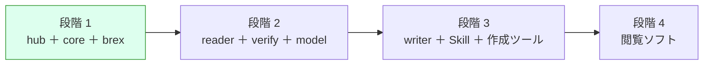

# 引き継ぎメモ（2026-10-24 JST 時点）

新しいチャットで s1000d-stack の作業を続けるための要約です。経緯の詳細は [ROADMAP.md](../ROADMAP.md)・[DECISIONS.md](../DECISIONS.md)・[background.md](./background.md) にあり、このメモはそれらへの入口です。

> [!IMPORTANT]
> 作業の前提は次の 3 つです。
> 1. DECISIONS.md の決定事項は覆さない。変える必要があると判断したときは、理由を挙げて先に相談する。
> 2. S1000D の仕様書・XSD・既定 BREX・公式サンプルは、どのリポジトリにも npm パッケージにもコミットしない（D-03）。置き場所は `s1000d-stack/specs/s1000d/`（git 管理外、D-06）。
> 3. `docs/` の 3 文書（ROADMAP・DECISIONS・notes/background）は、ローカル `s1000d-stack/docs/` と claude.ai Project「S1000D Stack」のナレッジの両方に同じ内容を置く。片方だけ直さない。

## いまどこにいるか



段階 1 の作業 1〜7 はすべて済んでいます（ROADMAP「進捗」）。段階 1 の完了条件のうち残っているのは **サイト 9 ページを利用者が通読して仕様書と矛盾がないか確かめること** だけです。

## リポジトリの状態

| リポジトリ | 公開 | npm | 状態 |
|---|---|---|---|
| [shuji-bonji/s1000d-core](https://github.com/shuji-bonji/s1000d-core) | Public | `@shuji-bonji/s1000d-core` 0.1.0（2026-10-24、手動公開） | CI 通過。`publish.yml`（Trusted Publisher、タグ `v*` で起動）と `docs/RELEASE.md` をコミット済み。npm 側の Trusted Publisher 登録も済み（2026-10-24）。次の版からは `docs/RELEASE.md` の手順（version を上げてタグ `vX.Y.Z` を push）だけで公開される |
| [shuji-bonji/s1000d-brex-mcp](https://github.com/shuji-bonji/s1000d-brex-mcp) | Private | 未公開 | CI 通過。core は npm の `^0.1.0` を参照 |
| [shuji-bonji/s1000d-stack](https://github.com/shuji-bonji/s1000d-stack)（hub） | Private | — | README・`stack.json`・`scripts/generate-stack.mjs`・`site/`・`.github/workflows/`（`deploy.yml` は手動実行のみ、`stack-check.yml` は毎日）・`docs/` を作成し、コミット・push 済み（2026-10-24）。今後も git のコミット・push は利用者側で行う（開発機の接続フォルダーからは git のロックファイルが消せないため） |

ローカルの配置は `/Users/bonji/workspace/shuji-bonji/s1000d-stack/` の下に `lib/s1000d-core`、`mcp/s1000d-brex-mcp`、`specs/s1000d/`（いずれも hub の `.gitignore` で除外）です。

## 動かし方（確認用）

```sh
# core（配布物に対するテストも含める場合）
cd lib/s1000d-core && npm test
S1000D_SPEC_TESTS=1 npm test          # 既定: ../../specs/s1000d/issue-7

# brex-mcp
cd mcp/s1000d-brex-mcp && npm test
S1000D_SPEC_DIR=../../specs/s1000d/issue-7 npm start   # stdio で起動

# サイト（Node 22.23.4 以上）
cd site && npm run build && npm run preview
```

## 次にやること（候補の順）

1. **利用者側**: サイト 9 ページの通読（`cd site && npm run build && npm run preview`）。段階 1 の最後の完了条件。
2. **U-01（公開の時期）** を決める。hub を Public にするなら `deploy.yml` の push トリガーを戻し、GitHub Pages（Source: GitHub Actions）を有効にする。brex-mcp を npm に出すなら、初回は手動 publish、以後は Trusted Publisher（D-14）。
3. **段階 2 の入口**: U-08（XSD 検証の方式。候補 `xmllint-wasm` と `libxml2-wasm`。判断材料は DECISIONS.md）を比較して決める → s1000d-reader-mcp / s1000d-verify-mcp / manual-model の設計。
4. **調査の宿題**: Bike Samples 105 件に既定 BREX への違反 55 件が出る原因（既定 BREX の厳しさか、サンプルの不備か）。学習サイトの題材になる。

## 新しいチャットの最初に読むもの

1. ROADMAP.md（全体像と進捗）
2. DECISIONS.md（D-01〜D-14 と未決 U-01〜U-09）
3. notes/background.md（仕様書の読解結果、配布物のファイル構成、設計のヒント）
4. このメモ

> [!NOTE]
> 文章は GitHub のアラート記法（`> [!NOTE]` など）を使い、日付は JST で書きます。既定 BREX の DMC は `S1000D-Y-04-10-0301-00A-022A-D` で、システム差異コード（Y）が配布物のファイル名・仕様書本文・データ辞書で食い違うため、コードでは決め打ちしていません。
