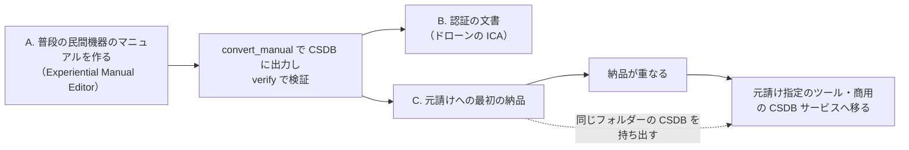
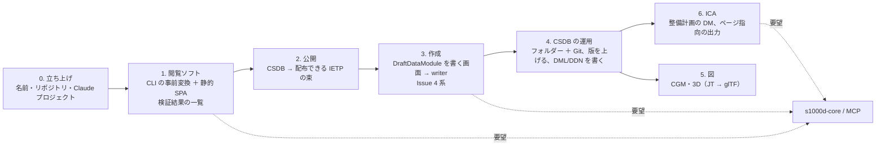

# IETM / IETP プロジェクトの最初の文書（下書き）

S1000D の CSDB を Web で表示する閲覧ソフト（IETP の最小形）から始め、作成・公開まで広げる産業向けの製品プロジェクトの、最初の文書の下書きです。D-29 で s1000d-stack から分けた製品の 1 つで、この文書は新しいプロジェクトのリポジトリと Claude プロジェクトを作ったときに、そこへ移して `docs/ROADMAP.md` の元にします。

- 作成日: 2026-11-07（JST）、更新日: 2026-11-14（JST、目標の水準・利用者・ドローンの ICA・元請けへの納品を追記）
- 前提の決定（s1000d-stack 側）: D-03（仕様書・XSD・公式サンプルを同梱しない）、D-19（組み込み基盤。製品はその最初の利用者）、D-28（SvelteKit ＋ PWA）、D-29（製品の分離）
- 前提の設計: [design/agent-platform.md](../design/agent-platform.md)「参照実装」（ここへ移す）、[design/reader-mcp.md](../design/reader-mcp.md)（本文の読み取りの形 `ContentNode`）
- 名前: 未定。S1000D は ASD の商標なので、製品名には使わず（D-02）、説明文に「S1000D® の CSDB を表示する」と書く
- 着手の時期: Experiential Manual Editor（体験型マニュアルの製品）の後

## 1. 目的

| 目的 | 内容 |
|---|---|
| 主 | S1000D のデータモジュールの集まり（CSDB）を、ブラウザーで読める技術マニュアル（IETP）として表示する。利用者が製品（適用性）を選ぶと、当てはまらない節が消える |
| 次 | CSDB を作って版を管理し、IETP として納められるようにする。中小企業・研究機関が、商用の CSDB 製品を買わずに最初の納品にたどり着けるようにする。輸出先から S1000D を求められる企業に限らず、普段の民間機器のマニュアルから使える形にする（1-1） |
| 基盤への還元 | s1000d-core・MCP の API が「製品から使える形」かをここで確かめ、足りないものを基盤に戻す（D-19） |

商用の CSDB 製品が持つ仕組み（版・状態・履歴・権限・マルチテナント）を全部は作りません。個人開発の規模で持てる範囲を 4 節で決めます。

### 1-1. 目標の水準（2026-11-14 に決定）

> [!IMPORTANT]
> 次の 3 つの場面で実際に使えることを、この製品の目標の水準にします。

| 場面 | 内容 | 詳細 |
|---|---|---|
| A. 普段使い | 中小企業が、閉鎖的な分野ではない民間の通常の機器のマニュアルを、普段からこの製品群で作る。その経験とデータが、高度な技術分野の仕事を受けるときにそのまま使える | 2-1 |
| B. 認証の文書 | 民間企業や研究機関がドローンを開発したときに、ATA・S1000D などの規格に沿って ICA（Instructions for Continued Airworthiness。点検・整備の手順書）を作れる | 2-2 |
| C. 元請けへの納品 | 航空・防衛の産業へ直接参入するのは難しくても、それを担う企業（重工各社など）への納品に使える。納品が重なった利用者は、元請け指定のツールや商用の CSDB サービス（富士フイルムビジネスイノベーションなど）へ移る前提にする | 2-3 |



この製品が下げられるのは「データの形式」と「作業の経験」の 2 つです。元請けのビジネスルールへの適合、情報セキュリティーの審査、品質認証、MIC・NCAGE の登録は利用者自身の仕事として残ります。説明文には「参入できる」ではなく「参入の条件の 1 つを満たせる」と書きます。

## 2. 利用者

| 区分 | 利用者 | 最初に見せるもの |
|---|---|---|
| 受け取る側 | 納入された S1000D のデータを持っていて、見る手段が欲しい整備・保守の担当 | 閲覧ソフト（段階 1） |
| 作る側 | S1000D をまだ持たず、これから作って納めたい中小企業・研究機関の技術文書の担当、技術マニュアル制作会社の担当。専用の編集システムを持たずに、2-1 の業務を行う人 | 作成と公開（段階 3〜4） |
| 学ぶ側 | 電子マニュアルの作成の仕事を目指していて、組織の外で S1000D の作業を経験したい人 | 閲覧ソフトと検証結果の一覧（段階 1）、学習サイト |
| 組み込む側 | 自社の CSDB 製品に AI エージェントと Web 表示を足したいベンダー | `CsdbSource` の差し替えと HTTP の MCP（基盤側、既にある） |

### 2-1. 扱う業務の一覧（求人情報から）

2026-11-14 に、航空機の整備向け電子マニュアルを作る職種の求人情報（重工メーカーのグループ会社 1 社の同じ職種が 3 つの求人サイトに載ったもの）を読みました。応募の必須条件は機械・電気・構造分野の業務経験と OA スキルで、S1000D の経験は必須にも歓迎にも入っていません。入社後に OJT で「S1000D 準拠の専用編集システム」を覚える前提です。S1000D の実務を組織の外で身に付ける手段が少ないことが分かります。

求人情報は利用者像としてではなく、「製品が扱う業務の一覧」として使います。応募者本人は入社すれば社内の専用システムを使うためです。

| 求人の業務 | 対応するもの | 状態（2026-11-14） |
|---|---|---|
| S1000D 準拠データの点検・品質確認 | verify-mcp、brex-mcp、Skill `s1000d-review` | 公開済み。段階 1 の閲覧ソフトに検証結果の一覧を出す |
| 整備手順書の編集・作成 | writer-mcp、Skill `s1000d-publish`、段階 3（作成の画面） | MCP と Skill は公開済み、画面は未着手 |
| 誤字脱字・記載ルールの校正 | `s1000d-review` の文章の観点、BREX の `nonContextRules` | 公開済み |
| 電子マニュアルの表示確認 | 段階 1（閲覧ソフト） | 未着手 |
| Illustrator での技術イラスト編集 | 段階 5（図）。ICN と `hotspot` の読み取りだけある | 作図は対象外 |
| 電子教材（E ラーニング・XR）の制作支援 | Experiential Manual Editor | 開発中（別プロジェクト） |
| 設計図面・3D データの読解、顧客との打ち合わせ | なし | 人の仕事として残る |

> [!NOTE]
> 根拠は 1 社分です。技術マニュアル制作会社や部品メーカーの求人・事例で、業務の一覧が同じかを確かめます（8 節）。

### 2-2. 具体例: ドローンの ICA

型式認証を申請するドローンの開発企業・研究機関で、技術文書の専任者を持たない組織を、場面 B の利用者にします。

| 確認できたこと（2026-11-14） | 出典 |
|---|---|
| 日本の無人航空機の型式認証では、点検・整備の手順書を ICA と呼び、サーキュラー No.8-001 のセクション 205 がこれを求める | NEDO ReAMo の解説資料 |
| フライトエッセンシャルパーツがある場合、申請者は整備手順か制限寿命（または両方）を決め、ICA の必須の点検・整備の章に書く | 同上 |
| No.8-001 の安全基準は、米国の Special Class Airworthiness Criteria（2022 年発行）の内容を含む | サーキュラー No.8-001 |
| 有人機の ICA の書式について、英国 CAA の指針（EASA の GM2 21.A.7(b) に当たるもの）は S1000D の version 4 以降と ATA iSpec 2200 を使ってよい標準として挙げる。特定の書式は求めず、選んだ書式を一貫して使うことを求める | UK CAA Regulatory Library |
| EASA は、specific カテゴリーの SAIL III までの UAS についても、設計者が ICA を作って運航者に提供する方針案を出している | EASA Proposed CM-ICA-002 |
| ASTM に、軽量の UAS の整備マニュアルと ICA の内容・構成を定める作業項目がある | ASTM WK62734 |

この例から決まること:

- **S1000D は必須ではなく、使ってよい書式の 1 つです。** 「S1000D で書ける」こと自体は価値になりません。価値は、整備手順・制限寿命・点検間隔を構造化して持てること、設計変更のたびにどの手順が変わったかを版で示せること、海外の認証や輸出のときに同じデータを S1000D として出せること、の 3 点です。
- **判定しない範囲を明記します。** 製品が扱うのは ICA の書式と整合性（参照切れ・適用性・版）までです。整備間隔の根拠や基準への適合は、申請者と審査側の仕事です。Skill が「S1000D への準拠は判定しない」としているのと同じ線引きです。
- **章立ては SNS で持ちます。** ATA の章番号に当たるものを S1000D では SNS で表し、プロジェクトの BREX（`snsRules`）で決めます。ドローン向けの SNS を自作 BREX として用意すれば、brex-mcp の `lookup_sns` がそのまま使えます。

ICA を作るために基盤に足りないもの:

| 足りないもの | 理由 | 扱い |
|---|---|---|
| 点検間隔・制限寿命を持つデータモジュール（整備計画）の読み書き | ICA の中心は「何を・いつ点検するか」と制限寿命。core の本文の読み取りは 5 種（descript / proced / process / fault / crew）で、整備計画の種類は対象外 | core と writer への要望（段階 6）。XSD の名前と構造は手元の配布物で確かめる |
| 版を上げる操作、DML・DDN の書き出し | ICA は型式認証の後も改訂し続ける文書 | 段階 4 に既にある。優先度を上げる |
| ページ指向の出力（PDF） | 審査や運航者への提供が閲覧ソフトだけで足りるかが未確認 | 段階 6。pdf-writer-mcp を使えるかを確かめる |

### 2-3. 元請けへの納品と、その後の移行

場面 C では、製品の役割を「最初の数回の納品までを支え、その後は元請け指定のツールや商用のサービスへ移れるようにする」ことに置きます。利用者が離れていくことを前提にします。

| 設計への影響 | 理由 | 既存の計画との関係 |
|---|---|---|
| 持ち出しやすさを機能として扱う | 利用者が離れるときに、データをそのまま商用の CSDB に取り込める必要がある。独自の保存形式を持たず、標準のファイル名の XML と ICN、DML・DDN だけで完結させる | 4 節のフォルダー ＋ Git の方針のままで足りる。DML・DDN の書き出し（段階 4）の優先度が上がる |
| 元請けの BREX を受け取って検査できることを前面に出す | 納品先ごとにビジネスルールが違う。元請けから渡された BREX を CSDB に置けば、`brexDmRef` の連鎖で各層に照合できる | brex-mcp と verify-mcp で公開済み。製品の画面で「納品先の BREX を選ぶ」操作にする |
| Issue 4 系への対応を早める | 元請けが指定する版は Issue 7 とは限らない（MRJ の供給企業に求められたのは 4.0.1） | 基盤の ROADMAP では Issue 4.2 が「次の対象」。作成機能（段階 3）と同じ時期に要る |
| LLM 無しで動く形を保つ | 元請けの技術情報を外部のサービスに送ることが、契約で禁じられる場合がある | 検証・組み立て・表示は core だけで動く。LLM を使う部分（文章の生成・レビュー・翻訳）は任意の追加にする |

> [!NOTE]
> 利用者が育つほど離れていく形なので、継続課金の事業にはなりにくいと見ています。収益を目的にする場合は、変換・検査の受託や、商用の CSDB 製品への組み込み（「組み込む側」）のほうが合います。

## 3. IETP の最小形（段階 1 の閲覧ソフト）

```text
┌──────────────────────────────────────────────────────────────┐
│ 出版物の題名（PM）   版 003-00  [製品を選ぶ ▾]  検証: XSD ✓ BREX ✓  機密区分: 01 │
├──────────────┬───────────────────────────────────────────────┤
│ 目次（PM）    │ DM の題名（techName / infoName）         DMC    │
│ ▾ 1 説明      │                                               │
│   1.1 概要 ◀  │  節・段落・箇条書き・表                          │
│   1.2 構成    │  手順（番号・警告・注意・結果）                   │
│ ▾ 2 手順      │  図（ICN → SVG / PNG）＋ホットスポット             │
│   2.1 交換    │  参照（dmRef / pmRef / internalRef）→ 押すと移る  │
│ ▸ 3 故障探求  │  適用性で消えた節は「この製品には当てはまらない」の印 │
└──────────────┴───────────────────────────────────────────────┘
```

| 機能 | 基盤の部品 | 補足 |
|---|---|---|
| CSDB のフォルダーを開き、PM の目次を出す | core `CsdbIndex`、`readPublicationModule` | PM が無い CSDB は DM の一覧を目次にする |
| DM を表示する（descript / proced / process / fault / crew の 5 種） | core `readContent` の `ContentNode` を HTML にする | XML をテキスト化しない。`ContentNode` の種類ごとに表示部品を 1 つ |
| 製品を選ぶと当てはまらない節・手順が消える | core `ApplicEvaluator`、`findApplicTables`（ACT・CCT・PCT） | 判定は表示側で行わない。`undetermined` は印を付けて残す |
| 参照を押すと参照先へ移る。無いものは「無い」と出す | core `collectReferences` / `resolveReferences` | 仕様書の章への `dmRef` は「仕様書への参照」と表示 |
| 図のホットスポットを押すと参照先へ移る | `figure/graphic` の `hotspot`（`applicationStructureIdent`） | 表示部品は体験型マニュアルの player の Stage を npm で取る（D-29） |
| ページの先頭に版・検証状態・機密区分 | `VerificationStatus`、`securityClassification` | reader-mcp の応答と同じ項目を人に見せる |
| 検証結果の一覧（2026-11-14 追加） | core `verifyDataModule`、`suggestFixes`、`checkAgainstBrexChain`、`reconcileDml` | CSDB 全体の XSD・BREX・参照・DML との照合の結果を 1 画面に出す。2-1 の「点検・品質確認」に当たる。事前変換の CLI が結果を JSON に書き出す |
| process DM の分岐を進める | `ContentNode` の `if` / `sequence` / `dialog` | 体験型マニュアルの遷移と同じ操作感にする |
| AI に質問する欄（任意） | reader-mcp の HTTP transport、WebMCP | 答えは reader の応答だけから作る。後の段階 |

### 動かし方（決めること）

core は `node:fs` と `libxml2-wasm` を使うので、ブラウザーでそのまま動かす前提では作られていません。2 つの形があります。

| 形 | 内容 | 向く場面 |
|---|---|---|
| **A. 事前変換 ＋ 静的サイト（提案）** | CLI（Node）が CSDB を読んで、`ContentNode`・目次・適用性の表・検証状態を JSON に書き出し、静的な SPA（SvelteKit `adapter-static`、PWA）がそれを読む | 納品物として渡せる（USB・社内サーバー・GitHub Pages）。オフラインで動く。core をブラウザーに移植しなくてよい |
| B. サーバー ＋ ブラウザー | Node のサーバーが CSDB を読み、ブラウザーに返す | CSDB が頻繁に変わる、権限が要る。製品ベンダーの組み込みの形 |

A から始めます。A の CLI は体験型マニュアルの cli の `build` と同じ考え方（JSON と画像を束ねる）で、IETP 側では入力が CSDB になります。B は基盤側の HTTP の MCP と `CsdbSource` で後からできます。

## 4. CSDB の仕組みをどこまで持つか

商用の CSDB 製品が重いのは、置き場所ではなく仕組み（版・状態・履歴・納入・権限）を持つからです。最初は**フォルダー ＋ Git** で代えます。

| CSDB の仕組み | フォルダー ＋ Git での代わり | 基盤に足りないもの |
|---|---|---|
| 置き場所 | フォルダー（core の `DirectoryCsdbSource`） | 無し |
| 変更の履歴・誰が変えたか | Git のコミット | 無し |
| inwork / released | DM の `issueInfo/@inWork` と Git のタグ | writer に「版を上げる」操作（`issueInfo` の更新）が無い |
| 納入の単位 | DDN をタグ付きのコミットから生成する | core に `readDdn` はあるが、DML・DDN を**書く**処理が無い |
| レビューの回付 | comment DM（writer `create_comment`）と Pull Request | 無し |
| 利用者と権限 | GitHub / GitLab に任せる | 持たない（D-19） |
| DB の CSDB | 作らない。製品ベンダーは `CsdbSource` を差し替える | 無し |

先例として、オープンソースの s1kd-tools がフォルダーの CSDB を前提にしています。

フォルダーの中身は標準のファイル名の XML と ICN だけにし、製品独自のファイルを納品物に混ぜません。利用者が商用の CSDB へ移るときに、フォルダーをそのまま取り込めるようにするためです（2-3）。

## 5. 段階（案）



| 段階 | 成果物 | 完了の条件 |
|---|---|---|
| 0 | 製品名（S1000D を含めない）、GitHub のリポジトリ、Claude プロジェクト、この文書を元にした ROADMAP | 文書が新しいプロジェクトに置かれている |
| 1 | 閲覧ソフト（3 節）。入力は自作の券売機の CSDB（`convert_manual` の出力。公開できる）。手元の Bike Samples でも動くことを確かめる（公開しない、D-03） | 券売機の CSDB で、PM の目次から DM をたどり、製品を選ぶと節が消え、参照先へ移れ、各ページに版・検証状態・機密区分が出る。`ContentNode` の 5 種がすべて表示できる。CSDB 全体の検証結果の一覧が出る |
| 2 | 公開の束（静的ファイル一式。PWA でオフライン） | GitHub Pages に置いた券売機の IETP をタブレットで開ける |
| 3 | 作成の画面。`DraftDataModule`（writer の入力。題名・段落・手順・警告・表・参照の木）を画面で書き、writer の `build_data_module` 相当（core `buildDataModule`）で DM にする。体験型マニュアルの editor の E-2（手順のアウトライナー）と同じ部品を使えるかをここで判断する。納品先の BREX を選んで照合できるようにする。Issue 4 系の読み書きを基盤に求める（2-3） | 自分で書いた手順 DM が XSD と BREX を通り、閲覧ソフトで読める。自作の「納品先の BREX」を置いた CSDB で、その層への違反が画面に出る |
| 4 | フォルダー ＋ Git の運用手順と、それに要る core の追加（版を上げる、DML・DDN を書く） | 券売機の CSDB を 2 版にし、DDN を出せる。出したフォルダーに製品独自のファイルが混ざっていない |
| 5 | 図。SVG・PNG の次に、CGM の表示と 3D（JT・PRC の原本と glTF の表示用）。形式は BREX の `list_notations` に従う | 後で決める |
| 6 | ICA に要る追加（2-2）。点検間隔・制限寿命を持つデータモジュールの読み書きと表示、ドローン向けの SNS を持つ自作 BREX、ページ指向の出力（PDF） | 自作のドローンの題材で、整備手順・点検間隔・制限寿命を持つ CSDB を作り、閲覧ソフトと PDF の両方で読める。段階 5 より先に行ってよい |

## 6. 読む資料（着手前）

D-03 のとおり仕様書は手元のものを読み、サイトや文書には自分の言葉で書きます。

| 章・資料 | 読む理由 |
|---|---|
| IETP の機能要件と表示の章（Chap 6 系。「Functionality matrix」を含む章） | IETP に求められる機能の一覧と、ページ指向 / IETP の表示の決まり。閲覧ソフトの「最小形」が仕様書のどの機能に当たるかを対応表にする |
| プロセスデータモジュール（process）と `dmIf` / `dmSeq` / `dialog` の章 | 段階 1 の分岐の表示と、体験型マニュアルの遷移との対応 |
| 図とホットスポット（`figure` / `graphic` / `hotspot`、ICN、IMF）の章 | 段階 1 のホットスポットと段階 5 の図 |
| 版と状態（`issueInfo`、`inWork`、`issueType`）、DML・DDN の章 | 段階 4 のフォルダー ＋ Git の運用が仕様書の語と食い違わないようにする |
| 整備計画のデータモジュール（点検間隔・制限寿命）の章と XSD | 段階 6。ICA の点検・制限寿命を S1000D のどの要素で持つかを決める |
| サーキュラー No.8-001 のセクション 205 と、航空局の「無人航空機の型式認証等の取得のためのガイドライン」の該当箇所 | 段階 6。日本の ICA に求められる章立てと、書式・提出の形の指定があるかを確かめる |
| FAA Order 8110.54（ICA の責任・要件・内容）、EASA の GM 21.A.7 | ICA に含める内容の一覧を、日本の基準の元になった側で確かめる |

## 7. 決めること

| 項目 | 提案 |
|---|---|
| 製品名・リポジトリ名 | S1000D を含めない語。Zenn Book「IETM入門」との呼び分けも考える |
| 技術 | SvelteKit ＋ PWA（D-28 に揃える）。事前変換の CLI は Node（core をそのまま使う） |
| 対象の版 | Issue 7 から。Issue 4 系は、元請けへの納品（2-3）のために作成機能（段階 3）と同じ時期に要る。基盤側 U-07 の判断と合わせて決める |
| LLM の扱い | 検証・組み立て・表示は LLM 無しで動かす。LLM を使う機能は任意の追加にし、外部に送るデータの範囲を画面に出す（2-3） |
| テストデータ | 段階 1 は自作の券売機の CSDB（`convert_manual` の出力。公開できる）。段階 2 以降は次の 3 つを足す（2026-11-08 追記。選定の経過は [editor-and-viewer-study.md](./editor-and-viewer-study.md)「8-2」）。(1) **体験型マニュアル側の Raspberry Pi の見本を S1000D に変換したもの**（MIT。組み立て・初期設定・GPIO・起動しないときの 4 種と `applic` が入る。2 つのプロジェクトをつなぐ共通の題材）。(2) **FAA『Aviation Maintenance Technician Handbook』（FAA-H-8083-30B / -31 / -32）の 1 章**を自作の CSDB にしたもの（米連邦政府の著作物でパブリックドメイン。`faa.gov` の Handbooks & Manuals のページから取る。英語なので `s1000d-translate` の題材にもなる。請負業者が作った部分・第三者の写真が混ざることがあるので冒頭の権利表示を確かめる）。(3) **米軍の TM の故障探求の表**（Distribution Statement A のものだけ。fault DM の題材）。段階 6 では (4) **自作のドローンの ICA**（整備手順・点検間隔・制限寿命を持つ題材。機体は自分で用意できるものにする）を足す（2026-11-14 追記）。Bike Samples は手元の確認だけに使い、公開しない（D-03） |
| 体験型マニュアルとの共有 | player の Stage（図＋ホットスポット）を npm で取る。手順のアウトライナーは段階 3 で判断。逆（IETP 側の部品を体験型マニュアルが使う）は作らない |
| 基盤へ最初に戻す要望 | `ContentNode` の 5 種を表示に十分な形で書き出す CLI 向けの関数（reader-mcp の応答と同じ形で足りるかを段階 1 で確かめる）、`issueInfo` の更新、DML・DDN の書き出し、Issue 4 系の読み書き、整備計画のデータモジュールの読み書き（2026-11-14 に後ろの 2 つを追加） |

## 8. 確かめること（未確認）

| 項目 | 確かめ方 |
|---|---|
| 日本の無人航空機の ICA に、書式（章立て・ファイル形式）の指定があるか | サーキュラー No.8-001 のセクション 205 と航空局ガイドラインを読む |
| 審査や運航者への提供が、閲覧ソフト（IETP）だけで足りるか、PDF が要るか | 同上。型式認証を取った機体の公開資料も見る |
| 元請けが、納品元に最初から編集ツールを指定することがどの程度あるか | 実際に納品している部品メーカー・制作会社の事例や求人を調べる。指定される場合、この製品は納品前の練習と受け取ったデータの確認に使われる |
| 2-1 の業務の一覧が、他社でも同じか | 技術マニュアル制作会社・部品メーカーの求人を 3 社以上読む |
| ドローン向けに広く使われている SNS（章番号の体系）があるか | ASTM の UAS の整備マニュアルの規格、仕様書の Example SNS を見る |
| 整備計画のデータモジュールの XSD の名前と、core の `ContentNode` に足す形 | 手元の `xml_schema_flat/` と仕様書の該当の章を読む |

## 参照した資料（2026-11-14）

- [NEDO ReAMo: サーキュラー No.8-001 セクション 135 の解説](https://reamo.nedo.go.jp/library/2024/04/7_1_135.pdf)
- [NEDO ReAMo: サーキュラー No.8-001 セクション 105 の解説](https://reamo.nedo.go.jp/library/2025/01/4_105_1_1.pdf)
- [国土交通省: サーキュラー No.8-001](https://www1.mlit.go.jp/koku/content/001739381.pdf)
- [UK CAA: GM2 21.A.7(b) Instructions for Continued Airworthiness - format](https://regulatorylibrary.caa.co.uk/748-2012/Content/ORS9%20Decision%2048/GM2%2021%20A%207%20b%20Instructions%20for%20Continued%20Airworthiness%20-%20format.htm)
- [EASA: Proposed CM-ICA-002 Issue 01](https://www.easa.europa.eu/en/downloads/139680/en)
- [ASTM: WK62734](https://store.astm.org/workitem-wk62734)
- [FAA Order 8110.54](https://www.faa.gov/documentLibrary/media/Order/ND/Order%20%208110.54.pdf)
