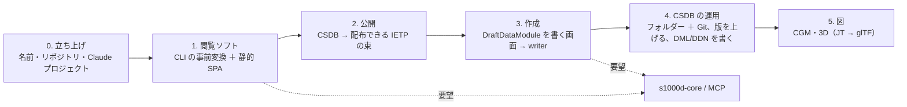

# IETM / IETP プロジェクトの最初の文書（下書き）

S1000D の CSDB を Web で表示する閲覧ソフト（IETP の最小形）から始め、作成・公開まで広げる産業向けの製品プロジェクトの、最初の文書の下書きです。D-29 で s1000d-stack から分けた製品の 1 つで、この文書は新しいプロジェクトのリポジトリと Claude プロジェクトを作ったときに、そこへ移して `docs/ROADMAP.md` の元にします。

- 作成日: 2026-11-07（JST）
- 前提の決定（s1000d-stack 側）: D-03（仕様書・XSD・公式サンプルを同梱しない）、D-19（組み込み基盤。製品はその最初の利用者）、D-28（SvelteKit ＋ PWA）、D-29（製品の分離）
- 前提の設計: [design/agent-platform.md](../design/agent-platform.md)「参照実装」（ここへ移す）、[design/reader-mcp.md](../design/reader-mcp.md)（本文の読み取りの形 `ContentNode`）
- 名前: 未定。S1000D は ASD の商標なので、製品名には使わず（D-02）、説明文に「S1000D® の CSDB を表示する」と書く

## 1. 目的

| 目的 | 内容 |
|---|---|
| 主 | S1000D のデータモジュールの集まり（CSDB）を、ブラウザーで読める技術マニュアル（IETP）として表示する。利用者が製品（適用性）を選ぶと、当てはまらない節が消える |
| 次 | CSDB を作って版を管理し、IETP として納められるようにする。輸出先から S1000D を求められる日本の中小企業が、商用の CSDB 製品を買わずに最初の納品にたどり着けるようにする |
| 基盤への還元 | s1000d-core・MCP の API が「製品から使える形」かをここで確かめ、足りないものを基盤に戻す（D-19） |

商用の CSDB 製品が持つ仕組み（版・状態・履歴・権限・マルチテナント）を全部は作りません。個人開発の規模で持てる範囲を 4 節で決めます。

## 2. 利用者

| 区分 | 利用者 | 最初に見せるもの |
|---|---|---|
| 受け取る側 | 納入された S1000D のデータを持っていて、見る手段が欲しい整備・保守の担当 | 閲覧ソフト（段階 1） |
| 作る側 | S1000D をまだ持たず、これから作って納めたい中小企業の技術文書の担当 | 作成と公開（段階 3〜4） |
| 組み込む側 | 自社の CSDB 製品に AI エージェントと Web 表示を足したいベンダー | `CsdbSource` の差し替えと HTTP の MCP（基盤側、既にある） |

## 3. IETP の最小形（段階 1 の閲覧ソフト）

```text
┌──────────────────────────────────────────────────────────────┐
│ 出版物の題名（PM）   版 003-00  [製品を選ぶ ▾]  検証: XSD ✓ BREX ✓  機密区分: 01 │
├──────────────┬───────────────────────────────────────────────┤
│ 目次（PM）    │ DM の題名（techName / infoName）         DMC    │
│ ▾ 1 説明      │                                               │
│   1.1 概要 ◀  │  節・段落・箇条書き・表                          │
│   1.2 構成    │  手順（番号・警告・注意・結果）                   │
│ ▾ 2 手順      │  図（ICN → SVG / PNG）＋ホットスポット             │
│   2.1 交換    │  参照（dmRef / pmRef / internalRef）→ 押すと移る  │
│ ▸ 3 故障探求  │  適用性で消えた節は「この製品には当てはまらない」の印 │
└──────────────┴───────────────────────────────────────────────┘
```

| 機能 | 基盤の部品 | 補足 |
|---|---|---|
| CSDB のフォルダーを開き、PM の目次を出す | core `CsdbIndex`、`readPublicationModule` | PM が無い CSDB は DM の一覧を目次にする |
| DM を表示する（descript / proced / process / fault / crew の 5 種） | core `readContent` の `ContentNode` を HTML にする | XML をテキスト化しない。`ContentNode` の種類ごとに表示部品を 1 つ |
| 製品を選ぶと当てはまらない節・手順が消える | core `ApplicEvaluator`、`findApplicTables`（ACT・CCT・PCT） | 判定は表示側で行わない。`undetermined` は印を付けて残す |
| 参照を押すと参照先へ移る。無いものは「無い」と出す | core `collectReferences` / `resolveReferences` | 仕様書の章への `dmRef` は「仕様書への参照」と表示 |
| 図のホットスポットを押すと参照先へ移る | `figure/graphic` の `hotspot`（`applicationStructureIdent`） | 表示部品は体験型マニュアルの player の Stage を npm で取る（D-29） |
| ページの先頭に版・検証状態・機密区分 | `VerificationStatus`、`securityClassification` | reader-mcp の応答と同じ項目を人に見せる |
| process DM の分岐を進める | `ContentNode` の `if` / `sequence` / `dialog` | 体験型マニュアルの遷移と同じ操作感にする |
| AI に質問する欄（任意） | reader-mcp の HTTP transport、WebMCP | 答えは reader の応答だけから作る。後の段階 |

### 動かし方（決めること）

core は `node:fs` と `libxml2-wasm` を使うので、ブラウザーでそのまま動かす前提では作られていません。2 つの形があります。

| 形 | 内容 | 向く場面 |
|---|---|---|
| **A. 事前変換 ＋ 静的サイト（提案）** | CLI（Node）が CSDB を読んで、`ContentNode`・目次・適用性の表・検証状態を JSON に書き出し、静的な SPA（SvelteKit `adapter-static`、PWA）がそれを読む | 納品物として渡せる（USB・社内サーバー・GitHub Pages）。オフラインで動く。core をブラウザーに移植しなくてよい |
| B. サーバー ＋ ブラウザー | Node のサーバーが CSDB を読み、ブラウザーに返す | CSDB が頻繁に変わる、権限が要る。製品ベンダーの組み込みの形 |

A から始めます。A の CLI は体験型マニュアルの cli の `build` と同じ考え方（JSON と画像を束ねる）で、IETP 側では入力が CSDB になります。B は基盤側の HTTP の MCP と `CsdbSource` で後からできます。

## 4. CSDB の仕組みをどこまで持つか

商用の CSDB 製品が重いのは、置き場所ではなく仕組み（版・状態・履歴・納入・権限）を持つからです。最初は**フォルダー ＋ Git** で代えます。

| CSDB の仕組み | フォルダー ＋ Git での代わり | 基盤に足りないもの |
|---|---|---|
| 置き場所 | フォルダー（core の `DirectoryCsdbSource`） | 無し |
| 変更の履歴・誰が変えたか | Git のコミット | 無し |
| inwork / released | DM の `issueInfo/@inWork` と Git のタグ | writer に「版を上げる」操作（`issueInfo` の更新）が無い |
| 納入の単位 | DDN をタグ付きのコミットから生成する | core に `readDdn` はあるが、DML・DDN を**書く**処理が無い |
| レビューの回付 | comment DM（writer `create_comment`）と Pull Request | 無し |
| 利用者と権限 | GitHub / GitLab に任せる | 持たない（D-19） |
| DB の CSDB | 作らない。製品ベンダーは `CsdbSource` を差し替える | 無し |

先例として、オープンソースの s1kd-tools がフォルダーの CSDB を前提にしています。

## 5. 段階（案）



| 段階 | 成果物 | 完了の条件 |
|---|---|---|
| 0 | 製品名（S1000D を含めない）、GitHub のリポジトリ、Claude プロジェクト、この文書を元にした ROADMAP | 文書が新しいプロジェクトに置かれている |
| 1 | 閲覧ソフト（3 節）。入力は自作の券売機の CSDB（`convert_manual` の出力。公開できる）。手元の Bike Samples でも動くことを確かめる（公開しない、D-03） | 券売機の CSDB で、PM の目次から DM をたどり、製品を選ぶと節が消え、参照先へ移れ、各ページに版・検証状態・機密区分が出る。`ContentNode` の 5 種がすべて表示できる |
| 2 | 公開の束（静的ファイル一式。PWA でオフライン） | GitHub Pages に置いた券売機の IETP をタブレットで開ける |
| 3 | 作成の画面。`DraftDataModule`（writer の入力。題名・段落・手順・警告・表・参照の木）を画面で書き、writer の `build_data_module` 相当（core `buildDataModule`）で DM にする。体験型マニュアルの editor の E-2（手順のアウトライナー）と同じ部品を使えるかをここで判断する | 自分で書いた手順 DM が XSD と BREX を通り、閲覧ソフトで読める |
| 4 | フォルダー ＋ Git の運用手順と、それに要る core の追加（版を上げる、DML・DDN を書く） | 券売機の CSDB を 2 版にし、DDN を出せる |
| 5 | 図。SVG・PNG の次に、CGM の表示と 3D（JT・PRC の原本と glTF の表示用）。形式は BREX の `list_notations` に従う | 後で決める |

## 6. 読む仕様書の章（着手前）

D-03 のとおり仕様書は手元のものを読み、サイトや文書には自分の言葉で書きます。

| 章 | 読む理由 |
|---|---|
| IETP の機能要件と表示の章（Chap 6 系。「Functionality matrix」を含む章） | IETP に求められる機能の一覧と、ページ指向 / IETP の表示の決まり。閲覧ソフトの「最小形」が仕様書のどの機能に当たるかを対応表にする |
| プロセスデータモジュール（process）と `dmIf` / `dmSeq` / `dialog` の章 | 段階 1 の分岐の表示と、体験型マニュアルの遷移との対応 |
| 図とホットスポット（`figure` / `graphic` / `hotspot`、ICN、IMF）の章 | 段階 1 のホットスポットと段階 5 の図 |
| 版と状態（`issueInfo`、`inWork`、`issueType`）、DML・DDN の章 | 段階 4 のフォルダー ＋ Git の運用が仕様書の語と食い違わないようにする |

## 7. 決めること

| 項目 | 提案 |
|---|---|
| 製品名・リポジトリ名 | S1000D を含めない語。Zenn Book「IETM入門」との呼び分けも考える |
| 技術 | SvelteKit ＋ PWA（D-28 に揃える）。事前変換の CLI は Node（core をそのまま使う） |
| 対象の版 | Issue 7 から。Issue 4.2 は閲覧ソフトができた後（基盤側 U-07 と同じ判断） |
| テストデータ | 段階 1 は自作の券売機の CSDB（`convert_manual` の出力。公開できる）。段階 2 以降は次の 3 つを足す（2026-11-08 追記。選定の経過は [editor-and-viewer-study.md](./editor-and-viewer-study.md)「8-2」）。(1) **体験型マニュアル側の Raspberry Pi の見本を S1000D に変換したもの**（MIT。組み立て・初期設定・GPIO・起動しないときの 4 種と `applic` が入る。2 つのプロジェクトをつなぐ共通の題材）。(2) **FAA『Aviation Maintenance Technician Handbook』（FAA-H-8083-30B / -31 / -32）の 1 章**を自作の CSDB にしたもの（米連邦政府の著作物でパブリックドメイン。`faa.gov` の Handbooks & Manuals のページから取る。英語なので `s1000d-translate` の題材にもなる。請負業者が作った部分・第三者の写真が混ざることがあるので冒頭の権利表示を確かめる）。(3) **米軍の TM の故障探求の表**（Distribution Statement A のものだけ。fault DM の題材）。Bike Samples は手元の確認だけに使い、公開しない（D-03） |
| 体験型マニュアルとの共有 | player の Stage（図＋ホットスポット）を npm で取る。手順のアウトライナーは段階 3 で判断。逆（IETP 側の部品を体験型マニュアルが使う）は作らない |
| 基盤へ最初に戻す要望 | `ContentNode` の 5 種を表示に十分な形で書き出す CLI 向けの関数（reader-mcp の応答と同じ形で足りるかを段階 1 で確かめる）、`issueInfo` の更新、DML・DDN の書き出し |
