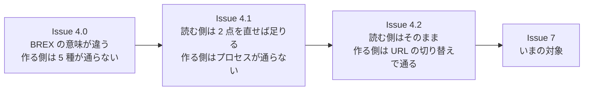

# Issue 4.0・4.1 の配布物で、いまの MCP を動かした結果（2026-11-28）

S1000D Issue 4.0 と Issue 4.1 の配布物を展開し、いまの s1000d-brex-mcp・s1000d-verify-mcp・s1000d-reader-mcp を、それぞれの Bike data set にそのままかけた結果の記録です。Issue 4.0・4.1 にどこまで対応するか（DECISIONS の U-14）を決める人が、材料として読むためのものです。Issue 4.2 の結果は [issue-4.2-survey.md](./issue-4.2-survey.md) にあります。

- 対応する Issue: [#14](https://github.com/shuji-bonji/s1000d-stack/issues/14)（「決めていないこと」の「4.0・4.1 も見るのか」）
- 使った版: s1000d-core 0.18.0、brex-mcp 0.9.0、verify-mcp 0.11.0、reader-mcp 0.16.0（MCP が読み込んでいる公開済みの core）
- 測り方とスクリプトは、Issue 4.2 のときと同じです（`scripts/experiments/issue-survey.mjs`）

> [!WARNING]
> 配布物の文章は写していません。この文書にあるのは、ファイル名・要素名・属性名・ルール ID・件数と、XSD の検証器が返した違反の文（要素名と属性名）だけです（D-03）。

## 結論

| 版 | 読む・検証する | 作る（Issue 7 向けの出力の URL だけを替える） |
|---|---|---|
| Issue 4.2 | そのまま動く | 27 件とも通る |
| Issue 4.1 | ほぼそのまま動く。直す所が 2 つある（BOM、`content/refs` の題名） | 説明・手順・故障探求・PM・コメント・DML は通る。プロセスは通らない |
| Issue 4.0 | XSD の検証と本文の読み取りは動く。**BREX への照合の結果は使えない**（`allowedObjectFlag` の意味が違う） | PM・コメント・DML・プロセス・ACT が通らない |

版をさかのぼるほど、Issue 7 との違いが大きくなります。Issue 4.1 は Issue 4.2 に近く、Issue 4.0 は別の扱いが要ります。

## その後（2026-11-28）

利用者が、Issue 4.1 と Issue 4.0 系をどちらも対象にすると決めました（DECISIONS の D-42）。Issue は [#27](https://github.com/shuji-bonji/s1000d-stack/issues/27)（Issue 4.1）と [#28](https://github.com/shuji-bonji/s1000d-stack/issues/28)（Issue 4.0 系）です。

下の「見つかった問題（版によらないもの）」の 3 つは、s1000d-core 0.19.0 で直しました（[#23](https://github.com/shuji-bonji/s1000d-stack/issues/23)・[#24](https://github.com/shuji-bonji/s1000d-stack/issues/24)・[#25](https://github.com/shuji-bonji/s1000d-stack/issues/25)）。直した core を直接呼んで測り直した結果です（`scripts/experiments/core-survey.mjs`。BOM を取り除いた写しではなく、配布物のファイルをそのまま読ませた）。

| 版 | XML | BOM で始まる | 読めない文書 | XSD で `valid` | 落としたテキスト節点 | 使われた XSD |
|---|---|---|---|---|---|---|
| Issue 4.0 | 195 | 126 | 0 | 194（残りの 1 件は版の書かれていない `SMC-…`） | 0（1,692 個のうち） | 193 件は XML Schema Package（`4.0`）、1 件は Patch 4.0.1（`4.0.1`） |
| Issue 4.1 | 103 | 1 | 0 | 103 | 0（1,495 個のうち） | Patch 4.1.A（`4.1`） |
| Issue 4.2 | 105 | 0 | 0 | 105 | 0（1,458 個のうち） | XML Schema Package（`4.2`） |
| Issue 7 | 118 | 0 | 0 | 118 | 0（1,587 個のうち） | XML Schema Package（`7`） |

- 見つかる XSD のフォルダーは、Issue 4.0 が 3 つ（`4.0`・`4.0.1`・`4.0.2`。データ辞書の中の写しは、XML Schema Package と中身が同じなので 1 つにまとまる）、Issue 4.1 が 3 つ（どれも `4.1` で、中身が違う）になりました。
- Issue 4.1 の 3 つ（Patch 4.1.A、直下の `xml_schema_flat`、XML Schema Package の `Schemas`）は、版が同じで中身が違います。名前の順で先に見つかる Patch 4.1.A が使われ、ほかの 2 つは `locateXsd` の `otherCandidates` に入ります。どれを優先するかは、まだ決めていません（#25 に残した）。
- MCP の応答に反映されるのは、MCP が読み込む core を 0.19.0 に上げた後です。下の節の数は、直す前（core 0.18.0）のものです。

## 見つかった問題（版によらないもの）

Issue 4.0・4.1 のサンプルで表に出ましたが、どの版の CSDB でも起きます。

### 1. 先頭に BOM がある XML を読めない

UTF-8 の BOM（U+FEFF）で始まる XML を、core の XML の読み取り（`@xmldom/xmldom`）が、整形式でないとして断ります。XML の規格では、BOM で始まる文書は正しい文書です。

| 版 | BOM で始まる XML | 起きること |
|---|---|---|
| Issue 4.0 | 195 件のうち 126 件 | `verify_data_module` は `wellFormed: false`・`schema: not-run`。`read_data_module`・`check_against_brex`・`reconcile_dml` は誤りを返す |
| Issue 4.1 | 103 件のうち 1 件 | 同上 |
| Issue 4.2、Issue 7 | 0 件 | — |

Windows の編集ソフトで保存した XML には BOM が付くことが多いので、実際の CSDB でも起きると考えられます。直すときは、元の文字列の一部だけを書き換える処理（`editContent`・`startRevision`・`applyFixes`・`applySegments`）が、位置を 1 文字ずらさないことを確かめる必要があります。

Issue 4.0 の下の数は、BOM を取り除いた写しで測りました（配布物のファイルは書き換えていません）。

### 2. `content/refs` の `dmRef` の題名が、本文の読み取りの結果に無い

本文の先頭の参照の一覧（`content/refs`）にある `dmRef` が、題名（`dmRefAddressItems/dmTitle` の `techName`・`infoName`）を持つとき、その文字が `read_data_module` の `content.blocks` にありません。`notReadElements` にも出ません。参照そのもの（DMC）は、応答の `references` に入っています。

| 版 | `content/refs` を持つ DM | その中の `dmTitle` | 読み取りの結果に無いテキスト節点 |
|---|---|---|---|
| Issue 4.0 | 30 | 67 | 94（構造として読む 58 件、1,692 個のうち） |
| Issue 4.1 | 25 | 51 | 69（構造として読む 58 件、1,495 個のうち） |
| Issue 4.2 | 39 | 0 | 0 |
| Issue 7 | 39 | 0 | 0 |

Issue 4.2 と Issue 7 のサンプルは、`content/refs` の `dmRef` に題名を付けていないので、これまで数に出ていませんでした。読む側は内容を落とさない（D-31）という方針に反する所です。

### 3. 配布物の中の XSD のフォルダーが、同じ版で複数見つかる

`list_schemas` は、Issue 4.1 で 4 つ（どれも `4.1`）、Issue 4.0 で 4 つ（`4.0` が 3 つ、`4.0.1` が 1 つ）の `xml_schema_flat/` を見つけました。

- データ辞書の中の写しを除く条件は、フォルダー名が `data_dictionary` で始まることです。Issue 4.0・4.1 のデータ辞書はこの名前ではないので、除かれません。
- Issue 4.0 の Patch 4.0.2 の `brex.xsd` は、URL に `S1000D_4-0-2` と書いてありますが、版は `4.0` と読まれました。
- 同じ版が複数あるときは、最初に見つかったものが使われます。今回は、Issue 4.0・4.1 とも、データ辞書の中の写し（`data-dictionary/…/xml_schema_flat`）が最初に見つかり、検証に使われました。XML Schema Package の XSD とパッチの XSD のどれが使われるかは、フォルダーの並びで決まります。3 つの中身の違いは比べていません。
- `xsi:noNamespaceSchemaLocation` に版が書かれていない文書（Issue 4.0 の `SMC-…`。`scormcontentpackage`）は、フォルダーが複数あると `schema-not-found`（`issue-mismatch`）になります。

## Issue 4.1

### 対象のファイル

Bike data set は 152 ファイルです（DMC 94、PMC 4、DML 1、DDN 1、UPF 1、DME 2、ICN 49）。IMF はありません。

### 読む・検証する

| 見た所 | 結果 |
|---|---|
| XSD の検証 | 103 件のうち 102 件が `valid`。残りの 1 件は BOM で読めない |
| BREX への照合 | 98 件を 2 層で照合し、違反は 0。飛ばしたルールも 0 |
| 既定 BREX | `S1000D-E-04-10-0301-00A-022A-D`。構造のルール 244、`nonContextRules` 1。配布物には `009-00`（元）と、Patch 4.1.A・B・C・E の `010-00`〜`013-00` の 5 つがある |
| 参照の解決 | 1,133 件を調べ、未解決は 4 文書の 4 種類の参照先（配布物に無い DM） |
| DML・DDN | DML は 88 項目とも `found`。DDN は 151 項目のうち `found` 149、`issue-mismatch` 1、`not-found` 1 |
| 識別・状態部 | 読めた 93 件のすべてで、`dmCode`・`issueInfo`・`brexDmRef`・`qualityAssurance` などが読めた。`reasonForUpdates` は 59 件 |
| 本文の読み取り | 構造として読む 58 件（descript 13、proced 39、process 1、fault 5）。知らない要素は 0。落としたテキスト節点は、上の 2 の 69 個だけ |
| PM | 4 件で、項目を 8・144・7・36 件読めた |

`allowedObjectFlag` は、Issue 7 と同じ 3 つの値（`0`・`1`・`2`）です。

### XSD の名前の違い（Issue 4.1 と Issue 7）

`descript`・`proced`・`fault`・`pm`・`comment`・`dml`・`ddn` では、Issue 4.1 の要素名はすべて Issue 7 にあります。4.1 だけにある属性は、`authorityName` と `authorityDocument` です（Issue 4.2 と同じ）。

`process` と `brex` には、4.1 だけにある要素が 15 あります（`crewDrill`・`crewDrillStep`・`challengeAndResponse`・`if`・`elseIf`・`case` など、乗員の手順の要素）。Bike data set のプロセス DM は、これらを使っていません。

### 作る側

`kenbaiki`（writer で作った CSDB）の 28 件を、URL だけ `S1000D_4-1` に替えて Issue 4.1 の XSD にかけました。

| 結果 | 件数 | 内容 |
|---|---|---|
| `valid` | 24 | 説明 3、手順 14、故障探求 1、PM 2、コメント 1、DML 1、ACT 1、PCT 1 |
| `invalid` | 1 | プロセス。`dmNode` の中の `title` が、Issue 4.1 では置けない（5 か所） |
| `invalid` | 2 | BREX。`brDecisionRef` と `defaultBrSeverityLevel` が、Issue 4.1 に無い。writer は BREX を作らないので、作る側の問題ではない |
| `invalid` | 1 | わざと誤りを入れた例 |

## Issue 4.0

### 対象のファイル

Bike data set は 381 ファイルです（DMC 190、DDN 2、DME 2、SMC 1、ICN など 186）。DMC のうち 114 件は学習の DM です。PM・DML・IMF はありません。配布物の中の XSD は 3 組あります（元の `4.0`、Patch 4.0.1、Patch 4.0.2。どれも 27 個）。

### 読む・検証する（BOM を取り除いた写しで測った）

| 見た所 | 結果 |
|---|---|
| XSD の検証 | 195 件のうち 194 件が `valid`（193 件は `4.0`、1 件は `4.0.1` の XSD）。残りの 1 件は、版の書かれていない `SMC-…` |
| BREX への照合 | **結果は使えない**（下の「BREX の違い」）。違反ありが 74 件、飛ばしたルールが 444 件と出た |
| 既定 BREX | `S1000D-A-04-10-0301-00A-022A-D` の `004-00`（元）と `005-00`（Patch 4.0.1）、`S1000D-D-…` の `006-00`（Patch 4.0.2）の 3 つがある。構造のルールは 78 |
| 参照の解決 | 1,152 件を調べ、未解決は 2 文書の 3 種類 |
| 識別・状態部 | 190 件のすべてで、`dmCode`・`issueInfo`・`brexDmRef`・`qualityAssurance` などが読めた。`issueType`・`reasonForUpdates` は 75 件（学習の DM に書かれていない） |
| 本文の読み取り | 構造として読む 58 件（descript 20、proced 32、process 1、fault 5）。知らない要素は `dmNodeAlt` が 1 つ（`unknownElements` で知らせている）。落としたテキスト節点は、上の 2 の 94 個だけ |

### BREX の違い

Issue 4.0 の BREX は、Issue 4.1 以降と 2 点で違います。

| 違い | Issue 4.0 | Issue 4.1 以降 | いまの core での動き |
|---|---|---|---|
| `objectPath/@allowedObjectFlag` の型 | 「はい・いいえ」の 2 値（XSD の型は `yesOrNoAttType`） | `0`・`1`・`2` の 3 値 | 値 `1` を「必ず含める」と読むので、対象の要素が無い DM を `missing` の違反にする。Bike data set では、自転車の BREX で 148 件の `missing` が出た |
| ルールの識別子 | `brDecisionRef` が無い（`brex.xsd` に要素が無い） | 各ルールに `brDecisionRef` | 違反の `ruleId` が空になる |

飛ばしたルールの 444 件は、自転車の BREX の `objectPath` が XPath として読めないためです（`dmCode@modelIdentCode` のように、`/` が抜けている式が 6 つある）。これはサンプルの側の誤りで、core は読めない式を飛ばして知らせています。

`allowedObjectFlag` の意味の違いは、XSD の型から分かったことです。Issue 4.0 の仕様書の本文（Chap 4.10.2）は読んでいません。対応するなら、先に本文で意味を確かめます。

### XSD の名前の違い（Issue 4.0 と Issue 7）

| XSD | 4.0 だけにある要素 | 4.0 だけにある属性（`authorityName`・`authorityDocument` のほか） |
|---|---|---|
| `descript`・`proced`・`fault` | 無し | `catalogSeqNumberValue`・`initialProvisioningProjectValue` |
| `pm`・`comment`・`ddn` | `variableRef` | `variableName` |
| `dml` | `dmEntry`・`variableRef` | `dmEntryType`・`variableName` |
| `process` | `dmNodeAlt`・`dialogAlt`・`messageAlt`・`proceduralStepAlt` と、乗員の手順の 15 要素 | `altName` など |

`dml` の項目の要素名が違います（Issue 4.0 は `dmEntry`、Issue 4.1 以降は `dmlEntry`）。`reconcile_dml` は、Issue 4.0 の DML を読めないはずです。Bike data set に DML が無いので、実物では確かめていません。

### 作る側

`kenbaiki` の 28 件を、URL だけ `S1000D_4-0` に替えて Issue 4.0 の XSD にかけました。

| 結果 | 件数 | 内容 |
|---|---|---|
| `valid` | 18 | 説明 3、手順 13、故障探求 1、PCT 1 |
| `invalid` | 2 | PM。`brexDmRef` が、書いた位置に置けない |
| `invalid` | 1 | コメント。`brexDmRef` が、書いた位置に置けない |
| `invalid` | 1 | DML。`brexDmRef` が書いた位置に置けず、項目の要素名は `dmEntry` |
| `invalid` | 1 | プロセス。`dmNode` の中の `title` が置けない |
| `invalid` | 1 | ACT。`productAttribute` に `productIdentifier` 属性が無い |
| `invalid` | 1 | 手順 1 件。本文の先頭の `referencedApplicGroup` が置けない |
| `invalid` | 2 | BREX（writer は作らない） |
| `invalid` | 1 | わざと誤りを入れた例 |

Issue 4.0 では、内容部の先頭に適用性の文の一覧（`referencedApplicGroup`）を置けません。適用性を本文の中で使い分ける DM は、Issue 4.0 では作れないことになります。

## 確かめていないこと

- Issue 4.0・4.1 の仕様書の本文。違いは、XSD と、XSD の検証器が返した違反の文から読みました。
- Issue 4.0 の Patch 4.0.1・4.0.2 と、Issue 4.1 の Patch 4.1.A の XSD が、元の XSD とどう違うか。
- Issue 4.0 の DML（サンプルに無い）と、Issue 4.1 の乗員の手順の要素を使ったプロセス DM（サンプルに無い）。
- core 0.19.0 の `findDefaultBrex`（同じ DMC のいちばん新しい版を返す）で測り直した数。MCP が読み込んでいる core は 0.18.0 なので、`brex` を省いた `explain_brex` は、Issue 4.1 で `009-00` を使いました。core 0.19.0 の関数を直接呼ぶと、Issue 4.1 では `013-00`、Issue 4.0 では `S1000D-A-…` の `005-00` を返します。Issue 4.0 の `006-00` は DMC が違う（システム差異コードが `D`）ので、比べる対象になりません。

## U-14 を決めるための材料

> [!NOTE]
> 2026-11-28 に、Issue 4.1 と Issue 4.0 系をどちらも対象にすると決まりました（D-42）。下の表の作業は、#27 と #28 に移しました。

| 版 | 読む・検証する側で要ること | 作る側で要ること |
|---|---|---|
| Issue 4.1 | BOM を読めるようにする。`content/refs` の題名を読む。どちらも版によらない修正 | プロセス DM の `dmNode` の題名の扱いを、版で分ける |
| Issue 4.0 | 上に加えて、BREX の `allowedObjectFlag` を版で読み分ける。ルールの識別子が無い BREX の扱いを決める。DML の `dmEntry` を読む | PM・コメント・DML の `brexDmRef` の位置、ACT の属性、適用性の文の一覧を、版で分ける。作る側の作りを版ごとに持つことになる |

日本での実例として記録にあるのは、MRJ の供給企業に求められた Issue 4.0.1 です（[background.md](./background.md) の「日本での状況」）。Issue 4.0 系は、今回見た 3 つの版の中で、対応に要る作業がいちばん多い版です。
