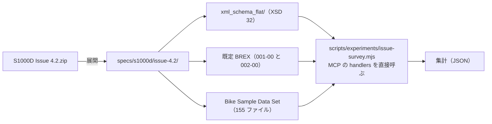

# Issue 4.2 の配布物で、いまの MCP を動かした結果（2026-11-28）

S1000D Issue 4.2 の配布物を展開し、いまの s1000d-brex-mcp・s1000d-verify-mcp・s1000d-reader-mcp を、Issue 4.2 の Bike Sample Data Set にそのままかけた結果の記録です。Issue 4.2 にどこまで対応するか（DECISIONS の U-07）を決める人が、材料として読むためのものです。

- 対応する Issue: [#14](https://github.com/shuji-bonji/s1000d-stack/issues/14)（進め方の案の 1〜3 番目）
- 使った版: s1000d-core 0.18.0、brex-mcp 0.9.0、verify-mcp 0.11.0、reader-mcp 0.16.0、writer-mcp 0.9.0
- コードは 1 行も変えていません。Issue 7 向けに作ったものを、そのまま動かしました

> [!WARNING]
> 配布物の文章は写していません。この文書にあるのは、ファイル名・要素名・属性名・ルール ID・件数だけです（D-03）。

## 結論

**読む側と検証する側は、Issue 4.2 の Bike Sample Data Set を、Issue 7 と同じ水準で扱えました。** 版ごとに読み取りを分ける必要は、今回の実測からは出てきませんでした。

| 見た所 | 結果 |
|---|---|
| XSD の検証 | 105 件すべて `valid`。Issue 4.2 の `xml_schema_flat/`（XSD 32 個）が、`issue: "4.2"` として選ばれた |
| 既定 BREX の探索 | Issue 4.2 の既定 BREX（`S1000D-F-04-10-0301-00A-022A-D`）が見つかり、自転車の BREX と合わせて 2 層で照合できた |
| 参照の解決 | 2,677 件を調べ、未解決は 6 文書の 6 種類の参照先。どれも配布物に入っていない DM・PM・ICN |
| 本文の読み取り（5 種） | 構造として読む 58 件で、テキスト節点 1,458 個のうち、読み取りの結果に無いものは 0 個。知らない要素（`unknownElements`）も 0 |
| 例外で止まったツール呼び出し | 0 件 |
| 作る側 | Issue 7 向けに作った 27 件は、スキーマの URL を `S1000D_4-2` に替えるだけで、Issue 4.2 の XSD に通った |

見つかった問題は 1 つで、Issue 4.2 に固有のものではありません（下の「見つかった問題」）。

## 測り方



- `S1000D_SPEC_DIR` に `specs/s1000d/issue-4.2`、`S1000D_CSDB_DIR` に Bike Sample Data Set のフォルダーを指定しました。
- `scripts/experiments/issue-survey.mjs` が、MCP 3 本の `dist/tools/handlers.js` を直接呼びます。引数と応答は、MCP のツールを呼んだときと同じです。
- 本文の読み取りは、core のテスト（`src/__fixtures__/text-coverage.ts`）と同じ数え方で測りました。本文のテキスト節点を 1 つずつ取り出し、`read_data_module` と同じ読み取りの結果に、その文字列が残っているかを見ます。
- 同じスクリプトを Issue 7 の Bike Samples にもかけ、比べる元にしました。Issue 7 の結果は、core のテストに記録してある数（59 件、1,587 個、落とした数 0）と一致しました。

```sh
cd s1000d-stack
S1000D_SPEC_DIR=specs/s1000d/issue-4.2 \
S1000D_CSDB_DIR="specs/s1000d/issue-4.2/bike-sample-data-set/Bike Data Set for Issue 4.2" \
  node scripts/experiments/issue-survey.mjs
```

## 対象のファイル

| 種類 | Issue 4.2 | Issue 7 |
|---|---|---|
| DMC | 95 | 106 |
| PMC | 4 | 4 |
| DML / DDN | 1 / 1 | 1 / 1 |
| IMF | 1 | 3 |
| UPF | 1 | 1 |
| DME | 2 | 2 |
| ICN（図のファイル） | 50（CGM 41、JPG 6、PNG 2、GIF 1） | 66 |
| 合計 | 155 | 184 |

Patch 4.2.B に入っている Bike Data Set（155 ファイル）は、元の Bike Sample Data Set と 1 バイトも違いませんでした。測ったのは元の 1 組だけです。

## 結果

### XSD の検証

XML の 105 件（DMC 95、PMC 4、DML 1、DDN 1、IMF 1、UPF 1、DME 2）が、すべて `valid` でした。スキーマは 23 種類です（`proced` 39、`descript` 13、`comrep` 9、`fault` 5、`learning` 5、`pm` 4、`crew` 4、`schedul` 4 など）。

`list_schemas` は、`xml_schema_flat/` を 1 つ見つけ、`brex.xsd` から版を `4.2` と読みました。データ辞書の中の写し（`data_dictionary_4-2/Files/xml_schema_flat/`）は、Issue 7 と同じく除外されています。

### BREX への照合

| 項目 | Issue 4.2 | Issue 7 |
|---|---|---|
| 照合した文書（`verify_data_module`） | 103 | 116 |
| 2 層（自転車の BREX → 既定 BREX）で照合できた | 100 | 111 |
| 1 層（自転車の BREX 自身） | 1 | 1 |
| 照合しなかった（`brexDmRef` が無い文書。Issue 4.2 は IMF 1 件と UPF 1 件） | 2 | 4 |
| 違反なし | 72 | 102 |
| 違反あり | 29 | 10 |
| 解決できなかった BREX | 0 | 0 |
| 評価できずに飛ばしたルール | 0 | 0 |

- Issue 4.2 の違反は、29 件とも既定 BREX の `BREX-S1-00030` です。発行番号と `issueType` の組み合わせを見るルールで、Issue 7 の Bike Samples でも 9 件に出ています。配布物のサンプルの側の事情で、読み取りの誤りではありません。
- 既定 BREX の構造のルールは 260、機械で判定できない取り決め（`nonContextRules`）は 1 で、XML に書かれている数と一致しました。Issue 7 は 274 と 1 です。
- 既定 BREX の文脈別のルールは、`dml`・`comment`・`ddn`・`pm`・`update` の 5 つです。Issue 7 にある `icnmetadata` は、Issue 4.2 にはありません。
- Issue 4.2 の既定 BREX には `notationRuleList` が無く、`list_notations` は「図の形式を制限していない」と返しました。XML Schema Package に `notations/notations.xml` も入っていません（Issue 7 には入っています）。

### 参照の解決

2,677 件の参照を調べ、97 文書はすべて解決、6 文書に未解決が残りました。未解決の参照先は次の 6 種類で、どれも配布物の Bike Sample Data Set に入っていません。

| 参照元（DMC の情報コードまで） | 種類 | 参照先 |
|---|---|---|
| `S1000DBIKE-…-002A-A`、`…-009A-A` | dmRef | `S1000DBIKE-AAA-D00-00-00-00AA-200A-T-T10B` |
| 同上、`…-01-00AA-930A-A` | dmRef | `S1000DBIKE-AAA-D00-00-00-00AA-941A-D` |
| `…-01-00AA-930A-A` | dmRef | `S1000DBIKE-AAA-D00-00-01-001A-933A-A` |
| `…-258A-A`、`…-258B-A` | pmRef | `S1000DBIKE-B6865-SAFE1-00` |
| `…-258A-A`、`…-258B-A` | icn | `ICN-S3627-S1000D0619-001-01` |
| `S1000DLIGHTING-…-700A-A` | dmRef | `S1000DLIGHTING-AAA-D00-00-00-00AA-941A-D` |

DML（97 項目）と DDN（154 項目）は、`reconcile_dml` ですべて `found` になりました。DML に載っていないのは PM の 4 件です（Issue 7 と同じ）。

### 識別・状態部の読み取り

DMC 95 件のすべてで、`dmCode`・`language`・`issueInfo`・`issueDate`・`techName`・`infoName`・`securityClassification`・`responsiblePartnerCompany`・`originator`・`brexDmRef`・`qualityAssurance` が読めました。応答の `issue` は、95 件とも `"4.2"` です。

| 項目 | 読めた件数 | 読めなかった理由 |
|---|---|---|
| `issueType` | 92 | 学習の DM 3 件は、XML に `issueType` 属性が書かれていない |
| `reasonForUpdates` | 94 | ビジネスルール文書の DM 1 件には、`reasonForUpdate` が無い |
| `applicDisplayText` | 73 | 残りは `displayText` を書いていない |
| `infoNameVariant` | 0 | Issue 4.2 の XSD に、この要素が無い（Issue 7 で足された） |

### 本文の読み取り

| 項目 | Issue 4.2 | Issue 7 |
|---|---|---|
| 構造として読む DM（descript・proced・process・fault） | 58（13・39・1・5） | 59（14・39・1・5） |
| 本文のテキスト節点 | 1,458 | 1,587 |
| 読み取りの結果に無いテキスト節点 | 0 | 0 |
| 1 つも落とさずに読めた DM | 58 | 59 |
| 知らない要素（`unknownElements`） | 0 | 0 |
| 読まないと知らせた要素（`notReadElements`） | `globalPropertyRef` 1 | `globalPropertyRef` 1 ほか 3 種 |

5 種以外（`comrep`・`learning`・`schedul`・`ipd` など 37 件）は、Issue 7 と同じく、識別・状態部だけを返します（#15）。

PM の 4 件は、項目を 8・146・7・36 件読めました。IMF の 1 件は、28 項目を読めました。`describe_applicability` は 95 件とも応答を返し、93 件で ACT を見つけ、適用性の文を 119 個読みました。

## XSD の要素名と属性名の違い

`scripts/experiments/xsd-name-diff.mjs` で、Issue 4.2 と Issue 7 の `xml_schema_flat/` を XSD ごとに比べました。比べたのは名前の集合だけです。同じ名前の要素の中身（子の順序・出現回数）と型の違いは見ていません。

| XSD | 要素（4.2 → 7） | 4.2 だけにある要素 | 属性（4.2 → 7） | 4.2 だけにある属性 |
|---|---|---|---|---|
| `descript` | 212 → 218 | 0 | 167 → 180 | 2 |
| `proced` | 264 → 274 | 0 | 198 → 213 | 2 |
| `process` | 323 → 333 | 0 | 226 → 241 | 2 |
| `fault` | 341 → 351 | 0 | 209 → 224 | 2 |
| `pm` | 165 → 169 | 0 | 127 → 137 | 2 |
| `comment` | 158 → 162 | 0 | 124 → 134 | 2 |
| `dml` | 124 → 128 | 0 | 121 → 131 | 2 |
| `ddn` | 148 → 152 | 0 | 118 → 128 | 2 |
| `icnmetadata` | 153 → 171 | 0 | 135 → 160 | 2 |
| `brex` | 219 → 224 | 0 | 173 → 184 | 2 |

- **いまの MCP が本文を読む 5 種と、PM・コメント・DML・DDN・IMF・BREX では、Issue 4.2 の要素名は、すべて Issue 7 にもあります。** Issue 7 の要素名で書いた読み取りが、Issue 4.2 の要素を知らずに落とすことは、名前の上ではありません。
- 4.2 だけにある属性は、どの XSD でも `authorityName` と `authorityDocument` の 2 つです。Issue 7 では、`controlAuthority`・`controlAuthorityGroup`・`controlAuthorityText` の要素と `controlAuthorityRefs` などの属性に置き換わっています。Bike Sample Data Set には、この 2 つの属性を書いた DM がありません。reader がこの 2 つの属性を応答に入れるかは、実物では確かめられていません。
- Issue 7 で足された要素は、`descript` で 6 つ（`controlAuthority` の 3 つ、`infoNameVariant`、`supplyRef`、`terminologyRef`）、`proced`・`process`・`fault` で 10（上に加えて `hazard`・`hazardRef`・`hazardousClass`・`hazards`・`safetyInformation`。`supplyRef` は元からある）です。
- 4.2 だけにある要素があるのは、`appliccrossreftable`（17）・`checklist`（25）・`comrep`（22）・`update`（22）・`ipd`（4）です。どれも、いまの reader が本文を読まない種類です。
- `xml.xsd` は Issue 7 だけにあります。

## 作る側（Issue 7 向けの出力を、Issue 4.2 の XSD にかける）

core の `buildDataModule` と `buildComment` は、スキーマの URL を `S1000D_7` に固定しています（`write/build.ts` の 362 行目、`comment/build.ts` の 51 行目）。URL だけを替えれば Issue 4.2 に通るのかを、[s1000d-examples](https://github.com/shuji-bonji/s1000d-examples) の `kenbaiki`（writer で作った CSDB）で確かめました。

`scripts/experiments/retarget-issue.mjs` は、ファイルを書き換えずに、XML の文字列の `S1000D_7/` を `S1000D_4-2/` に替えて `validate_schema` に渡します。

| 項目 | 結果 |
|---|---|
| 対象 | 28 件（`proced` 15、`descript` 3、`pm` 2、`brex` 2、`process`・`fault`・`comment`・`dml`・`appliccrossreftable`・`prdcrossreftable` が各 1） |
| Issue 4.2 の XSD で `valid` | 27 |
| `invalid` | 1（`invalid-example.xml`。わざと誤りを入れた例で、Issue 7 でも `invalid`） |
| Issue 4.2 の既定 BREX（002-00）への照合（`followChain: false`、誤りの例を除く 27 件） | 違反なし 26、違反あり 1（`BREX-S1-00004`） |

writer の出力は、Issue 4.2 で足りない要素や属性を使っていませんでした。ただし、`kenbaiki` が使っている要素の範囲での結果です。下書き（`DraftDataModule`）で書けるすべての節点を試したわけではありません。`hazards` と `safetyInformation` は Issue 4.2 の XSD に無いので、出力にこれらの要素が入る場合は通りません。

## 見つかった問題

### 既定 BREX が 2 つあるとき、ツールによって選ぶ版が違う

Issue 4.2 の配布物には、既定 BREX が 2 つ入っています。

| 場所 | 版 |
|---|---|
| `default-brex-data-module/` | `S1000D-F-04-10-0301-00A-022A-D` の `001-00` |
| `patches/Patch 4.2.B/S1000D_4.2.B_patch/` | 同じ DMC の `002-00` |

2 つとも `S1000D_SPEC_DIR` の下にあると、次のように分かれます。

| 呼び方 | 使う版 | 理由 |
|---|---|---|
| `brex` を省いた `explain_brex`・`lookup_value`・`list_notations` | `001-00` | core の `findDefaultBrex` は、条件に合う最初のファイルを返す |
| DM の `brexDmRef` をたどる `check_against_brex`・`verify_data_module` | `002-00` | BREX の解決器（`createBrexResolver`）は、索引の `findDataModules` が返す先頭を使う。今回は `002-00` だった |

「このルールは何か」を `explain_brex` で引いたときと、実際に照合したときとで、見ている既定 BREX の版が食い違います。Issue 7 の配布物には既定 BREX が 1 つしか無いので、これまで表に出ていませんでした。Issue 4.2 に限らず、パッチで既定 BREX が出し直された版すべてに当てはまります。

**その後（2026-11-28）**: s1000d-core 0.19.0 で直しました。`findDefaultBrex` は、同じ DMC の既定 BREX が複数あるとき、発行番号のいちばん大きいものを返します（D-41）。Issue 4.2 の配布物では `002-00` を返すことを確かめました。MCP 4 本が読み込む core を 0.19.0 に上げるまでは、MCP の動きは上の表のままです。

## 確かめていないこと

- Issue 4.2 の Front Matter Samples（内側の zip 3 本は展開していません）。
- `authorityName`・`authorityDocument` を書いた DM の読み取り（実物が無い）。
- 同じ名前の要素で、中身の決まり（子の順序・出現回数）が Issue 4.2 と Issue 7 で違う所。Bike Sample Data Set が通ることと、`kenbaiki` が通ることは確かめましたが、XSD の内容モデルを 1 つずつ比べてはいません。
- writer のツール（`build_data_module`・`start_revision`・`edit_data_module` など）を、Issue 4.2 の CSDB に対して動かすこと。`edit_data_module` は元の XML を保つ作りなので Issue 4.2 の DM にも使えそうですが、試していません。
- `suggest_fixes` の修正候補が、Issue 4.2 の XSD から正しく作られるか。1 件で応答が返ることだけ確かめました。
- Issue 4.0・4.1。

## U-07 を決めるための材料

> [!NOTE]
> 2026-11-28 に、利用者が範囲を決めました（DECISIONS の D-41）。作る側は、スキーマの URL を版で切り替える最低限の変更を行い、Issue 4.2 に無い要素の扱いは別の Issue にします。s1000d-core 0.19.0 の `options.issue` と、s1000d-writer-mcp 0.10.0 のツール引数 `issue` が、その変更です。Issue 4.2 の配布物を `S1000D_SPEC_DIR` に指定し、自作のマニュアルを `convert_manual` に `issue: "4.2"` でかけると、作った 10 件（DM 9、PM 1）がすべて Issue 4.2 の XSD で `valid` になり、既定 BREX への照合も通りました。Issue 4.0・4.1 の結果は [issue-4.0-4.1-survey.md](./issue-4.0-4.1-survey.md) にあります。

| 決めること | 今回の実測から言えること |
|---|---|
| core の読み取りを版ごとに分けるか（`src/content/<issue>/`） | 分ける理由は見つからなかった。Issue 4.2 の要素名は Issue 7 に含まれ、Bike Sample Data Set の本文を 1 つも落とさずに読めた |
| 読む・検証するだけの対応で足りるか | 読む側と検証する側は、コードを変えずに動いた。要るのは、テスト（`S1000D_SPEC_TESTS=1`）に Issue 4.2 の数を足すことと、サイトの「対象とする版」の書き直し |
| 作る側（writer）まで対応するか | スキーマの URL を版で切り替えることが最低限の変更。そのうえで、Issue 4.2 に無い要素（`hazards`・`safetyInformation`・`infoNameVariant`・`controlAuthority` など）を下書きが含むときに、どう知らせるかを決める必要がある |
| 4.0・4.1 も見るか | 今回は見ていない。配布物の zip は `specs/s1000d/archives/` にあり、同じスクリプトをそのまま使える |
