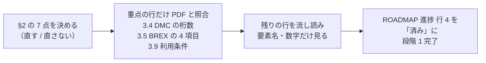

# サイト通読用の照合シート（2026-10-24 JST）

学習サイト（`site/`、9 ページ）を利用者が通読して「仕様書と矛盾がないか」を確かめるための補助資料です。段階 1 の最後の完了条件（ROADMAP「段階」の表、進捗の行 4）に対応します。

> [!NOTE]
> 通読は 2026-10-24 09:09 JST に完了し、仕様書との矛盾は見つかりませんでした。このメモは、以後はサイトの各記述の根拠を探すときの索引として使います。

- 前半は、Claude が 2026-10-24 に機械的に確かめた項目と、その結果です。読者はここを読み直す必要はありません。
- 後半は、ページごとに「サイトの記述 → 根拠 → 読者の確認方法」を並べた表です。読者は **根拠の列に挙げた箇所だけ** を `S1000D Issue 7.pdf` や配布物の実ファイルと見比べれば済みます。
- 仕様書のページ番号は、[background.md](./background.md) に記録済みのもの（Chap 4.10.2〜4.10.3 = p.2110〜2143、Chap 7.9 = p.3246〜3247、利用条件 = 冒頭 3 ページ）だけ書いています。それ以外の章は章番号のみで、ページは目次から探してください。

> [!IMPORTANT]
> サイトの文章は、仕様書の章を訳したものではなく、概念を自分の言葉で説明したものです（D-03）。したがって「仕様書の文言と一致するか」ではなく、「仕様書の定めと**矛盾していないか**」「数字と要素名が実物と一致するか」を見ます。

## 1. 機械的に確かめた項目

確認は開発機のファイルに対して行いました。サイトのビルドとテストは、開発機に接続した Linux VM 側の作業用フォルダーにコピーして実行しています。

| 観点 | 確認した内容 | 結果 |
|---|---|---|
| D-01 名前 | `s1kd`、旧称「IETM Stack」の残存 | 無し |
| D-01 BREX の初出 | 各ページで最初に現れる BREX の表記 | 「BREX（Business Rules Exchange）」の形があるのは `index.mdx`（Card 内）と `guide/brex.md` の 2 ページだけ。他 7 ページには無い。詳細は §2 |
| D-02 商標 | 「ASD とは無関係」「S1000D® は ASD の登録商標」の両方があるか | `index.mdx`（商標についての note）と `about/license.md`（商標の節）にある |
| D-02 「公式」「認定」 | 自プロジェクトを公式・認定と読ませる表現 | 「公式」は 12 箇所すべて S1000D 側の配布物を指す用法（公式サンプル・公式 XSD・公式サイト）。「認定」は `license.md` のルール文（「公式」「認定」と受け取られる表現を使わない）にだけ現れる |
| D-03 翻訳の禁止 | 仕様書の章をそのまま日本語にした段落 | 無し。`license.md` の利用条件の表は「私的な要約であり、法的な判断ではありません」と明記。`brex.md` の XML の例は自作 BREX（券売機）からの引用で、配布物ではない |
| 既定 BREX の DMC | システム差異コードの桁を決め打ちしている記述 | `brex.md` の note で「Issue 7 の同梱ファイルは `J`」と説明しているだけで、探索は決め打ちしないと書いている。`getting-started.md` のファイル名は `DMC-S1000D-*-04-10-0301-00A-022A-D_*.XML` と `*` で書いている |
| 内部リンク | `/s1000d-stack/...` へのリンク 5 件がビルド結果（`dist/`）に存在するか | 5 件すべて存在 |
| 外部リンク | 7 件に HTTP で到達できるか | 6 件が 200。`https://www.npmjs.com/package/@shuji-bonji/s1000d-core` は curl に 403 を返したが、レジストリ API（`registry.npmjs.org`）で 0.1.0 の存在を確認したので、ブラウザーからは開ける |
| ビルド | `npm run build`（Astro 7.4 ＋ Starlight 0.42 ＋ starlight-theme-rapide） | 成功。`index.html` 9 つ ＋ `404.html`。Pagefind は 10 HTML を索引 |
| core.md の関数名 | 表に挙げた 24 の関数と `XmlEngine` インターフェースが `@shuji-bonji/s1000d-core` の `src/index.ts` から公開されているか | すべて公開されている |
| brex-mcp.md の引数名 | `kind` / `context` / `search` / `offset` / `limit` / `value` / `csdbDirs` / `path` | `src/tools/definitions.ts` にすべてある。`csdbDirs` は 5 ツール共通 |
| brex-mcp.md の応答名 | `exact` / `manualChecks` / `unresolvedBrex` / `skipped` / `passed` / `allowedValues` / `actualValue` / `ruleId`、違反の `kind` 4 種（forbidden / missing / value / notation） | すべて実装にある |
| brex-mcp.md の環境変数 | `S1000D_SPEC_DIR` / `S1000D_CSDB_DIR`、複数指定の区切り | 実装と一致。区切りは `node:path` の `delimiter`（macOS / Linux は `:`、Windows は `;`） |
| テスト | core と brex-mcp のテスト | core 36 件（うち配布物 6 件）、brex-mcp 15 件（うち配布物 3 件）がすべて通過 |

## 2. 通読の前に直すかどうかを決める点

機械的な確認で見つかった、矛盾ではないが表現や数字をそろえたほうがよい箇所です。2026-10-24 に利用者が判断し、#1〜#5 と #7 は反映済み、#6 は U-01 の公開時に行う作業として DECISIONS.md の U-01 に記載しました。

| # | 箇所 | 内容 | 案 |
|---|---|---|---|
| 1 | `guide/getting-started.md` 本文 1 行目 | 入口のページで BREX の初出が「ビジネスルール（BREX）」。D-01 は README とパッケージ説明文を対象にしているのでサイトは義務ではないが、入口ページに正式名が無い | 「ビジネスルール（BREX、Business Rules Exchange）」にする |
| 2 | `index.mdx` の `hero.tagline` と `description` | 「BREX（ビジネスルール）」が Card の「BREX（Business Rules Exchange）」より先に表示される | tagline を「（BREX、Business Rules Exchange）」にするか、現状維持（Card が同じ画面にある） |
| 3 | `mcp/core.md`「配布物の中の不整合に備える」 | 「Bike Samples 117 件の照合を約 10 秒」とあるが、117 は `spec.test.ts` が対象にする配布物の DM 全体（Bike Samples 106 ＋ Front Matter Samples 9 ＋ 既定 BREX とビジネスルール文書の雛形 2）の数で、Bike Samples だけではない。`guide/brex.md` の「105 のデータモジュール」とも数が合わない | 「配布物のサンプル 117 件（Bike Samples 106 を含む）」と書く。brex.md の 105 は「自転車 BREX 自身を除いた 105」である旨を一言足す |
| 4 | `mcp/core.md`「XML は @xmldom/xmldom、XPath は fontoxpath」 | 「fontoxpath は属性を選ぶと節点ではなく文字列を返す」は実装（`xml/xmldom-fontoxpath.ts` 46 行のコメント）と一致。ただし D-12 の実装上の注意には「`ANY_TYPE` は節点 1 つのとき配列ではなく節点そのものを返す」とだけあり、この件は書かれていない | D-12 の実装上の注意にこの 1 文を追記して、文書間でそろえる |
| 5 | `about/license.md` ライセンスの表 | 自作サンプルデータが「MIT」。D-11 は「MIT または CC0」 | D-11 を MIT に確定するか、サイトを「MIT（CC0 も検討中）」にする |
| 6 | `guide/getting-started.md` と `mcp/brex-mcp.md` の note | 「2026-10-24 時点で npm 未公開（開発中）」が 2 箇所 | U-01 で brex-mcp を公開したら両方を消す。公開手順のチェックリストに入れておく |
| 7 | npm レジストリ | `@shuji-bonji/s1000d-core` に `0.0.0-stage`（2026-10-24 01:34 JST、0.1.0 の 1 分前）が残っていた。文書には記載が無く、`dist-tags.latest` は 0.1.0 | 2026-10-24 08:21 JST に `npm unpublish` で削除済み。`versions` は 0.1.0 のみ（`time` の履歴には残る） |

## 3. ページごとの照合表

「読者の確認方法」の列で、**PDF** は `specs/s1000d/issue-7/S1000D Issue 7.pdf`、**配布物** は同フォルダー以下の実ファイルを指します。「実装」は s1000d-core / s1000d-brex-mcp のコードで、§1 で確認済みなので読み直しは不要です。

### 3.1 トップ（`index.mdx`）

| サイトの記述 | 根拠 | 読者の確認方法 |
|---|---|---|
| BREX の連鎖（プロジェクト → 組織 → S1000D 既定 BREX）に各層ごとに照合 | PDF Chap 7.9（p.3246〜3247）「各層に個別に照合し、どの層にも失敗が無いときだけ合格」 | PDF の該当 2 ページ |
| 違反を箇所（XPath と行番号）・値・ルール ID・重大度付きで返す | 実装（`check_against_brex` の応答） | 不要（§1） |
| 仕様書・XSD・既定 BREX・公式サンプルは再配布できない | PDF 冒頭の利用条件 `S1000D-A-00-00-0000-00A-021A-D` 条項 3・4.1・4.3 | PDF 冒頭 3 ページ。background.md「利用条件（Issue 7）の確認結果」と照らす |
| 商標の note | D-02 | 不要 |

### 3.2 はじめに（`guide/getting-started.md`）

| サイトの記述 | 根拠 | 読者の確認方法 |
|---|---|---|
| 仕様書は 3,700 ページ | 配布物 `S1000D Issue 7.pdf` のページ数 | PDF のページ数を開いて見る |
| 配布物の中に既定 BREX（`DMC-S1000D-*-04-10-0301-00A-022A-D_*.XML`）と XML スキーマが入っている | 配布物 `default-brex/`、`xml-schema-package/.../xml_schema_flat/` | フォルダーを開く。ファイル名の `*` の位置が `J` であることを見る |
| 利用条件は非独占的な利用を許諾するだけで再配布の権利を与えていない | PDF 冒頭の利用条件 条項 2・3・4.3 | PDF 冒頭 3 ページ |
| Node.js 22 以上 | D-13（MCP SDK v2 の要件） | 不要 |
| `claude_desktop_config.json` の例、環境変数 2 つ | 実装（`src/config.ts`） | 不要（§1） |
| 「`securityClassification` の `01` は何を意味するか」→ `lookup_value` | 既定 BREX の `objectValue` に説明文が空のものがある（background.md「実装で分かった配布物の性質」） | 既定 BREX の XML で `securityClassification` の `objectValue` を検索し、本文が空であることを見る。サイトの例が「意味が返らないことがある値」を使っている点に注意（別の属性の例に替えるかは任意） |

### 3.3 IETM と S1000D（`guide/ietm-and-s1000d.md`）

このページは仕様書より外部資料に基づく記述が多く、根拠は background.md「IETM と S1000D の関係」「日本での状況」と、同メモ末尾の「参照した資料」です。

| サイトの記述 | 根拠 | 読者の確認方法 |
|---|---|---|
| IETM は 1992 年の米国防総省の 3 規格（MIL-M-87268 / MIL-D-87269 / MIL-Q-87270）、Class 0〜5、現在は機能マトリクス | background.md、Wikipedia「Interactive electronic technical manual」 | 参照資料のリンク |
| S1000D は ASD が始め、ASD・AIA・A4A（旧 ATA）が共同で保守 | PDF Chap 1（Introduction）、s1000d.org | PDF 冒頭の Introduction の章 |
| 米国防総省は 2005 年に S1000D を採用 | background.md、Wikipedia「S1000D」 | 参照資料のリンク |
| 出力先を IETP と呼ぶ | PDF Chap 6（Information presentation and use）の IETP の章 | PDF 目次で「IETP」を探す |
| データモジュール・CSDB・パブリケーションモジュール・BREX の説明 | PDF Chap 3.9（Data module）、Chap 4.10（Business rules exchange）、Chap 5（CSDB）、Chap 4.9（Publication module） | 各章の冒頭の定義。章番号は Issue 7 の目次で確かめる |
| 体験型マニュアルの JSON と S1000D の対応表 | background.md「2021 年の作品との対応」（自分の整理） | 仕様書との照合対象ではない。「プロセスデータモジュール（提示順の制御）」の説明だけ、PDF Chap 3.9.5.2.x（Process data module）の定義と矛盾しないかを見る |
| MRJ で S1000D 4.0.1 と MRJ 用ビジネスルールが要求された、ビジネスルールは 450 を超える | background.md「日本での状況」、Airframer・中央図研の寄稿 | 参照資料のリンク |

### 3.4 データモジュールと DMC（`guide/data-module-and-dmc.md`）

| サイトの記述 | 根拠 | 読者の確認方法 |
|---|---|---|
| `dmodule` → `identAndStatusSection`（`dmAddress`、`dmStatus`）と `content` | 配布物 `xml_schema_flat/descript.xsd` と Bike Samples の任意の DM | DM を 1 つ開いて要素名を見る |
| 識別・状態部の表（`dmCode`、`language`、`issueInfo`、`issueDate`、`dmTitle`、`dmStatus/@issueType`、`security`、`applic`、`brexDmRef`、`qualityAssurance`） | PDF Chap 3.9.5.1（Identification and status section）、配布物の DM | 章の見出し一覧と DM の実物 |
| `qualityAssurance` は 未検証 / 第 1 検証 / 第 2 検証 | PDF Chap 3.9.5.1 の `qualityAssurance`（`unverified` / `firstVerification` / `secondVerification`） | 同章 |
| `xsi:noNamespaceSchemaLocation` の URL（`http://www.s1000d.org/S1000D_7/xml_schema_flat/descript.xsd`）に版が入る | 配布物の DM、background.md | DM の 1 行目を見る |
| DMC の区画と桁数（MIC 2〜14、システム差異 1〜4、システム 2〜3、サブシステム 1 ＋ サブサブシステム 1、組立 2 または 4、分解 2 ＋ バリアント 1〜3、情報コード 3 ＋ バリアント 1、アイテムロケーション 1） | PDF Chap 4.3（Data module code）の各節 | **重点**。各区画の桁数を章の記述と 1 つずつ突き合わせる |
| 学習コード 3 文字 ＋ 学習イベントコード 1 文字 | PDF Chap 4.3 の学習データモジュールの節、Chap 8.5 | 同章 |
| MIC は NSPA への登録が前提 | PDF Chap 4.3.1（Model identification code） | 同章 |
| `040` は説明、`022` は BREX、`5xx` は手順 | PDF Chap 8.4.1（Information codes）、既定 BREX の情報コードの `objectValue` | 情報コード表で 040・022 を見る。「`5xx` は手順」は 500 番台の見出しが手順系であることを見る（大まかな言い方なので、厳密な表現にするかは任意） |
| アイテムロケーションコード `D` | PDF Chap 4.3（Item location code） | 同章 |
| ファイル名 `DMC-…_002-01_JA-JP.XML`（発行番号・作業中番号・言語と国） | PDF Chap 4.3（File naming の節、または Chap 7.5）、配布物 Bike Samples のファイル名 | Bike Samples のファイル名を見る |
| データ辞書の見本にファイル名の DMC と中身の DMC が一致しないものがある | background.md「実装で分かった配布物の性質」、配布物 `data_dictionary_7/Files/samples/` | 任意。既に実測済み |
| ICN は MIC 基準と CAGE 基準の 2 書式、形式は DOCTYPE の `ENTITY` と `NOTATION` で対応付ける | PDF Chap 4.4（Information control number）、Bike Samples の DM の DOCTYPE | Chap 4.4 の 2 書式の節。DM の DOCTYPE を 1 つ見る |
| コード例（`parseDmc`、`readDataModuleInfo`） | 実装 | 不要（§1） |

### 3.5 BREX（`guide/brex.md`）

根拠の大半は background.md「BREX の章の読解結果」（PDF p.2110〜2143）です。

| サイトの記述 | 根拠 | 読者の確認方法 |
|---|---|---|
| すべての DM は自分が従う BREX を 1 つ参照する | PDF Chap 4.10.2（p.2110〜）、Chap 4.10.2.4 | 「1 つの CSDB オブジェクトが参照できる BREX は 1 つだけ」の記述 |
| BREX は情報コード `022` | PDF Chap 4.10.2.4 | 同節 |
| `<brex>` の 4 ブロック（`commonInfo`、`snsRules`、`contextRules`、`nonContextRules`） | 配布物 `xml_schema_flat/brex.xsd`、PDF Chap 4.10.2 | `brex.xsd` で `brex` 要素の子を見る |
| `notationRuleList` は `contextRules` の子（`structureObjectRuleGroup` の兄弟） | 配布物 `brex.xsd` | 同 |
| `rulesContext` はスキーマの URL、省略時はすべてに適用、スキーマ固有は共通を上書きしかつ狭める方向 | PDF Chap 4.10.2.2 | **重点**。「上書き」と「真の制限」の 2 条件の記述 |
| `allowedObjectFlag` の `0` / `1` / `2` の意味 | PDF Chap 4.10.2.2 | **重点** |
| `valueForm` の `single` / `range` / `pattern`、`range` の書式（`500~599`）、`pattern` は XML Schema の正規表現 | PDF Chap 4.10.2.2、範囲表記は Chap 3.9.5.3 | **重点**。範囲の区切りが `~` であること |
| `brDecisionIdentNumber` は既定 BREX では `BREX-S1-NNNNN`、版が変わっても番号は変わらない | PDF Chap 4.10.3、既定 BREX の実物 | 既定 BREX の XML で `brDecisionIdentNumber` を検索 |
| `brSeverityLevel` は `brsl01`〜`brsl99`、意味はプロジェクトが決める | PDF Chap 4.10.1、Chap 3.9.6.1 | 同章 |
| 下位は上位を制限することしかできない、下位は上位を繰り返さない、連鎖は既定 BREX で終わり既定 BREX は自分自身を参照する | PDF Chap 4.10.2（レイヤーの節）、既定 BREX の `brexDmRef` | **重点**。既定 BREX の `brexDmRef` が自分の DMC であることを見る |
| 照合は各層に個別、層の統合や矛盾の解決は検査側の責務ではない（Chap 7.9） | PDF Chap 7.9（p.3246〜3247）、Chap 2.5.1 | 該当 2 ページ |
| 既定 BREX には 274 の構造ルールと 1,445 の許可値 | 既定 BREX の実物（background.md の実測） | `grep -c "<structureObjectRule" `、`grep -c "<objectValue" ` で数える |
| 既定 BREX の内容（設定可能属性の既定値集合、許可する情報コード、学習コード、スキーマで表せない規則） | PDF Chap 4.10.3 | 同節の冒頭 |
| 既定 BREX の DMC `S1000D-Y-…`、Issue 7 の同梱ファイルは `J`、仕様書本文・データ辞書と食い違う | PDF Chap 4.10.3（本文は `I`）、配布物 `default-brex/` のファイル名（`J`）、`data_dictionary_7/Files/samples/`（`X`） | 3 箇所を見る。サイトは「食い違いがある」と書くだけで値を断定していない |
| 照合の規則の表（`forbidden` / `missing` / `value` / `notation`、真偽値の扱い、`rulesContext` の選び方、階層の扱い） | 実装。ただし判定の根拠は PDF Chap 4.10.2.2 と 7.9 | 表の判定が上の `allowedObjectFlag` の定義と矛盾しないかだけ見る |
| BREX の照合は XSD の検証を含まない。BREX は「スキーマに適合している DM」が前提 | PDF Chap 4.10.2（BREX とスキーマの関係）、Chap 7.9 | 同節 |
| Bike Samples 105 の DM を 2 層に照合すると既定 BREX への違反が 55 件 | background.md の実測（spec テスト） | 任意。`S1000D_SPEC_TESTS=1 npm test` で再現できる。数の表現は §2 の #3 を参照 |

### 3.6 s1000d-brex-mcp（`mcp/brex-mcp.md`）

このページの記述は実装に基づくもので、§1 で突き合わせ済みです。仕様書と照らす行は 2 つだけです。

| サイトの記述 | 根拠 | 読者の確認方法 |
|---|---|---|
| 既定では `brexDmRef` の連鎖をたどり、各層に個別に照合 | PDF Chap 7.9 | 3.5 と同じ |
| `nonContextRules` は `manualChecks` として返し、判断は人が行う | PDF Chap 4.10.2.3（Context independent rules） | 「スキーマや要素に結び付けられない規則」「一般的なコメントに使ってはならない」の記述 |
| ツール 5 つ、引数、応答の形、環境変数、`unresolvedBrex` / `skipped` / `manualChecks` の読み方 | 実装 | 不要（§1） |
| npm 未公開の note | — | §2 の #6 |

### 3.7 s1000d-core（`mcp/core.md`）

| サイトの記述 | 根拠 | 読者の確認方法 |
|---|---|---|
| 関数の表（24 関数） | 実装 | 不要（§1） |
| 既定 BREX 274 件のうち 1 件が XPath 2.0 の構文（`for … return some … satisfies`） | D-12、既定 BREX の実物 | 既定 BREX の XML で `satisfies` を検索して 1 件であることを見る |
| fontoxpath は属性を選ぶと文字列を返す、xmldom 0.9 は致命的エラーを例外で投げる | 実装（`xml/xmldom-fontoxpath.ts`）、D-12 | §2 の #4 |
| 照合処理はライブラリに置く | D-10 | 不要 |
| 配布物は含めない、テストは自作データで、配布物テストは `S1000D_SPEC_TESTS=1` | D-03、実装 | 不要 |
| データ辞書の見本の循環、117 件を約 10 秒 | background.md の実測 | §2 の #3 |
| Trusted Publisher、0.x の `^0.1.0` は minor をまたがない | D-14、semver の規則 | 不要 |

### 3.8 構成と進み方（`about/stack.md`）

このページは ROADMAP.md と DECISIONS.md の要約で、仕様書との照合対象はありません。確かめるのは文書との整合だけです。

| サイトの記述 | 根拠 | 読者の確認方法 |
|---|---|---|
| 部品の表と状態（2026-10-24） | ROADMAP「全体像」、`stack.json` | `stack.json` の `status` と一致（core `released`、brex-mcp と hub `developing`、段階 2〜3 `planned`、Skill と app `concept`） |
| 段階の表 | ROADMAP「段階」 | 完了条件の文言が ROADMAP と同じ趣旨か |
| 決めていること 6 項目 | D-01、D-03、D-04、D-10、D-12、D-14 | 不要 |
| 対象の版（Issue 7 → 4.2） | ROADMAP「対象とする S1000D の版」 | 不要 |

### 3.9 仕様書の扱いと商標（`about/license.md`）

| サイトの記述 | 根拠 | 読者の確認方法 |
|---|---|---|
| 利用条件の表（License to use / Special usage rights / Definitions / Intellectual property rights / No modifications） | PDF 冒頭の利用条件 `S1000D-A-00-00-0000-00A-021A-D` 条項 2・3・4.1・4.3・4.4 | **重点**。冒頭 3 ページを読み、background.md「利用条件（Issue 7）の確認結果」の表と 3 点照合する。(1) Special usage rights の対象が 8 区分であること、(2) Definitions に XML スキーマと例が含まれること、(3) No modifications に「ビジネスルールの追加は可」が書かれていること |
| S1000D™ は ASD の商標、S1000D® は EU の登録商標 | 利用条件 条項 1、s1000d.org の Terms of Use | 同 |
| i2oss/s1000d-mcp と Oxygen XML の例 | background.md「既存のツール」、Oxygen の License Agreement のリンク | リンク先（§1 で到達を確認） |
| ライセンスの表 | D-11 | §2 の #5 |

## 4. 通読の進め方（提案）

1. §2 の 7 点について、直すかどうかを決めます。直すものは Claude が修正案を作れます。
2. 「重点」と書いた行（3.4 の DMC の桁数、3.5 の `rulesContext` / `allowedObjectFlag` / `valueForm` / 層の規則、3.9 の利用条件）を PDF と照合します。ここが仕様書との矛盾が出るとすれば最も可能性の高い箇所です。
3. 残りの行は、要素名と数字が実物と一致するかだけを見ます。
4. 終わったら ROADMAP の進捗 行 4 を「済み」にし、段階 1 を完了とします。U-01（公開の時期）の判断に進めます。
