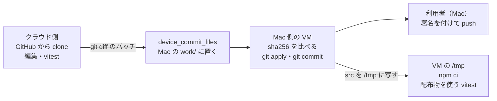

# 実在の TM を使った確認の引き継ぎ（3 回目、2026-11-16 16:20 JST）

次のチャットで続きを始めるための文書です。2 回目の引き継ぎは [tm-eval-handoff-2.md](./tm-eval-handoff-2.md)、作業の記録は [tm-eval-progress.md](./tm-eval-progress.md)、要望の一覧は [tm-eval-requests.md](./tm-eval-requests.md) です。

> [!WARNING]
> 題材から作ったもの（`manual.json`、切り出した図、変換した XML）は社内の確認用です。配布しません。リポジトリにも入れません。公開してよいのは、自分たちの観察だけです。
>
> S1000D の仕様書・スキーマ・公式サンプル（Bike Samples を含む）は再配布できません。リポジトリの `/specs/` は `.gitignore` の対象です。テストに使う BREX のルールと XSD は、自作のものを書きます（配布物の式や定義を写しません）。

## 最初に読むもの

1. この文書
2. [tm-eval-progress.md](./tm-eval-progress.md) の「BREX の修正候補と、Bike Samples の残り 13 個」と「残り」の節
3. `lib/s1000d-core/CHANGELOG.md` の「未リリース」の節
4. [DECISIONS.md](../DECISIONS.md) の D-31

## いまの状態（2026-11-16 16:15 JST に確かめた）

hub と 6 つのリポジトリは、すべて `origin/main` と一致しています。作業コピーに未コミットの変更はありません。

| リポジトリ | npm に公開した版 | `main` の先頭 | 公開していない変更 |
|---|---|---|---|
| s1000d-core | 0.11.0 | `69e6bbf` | あり（下の 3 つ） |
| experiential-manual-model | 0.4.0 | `4137a87` | なし |
| s1000d-writer-mcp | 0.3.1 | `b7a56c6` | なし |
| s1000d-reader-mcp | 0.10.0 | `78b9fb3` | なし |
| s1000d-verify-mcp | 0.7.2 | `09a1931` | なし |
| s1000d-brex-mcp | 0.6.2 | `7df7c98` | なし |
| s1000d-stack（hub） | — | `b26a82a` | — |

MCP 4 本は、どれも core `^0.11.0` に依存しています。

core の公開していない変更は次の 3 つです。`package.json` は 0.11.0 のままで、CHANGELOG は「未リリース」の見出しで書いてあります。

| コミット | 内容 |
|---|---|
| `cdd8c2a` | 配布物を使うテストの実測値の更新（descript の `para` 72 → 91）。テストだけの変更 |
| `f1c58a7` | 条件付きで禁止する BREX ルールの修正候補を、条件を成り立たなくする変更にした |
| `69e6bbf` | Bike Samples で知らせるだけだった残りの要素を読むようにした（読み取りの結果に無いテキスト節点 13 個 → 0 個） |

> [!IMPORTANT]
> 決定（利用者、2026-11-16 16:12 JST）: core の上の変更は、すぐには公開しない。次の変更とまとめて 0.12.0 として公開する。
>
> [tm-eval-progress.md](./tm-eval-progress.md) の「残り」の表の最初の行（「すぐ: core 0.12.0 の公開」）は、この決定の前に書いたものです。この文書のほうが新しい内容です。

## 最初にやること

1. **状態を確かめる。** hub と 6 つのリポジトリで `git status -sb` と `git log --oneline -1` を見て、上の表と同じかを確かめます。
2. **0.12.0 に入れる「次の変更」を、利用者に確かめる。** 候補は下の表です。どこまで入れてから公開するかは決まっていません。
3. 決まった変更を core に実装し、配布物を使う vitest を通します（やり方は「作業の仕方」）。
4. 公開の前に、下の「公開の前に確かめること」を行います。

### 0.12.0 に入れる変更の候補

| 候補 | 内容 | 決めること |
|---|---|---|
| 故障探求 DM の要素 | `lru`・`lruItem`・`bitMessage`・`circuitBreakerDescr`・`detectionInfo`・`isolationInfo`・`faultIsolationTest` などを、いまは `kind: "unknown"` の節点で返している。文は落ちていないが、構造としては読めていない | 返す形を Issue 7 の `fault.xsd` と Bike Samples の実物から決める（D-31） |
| `dmIf` の式 | `expression` に `humanReadableForm` が無く、変数 1 つでもない式は `unknown` のまま。`69e6bbf` で足した `expressionText`（式を文にする関数）を使えば、`question` か `attrs.expression` に入れられる。`assert`（適用性の条件）は `expressionText` がまだ扱えない | 返す場所（`question` に入れるか、`attrs.expression` にするか） |
| `userEntry` の `variableRef` | reader は変数名を `dialog` の `attrs.variableName` に読んでいるのに、`variableRef` を `unknown` にも数える | 数えないようにするだけでよいか |
| BREX-S1-00121 型の候補 | 属性が無いこと（`not(@applicRefId)`）が条件のルールは、足す値を決められず候補なしになる。文書の中の `applic` の `id` を候補にする、などの案がある | 方針 |
| `apply_fixes` の `target` | `selections` に候補の `target` を写さないと `candidate-not-offered` で断られ、理由から `target` が足りないことが読み取れない | 直すかどうか（候補と選択を突き合わせているのは core の `src/fix/apply.ts`） |

## この回で決まったこと

| 項目 | 内容 |
|---|---|
| 条件付きで禁止する BREX ルールの候補 | 取り除く候補は出さない。文書を 1 か所だけ変えて objectPath を評価し直し、違反の要素が選ばれなくなる変更だけを候補にする。確からしさは `several` か `none`（`exact` にしない。`exact` は writer が自動で適用するため）。対象そのものの識別（`dmAddress` の下の属性）は候補にしない。述語の無い objectPath は、これまでどおり「取り除く」を `exact` で返す |
| 候補の `target` の書き方 | 違反の場所から見た道（`identAndStatusSection/dmStatus/@issueType`）。違反の要素の子孫でないときは `/` で始まる道。`applyFix` がこの形の `replace` と `add` を適用する |
| 読み取りで足した形 | 品目の `identifiers`（`ContentIdentifier`）、品目の `children` に `hazard`（`list`）と `hazardRef`（`para`）、`requirements` の子に `productionMaintData`（`para`）と `footnote`（`para`）、変数の宣言（`list`）・代入・検査（`para`）、図への参照の `reasonForAmendment`。新しい `kind` は足さず、`element` で元の要素を区別する |
| 式の文 | 式は評価せず、書かれた値と演算の名前を並べた文にする（`(age greaterThanOrEqual 4) and (age lessThanOrEqual 100)`）。この書き方は core が決めたもので、仕様書のプロセス DM の章は読んでいない。W-6 のときに見直す |
| 読む側と作る側 | 読む側は何が来るか選べないので全部が対象。新しく作る側が部分集合なのは作業の順番の結果で、S1000D として要らないと判断したわけではない。既にある DM を直す経路（`apply_fixes`・`apply_segments`）は元の XML を保つ |

## 公開の前に確かめること

| 項目 | 内容 |
|---|---|
| Skill 4 つ | `s1000d-review`・`s1000d-publish`・`s1000d-translate`・`experience-to-s1000d` が、変わる前の応答（`attrs.notRead`、`kind: "unknown"` の `productionMaintData`、`element: "foldout"` の `figure`、`notReadElements` の `hazards` など）を前提にしていないか。claude-plugins のリポジトリは、これまでのチャットに接続していないので、フォルダーの接続が要る |
| reader-mcp の説明文 | `src/server.ts` が、読んでいない要素の例として `productionMaintData, hazards` を挙げている。core 0.12.0 では読むので、例を変える |
| MCP 4 本の依存 | `package.json` を `^0.12.0` に書き換える（0.x の `^` は minor を固定するので、`npm update` では上がらない）。`package-lock.json` は、1 本で `npm install` した結果の `version`・`resolved`・`integrity` を、ほかの 3 本に写す。VM の npm（v10）で `--package-lock-only` を使うと、関係の無い行が書き換わる |
| 修正候補の副作用 | BREX-S1-00030 の候補（`issueType` を 7 つの値のどれかにする）は、適用すると別のルールに当たることがある（`changed` にすると変更の印が要る、など）。候補に注記はあるが、適用の後の検証し直しを Skill が行っているかは確かめていない |
| 確かめていないツール | DML がある CSDB での `reconcile_dml`、plugin 経由の verify |

公開の手順（利用者の作業）は、これまでと同じです。core の版を上げて CHANGELOG の見出しを日付にする → `npm publish` と tag → MCP 4 本の依存を上げて公開 → `mcp-publisher publish` → plugin の更新 → hub で `node scripts/generate-stack.mjs --readme`。最後の生成は、npm が新しい版を返すようになってから行います（早いと `stack.json` に古い版が入ります）。

## 作業の仕方

この回で確かめた手順です。次のチャットでは、クラウド側の作業フォルダーは空から始まります。

| 項目 | 内容 |
|---|---|
| 編集とテスト | クラウド側に 6 つのリポジトリを clone し、そこで編集して `npx vitest run` を実行する。配布物（`specs/`）はクラウド側に無いので、配布物を使うテストはスキップされる |
| パッチの受け渡し | `git diff` を `/mnt/user-data/outputs/` に書き、`device_commit_files` で `/Users/bonji/s1000d-stack-eval/work/` に置く。VM で `sha256sum` を比べてから `git apply` する（古い内容が書かれることがあった。そのときは別の名前で書き直す） |
| 配布物を使う vitest | VM のリポジトリのフォルダーでは起動しない（`node_modules` が macOS 用）。`src`・`schema`・`package.json`・`package-lock.json`・`tsconfig.json`・`vitest.config.ts` を `/tmp/corevt` に写し、`npm_config_cache=/tmp/npmcache npm ci --ignore-scripts` の後に `S1000D_SPEC_TESTS=1 S1000D_SPEC_DIR=$HOME/mnt/s1000d-stack/specs/s1000d/issue-7 npx vitest run`。いまの core は 335 件が通る |
| VM でしてはいけないこと | リポジトリのフォルダーで vitest を実行しない（`vitest.config.ts.timestamp-*.mjs` が残る）。`pkill -f` を使わない（自分のシェルが落ちる）。ホームに大きなファイルを置かない（空きが少ない。`/tmp` を使う） |
| 削除の許可 | VM での `git commit` は削除を伴う。`device_request_delete_permission` に `/Users/bonji/workspace/shuji-bonji/s1000d-stack` と `/Users/bonji/s1000d-stack-eval` を渡す。許可は時間で切れる。コミットの後に `.git/*.lock` が残っていないかを見る。削除は `$HOME/mnt/s1000d-stack/…` の道で行う |
| コミット | VM で `git -c user.name=shuji-bonji -c user.email=<利用者のメール> commit`。署名は利用者が付け直すので、ハッシュが変わる。文書にハッシュを書いたら、push の後に新しいハッシュに直す |
| 署名のコマンド | 1 コミットなら `git commit --amend --no-edit -S && git push`、複数なら `git rebase --exec 'git commit --amend --no-edit -S' origin/main && git push` |
| 環境変数 | `S1000D_SPEC_TESTS=1 npm test` と 1 行で書く。別の行で設定するなら `export` が要る。渡ったかどうかは、vitest の最後の行にスキップが無いことで分かる |
| 文書 | hub（`s1000d-stack/docs/`）と Project の両方に置く。`project_write` の `local_path` は、そのチャットで全文を読んだファイルに限られる。`tm-eval-progress.md` は 47 KB あるので、新しい記録はこの文書か新しい文書に書くほうが軽い |
| S1000D の判断 | 推測しない。XSD（`specs/s1000d/issue-7/xml-schema-package/…/xml_schema_flat/`）、Bike Samples（`specs/s1000d/issue-7/bike-samples/`）、既定 BREX（`specs/s1000d/issue-7/default-brex/`）、MCP（`s1000d-*-dev`）、Skill で確かめる |

## Bike Samples の実測（core `69e6bbf`）

次の変更の前後を比べるための数です。

| 測ったもの | 値 |
|---|---|
| `verify_csdb`（DM 106 件 ＋ PM 4 件） | XSD valid 110 件、BREX の違反がある 10 件（18 個）、解決しない参照がある 6 件 |
| BREX の違反の内訳 | BREX-S1-00030 が 9 件、BREX-S1-00038 が 8 件、BREX-S1-00121 が 1 件 |
| 本文を構造化して読む DM | 59 件、テキスト節点 1,587 個 |
| 読み取りの結果に無いテキスト節点 | 0 個（59 件とも） |
| `notReadElements` に数えている要素 | `globalPropertyRef` 1、`behavior` 2、`pubMedia` 2、`shortExternalPubTitle` 2 |
| `preliminaryRqmts` を読んで書いたときに失われる要素・属性 | 602 個（41 件、2,527 個のうち）。何も失わずに往復できる DM 26 件 |
| 配布物を使う vitest | 335 件が通る（Mac で 2026-11-16 16:08 JST） |

## 残り

| 順 | 作業 | 待つもの |
|---|---|---|
| 1 | 0.12.0 に入れる変更を決めて実装する（上の候補の表） | 利用者の決定 |
| 2 | 公開の前の確認（Skill 4 つ、reader-mcp の説明文、MCP 4 本の依存） | claude-plugins のフォルダーの接続 |
| 3 | core 0.12.0 と MCP 4 本の公開 | 利用者の作業 |
| R11 の後 | 作らなかった DM への参照（R14）の扱いを決める | 方針の決定 |
| 5 | W-4 → W-5 → RD-2（hotspot） | core に足す形は、XSD の `hotspot` と配布物の実測から決める（D-31） |
| 6 | 仕様書のプロセス DM の章を読んでから W-6。式の文の書き方も見直す | — |
| 7 | M-4〜M-7 と W-9、その後に優先 3 | — |

editor と player の 0.3.0 対応は、製品側（`webapps/experiential-manual-editor`）の作業です。評価フォルダーの `.emanual` と HTML は 0.2.0 の形のままで、作り直していません。
