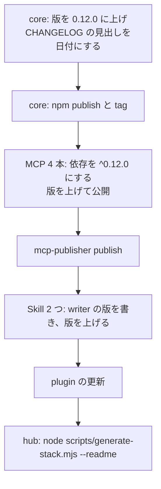

# 実在の TM を使った確認の引き継ぎ（4 回目、2026-11-17 01:45 JST）

次のチャットで続きを始めるための文書です。3 回目の引き継ぎは [tm-eval-handoff-3.md](./tm-eval-handoff-3.md)、作業の記録は [tm-eval-progress.md](./tm-eval-progress.md)、要望の一覧は [tm-eval-requests.md](./tm-eval-requests.md) です。

> [!WARNING]
> 題材から作ったもの（`manual.json`、切り出した図、変換した XML）は社内の確認用です。配布しません。リポジトリにも入れません。公開してよいのは、自分たちの観察だけです。
>
> S1000D の仕様書・スキーマ・公式サンプル（Bike Samples を含む）は再配布できません。リポジトリの `/specs/` は `.gitignore` の対象です。テストに使う BREX のルールと XSD は、自作のものを書きます（配布物の式や定義を写しません）。

## 最初に読むもの

1. この文書
2. [design/core-fault-and-process.md](../design/core-fault-and-process.md)（この回で決めた、core が読む形と BREX の候補の決まり）
3. `lib/s1000d-core/CHANGELOG.md` の「未リリース」の節
4. [tm-eval-handoff-3.md](./tm-eval-handoff-3.md) の「作業の仕方」（クラウド側で編集し、パッチを Mac に渡す手順。この回も同じ手順で行いました）

## いまの状態（2026-11-17 01:42 JST に確かめた）

hub と 10 のリポジトリは、すべて `origin/main` と一致しています。作業コピーに未コミットの変更はありません。

| リポジトリ | npm に公開した版 | `main` の先頭 | 公開していない変更 |
|---|---|---|---|
| s1000d-core | 0.11.0 | `00e99b9` | あり（下の表の 7 コミット） |
| experiential-manual-model | 0.4.0 | `4137a87` | なし |
| s1000d-writer-mcp | 0.3.1 | `ae93faa` | あり（`apply_fixes` の `position`） |
| s1000d-reader-mcp | 0.10.0 | `3e7bb1c` | あり（説明文と README の例） |
| s1000d-verify-mcp | 0.7.2 | `09a1931` | なし |
| s1000d-brex-mcp | 0.6.2 | `7df7c98` | なし |
| s1000d-publish-skill | 0.1.2 | `12754e2` | あり（作り直す手順をやめる、`position`） |
| experience-to-s1000d-skill | 0.1.1 | `6af08bf` | あり（`position`） |
| s1000d-review-skill | — | `da8b627` | なし |
| s1000d-translate-skill | — | `dcb3486` | なし |
| s1000d-stack（hub） | — | `3a57c7b` | — |

MCP 4 本は、どれも core `^0.11.0` に依存しています。core・writer-mcp・Skill 2 つの CHANGELOG は「未リリース」の見出しで書いてあり、`package.json` と `plugin.json` の版は上げていません。

> [!NOTE]
> 2026-11-17 02:15 JST に、core の CHANGELOG の見出しを「0.12.0 (2026-11-17)」に変えるコミットを足しました（push の前。署名でハッシュが変わるので、ここには書きません）。`package.json` の版は 0.11.0 のままで、`npm version minor` は利用者の作業です。公開が別の日になったら、見出しの日付を直します。

core の公開していない変更は次のとおりです。上の 3 つは 3 回目の引き継ぎの時点でありました。

| コミット | 内容 |
|---|---|
| `cdd8c2a` | 配布物を使うテストの実測値の更新。テストだけの変更 |
| `f1c58a7` | 条件付きで禁止する BREX ルールの修正候補を、条件を成り立たなくする変更にした |
| `69e6bbf` | Bike Samples で知らせるだけだった残りの要素を読むようにした |
| `c4f0d75` | `userEntry` の `variableRef` を `unknown` に数えない。`candidate-not-offered` で断るときに、食い違った項目を `notes` に書く |
| `2065390` | `dmIf` と `dmLoop` の条件の式を `attrs.expression` に読む。`dmLoop` は `kind: "sequence"` の節点。式の中の `assert` を文にする |
| `944209e` | 属性が無いことが条件の BREX ルールに、候補と注記を返す |
| `00e99b9` | 故障の報告（`faultReporting`）と回路遮断器の一覧を、節点として読む |

> [!IMPORTANT]
> 3 回目の引き継ぎの「0.12.0 に入れる変更の候補」の 5 つは、すべて実装して push しました。core 0.12.0 に入れる変更は、これで揃っています。

## 最初にやること

1. **状態を確かめる。** hub と 10 のリポジトリで `git status -sb` と `git log --oneline -1` を見て、上の表と同じかを確かめます。
2. **残っている確認を行う。** DML がある CSDB での `reconcile_dml` と、plugin 経由の verify は、まだ確かめていません。0.12.0 の公開の前に行うか、後に回すかを利用者に確かめます。
3. **公開の手順に進む。** 下の「公開の手順」です。`npm publish`・tag・push は利用者の作業です。

## この回で決まったこと（2026-11-16〜17、利用者の決定）

| 項目 | 内容 |
|---|---|
| 0.12.0 の範囲 | 候補 5 つをすべて入れる |
| `dmIf` の式 | 式を文にしたものは `attrs.expression` に入れる。`question` は人が書いた文（`humanReadableForm`）だけ |
| `dmLoop` | `kind: "sequence"`・`element: "dmLoop"` の節点にする。条件の式は `attrs.expression` |
| 式の中の `assert` | `assert(識別子 種類 "値")` の文にする。この書き方は core が決めたもので、W-6 のときに見直す |
| 故障の報告 | 新しい `kind` を足さず、`section` と `para` で返す。`detectedFault`・`isolatedFault`・`correlatedFault` を節点にするので、fault の読み取りの結果は階層が 1 段増える |
| 回路遮断器の一覧 | `list` と `listItem` で返す |
| BREX-S1-00121 型の候補 | 属性が無い場所が 1 か所で、足す値の出どころがあるときだけ `add` の候補（`several`）を返す。複数のときは候補なしのままで、`note` に場所の数と使える値を書く |
| `apply_fixes` の `target` | 照合の厳しさは変えない。断るときに、食い違った項目を `notes` に書く |
| `apply_fixes` の `position` | writer-mcp の入力に足す。0.12.0 と一緒に公開する |
| `s1000d-publish` の「既存の DM を書き直すとき」 | 手順を D-31 に合わせる。CSDB にある DM を reader で読み、下書きに写して作り直すことはしない |
| 構造を変える編集（手順を足す、段落を削るなど） | Skill では扱わないと明記する。経路は、core に元の XML を保つ操作を足すときに改めて設計する |

形の詳しい決まりは [design/core-fault-and-process.md](../design/core-fault-and-process.md) にあります。

### 「reader が知らない構造」の意味

`unknown` は、S1000D の仕様に合っているかどうかの判定ではありません。core の読み取り部分が、その要素をまだ実装していないという意味です。次の 3 つは別のことなので、文書と Skill では分けて書きます。

| 知りたいこと | 見るもの |
|---|---|
| S1000D の XSD に合っているか | verify の結果（`verification.schema`） |
| reader が読めているか | `content.unknownElements` と `content.notReadElements` |
| 下書きに書けるか | writer が受け付ける構造（S1000D の部分集合）。reader が読めても書けない構造がある |

## この回で見つけて直したこと

| 見つけたこと | 直した場所 |
|---|---|
| `detectedFault`・`isolatedFault`・`correlatedFault` の `id` と `faultCode` が、読み取りの結果のどこにも無かった（`notReadElements` にも数えていなかった） | core `00e99b9` |
| `detectionInfo/@detectionType`、`faultIsolationTest` の `testType`・`testCode`、`testParameters` の属性が落ちていた | core `00e99b9` |
| `dmLoop` を節点にしていなかったので、繰り返しの条件の式が外側の `dmIf` の子の `unknown` になっていた | core `2065390` |
| writer-mcp の `apply_fixes` が `position` を core に渡しておらず、`position: "before"` の候補を適用できなかった | writer-mcp `ae93faa` |
| `s1000d-publish` の「reader の応答に `unknown` があれば伝える」という注意が、core 0.12.0 では合わなくなる | s1000d-publish-skill `12754e2` とその 1 つ前 |
| reader-mcp の説明文と README が、読んでいない要素の例に `productionMaintData`・`hazards` を挙げていた | reader-mcp `3e7bb1c` |
| サイトの reader-mcp のページが「`proced` の未知は回路遮断器の群だけ」と書いていた | hub |

## Bike Samples の実測（core `00e99b9`、2026-11-16 17:55 JST）

次の変更の前後を比べるための数です。

| 測ったもの | 値 |
|---|---|
| 知らない要素（`unknownElements`）の種類 | 0 種類（`69e6bbf` では 35 種類: fault 23、proced 7、process 6） |
| `notReadElements` に数えている要素 | `globalPropertyRef` 1、`behavior` 2、`pubMedia` 2、`shortExternalPubTitle` 2 |
| 読み取りの結果に無いテキスト節点 | 0 個（59 件とも） |
| BREX-S1-00121（009A） | 候補なし。`note` に、82 か所の `dmRef` に `applicRefId` が無いこと、最初の 3 つの道、使える `id` 6 個 |
| 配布物を使う vitest | 339 件が通る（VM の `/tmp/corevt`） |
| 配布物を使わない vitest | core 299 件（39 件はスキップ）、writer-mcp 53 件（2 件はスキップ） |

測り直していない数は次のとおりです。3 回目の引き継ぎの値のままだと考えていますが、確かめてはいません。

- `verify_csdb`（XSD valid 110 件、BREX の違反 18 個、解決しない参照がある 6 件）。2026-11-17 に core 0.12.0 で測り直し、同じ値でした（下の「公開の結果」）
- `preliminaryRqmts` の往復で失われる要素・属性（602 個）。配布物を使う vitest が同じ上限で通っているので、増えてはいません

## 公開の前に確かめること

| 項目 | 状態 |
|---|---|
| Skill 4 つが、変わる前の応答を前提にしていないか | 済み。該当は `s1000d-publish` の 1 か所だけで、直した |
| reader-mcp の説明文 | 済み |
| 修正候補の副作用（適用の後の検証し直し） | 済み。writer-mcp の `apply_fixes` が自分で検証し直して `verification` を返し、Skill 2 つはそれを読み直すと書いている |
| DML がある CSDB での `reconcile_dml` | 済み（2026-11-17 02:10 JST）。下の「`reconcile_dml` の確認」 |
| plugin 経由の verify | 済み（2026-11-17 03:05 JST、公開の後）。下の「公開の結果」 |
| MCP 4 本の依存 | 済み（2026-11-17）。行ったことは次のとおり。`package.json` を `^0.12.0` に書き換える（0.x の `^` は minor を固定するので、`npm update` では上がらない）。`package-lock.json` は、1 本で `npm install` した結果の `version`・`resolved`・`integrity` を、ほかの 3 本に写す。VM の npm（v10）で `--package-lock-only` を使うと、関係の無い行が書き換わる |

### `reconcile_dml` の確認（2026-11-17 02:10 JST）

`s1000d-verify-dev`（verify-mcp `09a1931`、`node_modules` の core は 0.11.0）で確かめました。core の `src/dml/` は `v0.11.0` から `00e99b9` まで変わっていないので、0.12.0 でも同じ結果になります。

| CSDB | 一覧 | 結果 |
|---|---|---|
| Bike Samples（184 ファイル） | DML `S1000DBIKE-B6865-S-2026-00001`（108 件） | `found` 108。`notListed` は PM 4 件（この DML に `pmRef` は無い） |
| Bike Samples | DDN `S1000DBIKE-B6865-B6865-2026-00001`（184 件） | `found` 180、`issue-mismatch` 1、`not-found` 3 |
| 評価フォルダーの `csdb/` | DML `KENBAIKI-K0001-S-2026-00001`（4 件） | `found` 2、`issue-mismatch` 1、`not-found` 1。`notListed` は 13 件 |

Bike Samples の結果は、DML の `dmlEntry` の数と、DDN の `dispatchFileName` とフォルダーのファイル名の突き合わせ（`grep` と `comm`）で確かめ、一致しました。DDN の `issue-mismatch` と `not-found` は、配布物の DDN に書かれたファイル名がフォルダーに無いためで、ツールの誤りではありません。

> [!NOTE]
> フォルダーにあって DDN に書かれていないファイル（Bike Samples では ICN 1、IMF 1、PDF 1）は、応答に出ません。`notListed` は DML だけの項目です。DDN でも知らせるかどうかは、決めていません。

## 公開の結果（2026-11-17 03:10 JST）

core と MCP 4 本を公開しました。npm の版と MCP Registry の版は同じです。

| パッケージ | 公開した版 | 版をそう決めた理由 |
|---|---|---|
| s1000d-core | 0.12.0 | — |
| s1000d-brex-mcp | 0.6.3 | 動きは変わらない |
| s1000d-reader-mcp | 0.11.0 | `read_data_module` の応答が変わる |
| s1000d-verify-mcp | 0.8.0 | `suggest_fixes` が返す BREX の修正候補が変わる（これまでの core の更新は patch だった） |
| s1000d-writer-mcp | 0.4.0 | 修正候補が変わり、`apply_fixes` の入力に `position` が増える |

- 公開の前に、4 本とも core 0.12.0 を入れた状態で、配布物を使うテストを含む vitest（brex 26 件、reader 32 件、verify 40 件、writer 55 件）と `tsc --noEmit` が通ることを、VM の `/tmp` で確かめました。
- `package-lock.json` は、core の `version`・`resolved`・`integrity` の 3 行を `npm view` の値に書き換えました。core 0.12.0 は依存を変えていないので、ほかの行は変わりません。
- hub の `stack.json` と README は、利用者が更新しました（MCP 4 本の版）。

plugin 経由の verify（`plugin_s1000d-verify-mcp`）は、次の 3 つを確かめました。

| 呼び出し | 結果 |
|---|---|
| `list_schemas` | Issue 7 の `xml_schema_flat`（XSD 33 個）を見つけている |
| `verify_csdb`（Bike Samples、1 件だけ） | 対象 110 件。1 件目は XSD `valid`、BREX `passed`（2 層）、参照 `resolved` |
| `suggest_fixes`（Bike Samples の 009A） | BREX-S1-00121 に候補なし。`note` に、82 か所の `dmRef` に `applicRefId` が無いこと、最初の 3 つの道、使える `id` 6 個。上の「Bike Samples の実測」と同じなので、plugin は core 0.12.0 で動いている |

`verify_csdb` を 110 件すべてに実行した数は、2026-11-17 03:26 JST に測り直しました（verify-mcp 0.8.0 の `dist/index.js` を VM で起動し、`tools/call` を送った結果）。3 回目の引き継ぎの値と同じです。

| 測ったもの | 値 |
|---|---|
| XSD | `valid` 110 件 |
| BREX | `passed` 100 件、`violations` 10 件（違反は合わせて 18 個） |
| 参照 | `resolved` 104 件、`unresolved` 6 件 |

Skill 2 つも公開しました（tag は `v0.2.0` と `v0.1.2`）。claude-plugins の `marketplace-version-check.mjs` は、31 件とも一致しました。

| Skill | 版 | 変えたこと |
|---|---|---|
| s1000d-publish | 0.2.0（手順が変わるので minor） | 前提の s1000d-writer-mcp の最低版を 0.1.1 → 0.4.0。`position` を受け取る版を「writer 0.4.0 以降」に |
| experience-to-s1000d | 0.1.2 | 同じ |

writer の最低版を 0.4.0 にしたのは、0.3.1 までは条件付きで禁止する BREX ルールの違反に「この要素を取り除く」を `exact` で返し、自動で適用することがあったためです。`s1000d-review` と `s1000d-translate` の最低版は変えていません。

> [!NOTE]
> VM での削除の許可は、この回も途中で切れました（30 分ほど）。切れた状態で `git commit` をすると、コミットはできますが `.git/HEAD.lock` と `.git/objects/*/tmp_obj_*` が残ります。許可を取り直して消し、`git fsck` で確かめました。

## 公開の手順（利用者の作業）

| 順 | 作業 | 注意 |
|---|---|---|
| 1 | core の版を 0.12.0 に上げ、CHANGELOG の「未リリース」を日付にして、`npm publish` と tag | — |
| 2 | MCP 4 本の依存を `^0.12.0` に上げ、版を上げて公開 | writer-mcp は `position` の修正が入る。reader-mcp は説明文と README が変わっている。writer-mcp の CHANGELOG の「未リリース」を、版の見出しにする |
| 3 | `mcp-publisher publish` | — |
| 4 | Skill 2 つの記述を直して版を上げる | `s1000d-publish` と `experience-to-s1000d` の `SKILL.md` は、`position` を受け取る版を「writer 0.3.1 より後の版」と書いている。writer-mcp の版が決まったら、その番号に直す。前提 MCP の最低版の表も見直す |
| 5 | plugin の更新 | claude-plugins のリポジトリは、これまでのチャットに接続していない |
| 6 | hub で `node scripts/generate-stack.mjs --readme` | npm が新しい版を返すようになってから行う（早いと `stack.json` に古い版が入る） |

公開の後に、サイトの reader-mcp のページを確かめます。「5 種のどれにも未知の要素はありません（s1000d-core 0.12.0 以降）」と書いてあるので、reader-mcp が core 0.12.0 に依存する版になっていれば合っています。

## 作業の仕方（3 回目からの追加）

3 回目の引き継ぎの「作業の仕方」は、そのまま使えます。この回で分かったことを足します。

| 項目 | 内容 |
|---|---|
| `device_commit_files` の古い内容 | この回も 1 度ありました。クラウド側でファイルを書き直した直後に同じ名前で渡すと、書き直す前の内容が Mac に書かれます。Mac で `sha256sum` を比べ、違っていたら別の名前に写してから渡し直します |
| VM に写した core での確認 | `/tmp/corevt` に `git init` をしておくと、パッチを `git apply --exclude=CHANGELOG.md` で当てられます。確認用のテスト（`src/probe.test.ts` など）は、終わったら消します |
| MCP を core の未公開の内容で試す | クラウド側の core で `npm run build` と `npm pack` を行い、MCP のフォルダーで `npm i --no-save --ignore-scripts <tgz>` とします。終わったら `npm ci` で戻します |
| 利用者の署名と push | 署名でハッシュが変わります。文書にハッシュを書いたら、push の後に新しい値に直します。この文書のハッシュは、push の後の値です |
| Skill のリポジトリ | `s1000d-stack/skill/` の下に 4 つあります。`SKILL.md` の確認と修正は、ここで行えます |
| Project の文書の更新 | 既にある文書を `project_write` で置き換えるには、そのチャットで `project_read` をしておく必要があります |

## 残り

| 順 | 作業 | 待つもの |
|---|---|---|
| 済み | core 0.12.0、MCP 4 本、Skill 2 つ（`s1000d-publish` 0.2.0、`experience-to-s1000d` 0.1.2）の公開、plugin と hub の `stack.json` の更新（2026-11-17 03:20 JST まで） | — |
| 3 | 既にある DM の構造を変える編集の経路 | core に、元の XML を保ったまま構造を変える操作を足すときに設計する（D-31） |
| R11 の後 | 作らなかった DM への参照（R14）の扱いを決める | 方針の決定 |
| 5 | W-4 → W-5 → RD-2（hotspot） | core に足す形は、XSD の `hotspot` と配布物の実測から決める（D-31） |
| 6 | 仕様書のプロセス DM の章を読んでから W-6。式の文の書き方（`assert` を含む）も見直す | — |
| 7 | M-4〜M-7 と W-9、その後に優先 3 | — |

読む側でまだ読んでいないものは、次のとおりです。どれも `notReadElements` に数えています。

- 式の中と代入先の `globalPropertyRef`
- `behavior`、`pubMedia`、`shortExternalPubTitle`
- `lru`・`sru` の 2 つ目からの `identNumber`・`partAndSerialNumber` と、`serialNumber`（Bike Samples には無い）

同じ言語のまま文だけを直す依頼は、`s1000d-publish` の使い分けの表に入れていません。core の `apply_segments` は訳先に元と同じ言語を渡せる作りですが、その使い方で版と変更の印をどう扱うかを確かめていないためです。

editor と player の 0.3.0 対応は、製品側（`webapps/experiential-manual-editor`）の作業です。評価フォルダーの `.emanual` と HTML は 0.2.0 の形のままで、作り直していません。
