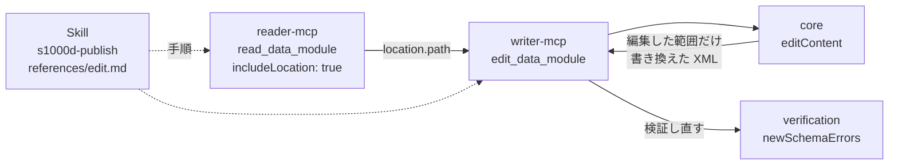

# 実在の TM を使った確認の引き継ぎ（5 回目、2026-11-17 09:05 JST）

次のチャットで続きを始めるための文書です。4 回目の引き継ぎは [tm-eval-handoff-4.md](./tm-eval-handoff-4.md)、作業の記録は [tm-eval-progress.md](./tm-eval-progress.md)、要望の一覧は [tm-eval-requests.md](./tm-eval-requests.md) です。

> [!WARNING]
> 題材から作ったもの（`manual.json`、切り出した図、変換した XML）は社内の確認用です。配布しません。リポジトリにも入れません。公開してよいのは、自分たちの観察だけです。
>
> S1000D の仕様書・スキーマ・公式サンプル（Bike Samples を含む）は再配布できません。リポジトリの `/specs/` は `.gitignore` の対象です。仕様書の文章を、文書やコードに写しません（決まりは自分の言葉で書き、章の番号を添えます）。

## 最初に読むもの

1. この文書
2. [design/core-structural-edit.md](../design/core-structural-edit.md)（既にある DM の構造を変える編集の設計、決定、実測。**「この回の後に直すこと」のとおり、内容が実装より古い箇所があります**）
3. [tm-eval-handoff-3.md](./tm-eval-handoff-3.md) の「作業の仕方」と、4 回目の「作業の仕方（3 回目からの追加）」
4. `skill/s1000d-publish-skill/skills/s1000d-publish/references/edit.md`（`edit_data_module` を使う手順）

## いまの状態（2026-11-17 09:02 JST に確かめた）

hub のほかの 10 のリポジトリは、すべて `origin/main` と一致しています。作業コピーに未コミットの変更はありません。

| リポジトリ | 公開した版 | `main` の先頭 | この回の変更 |
|---|---|---|---|
| s1000d-core | 0.13.0 | `aa4efad` | 0.12.0（読み取りと修正候補）、0.13.0（`editContent` と要素の範囲の関数） |
| experiential-manual-model | 0.4.0 | `4137a87` | なし |
| s1000d-writer-mcp | 0.5.1 | `06e6aae` | 0.4.0（`apply_fixes` の `position`）、0.5.0（`edit_data_module`）、0.5.1（応答の修正と `includeXml`） |
| s1000d-reader-mcp | 0.12.0 | `2b7a041` | 0.11.0・0.11.1（core の更新）、0.12.0（`read_data_module` の `includeLocation`） |
| s1000d-verify-mcp | 0.8.1 | `dd14e6b` | 0.8.0（修正候補の変化）、0.8.1（core の更新） |
| s1000d-brex-mcp | 0.6.4 | `2a2de9f` | 0.6.3・0.6.4（core の更新） |
| s1000d-publish-skill | 0.3.1 | `e4e1ba9` | 0.2.0（作り直す手順をやめる）、0.3.0（`edit_data_module` の手順）、0.3.1（場所の得方の修正） |
| experience-to-s1000d-skill | 0.1.2 | `9eaf48b` | 0.1.2（writer の最低版） |
| s1000d-review-skill | 0.1.1 | `da8b627` | なし |
| s1000d-translate-skill | 0.1.1 | `dcb3486` | なし |
| s1000d-stack（hub） | — | `bfebae8`（この文書のコミットの 1 つ前） | `origin/main` より先に、未 push のコミットがある |

MCP 4 本は、どれも core `^0.13.0` に依存しています。plugin（claude-plugins の台帳）と hub の `stack.json`・README は、上の版に更新済みです。

## 最初にやること

1. **状態を確かめる。** hub と 10 のリポジトリで `git status -sb` と `git log --oneline -1` を見て、上の表と同じかを確かめます。hub に未 push のコミットが残っていれば、署名と push を利用者に頼みます。
2. **「この回の後に直すこと」の文書を直す。** 設計文書の内容を、実装に合わせます。
3. **「決めること」を利用者に確かめる。** 手順の最初の段落に場所が付かない制約の扱いです。
4. **層 2（改版）の設計に進む。** 仕様書の Chap 3.9.5.2.1.1 の Para 2.5〜2.7 を読んでから書きます。

## この回で決まったこと（2026-11-17、利用者の決定）

| 項目 | 内容 |
|---|---|
| 公開の前の確認 | `reconcile_dml` は公開の前に、plugin 経由の verify は公開の後に行う（どちらも済み） |
| 文字列の保ち方 | 構造を変える編集は、元の文字列の編集した範囲だけを書き換える。文書要素の全体を直列化し直さない |
| 最初の版の対象 | 手順（`proceduralStep`）、段落、警告・注意・注記、リストの項目 |
| 節点の置き換え（replace） | 入れない |
| `applyFix`・`applySegments` を同じ方法に寄せるか | `editContent` の後で決める（まだ決めていない） |
| 版と変更の印 | 層を分ける。層 1（`editContent`）は版も変更の印も変えない。層 2（改版）は別の設計文書にする |
| 発行済みの版（`inWork` が `00`） | 利用者が明示したときだけ編集する（`allowReleasedIssue: true`） |
| 編集で XSD のエラーが増えたとき | `write: true` でも書き込まず、増えたエラーを返す |
| Skill の置き場所 | `s1000d-publish` に書く（別の Skill にしない） |
| 版の番号 | core 0.12.0・0.13.0、writer 0.4.0・0.5.0・0.5.1、reader 0.11.0・0.11.1・0.12.0、verify 0.8.0・0.8.1、brex 0.6.3・0.6.4、`s1000d-publish` 0.2.0・0.3.0・0.3.1、`experience-to-s1000d` 0.1.2 |

利用者の決定ではなく、実装で決めたままになっているもの:

| 項目 | いまの動き |
|---|---|
| 取り除いた `id` を、CSDB のほかの DM・PM の `dmRef/@referredFragment` が指しているとき | `edit_data_module` は `referencedFromOtherObjects[]` に返し、書き込まない（`referenced-from-other-objects`）。2 度確かめたが、返事は無かった |

## この回で作ったもの

| 層 | もの | 要点 |
|---|---|---|
| core | `editContent`（`src/edit/`） | insert・remove・move。全部か無しか。文字列を書き換えた結果を読み直し、DOM で同じ操作をした結果と比べる。合わなければ `internal-mismatch` |
| core | `scanElementRanges`・`rangeOfElement`・`rangesMatchDocument`（`src/xml/ranges.ts`） | 要素が元の文字列の中で占める範囲。DOM との対応は、文書要素から数えた子要素の番号で取る |
| writer-mcp | `edit_data_module` | 検証 → `editContent` → 検証し直す → 書き込む。`newSchemaErrors[]`、`referencedFromOtherObjects[]`、`includeXml` |
| reader-mcp | `read_data_module` の `includeLocation` | `true` のときだけ、本文と概要の節点に `location`（`path`・`line`・`column`）が付く |
| Skill | `s1000d-publish` の `references/edit.md` | E1（版を確かめる）〜 E6（書き込んで確かめる）。path と `id` を自分で作らない |

## この回の実測

### Bike Samples（Issue 7）

| 測ったもの | 値 |
|---|---|
| `verify_csdb`（core 0.12.0） | XSD `valid` 110 件、BREX の違反 18 個（10 件）、解決しない参照がある 6 件。3 回目の値と同じ |
| `reconcile_dml` | DML 108 件すべて `found`。DDN 184 件のうち `found` 180、`issue-mismatch` 1、`not-found` 3 |
| 何も変えずに `serializeKeepingProlog` で戻したとき | 110 件のうち、元と同じ文字列になったもの 0 件。91,215 行のうち 26,258 行（29 %）が変わる |
| 要素の範囲が DOM と対応したファイル | 110 件のうち 110 件 |
| 対象の要素を 1 つ取り除く編集 | 文字列と DOM の結果が食い違ったもの 0 件 |
| 最後の手順を 1 つ前の要素の前に移して戻す | 手順 DM 39 件のうち 37 件が元の文字列と同じ。残りの 2 件は、間にあるコメントの位置だけが入れ替わる |
| 最初の手順の後ろに手順を足す | 手順 DM 39 件のすべてで、足した 3 行のほかは元の文字列と同じ |

### vitest（core 0.13.0 を入れた状態）

| リポジトリ | 配布物を使わない | 配布物を使う |
|---|---|---|
| s1000d-core | 316 件（43 件はスキップ） | 359 件のうち 351 件を確かめた（`src/write/schema.test.ts` は、VM に `schema` フォルダーを写し忘れて実行できなかった。1 つ前の実行では通っている） |
| s1000d-writer-mcp | 58 件（2 件はスキップ） | 60 件 |
| s1000d-reader-mcp | 28 件（5 件はスキップ） | 33 件 |
| s1000d-verify-mcp | — | 40 件 |
| s1000d-brex-mcp | — | 26 件 |

### plugin 経由の確認（2026-11-17 09:00 JST）

評価フォルダーの `work/EDIT-1/` に、手順 DM を作業中の版（`001-01`）にして写し、Skill の手順どおりに進めました。

| 手順 | 結果 |
|---|---|
| reader の `includeLocation: true` | 節点に `location.path` が付いた |
| `edit_data_module`（注意を取り除き、2 つ目の手順を 1 つ目の前に移す。`write` なし） | `applied: true`。`refusals`・`newSchemaErrors`・`referencedFromOtherObjects` は空 |
| 同じ編集を `write: true` | `written` にファイルのパス。XSD `valid`、BREX `passed` |
| `verify_data_module` | XSD `valid`。参照は、図のファイルが無いための未解決が 1 つ（編集の前からある） |
| 元のファイルとの `diff` | 2 回の編集を通して、足した手順の 3 行だけが違う |

`work/EDIT-1/` は残してあります。

## この回で見つけて直したこと

| 見つけたこと | 直した場所 |
|---|---|
| `applyFix`・`applySegments` は、要素・属性・文は保つが、文字列は保っていない（開始タグの属性の改行が空白 1 つになる） | 直していない。`editContent` は別の方法にした。2 つの操作を寄せるかは未決定 |
| `editContent` の `insert` が、`content` の先頭に `refs` などがある DM をすべて断っていた（DM の種類を、最初の子要素だけで決めていた） | core 0.13.0 |
| `edit_data_module` が、増えた XSD のエラーへの候補を `fixes[]` に載せ、`apply_fixes` を案内していた | writer-mcp 0.5.1 |
| **reader-mcp が応答から `location` を外していて、`edit_data_module` に渡す場所を得る手段が無かった。** 設計文書、writer-mcp の説明、Skill の手順は、reader の実際の応答を確かめずに書いていた | reader-mcp 0.12.0（`includeLocation`）、`s1000d-publish` 0.3.1 |
| verify-mcp の CHANGELOG の 0.7.2 の日付が「2026-11-06」だった | verify-mcp |
| `git rebase --exec '…' main` は、`main` の上では対象が 0 個になり、署名が付かない | 基準を `origin/main` にする |

> [!IMPORTANT]
> 自作のテスト用の DM だけで確かめたものは、Bike Samples と plugin 経由でも確かめます。この回の不具合 2 つ（`insert` の断り、`location` の欠落）は、どちらも実際のデータと実際の MCP の応答を使って初めて見つかりました。

## 決めること

| # | 項目 | 内容 | 案 |
|---|---|---|---|
| 1 | 手順の最初の段落に場所が付かない | reader は、手順の最初の段落を、子の節点ではなく手順の節点の `text` として返す。この段落には節点が無いので、`includeLocation: true` でも `location` が付かない。その段落だけを取り除く・移すことが、いまはできない | reader が `includeLocation: true` のときに、その段落の場所を親の節点に `textLocation` として添える |
| 2 | 取り除いた `id` をほかの DM が指しているとき | 上の「実装で決めたまま」の項目 | いまの動き（書き込まない）のまま |
| 3 | 層 2 での `move` の変更の印 | `changeType` に移動を表す値は無く、読んだ範囲の仕様書に付け方は書かれていない | 層 2 の設計のときに決める |
| 4 | `applyFix`・`applySegments` を、範囲だけを書き換える方法に寄せるか | 要素の範囲の関数ができたので、差分がどれだけ減るかを測れる | 測ってから決める |

## この回の後に直すこと（文書）

| 文書 | 直すこと |
|---|---|
| `docs/design/core-structural-edit.md` | 「reader の `read_data_module` の応答の `location.path` をそのまま渡せる」という記述を、`includeLocation: true` が要ることに直す。writer-mcp 0.5.1 の変更（`fixes[]` から候補を外す、`includeXml`）、reader-mcp 0.12.0、Skill 0.3.0・0.3.1、plugin 経由の確認の結果、上の「決めること 1」の制約を足す。「次に作るもの」と「writer-mcp の変更はコミットできません」の注記は、済んだので消す。状態を「層 1 は公開済み」に変える |
| `docs/design/skills-and-editor.md` | `s1000d-publish` の節に、`edit_data_module` の手順（`references/edit.md`）を足す。「構造を変える編集の経路は、core に元の XML を保つ操作を足すときに設計する」を、済んだ内容に直す |
| `docs/design/writer-mcp.md`・`docs/design/reader-mcp.md` | `edit_data_module` と `includeLocation` を足す |
| `docs/DECISIONS.md` | D-31 に、構造を変える編集の決定（層を分ける、範囲だけを書き換える、発行済みの版の扱い、XSD のエラーが増えたときの扱い）を足すか、新しい番号にする |
| サイト（`site/`） | writer-mcp・reader-mcp・Skill のページに、新しいツールと引数が載っているかを確かめる（この回は見ていない） |
| `docs/notes/tm-eval-progress.md` | この回の作業を足す |

## 作業の仕方（4 回目からの追加）

| 項目 | 内容 |
|---|---|
| 署名のコマンド | `git rebase --exec 'git commit --amend --no-edit -S' origin/main && git push`。基準は `origin/main`（`main` にすると対象が 0 個になる）。1 コミットなら `git commit --amend --no-edit -S && git push` |
| 署名の有無の確かめ方 | VM では `git log --format=%G?` が使えない（`allowedSignersFile` が無い）。`git cat-file -p <コミット> \| grep -c '^gpgsig'` で確かめる |
| 削除の許可 | 30 分ほどで切れる。切れた状態で `git commit` をすると、コミットはできるが `.git/HEAD.lock` と `.git/objects/*/tmp_obj_*` が残る。コミットの前に取り直す |
| MCP の依存を上げる | `package.json` と `package-lock.json` の core の `version`・`resolved`・`integrity` を、`npm view @shuji-bonji/s1000d-core@<版> dist.tarball dist.integrity` の値に書き換える。core が依存を変えていなければ、ほかの行は変わらない。VM の `/tmp` に写して `npm ci` と vitest で確かめる |
| core の未公開の内容を使う MCP の変更 | core が npm に出るまで、MCP にコミットしない（ビルドが通らなくなる）。パッチを評価フォルダーの `work/` に置き、公開の後に当てる |
| 配布物を使う vitest | VM の `/tmp` に `src`・`schema`・`tests`・`package.json`・`package-lock.json`・`tsconfig.json`・`vitest.config.ts` を写す（`schema` を忘れると `src/write/schema.test.ts` が読み込めない）。`/tmp` の古いフォルダーは持ち主が違って書けないことがあるので、新しい名前で作る |
| 実際の MCP の応答を確かめる | 手順や説明を書く前に、plugin か dev の MCP を呼んで応答の形を見る。core の型だけを根拠にしない |
| MCP の更新が会話に出ないとき | plugin を更新しても、Claude のデスクトップアプリが前のプロセスを使い続けることがある。アプリを起動し直してから、ツールの一覧を取り直す |
| Project の文書の更新 | 既にある文書を置き換えるには、その内容を全部読んでおく必要がある。大きい文書を何度も置き換えると読む量が増えるので、変更をまとめてから 1 度で行う |
| 仕様書の読み方 | VM で `pdftotext -layout` で文章にし、章の見出しを `grep` で探して読む。出力は `/tmp` に置き、終わったら消す |

## 残り

| 順 | 作業 | 待つもの |
|---|---|---|
| 1 | 「この回の後に直すこと」の文書を直す | — |
| 2 | 手順の最初の段落に場所が付かない制約（決めること 1） | 利用者の決定 |
| 3 | 層 2（改版）の設計文書。作業中の版を始める操作（`inWork` を上げる、新しいファイル名で書く、前の版の印を消す）と、変更の印（`changeType`・`changeMark`・`reasonForUpdate`）を付ける指定 | 仕様書の Chap 3.9.5.2.1.1 の Para 2.5〜2.7 を読む。Para 1〜2.4.2 と Chap 3.5 は読んで、設計文書の「版と変更の印の決まり」に書いた |
| 4 | `applyFix`・`applySegments` の差分を測る（決めること 4） | — |
| 5 | 同じ言語のまま文だけを直す経路（`applySegments` を同じ言語で使う）。版と変更の印の扱いを確かめていない | 層 2 の設計 |
| 6 | 対象の節点を広げる（表の行、図、`preliminaryRqmts` の品目、プロセス DM・故障探求 DM の節点） | — |
| R11 の後 | 作らなかった DM への参照（R14）の扱いを決める | 方針の決定 |
| 8 | W-4 → W-5 → RD-2（hotspot） | core に足す形は、XSD の `hotspot` と配布物の実測から決める（D-31） |
| 9 | 仕様書のプロセス DM の章を読んでから W-6。式の文の書き方（`assert` を含む）も見直す | — |
| 10 | M-4〜M-7 と W-9、その後に優先 3 | — |

確かめていないこと:

- `edit_data_module` の `referencedFromOtherObjects` が返る場合を、plugin 経由では呼んでいない（writer-mcp の自作のテストでは通っている）
- Skill の手順どおりに LLM が動くかは、この回の 1 件（作業中の版への remove と move）しか試していない。発行済みの版を渡されたときに利用者に聞くか、`newSchemaErrors` が返ったときに呼び直すかは、Skill では試していない
- reader が読んでいない要素（`globalPropertyRef`、`behavior`、`pubMedia`、`shortExternalPubTitle`、`lru`・`sru` の 2 つ目からの識別子）は、4 回目の引き継ぎのまま

editor と player の 0.3.0 対応は、製品側（`webapps/experiential-manual-editor`）の作業です。この回は触っていません。
