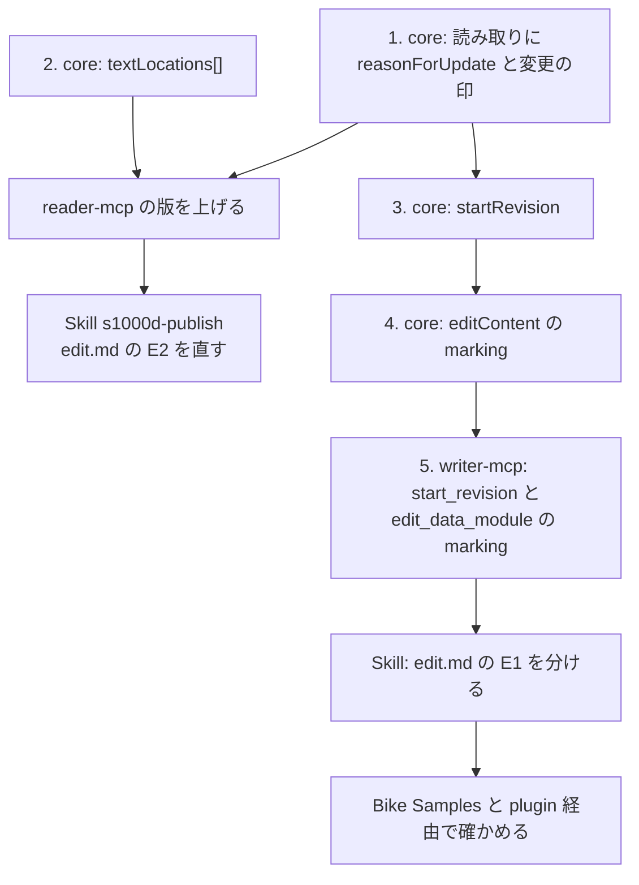

# 実在の TM を使った確認の引き継ぎ（6 回目、2026-11-17 10:10 JST）

次のチャットで続きを始めるための文書です。5 回目の引き継ぎは [tm-eval-handoff-5.md](./tm-eval-handoff-5.md)、作業の記録は [tm-eval-progress.md](./tm-eval-progress.md)、要望の一覧は [tm-eval-requests.md](./tm-eval-requests.md) です。

> [!WARNING]
> 題材から作ったもの（`manual.json`、切り出した図、変換した XML）は社内の確認用です。配布しません。リポジトリにも入れません。公開してよいのは、自分たちの観察だけです。
>
> S1000D の仕様書・スキーマ・公式サンプル（Bike Samples を含む）は再配布できません。リポジトリの `/specs/` は `.gitignore` の対象です。仕様書の文章を、文書やコードに写しません（決まりは自分の言葉で書き、章の番号を添えます）。仕様書のページを画像にしたときは、確かめた後に消します。

## 最初に読むもの

1. この文書
2. [design/core-revision.md](../design/core-revision.md)（層 2（改版）の設計。決定済み、未実装）
3. [design/core-structural-edit.md](../design/core-structural-edit.md) の「手順の段落に場所が付かない」（`textLocations[]` の決定）
4. [DECISIONS.md](../DECISIONS.md) の D-32・D-33
5. [tm-eval-handoff-3.md](./tm-eval-handoff-3.md) の「作業の仕方」と、4 回目・5 回目の「作業の仕方」の追加

## いまの状態（2026-11-17 10:06 JST に確かめた）

この回は、文書だけを変えました。コードと公開した版は、5 回目の引き継ぎの表のままです（core 0.13.0、writer-mcp 0.5.1、reader-mcp 0.12.0、verify-mcp 0.8.1、brex-mcp 0.6.4、`s1000d-publish` 0.3.1）。hub のほかの 10 のリポジトリは、2026-11-17 09:11 JST に `origin/main` と一致していて、その後は触っていません。

| リポジトリ | `main` の先頭 | 状態 |
|---|---|---|
| s1000d-stack（hub） | この文書のコミット | `origin/main` より先に、未 push のコミットが 3 つある（下の表）。どれも署名が無い |

| hub のコミット（署名の前の値） | 内容 | push |
|---|---|---|
| `2a84c6c` | 構造を変える編集の文書を実装に合わせた。層 2 の設計の案。サイト（日本語・英語） | 済み（署名あり） |
| `e858ffe` | 層 2 の設計に、確かめた結果を足した | 未 |
| `de815a5` | D-33 と、設計文書の「決めたこと」 | 未 |
| この文書のコミット | 引き継ぎ（6 回目） | 未 |

署名と push のコマンド（利用者が実行する）:

```
cd /Users/bonji/workspace/shuji-bonji/s1000d-stack
git rebase --exec 'git commit --amend --no-edit -S' origin/main && git push
```

### Project の文書（古いままのものがある）

| 文書 | Project の状態 |
|---|---|
| `docs/design/core-revision.md` | hub と同じ（`de815a5` の内容） |
| `docs/notes/tm-eval-handoff-6.md`（この文書） | hub と同じ |
| `docs/design/core-structural-edit.md` | **古い**（この回の修正の前の内容） |
| `docs/design/skills-and-editor.md` | **古い** |
| `docs/design/writer-mcp.md` | **古い** |
| `docs/design/reader-mcp.md` | **古い** |
| `docs/DECISIONS.md` | **古い**（D-32・D-33 が無い） |
| `docs/notes/tm-eval-progress.md` | **古い** |

古い 6 つは、hub の内容が正しいものです。この回は、会話が長くなったので反映していません。

## 最初にやること

1. **状態を確かめる。** hub で `git status -sb` と `git log --oneline -5` を見ます。未 push のコミットが残っていれば、署名と push を利用者に頼みます。
2. **Project の 6 つの文書を、hub の内容にする。** `device_stage_files` で写し、`Read` で全文を読んでから `project_write` の `local_path` で置き換えます。ただし、手順 3 と 4 で `core-structural-edit.md`・`reader-mcp.md`・`writer-mcp.md`・`skills-and-editor.md` をまた直すので、その 4 つは実装の後に 1 度で反映してかまいません。`DECISIONS.md` と `tm-eval-progress.md` は先に反映できます。
3. **core の読み取りに足す（層 2 の前提）。** 下の「次に作るもの」の 1 と 2 です。core → reader-mcp → Skill の順に進めます。
4. **層 2 を実装する。** 下の「次に作るもの」の 3〜5 です。

## この回で決まったこと（2026-11-17、利用者の決定）

| 時刻（JST） | 項目 | 内容 |
|---|---|---|
| 09:15 ごろ | 手順の段落の場所 | reader は、`includeLocation: true` のときだけ、手順の節点に `textLocations[]` を添える。`text` にまとめた段落ごとの `location`（`path`・`line`・`column`）を、並びの順に入れる。既定の応答は変えない |
| 09:15 ごろ | 取り除いた `id` をほかの DM・PM が指しているとき | いまの動きのまま（`referencedFromOtherObjects[]` に返して書き込まない）。実装で決めていた動きを、決定にした |
| 09:15 ごろ | サイト | この回で直す（済み） |
| 09:56 | 層 2 の R-1〜R-8 | すべて提案どおり（D-33。下の表） |

### 層 2 の決定（D-33）

| # | 決定 |
|---|---|
| R-1 | 作業中の版を始めるとき、`issueType` は入力で必ず受け取る（`changed`・`revised`・`status`）。`001-00` から始めるときだけ、`new` のままにする値も選べる。選んだ結果が既定 BREX に違反することを、応答で知らせる |
| R-2 | 前の版の変更の印は、作業中の版を始めるときに消す（印の属性、`changeInline` のタグ、`reasonForUpdate`）。`changeType="delete"` の要素は取り除く。取り除く要素の `id` を指す参照が残っていれば断る |
| R-3 | 同じ親の中の `move` は、親の要素に `changeType="modify"` を付ける。親が変わる移動は断る（利用者が remove と insert で指定する） |
| R-4 | `updateReasonType` は必須の入力（値を補わない） |
| R-5 | `changeMark` は必須の入力。`reasonForUpdate/@id` は、省略時に core が文書に無い値を作る |
| R-6 | 発行の操作（`inWork` を `00` に戻し、`issueNumber` を上げる）は、層 2 に入れない |
| R-7 | 作業中の版の間、編集のたびに `inWork` を上げない（作業中の版を始めるときの 1 度だけ） |
| R-8 | 表・図の変更の印は、対象の節点を表の行・図に広げるときに扱う |

## この回で分かったこと

| 分かったこと | 確かめ方 | 影響 |
|---|---|---|
| reader は、手順（`proceduralStep`）の直下にある子を持たない段落を、**すべて**手順の節点の `text` にまとめる（最初の段落だけではない） | core の `src/content/read.ts` の `case 'step'`。dev の reader-mcp の応答 | 5 回目の引き継ぎの「最初の段落」は狭すぎた。`textLocation`（1 つ）ではなく `textLocations[]`（配列）にした |
| Bike Samples の `proceduralStep` 340 個のうち、直下の段落（中にリストを持たないもの）が 1 つのものは 312 個、2 つ以上は 11 個（7 件の DM）、0 個は 17 個 | XML を直接数えた | 同上 |
| **仕様書の表と既定 BREX が食い違う。** Chap 3.9.5.1 の Table 3 は `001-01`・`001-NN` の `issueType` を `new` と書く。既定 BREX の BREX-S1-00030 の `objectPath` は、`000-NN` でも `001-00` でもない版の `new` を違反にする | PDF の 421 ページを画像にして目で確かめた。既定 BREX の XML の `objectPath` を読んだ | R-1。core はどちらに合わせるかを決めない |
| Bike Samples の `issueType="new"` の DM 10 件のうち、9 件は `002-00`。仕様書の本文にも BREX-S1-00030 にも合わない | XML を直接数えた | 版の決まりについては、Bike Samples を手本にできない |
| `dmStatus` に `issueType` の属性が無い DM は、BREX-S1-00030 のどちらの条件にも当たらない（評価フォルダーの `work/EDIT-1/` の `001-01` の DM がこの形） | `objectPath` の式から。`EDIT-1` の DM の XML | 属性が無いために条件に当たらないだけで、決まりに合っていることにはならない |
| **reader は、識別・状態部の `reasonForUpdate` と、変更の印の属性（`changeType`・`changeMark`・`reasonForUpdateRefIds`）を返していない。** 返していないことの知らせも無い（`notReadElements` は空）。`issueType` は返す | dev の reader-mcp で、Bike Samples の `…D00-00-00-00AA-040A-A_011-00` を読んだ。core の `src/content/read.ts` を検索した | D-31 の「読む側は落とさない」から漏れている。層 2 の実装の前に足す |
| core の `buildDataModule` は、`dmStatus/@issueType` を書いていない（`src/write/` を検索して 0 件） | 検索 | `issuePolicy` で版を上げた DM が既定 BREX に通るかは、確かめていない |
| Chap 3.9.5.2.1.1 の全体（Para 1〜2.7）に、要素を移したときの印の決まりは無い | 章の全体を読んだ | R-3 |
| 警告・注意の変更の印は、警告・注意の全体に付ける。中の段落には付けない | Chap 3.9.5.2.1.1 Para 2.7 | 層 2 の設計の「警告と注意」 |
| サイトに、`edit_data_module` と `includeLocation` が載っていなかった。writer-mcp のページの「ツールは 6 つ」「読んだ木は、そのまま書き戻せます」、`s1000d-publish` のページの前提 MCP の最低版も古かった | サイトの 8 ページを読んだ | 直した（`2a84c6c`）。`check-i18n.mjs` は通った。`astro build` は実行していない |
| `device_commit_files` で、書き直した直後のファイルを同じ名前で渡すと、書き直す前の内容が Mac に書かれる（この回も 1 度あった） | Mac で `sha256sum` を比べた | 別の名前に写してから渡し直す。4 回目の引き継ぎに書いたとおり |

## 次に作るもの



| 順 | 作るもの | 内容 | 先に確かめること |
|---|---|---|---|
| 1 | core: 読み取りに `reasonForUpdate` と変更の印を足す | `IdentAndStatus` に `reasonForUpdate`（`id`・`updateReasonType`・`updateHighlight`・文）。`ContentNode` と `ContentRef` に、変更の印（`changeType`・`changeMark`・`reasonForUpdateRefIds`）。`changeInline` の扱い | 返す形は、XSD（`changeAttGroup`、`reasonForUpdate`）と Bike Samples の実測（`reasonForUpdate` は 97 件に 124 個、`changeType` は 3 件の `wire`・`electricalEquip`・`graphic`）から決める（D-31）。読み取りの結果が変わるので、reader-mcp の応答も変わる |
| 2 | core: `textLocations[]` | 手順の節点に、`text` にまとめた段落ごとの `location` を足す。reader-mcp は `includeLocation: true` のときだけ応答に入れる | 手順のほかに、子の段落を `text` にまとめている節点があるかを、`src/content/read.ts` で確かめる。`edit_data_module` が、その path の `para` を remove・move できることを、Bike Samples の段落が 2 つ以上ある手順（7 件の DM）で確かめる |
| 3 | core: `startRevision`（仮称） | 設計文書の「操作 1」 | 下の「確かめること」の Chap 3.5 と `descript.xsd` |
| 4 | core: `editContent` の `marking` | 設計文書の「操作 2」 | 開始タグの中の属性を 1 つ足す・取り除く操作を、要素の範囲の関数（`src/xml/ranges.ts`）に足す |
| 5 | writer-mcp: `start_revision`（仮称）と、`edit_data_module` の `marking` | 設計文書の「writer-mcp」 | core が npm に出るまで、writer-mcp にコミットしない（パッチを評価フォルダーの `work/` に置く） |
| 6 | Skill `s1000d-publish` | `references/edit.md` の E2（`textLocations[]`）と E1（発行済みの版のときの 3 つの選択肢） | 手順を書く前に、plugin か dev の MCP を呼んで応答の形を見る |

1 と 2 は、どちらも core の読み取りと reader-mcp の変更なので、1 つの版にまとめられます。

> [!IMPORTANT]
> 自作のテスト用の DM だけで確かめたものは、Bike Samples と plugin 経由でも確かめます。手順や説明を書く前に、実際の MCP の応答の形を見ます。core の型だけを根拠にしません。5 回目の不具合 2 つと、この回の「最初の段落」の誤りは、どれも実際のデータと応答を見て初めて分かりました。

## 確かめること（未読・未測）

設計文書（`core-revision.md`）の「確かめること」と同じです。

| 項目 | 内容 |
|---|---|
| Chap 3.5（データモジュールの更新） | 作業中の版を始めるときに `issueDate` と `qualityAssurance` をどうするか、`delete` の印の要素を次の版でどうするかの記述があるか（R-2 の「`delete` の要素を取り除く」は、読んだ範囲の仕様書に明記が無く、解釈である） |
| 手順の並べ替えの記述 | 手順 DM の章など、Chap 3.9.5.2.1.1 のほかに、移動・並べ替えの印についての記述があるか |
| `descript.xsd` | `levelledPara`・`para` の親になる要素が、変更の印の属性を持てるか（R-3 の「親に `modify`」が説明 DM で使えるか） |
| Bike Samples の `002-00` で `new` の 9 件 | BREX-S1-00030 の違反として `verify_csdb` に出ているか |
| Table 3 と BREX-S1-00030 の食い違い | 仕様書のほかの版（Issue 6 など）の同じ表と既定 BREX に、同じ食い違いがあるか |
| `buildDataModule` と `issueType` | `issuePolicy` で版を上げた DM（`002-00` 以降）が、既定 BREX に通るか |
| サイト | `astro build` が通るか（この回は、VM で動かせないので実行していない） |
| 5 回目から残っているもの | `referencedFromOtherObjects[]` が返る場合を、plugin 経由では呼んでいない。Skill の手順どおりに LLM が動くかは、1 件しか試していない |

## 決めていないこと

| 項目 | 内容 | 案 |
|---|---|---|
| `applyFix`・`applySegments` を、範囲だけを書き換える方法に寄せるか | 要素の範囲の関数ができたので、差分がどれだけ減るかを測れる | 測ってから決める |
| 編集上の変更（`urt01`）に `reasonForUpdate` だけを足す入口 | `marking` は、印を付ける指定である。印を付けない変更に理由だけを足す入口を、別に用意するか | 層 2 の実装のときに決める（R-4 の補足） |
| core の読み取りで、変更の印を返す形 | 上の「次に作るもの」の 1 | XSD と Bike Samples の実測から案を作り、利用者に確かめる |

## 作業の仕方（5 回目からの追加）

| 項目 | 内容 |
|---|---|
| 文書だけの変更 | Mac 側の VM（`device_bash`）で、`python3` の置き換え（置き換える文字列がちょうど 1 か所にあることを `assert` で確かめる）で直せる。クラウド側に clone しなくてよい |
| 仕様書の表を確かめる | PDF から取り出した文章で、表の列の対応が疑わしいときは、`pdftoppm -f <ページ> -l <ページ> -r 80 -png` でページを画像にし、`device_stage_files` で写して `Read` で見る。ページの番号は、`pdftotext -f … -l …` の出力を `\f` で分けて探す。画像は接続したフォルダーに置く必要があるので、評価フォルダーの `work/` に作り、見た後に消す（削除の許可が要る） |
| 仕様書を文章にする | `pdftotext -layout` で全体を文章にするのに、1 分ほどかかる。`/tmp` に置き、読み終わってから消す（同じコマンドの先頭で消さない） |
| Project の文書の置き換え | `project_write` の `local_path` は、そのファイルを `Read` で全部読んだ直後でなければ断られる。`Edit` で直した後も、読み直しが要る。自分で `Write` で書いたファイルは、そのまま渡せる |
| `Edit` | `device_stage_files` で写したファイルは、`Read` で全部読んでいなければ `Edit` できない |
| コミットの前の確認 | `device_commit_files` の直後に `sha256sum` を比べてから `git add` する。この回は、比べる前にコミットして、古い内容のままコミットした（`--amend` で直した） |
| 利用者への確認 | 選択肢が決まっている確認は `AskUserQuestion` で行う。提案には、確かめた事実（数、出どころ）を添える |

## 残り

| 順 | 作業 | 待つもの |
|---|---|---|
| 1 | Project の 6 つの文書を hub の内容にする | — |
| 2 | core の読み取りに、`reasonForUpdate`・変更の印・`textLocations[]` を足す。reader-mcp と Skill を合わせる | 返す形の案を利用者に確かめる |
| 3 | 層 2 の実装（core → writer-mcp → Skill）。Bike Samples と plugin 経由で確かめる | 2 |
| 4 | `applyFix`・`applySegments` の差分を測る | — |
| 5 | 同じ言語のまま文だけを直す経路（`applySegments` を同じ言語で使う）。`changeInline` の扱いを含む | 層 2 の実装 |
| 6 | 対象の節点を広げる（表の行、図、`preliminaryRqmts` の品目、プロセス DM・故障探求 DM の節点）。表・図の変更の印（R-8） | — |
| R11 の後 | 作らなかった DM への参照（R14）の扱いを決める | 方針の決定 |
| 8 | W-4 → W-5 → RD-2（hotspot） | core に足す形は、XSD の `hotspot` と配布物の実測から決める（D-31） |
| 9 | 仕様書のプロセス DM の章を読んでから W-6。式の文の書き方（`assert` を含む）も見直す | — |
| 10 | M-4〜M-7 と W-9、その後に優先 3 | — |

reader が読んでいない要素（`globalPropertyRef`、`behavior`、`pubMedia`、`shortExternalPubTitle`、`lru`・`sru` の 2 つ目からの識別子）は、4 回目の引き継ぎのままです。

評価フォルダーの `work/EDIT-1/` は残してあります。editor と player の 0.3.0 対応は、製品側（`webapps/experiential-manual-editor`）の作業です。この回は触っていません。
