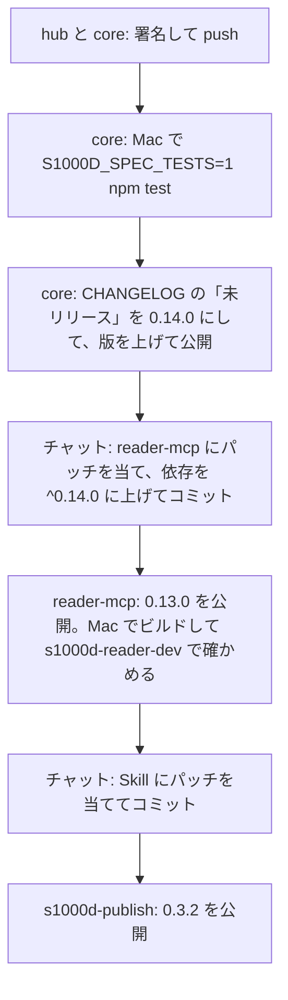

# 実在の TM を使った確認の引き継ぎ（7 回目、2026-11-17 10:55 JST）

次のチャットで続きを始めるための文書です。6 回目の引き継ぎは [tm-eval-handoff-6.md](./tm-eval-handoff-6.md)、作業の記録は [tm-eval-progress.md](./tm-eval-progress.md)、要望の一覧は [tm-eval-requests.md](./tm-eval-requests.md) です。

> [!WARNING]
> 題材から作ったもの（`manual.json`、切り出した図、変換した XML）は社内の確認用です。配布しません。リポジトリにも入れません。公開してよいのは、自分たちの観察だけです。
>
> S1000D の仕様書・スキーマ・公式サンプル（Bike Samples を含む）は再配布できません。リポジトリの `/specs/` は `.gitignore` の対象です。仕様書の文章を、文書やコードに写しません（決まりは自分の言葉で書き、章の番号を添えます）。

## 最初に読むもの

1. この文書
2. [design/core-revision.md](../design/core-revision.md)（層 2（改版）の設計。「読み取りに足したもの」が、この回の結果）
3. [DECISIONS.md](../DECISIONS.md) の D-32・D-33・D-34
4. [tm-eval-handoff-3.md](./tm-eval-handoff-3.md) の「作業の仕方」と、4 回目〜6 回目の「作業の仕方」の追加、この文書の「作業の仕方（6 回目からの追加）」

## いまの状態（2026-11-17 10:55 JST）

公開した版は、5 回目の引き継ぎの表のままです（core 0.13.0、writer-mcp 0.5.1、reader-mcp 0.12.0、verify-mcp 0.8.1、brex-mcp 0.6.4、`s1000d-publish` 0.3.1）。

| リポジトリ | 状態 |
|---|---|
| s1000d-stack（hub） | `origin/main` より先に、未 push のコミットが 2 つある（U-08 の付録を分けたもの、この回の文書）。どちらも署名が無い。6 回目の 3 つのコミットは、利用者が署名して push 済み（`ba4caf0` まで） |
| s1000d-core | `origin/main` より先に、未 push のコミットが 1 つある（署名の前の値は `270a1fc`。読み取りに、更新の理由・変更の印・手順の段落の場所を足した）。署名が無い。npm に未公開 |
| s1000d-reader-mcp | 変更なし。パッチが評価フォルダーの `work/reader-mcp-change-marks.patch` にある |
| s1000d-publish-skill | 変更なし。パッチが評価フォルダーの `work/s1000d-publish-skill-textlocations.patch` にある |

評価フォルダーは `/Users/bonji/s1000d-stack-eval/tm-9-6115-749-10/` です。`work/core-read-change.patch` は、core のコミットと同じ内容です（消してかまいません）。

### 利用者が行うこと（この順）



署名と push のコマンド（hub と core で同じ）:

```
cd /Users/bonji/workspace/shuji-bonji/s1000d-stack
git rebase --exec 'git commit --amend --no-edit -S' origin/main && git push

cd /Users/bonji/workspace/shuji-bonji/s1000d-stack/lib/s1000d-core
git rebase --exec 'git commit --amend --no-edit -S' origin/main && git push
```

verify-mcp・brex-mcp・writer-mcp は、core 0.14.0 で動きが変わりません。依存を上げるかどうかは、層 2 の実装（core 0.15.0 の見込み）とまとめてもかまいません。

### Project の文書

| 文書 | Project の状態 |
|---|---|
| `docs/notes/tm-eval-handoff-7.md`（この文書） | hub と同じ |
| `docs/notes/u08-xsd-validation.md` | hub と同じ（この回に作った） |
| `docs/DECISIONS.md` | hub と同じ（D-34 まで）。違いは 1 か所で、D-34 の決定の時刻が Project では「10:33 JST ごろ」のまま（hub は「10:40 JST ごろ」に直した） |
| `docs/design/core-revision.md` | hub と同じ（「読み取りに足したもの」まで）。違いは、同じ時刻の 1 か所 |
| `docs/notes/tm-eval-progress.md` | **古い**（6 回目の終わりの内容。この回の節が無い） |
| `docs/design/core-structural-edit.md` | **古い**（6 回目の修正の前の内容） |
| `docs/design/reader-mcp.md` | **古い**（同上） |
| `docs/design/writer-mcp.md` | **古い**（同上） |
| `docs/design/skills-and-editor.md` | **古い**（同上） |

古い 5 つは、hub の内容が正しいものです。`tm-eval-progress.md` は、1 度反映した後に、この回の節を足しました。会話が長くなったので、2 度目は反映していません。

## 最初にやること

1. **状態を確かめる。** hub と core で `git status -sb` と `git log --oneline -5` を見ます。未 push のコミットが残っていれば、署名と push を利用者に頼みます。core が npm に 0.14.0 として出ているかを `npm view @shuji-bonji/s1000d-core version` で見ます。
2. **Project の 5 つの文書を、hub の内容にする。** 下の「作業の仕方」の「Project の文書の置き換え」のとおり、1 つずつ行います。`core-structural-edit.md`・`reader-mcp.md`・`writer-mcp.md`・`skills-and-editor.md` は、層 2 の実装でまた直すので、実装の後に 1 度で反映してかまいません。`tm-eval-progress.md` は先に反映できます。
3. **core が公開済みなら、reader-mcp と Skill にパッチを当てる。** reader-mcp は `package.json` と `package-lock.json` の core を 0.14.0 にしてからコミットします。公開の後に、`s1000d-reader-dev` か plugin 経由で `read_data_module` を呼び、`textLocations`・`change`・`content.changeMarks`・`identAndStatus.reasonForUpdates` が返ることを見ます。
4. **層 2 を実装する。** 6 回目の引き継ぎの「次に作るもの」の 3〜5（core の `startRevision`、`editContent` の `marking`、writer-mcp）と 6 の残り（Skill の E1）です。先に、6 回目の「確かめること（未読・未測）」の Chap 3.5 と `descript.xsd` を読みます。

## この回で決まったこと（2026-11-17、利用者の決定）

| 時刻（JST） | 項目 | 内容 |
|---|---|---|
| 10:40 ごろ | 変更の印を返す形 | 節点・参照の `change` と、DM 全体の一覧 `changeMarks[]` の両方に返す（D-34） |
| 10:40 ごろ | `textLocations[]` の範囲 | 手順だけ。リストの項目には付けない |
| 10:40 ごろ | `DECISIONS.md` | U-08 の判断材料と比較結果を `docs/notes/u08-xsd-validation.md` に分ける |

## この回で分かったこと

| 分かったこと | 確かめ方 | 影響 |
|---|---|---|
| Bike Samples で変更の印を持つ要素は 14 個で、12 個は本文を構造化して読まない `wrngdata` の DM にある（`wire` 10・`electricalEquip` 2）。残りは `descript` の DM 1 件の `graphic` 2 個 | XML を直接数えた | 節点だけに印を返す形では足りない。一覧 `changeMarks[]` を足した |
| 利用者に形を確かめたときの問いに「13 個」と書いたが、正しくは 14 個 | 同上 | 選択肢の内容には影響しない。文書は 14 個で書いた |
| 印の 3 つの属性は、`proced.xsd` の 233 の型のうち 136 が持てる。`title`・`row`・`changeInline` など、節点にならない要素も含む | Issue 7 の XSD で `changeAttGroup` の参照を数えた | 同上 |
| 段落が 1 つだけの `listItem` も、その段落を `text` にまとめる（Bike Samples で 729 個のうち 728 個） | `src/content/read.ts` の `case 'listItem'`。XML を直接数えた | `textLocations` は付けないと決まった |
| `text` にまとめた `para` 自身の `id`・`applicRefId` は、いまも応答に無い。Bike Samples では、この形の `para` に属性を持つものは 0 個 | XML を直接数えた | 未着手。D-31 の「読む側は落とさない」に当たる |
| PM の `pmStatus/reasonForUpdate` は読んでいない。Bike Samples の PMC 4 件には無い | core の `readIdentAndStatus` は `dmodule` だけを読む。XML を直接数えた | 未着手 |
| Mac 側の VM で、配布物を使う vitest を実行できる | `/tmp` に作業コピーを作り、`npm ci --cache /tmp/npm-cache`、`TMPDIR=/tmp ./node_modules/.bin/vitest --run` | 5 回目までの「VM では vitest が起動しない」は、Mac の `node_modules` をそのまま使ったときの話 |
| `DECISIONS.md` は 25,572 トークンで、`Read` の上限（25,000）を超えていた | `Read` のエラー | 付録を分けた。D-34 を足した後は 60,726 バイトで、1 度の `Read` で読めた。あと 2,000 バイトほど増えると、また超える見込み。次に決定を足すときは、古い決定の経過を別の文書に分ける |

## 決めていないこと

6 回目の「決めていないこと」の 3 つのうち、「core の読み取りで、変更の印を返す形」は決まりました（D-34）。残りは 2 つです（`applyFix`・`applySegments` を範囲だけを書き換える方法に寄せるか、`urt01` に `reasonForUpdate` だけを足す入口）。この回で増えたものは次のとおりです。

| 項目 | 内容 | 案 |
|---|---|---|
| `text` にまとめた `para` の `id`・`applicRefId` | 手順と `listItem` で、まとめた段落の属性が応答に無い | `textLocations[]` を、場所だけでなく `id`・`applicRefId` も持つ形に広げるか、属性を持つ段落はまとめずに子の節点として残す。応答の形が変わるので、利用者に確かめる |
| PM の `reasonForUpdate` | `pmStatus` の下を読んでいない | reader-mcp の `read_publication_module` の識別・状態部に足す |
| Skill `s1000d-review` | 変更の印と更新の理由が読めるようになったので、レビューの観点に入れるか | 層 2 の後に決める |

## 作業の仕方（6 回目からの追加）

| 項目 | 内容 |
|---|---|
| Project の文書の置き換え | 既にある文書を `local_path` で置き換えるには、(1) その会話で `project_read` をして、(2) 写したファイルを `Read` で 1 度に全部読み、(3) 直後に `project_write` をする。`Read` を 2 回に分けて読んだものは通らない。25,000 トークンを超えるファイルは、この方法では置き換えられない。1 つの文書に、文書 2 つ分の量が会話に入るので、大きい文書は 1 回のチャットで 2〜3 個までにする |
| 新しい文書 | クラウド側で `Write` で書いたファイルは、`Read` なしで `project_write` に渡せる。同じファイルを `device_commit_files` で Mac に写す |
| git のコミット | Mac 側の VM には git の利用者名が無い。`git -c user.name="$(git log -1 --format=%an)" -c user.email="$(git log -1 --format=%ae)" -c commit.gpgsign=false commit …` で、前のコミットと同じ名前にする。接続したフォルダーでの削除の許可（`device_request_delete_permission`）が無いと、git がロックファイルを消せない |
| コードの変更 | クラウド側に GitHub から clone して直し、vitest を通す。差分を `/mnt/user-data/outputs/` にパッチとして書き、`device_commit_files` で評価フォルダーの `work/` に写し、Mac 側で `git apply` する。`sha256sum` を両側で比べる |
| 配布物を使うテスト | 上の「この回で分かったこと」の VM での実行の仕方。core を直したら、`/tmp` の作業コピーで `S1000D_SPEC_TESTS=1 S1000D_SPEC_DIR=$HOME/mnt/s1000d-stack/specs/s1000d/issue-7` を付けて実行する |
| MCP の応答を見る | 公開の前でも、`/tmp` にビルドした MCP を `node dist/index.js` で起動し、stdio に JSON-RPC（`initialize` → `tools/call`）を書けば、実際の応答を見られる |
| 利用者への確認 | 数を書くときは、数えた結果を写す。この回は、14 個を 13 個と書いた。時刻は、見当で書かずに `date` で確かめる。この回は、決定の時刻を 10:33 ごろと書き、後で 10:40 ごろに直した（Project に反映した後だった） |

## 残り

| 順 | 作業 | 待つもの |
|---|---|---|
| 1 | Project の 5 つの文書を hub の内容にする | — |
| 2 | reader-mcp と Skill にパッチを当てて公開する。公開版で応答を確かめる | core 0.14.0 の公開（利用者） |
| 3 | 層 2 の実装（core → writer-mcp → Skill）。Bike Samples と plugin 経由で確かめる | 仕様書の Chap 3.5 と `descript.xsd` の確認 |
| 4 | `applyFix`・`applySegments` の差分を測る | — |
| 5 | 同じ言語のまま文だけを直す経路。`changeInline` の扱いを含む | 層 2 の実装 |
| 6 | 対象の節点を広げる（表の行、図、`preliminaryRqmts` の品目、プロセス DM・故障探求 DM の節点）。表・図の変更の印（R-8） | — |
| 7 | `text` にまとめた `para` の `id`・`applicRefId`、PM の `reasonForUpdate` | 形を利用者に確かめる |
| R11 の後 | 作らなかった DM への参照（R14）の扱いを決める | 方針の決定 |
| 8 以降 | 6 回目の引き継ぎの「残り」の 8〜10 と同じ | — |

評価フォルダーの `work/EDIT-1/` は残してあります。editor と player の 0.3.0 対応は、製品側（`webapps/experiential-manual-editor`）の作業です。この回は触っていません。
