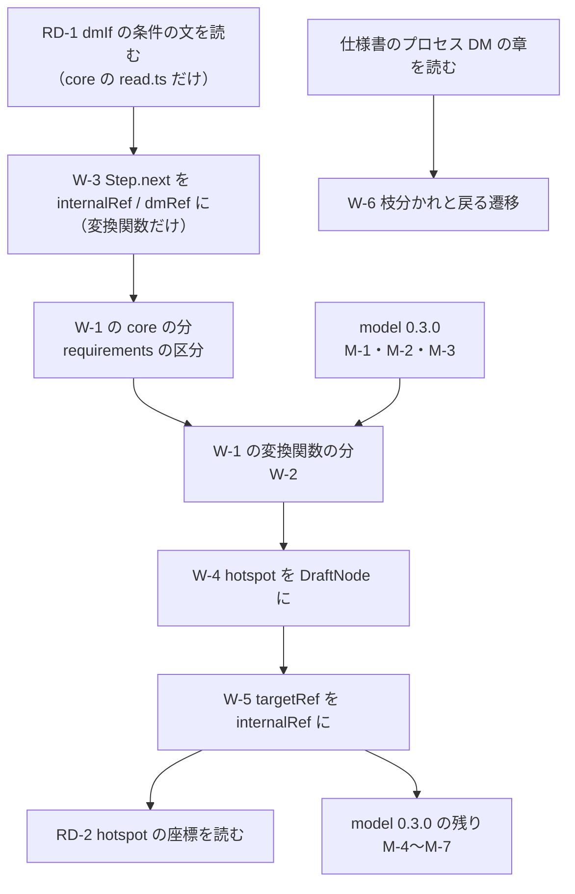

# 実在の TM を使った確認から出た要望の一覧（2026-11-15）

TM 9-6115-749-10 を体験型マニュアルに写し、S1000D に変換して読み戻した結果（[tm-eval-handoff.md](./tm-eval-handoff.md) と、評価フォルダーの `NOTES.md`）を、直す場所ごとに振り分けて優先順を付けた一覧です。引き継ぎメモの「次にやること」の 1 にあたります。

- 作成日: 2026-11-15（JST）。同日 07:01 JST に、優先の基準・M-1 の形・W-6 の扱いを利用者が決定（末尾の「決まったこと」）
- 元の記録: `/Users/bonji/s1000d-stack-eval/tm-9-6115-749-10/NOTES.md`
- 対象の版: experiential-manual-model 0.2.0、s1000d-core 0.8.3、S1000D Issue 7 の XSD
- 進み具合: [tm-eval-progress.md](./tm-eval-progress.md)。この一覧は振り分けたときの内容で、その後に変わった点は「その後に変わった点」にまとめています

> [!NOTE]
> この一覧は自分たちの観察だけを書いています。題材の本文・図は含みません。

## その後に変わった点（2026-11-15 13:20 JST 頃まで）

| 要望 | 変わった点 |
|---|---|
| RD-1、W-3 | 済み（core `d69a6f8`、writer-mcp `4ad1e08`） |
| M-1・M-2・M-3 | 済み（model `e0ca740`）。M-2 は `Topic.admonitions` を足さず、`prerequisites.safety` の 1 か所にした（[design/manual-model-0.3.0.md](../design/manual-model-0.3.0.md) の決定 1） |
| W-1 の core の分 | 済み（core `118fd99`〜`830de9f`）。形は model の区分からではなく XSD から決め直した（D-31、[design/core-preliminary-rqmts.md](../design/core-preliminary-rqmts.md)） |
| W-3 の補足 | 「`dmRef` は DM の中の手順を指せない」としていたが、`dmRef/@referredFragment` で指せる。core は読み書きできるようになり（`830de9f`）、writer-mcp の変換関数も使うようになった（`1a3027c`） |
| W-1 の変換関数の分、W-2 | 済み（writer-mcp `1a3027c`）。見本を model 0.3.0 の形に書き直して変換し直し、R1 と R2 が消えたことを XML で確かめた |
| W-10（新規） | 見本の書き直しで見つかった。下の「core / writer への要望」に足した。`reqSupplies` は `noSupplies` か品目 1 件以上のどちらかしか書けないので、「`noSupplies` と書かない」ことはできない。識別子か数量の無い品目がある Topic の DM を作らないことにした（利用者の決定、writer-mcp `601e53e`）。品目番号だけの材料の書き方は残っている |
| 全体の方針 | s1000d-core は S1000D の構造を出発点にし、experiential-manual-model の都合で形を決めない（D-31）。下の「core / writer への要望」のうち core に足すものは、XSD と配布物の実測から形を決める |

## 材料と振り分け先

| 材料 | 件数 | この一覧での呼び方 |
|---|---|---|
| model で表せず、別の形で書いたもの | 15 件 | `#1`〜`#15`（NOTES.md の表の番号） |
| writer が DM に入れなかったもの（`convert_manual` の応答の `notRepresented`） | 9 種類、112 件 | `what` の文と件数 |
| reader で読んで分かったもの | 7 行（R1〜R7） | `R1`〜`R7` |

R5 と R7 は NOTES.md で「問題なし」としているので、要望にはしていません。R6 は `notRepresented` の「Step.next on a troubleshooting step」1 件と同じものです。引き継ぎメモは reader の材料を「4 件（R1〜R4）」と書いていますが、NOTES.md には R7 まであります。

振り分け先は 3 つです。

| 記号 | 振り分け先 | 直す場所 |
|---|---|---|
| M | model 0.3.0 への要望 | `lib/experiential-manual-model`（型、JSON Schema、`validateManual`） |
| W | core / writer への要望 | `lib/s1000d-core` の `src/write/`（`DraftNode`、`buildContent`）と、`mcp/s1000d-writer-mcp` の `src/convert/manual-to-draft.ts` |
| RD | reader への要望 | `lib/s1000d-core` の `src/content/read.ts`（reader-mcp はこれを呼ぶ） |

## 優先の付け方

| 優先 | 基準 |
|---|---|
| 1 | 安全に関わる内容が手順 DM から欠ける。または、DM を読んだ人が文を誤って読む |
| 2 | 体験型マニュアルで操作できていたこと（押す場所、行き先）が DM に入らない |
| 3 | 文や表に直せば読める。または件数が少ない |
| 保留 | S1000D の側でどう表すかを決めていない。仕様書を読んでから決める |

## 振り分ける前に確かめたこと

推測で振り分けないよう、次の 5 点を実物で確かめました（2026-11-15 07:00 JST 頃）。

| 確かめたこと | 結果 | 影響する要望 |
|---|---|---|
| R3 で、writer が条件の文を XML のどこに書いたか（NOTES.md では未確認） | `csdb/DMC-AMMPS5KW-A-10-20-00-03A-130A-D_000-02_JA-JP.XML` の `dmIf/expression/@humanReadableForm` に「[◄ Previous] と [Next ►] を同時に 2 秒押したとき」が入っている。core の `read.ts` は `dmIf` で `applicRefId` しか読んでいない | R3 は reader だけの不足（RD-1） |
| core の `DraftNode` の `requirements` が受け取るもの | 条件の文だけ（`reqCondGroup`）。`reqSupportEquips`・`reqSupplies`・`reqSpares`・`reqSafety` は、入力に関係なく `noSupportEquips`・`noSupplies`・`noSpares`・`noSafety` を書く（`src/write/content/common.ts`） | R2 は model だけでなく core にも不足がある（W-1） |
| Issue 7 の `proced.xsd` の `preliminaryRqmts` の子要素 | `reqCondGroup`・`reqPersons`・`reqTechInfoGroup`・`reqSupportEquips`・`reqSupplies`・`reqSpares`・`reqSafety`。`reqSafety` の下の `safetyRqmts` は `warningRefs`・`cautionRefs` の属性を持つ | M-1、W-1 |
| `hotspot` 要素の属性と子要素 | 属性に `objectCoordinates`・`applicationStructureIdent`・`applicationStructureName`・`hotspotTitle`・`objectDescr`・`hotspotType`、子要素に `internalRef`・`dmRef`・`hotspot` | M-3、W-4、W-5 |
| `process.xsd` の分岐の要素 | `dmIf` の子に `dmThenSeq` と `dmElseSeq`、`dmSeq` の子に `dmIf`・`dmLoop`・`dmNode`・`dmNodeAlts`・`dmSeqAlts`。いまの writer が書くのは `dmIf` と `dmThenSeq` だけ | W-6 |

`DraftRef` には `internalRef` と `dmRef` が既にあります。`Step.next` が DM に入らないのは、変換関数がそれを使っていないためです（W-3）。

## model 0.3.0 への要望

| ID | 優先 | 要望 | 材料 | 補足 |
|---|---|---|---|---|
| M-1 | 1 | 手順と困ったときの Topic に、作業前の要件を置く場所を足す。区分は XSD と同じ 7 つ（条件、人員、参照する文書、試験器材・工具、材料、予備品、安全） | `#1`、R2 | 受ける側の `preliminaryRqmts` に 7 つの区分がある。フィールド名に S1000D の語は使わない（D-01） |
| M-2 | 1 | Topic 全体にかかる警告・注意（`Topic.admonitions`）を足す。player は手順の画面の先頭に出す | `#2`、R2 | いまは別の説明 Topic に置いていて、手順の画面に出ない |
| M-3 | 1 | Hotspot に、名前（`label`）とは別に説明を置く場所と、図の引き出し線の番号を置く場所を足す | R1、`#10`、`#9` の一部 | 受ける側の `hotspot` に `hotspotTitle` と `objectDescr` がある |
| M-4 | 2 | Step と Block の文の中から、Topic・Screen・Step・表・図を指す参照を足す | `#4`、`#3` | 押すと移動できるようにする。W-9 と組になる |
| M-5 | 2 | 1 つの Step から複数の操作対象を指せるようにする。図の中の場所（Hotspot）も指せるようにする | `#6`、`#15` | いまの `Step.targetRef` は 1 つ、`Step.assetRefs` は素材全体 |
| M-6 | 2 | 遷移の行き先に Topic を指定でき、呼んだ先が終わったら元の Step に戻れるようにする | `#11` | `validateManual` は Topic の id を「not a screen or step id」として断る |
| M-7 | 2 | 困ったときの Topic に、原因の名前を置く場所と、対処の中に順序のある手順を並べる場所を足す | `#12` | `fault.xsd` に `isolatedFault`・`faultDescr`・`locateAndRepair` がある。使い方は未検討 |
| M-8 | 3 | Step の中に表を置けるようにする。Step の外（手順と手順の間）に注意を置けるようにする | `#3`、`#5` | `proceduralStep` の中に表を置けるかは、XSD の group をたどっていないので未確認 |
| M-9 | 3 | 表の行ごとに適用範囲（`scopeRefs`）を付けられるようにする | `#14` | 件数は 1 |
| M-10 | 3 | 複数の Hotspot を同時に押す操作と、長押しを表せるようにする | `#7` | R3 の条件の元になった操作 |
| M-11 | 3 | 時間が経つと起きる遷移を表せるようにする | `#8` | |
| M-12 | 3 | 同じ画面で表示だけが変わる状態を表せるようにする | `#9` | 画面を状態ごとに分ければ今でも書ける |
| M-13 | 3 | 並びの「次」（次の症状、次の不具合）を指す遷移を足す | `#13` | id を直接書けば今でも書ける |

## core / writer への要望

| ID | 優先 | 要望 | 材料 | 直す場所 | 待つもの |
|---|---|---|---|---|---|
| W-1 | 1 | `DraftNode` の `requirements` で、安全・支援器材・補給品・予備品・人員・参照する文書を受け取り、`preliminaryRqmts` の該当する要素に書く。`convert_manual` は M-1・M-2 から写す | R2 | core、変換関数 | core の分は待たずに始められる（`build_data_module` だけでも使える）。変換関数は M-1・M-2 |
| W-2 | 1 | 画面の手順の文を Hotspot の名前だけから作り、説明は別の文にする | R1 | 変換関数 | M-3。見本の `label` を名前だけにすれば今でも避けられる（引き継ぎメモ「次にやること」の 2） |
| W-3 | 2 | `Step.next` と、対処から別の手順への行き先を、同じ DM なら `internalRef`、別の DM なら `dmRef` として書く | `Step.next` 4 件、`Step.next on a troubleshooting step` 1 件、R6 | 変換関数だけ | 無し |
| W-4 | 2 | `DraftNode` で図の下に hotspot（形、座標、`applicationStructureIdent`、名前）を受け取り、`convert_manual` は Hotspot を写す | `Hotspot shape and coords` 76 件 | core、変換関数 | 無し。`objectCoordinates` の書式は仕様書で確かめる |
| W-5 | 2 | `Step.targetRef` を、W-4 で書いた hotspot への `internalRef` にする | `Step.targetRef` 11 件 | 変換関数 | W-4 |
| W-9 | 2 | 参照を文の中の位置に置く | `#4` | core（`DraftNode` のインライン要素） | M-4。いまの `DraftRef` は `text` の後ろに並ぶ。インライン要素は writer-mcp.md「確定が要ること」で未実装 |
| W-6 | 保留 | プロセス DM で、枝分かれ、通った画面へ戻る遷移、別の Topic の画面への遷移を表す | R4、`a transition back to a screen already in the flow` 6 件、`transition to something that is not a screen of this topic` 2 件 | core、変換関数 | 仕様書のプロセス DM の章を読み、`dmElseSeq`・`dmLoop`・`dmNodeAlts` のどれを使うかを決める |
| W-10 | 1 | 識別子か数量が無くて品目を落としたときに、その区分が `noSupplies`・`noSupportEquips`・`noSpares` になる DM を出力しない（DM が「要らない」と読めてしまう）。品目番号だけで示された材料の書き方を決める | `prerequisites item without manufacturerCode or quantity` 12 件（R8） | 変換関数。書き方によっては core | XSD と仕様書で、識別子・数量の無い品目の書き方を確かめる |
| W-7 | 3 | Topic より下の適用範囲を書く（`applicRefId` が指す `applic` の置き場所を core に足す） | `scopeRefs on a block, step or screen below the topic` 2 件 | core、変換関数 | 無し |
| W-8 | 3 | 説明以外の Topic の `summary` と、`Manual.description` の置き場所を決める | `Topic.summary of a non-description topic` 9 件、`Manual.description` 1 件 | 変換関数 | 無し |

`notRepresented` の 112 件は、W-3（5）・W-4（76）・W-5（11）・W-6（8）・W-7（2）・W-8（10）ですべて割り当て済みです。

## reader への要望

| ID | 優先 | 要望 | 材料 | 補足 |
|---|---|---|---|---|
| RD-1 | 1 | プロセス DM の `dmIf` で、`expression/@humanReadableForm` を条件の文として返す | R3 | reader-mcp.md は `flow` の `condition`（displayText）を返す設計。いまは `expression` と `variableRef` が `unknown` になる |
| RD-2 | 2 | 図の `hotspot` の座標と名前を返す | W-4 の後に確かめる | reader-mcp.md は `applicationStructureIdent` と `id` を返すと書いている。座標は書いていない |
| RD-3 | — | 残りの DM 21 件と PM を読むと、要望が増える可能性がある | 引き継ぎメモ「次にやること」の 3 | 説明 DM と PM はまだ 1 件も読んでいない |

R2 について、reader は XML に書かれた `noSafety` などをそのまま「none」と返しています。reader の不足ではありません。

## 振り分け先が決まらないもの

R1 と R2 は、XSD・BREX・参照のどれにも掛からずに通りました。`reqSafety` が `noSafety` の手順 DM を `verify_data_module` の `manualChecks`（人の確認が要る項目）に出すかどうかは、verify が「意味を解釈しない」と決めていること（D-19）に関わるので、要望にはせず検討事項として残します。

## 進める順

| 順 | 作業 | 理由 |
|---|---|---|
| 1 | RD-1 | core の 1 か所で済み、他を待たない。R3 が消える |
| 2 | W-3 | 変換関数だけで済み、model を変えない。`notRepresented` が 5 件減り、R6 が消える |
| 3 | W-1 の core の分と、model 0.3.0 の M-1・M-2・M-3 の設計 | 優先 1 の残り。model と core は並行して進められる |
| 4 | W-1 の変換関数の分、W-2 | R1 と R2 が消える |
| 5 | W-4 → W-5 → RD-2 | `notRepresented` が 87 件減る |
| 6 | 仕様書のプロセス DM の章を読んでから W-6 | R4 と 8 件 |
| 7 | M-4〜M-7 と W-9、その後に優先 3 | |

順 1 と順 2 を済ませた後に変換し直すと、残りの DM を reader で読む（RD-3）ときに、既に分かっている不足が結果に混ざりません。

## 決まったこと（2026-11-15 07:01 JST、利用者の決定）

| 項目 | 決定 |
|---|---|
| 優先の基準 | 上の 4 段階と「進める順」のとおり。安全に関わる欠落（R2）を、件数の多い hotspot（76 件）より先にする |
| M-1 の形 | 作業前の要件は XSD と同じ 7 つの区分で持つ |
| W-6 の扱い | 仕様書のプロセス DM の章を読むまで保留 |
