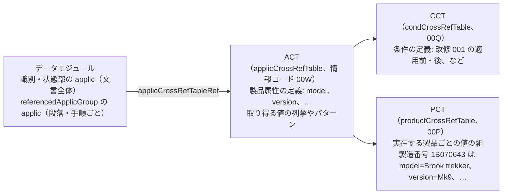
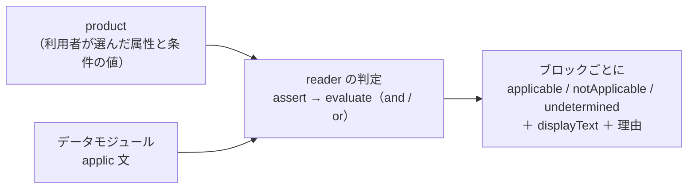

S1000D のデータモジュールは、1 つの文書で複数の機種・構成を扱えるように作られています。「この段落は MV-60 だけ」「この手順は改修 001 を適用した後の機体だけ」のような条件を **適用性（applicability）** と呼び、文書の中に機械が読める形で書きます。LLM がマニュアルを読んで答えるとき、利用者の製品に当てはまらない段落を混ぜて答えてしまわないために、この仕組みを押さえておく必要があります。

## 3 つの表と applic 文

| 要素 | 内容 |
| --- | --- |
| ACT の `productAttribute` | 属性の id（`model` など）、人が読む名前、取り得る値（`enumeration` の列挙や `valuePattern` の正規表現）。`productIdentifier="primary"` が付いた属性（製造番号など）が製品を識別します |
| CCT の `condType` / `cond` | 条件の種類（改修の適用状況、など）と個々の条件。値の書き方は `condType` の列挙で決まります |
| PCT の `product` | 実在する製品 1 つ分の値の組。`assign` が属性・条件ごとに値を割り当てます。利用者が「自分の製品」を選ぶときの出発点になります |
| `applic` | 条件の文。`displayText`（人が読む文）と、`assert`（1 つの属性・条件に対する「この値のどれか」）を `evaluate`（and / or）で結んだ式を持ちます。識別・状態部の `applic` は文書全体の適用範囲、`referencedApplicGroup` の `applic` は要素が `applicRefId` で指す個別の適用範囲です |

`assert` の値（`applicPropertyValues`）の書き方は 3 通りで、BREX の許可値と同じです。

| 書き方 | 例 | 意味 |
| --- | --- | --- |
| 単一値 | `Mk9` | その値と一致 |
| `\|` 区切り | `Mk1\|Mk9` | どれか 1 つと一致 |
| `~` の範囲 | `1~3`、`POST-001~POST-999` | 共通の接頭辞＋数字の範囲に入る |

## LLM に式を渡さない

`assert` と `evaluate` の式を LLM に見せて「この製品に当てはまるか」を判断させると、`and` と `or` の入れ子や範囲の書式を読み違えることがあります。このスタックでは、判定は `s1000d-reader-mcp` が行い、LLM には結果だけを渡します。

判定は 3 値です。

| 状態 | 意味 | LLM の読み方 |
| --- | --- | --- |
| `applicable` | 渡した製品に当てはまる | そのまま使う |
| `notApplicable` | 当てはまらない | 答えに混ぜない。`omitNotApplicable` で本文から省ける |
| `undetermined` | 判定できない。`reason` に「製品に `type` の値が無い」「`product` が渡されていない」などの理由 | 「当てはまらない」と読まない。足りない値を利用者に聞く |

`and` は 1 つでも偽があれば偽、`or` は 1 つでも真があれば真と確定します。確定した枝で足りなかった値は理由に含めません。要素の判定は、その要素（または最も近い祖先）の `applicRefId` が指す `applic` と、文書全体の `applic` を and で結んだものです。

## 製品の値をどう決めるか

`s1000d-reader-mcp` の `describe_applicability` が、対象データモジュールの ACT・CCT・PCT を CSDB から探して、使える属性と値、PCT に登録された製品、文書の中の `applic` 文の一覧を返します。LLM はこれを見て利用者に「どの機種ですか」と聞き、答えを `product` として `read_data_module` に渡します。

PCT に登録された製品をそのまま渡すこともできますが、PCT が値を割り当てていない属性があると、その属性を使う文は `undetermined` のままになります。`describe_applicability` はそのような属性を `propertiesNotAssignedInPct` として一覧にするので、不足分を補ってください。

:::note[公式サンプルで分かったこと]
Issue 7 の Bike Samples では、ACT が属性 `type` を定義し 110 件の `assert` が使っているのに、PCT の 3 製品はどれも `type` に値を割り当てていません。PCT の製品で判定すると、要素の `applic` 366 件のうち 310〜324 件が「製品に `type` の値が無い」理由で `undetermined` になります。判定の仕組みは正しく動いており、理由が 1 種類に集約されることで、補うべき値がはっきりします。また、PCT の条件値 `Pre` / `Post` は CCT の列挙 `PRE` / `POST-001~POST-999` と大文字小文字も書式も合いません。値の比較は完全一致のままにしてあり、配布物側の不整合がそのまま見えます。
:::

## 別のデータモジュールにある適用性文

`referencedApplicGroupRef/applicRef` は、`applicIdentValue` で別のデータモジュール（適用性リポジトリ）にある `applic` 文を指す書き方です。reader は CSDB の中から `applic/@applicIdentValue` を持つデータモジュールを集めて解決します。Bike Samples には指す先が入っていないため、該当する 64 件は「リポジトリに無い」理由で `undetermined` になります。

## このスタックでの実装

判定の論理は共有ライブラリ `s1000d-core` の `ApplicEvaluator` にあり、`s1000d-reader-mcp` と段階 3 の `s1000d-writer-mcp`（出力時に適用性を付ける）が同じものを使います。ACT・CCT・PCT の読み取り（`readAct` / `readCct` / `readPct`）、PCT の 1 行から製品を作る `productFromPct`、評価（`evaluateApplic`）も同じライブラリにあります。
