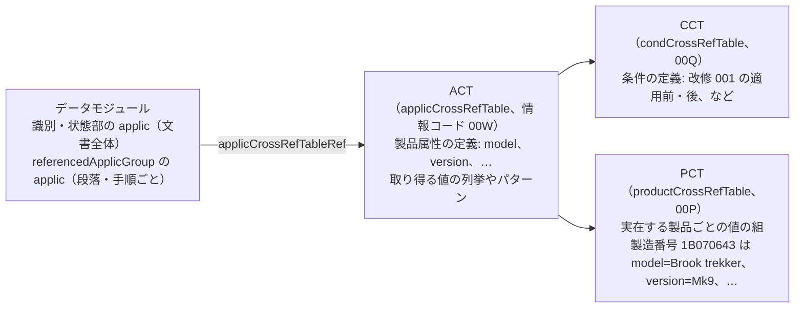
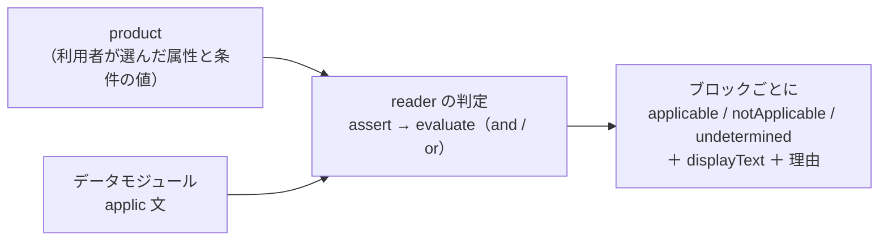

S1000D のデータモジュールは、1 つの文書で複数の機種・構成を扱えるように作られています。「この段落は MV-60 だけ」「この手順は改修 001 を適用した後の機体だけ」のような条件を **適用性（applicability）** と呼び、文書の中に機械が読める形で書きます。読み手は、自分の製品に当てはまらない段落を混ぜて読まないために、この仕組みを押さえておく必要があります。

## 3 つの表と applic 文

| 要素 | 内容 |
| --- | --- |
| ACT の `productAttribute` | 属性の id（`model` など）、人が読む名前、取り得る値（`enumeration` の列挙や `valuePattern` の正規表現）。`productIdentifier="primary"` が付いた属性（製造番号など）が製品を識別します |
| CCT の `condType` / `cond` | 条件の種類（改修の適用状況、など）と個々の条件。値の書き方は `condType` の列挙で決まります |
| PCT の `product` | 実在する製品 1 つ分の値の組。`assign` が属性・条件ごとに値を割り当てます。利用者が「自分の製品」を選ぶときの出発点になります |
| `applic` | 条件の文。`displayText`（人が読む文）と、`assert`（1 つの属性・条件に対する「この値のどれか」）を `evaluate`（and / or）で結んだ式を持ちます。識別・状態部の `applic` は文書全体の適用範囲、`referencedApplicGroup` の `applic` は要素が `applicRefId` で指す個別の適用範囲です |

`assert` の値（`applicPropertyValues`）の書き方は 3 通りで、BREX の許可値と同じです。

| 書き方 | 例 | 意味 |
| --- | --- | --- |
| 単一値 | `Mk9` | その値と一致 |
| `\|` 区切り | `Mk1\|Mk9` | どれか 1 つと一致 |
| `~` の範囲 | `1~3`、`POST-001~POST-999` | 共通の接頭辞＋数字の範囲に入る |

## 式の評価のしかた

ある製品にある要素が当てはまるかは、次の手順で決まります。

1. 製品の属性と条件の値（PCT の 1 行、または利用者が指定した値の組）を用意します。
2. `assert` ごとに、製品の値が `applicPropertyValues` のどれかに一致するかを見ます。製品にその属性の値が無ければ、その `assert` は判定できません。
3. `evaluate` の `and` は 1 つでも偽があれば偽、`or` は 1 つでも真があれば真と確定します。
4. 要素の適用範囲は、その要素（または最も近い祖先）の `applicRefId` が指す `applic` と、文書全体の `applic` を and で結んだものです。

`and` と `or` の入れ子や範囲の書式を読み違えると、当てはまらない段落を当てはまると判断してしまいます。この評価は人や LLM が式を読んで行うものではなく、機械が行うものです。

### 別のデータモジュールにある適用性文

`referencedApplicGroupRef/applicRef` は、`applicIdentValue` で別のデータモジュール（適用性リポジトリ）にある `applic` 文を指す書き方です。文書の中に式が無いため、評価には CSDB の中からリポジトリを見つける必要があります。

## このスタックでは

判定は `s1000d-reader-mcp` が上の手順で行い、LLM には `assert` と `evaluate` の式を渡さず、ブロックごとの結果（`applicable` / `notApplicable` / `undetermined`）と `displayText`、判定できなかった理由だけを渡します。`undetermined` は「当てはまらない」ではなく「製品に値が足りない」「リポジトリが無い」などで判定できなかった状態です。

製品の値をどう決めるか（`describe_applicability`）、3 値をどう読むか、適用性リポジトリの解決は [s1000d-reader-mcp](/s1000d-stack/mcp/reader-mcp/#適用性と検証状態) に書いています。判定の論理は共有ライブラリ `s1000d-core` の `ApplicEvaluator` にあり、`s1000d-reader-mcp` と段階 3 の `s1000d-writer-mcp`（出力時に適用性を付ける）が同じものを使います。ACT・CCT・PCT の読み取り（`readAct` / `readCct` / `readPct`）、PCT の 1 行から製品を作る `productFromPct`、評価（`evaluateApplic`）も同じライブラリにあります。

:::note[公式サンプルで分かったこと]
Issue 7 の Bike Samples では、ACT が属性 `type` を定義し 110 件の `assert` が使っているのに、PCT の 3 製品はどれも `type` に値を割り当てていません。PCT の製品で判定すると、要素の `applic` 366 件のうち 310〜324 件が「製品に `type` の値が無い」理由で `undetermined` になります。また、PCT の条件値 `Pre` / `Post` は CCT の列挙 `PRE` / `POST-001~POST-999` と大文字小文字も書式も合いません。このスタックは値の比較を完全一致のままにしてあり、配布物側の不整合がそのまま見えます。`applicIdentValue` で指す先の適用性リポジトリも Bike Samples には入っておらず、該当する 64 件は「リポジトリに無い」理由で `undetermined` になります。
:::
