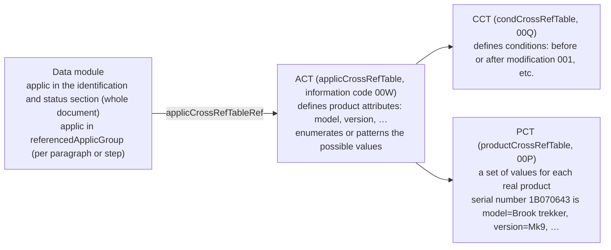
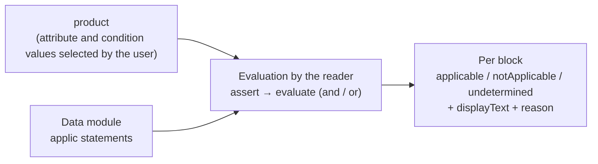

S1000D® data modules are designed so that one document can cover several models and configurations. A condition such as "this paragraph applies only to the MV-60" or "this procedure applies only to aircraft after modification 001 has been applied" is called **applicability**, and it is written inside the document in a machine-readable form. Readers need to understand this mechanism so that they do not read paragraphs that do not apply to their own product along with the ones that do.

## The three tables and the applic statement

| Element | Content |
| --- | --- |
| `productAttribute` in the ACT | The attribute id (such as `model`), a human-readable name and the possible values (an `enumeration` list or a `valuePattern` regular expression). The attribute marked `productIdentifier="primary"` (a serial number, for example) identifies the product |
| `condType` / `cond` in the CCT | The kind of condition (whether a modification is applied, etc.) and the individual conditions. How values are written is determined by the enumeration in `condType` |
| `product` in the PCT | The set of values for one real product. `assign` assigns a value to each attribute and condition. This is the starting point when a user selects "my product" |
| `applic` | The condition statement. It holds `displayText` (a human-readable sentence) and an expression in which `assert` elements ("one of these values" for a single attribute or condition) are joined by `evaluate` (and / or). The `applic` in the identification and status section is the scope of the whole document; an `applic` in `referencedApplicGroup` is the individual scope that an element points to with `applicRefId` |

The value of an `assert` (`applicPropertyValues`) can be written in three ways, the same as an allowed value in a BREX (Business Rules Exchange).

| Form | Example | Meaning |
| --- | --- | --- |
| Single value | `Mk9` | Matches that value |
| `\|`-separated | `Mk1\|Mk9` | Matches any one of them |
| `~` range | `1~3`, `POST-001~POST-999` | Falls within a numeric range with a common prefix |

## How expressions are evaluated

Whether an element applies to a given product is decided by the following steps.

1. Prepare the product's attribute and condition values (one row of the PCT, or a set of values the user specifies).
2. For each `assert`, check whether the product's value matches one of the `applicPropertyValues`. If the product has no value for that attribute, that `assert` cannot be evaluated.
3. In `evaluate`, `and` is settled as false as soon as one operand is false, and `or` is settled as true as soon as one operand is true.
4. The scope of an element is the `applic` pointed to by the `applicRefId` of that element (or of its nearest ancestor), joined by `and` with the `applic` of the whole document.

Misreading the nesting of `and` and `or` or the range format leads to judging a paragraph as applicable when it is not. This evaluation is not something a person or an LLM does by reading the expression; a machine does it.

### Applicability statements in another data module

`referencedApplicGroupRef/applicRef` is a way of pointing, with `applicIdentValue`, to an `applic` statement in another data module (an applicability repository). Because the expression is not in the document, evaluation requires finding the repository within the CSDB.

## In this stack

`s1000d-reader-mcp` performs the evaluation by the steps above. It does not pass the `assert` and `evaluate` expressions to the LLM; it passes only the result for each block (`applicable` / `notApplicable` / `undetermined`), the `displayText` and the reason when evaluation was not possible. `undetermined` does not mean "does not apply"; it is the state in which evaluation was not possible because, for example, the product lacks a value or the repository is missing.

How the product values are decided (`describe_applicability`), how to read the three states, and how applicability repositories are resolved are described in [s1000d-reader-mcp](/s1000d-stack/mcp/reader-mcp/#applicability-and-verification-status). The evaluation logic lives in `ApplicEvaluator` in the shared library `s1000d-core`, and `s1000d-reader-mcp` and the stage 3 `s1000d-writer-mcp` (which attaches applicability on output) use the same one. Reading the ACT, CCT and PCT (`readAct` / `readCct` / `readPct`), building a product from one row of the PCT (`productFromPct`) and evaluation (`evaluateApplic`) are in the same library too.

:::note[What the official samples show]
In the Issue 7 Bike Samples, the ACT defines the attribute `type` and 110 `assert` elements use it, yet none of the 3 products in the PCT assigns a value to `type`. When evaluated against a PCT product, 310–324 of the 366 element-level `applic` statements become `undetermined` for the reason "the product has no value for `type`". In addition, the condition values `Pre` / `Post` in the PCT match neither the case nor the format of the CCT enumeration `PRE` / `POST-001~POST-999`. This stack deliberately keeps value comparison as an exact match, so the inconsistencies on the distribution side show through as they are. The applicability repository pointed to by `applicIdentValue` is also not included in the Bike Samples, so the 64 statements concerned become `undetermined` for the reason "not in the repository".
:::
