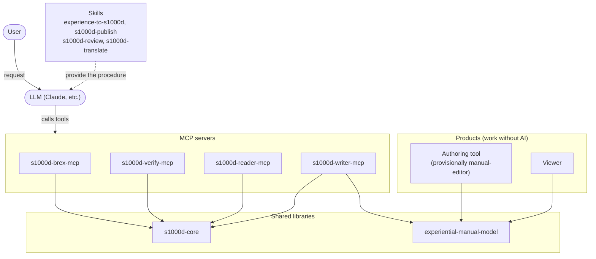

s1000d-stack consists of four kinds of component: shared libraries, MCP servers, Skills and products. The shared libraries hold the S1000D® processing (reading, validation, assembly); the MCP servers turn that processing into tools an LLM can call; the Skills tell the LLM in which order to call the tools and what to confirm with the user. The products (the authoring tool and the viewer) are software for people that works without AI.

Each component is published as an independent repository. The hub repository [s1000d-stack](https://github.com/shuji-bonji/s1000d-stack), which holds this site, contains only the documentation site (`site/`), the stack manifest recording the published version of each component (`stack.json`), and the plans and decision records (`docs/`).

## Shared libraries

| Library | What it is used for | Published |
| --- | --- | --- |
| [s1000d-core](/s1000d-stack/lib/s1000d-core/) | The shared library used by the MCP servers. It provides functions such as splitting DMCs and ICNs, reading the identification and status section, BREX (Business Rules Exchange) checks, XSD validation, reference resolution, applicability evaluation, reading the content, deciding fix candidates, building data modules and applying fixes | [npm 0.8.1](https://www.npmjs.com/package/@shuji-bonji/s1000d-core) |
| [experiential-manual-model](https://github.com/shuji-bonji/experiential-manual-model) | The common data model for experiential manuals (manuals in which you learn an operation by trying it while looking at the screen). It provides types and a JSON Schema, content checks, and conversion from the 2021 work. It does not depend on S1000D | [npm 0.1.0](https://www.npmjs.com/package/@shuji-bonji/experiential-manual-model) |

## MCP servers

An MCP server is a program that provides tools an LLM can call. None of the four passes the XML of a data module or applicability expressions to the LLM; they return only the results of their decisions.

| MCP server | What it is used for | Tools | Published |
| --- | --- | --- | --- |
| [s1000d-brex-mcp](/s1000d-stack/mcp/brex-mcp/) | Reads the BREX (the rules for how data modules are written) handed over by a customer or project, and confirms whether a data module follows those rules | 5 | [npm 0.4.0](https://www.npmjs.com/package/@shuji-bonji/s1000d-brex-mcp) |
| [s1000d-verify-mcp](/s1000d-stack/mcp/verify-mcp/) | Confirms that a data module is written correctly against the official XML schema (XSD), BREX and the existence of reference targets together, and proposes candidate corrections. It also reconciles the CSDB with the data management list (DML, the list of data modules to be produced) | 7 | [npm 0.6.0](https://www.npmjs.com/package/@shuji-bonji/s1000d-verify-mcp) |
| [s1000d-reader-mcp](/s1000d-stack/mcp/reader-mcp/) | Passes the content of a data module to the LLM as a structure of headings, steps, warnings and illustrations. It follows references and evaluates which product the content applies to (applicability) | 6 | [npm 0.7.0](https://www.npmjs.com/package/@shuji-bonji/s1000d-reader-mcp) |
| [s1000d-writer-mcp](/s1000d-stack/mcp/writer-mcp/) | Creates data modules. From a draft passed by the LLM, the server assembles the XML and validates it. It also converts experiential manuals, applies fixes, creates comment data modules, and hands sentences out and back for translation | 6 | [npm 0.1.1](https://www.npmjs.com/package/@shuji-bonji/s1000d-writer-mcp) |

## Skills

A Skill is a written procedure that tells the LLM (Claude) which MCP servers to call in which order, and what to confirm with the user along the way. A Skill has no assembly or validation logic of its own; every decision is based on the responses of the MCP servers. All four are published as 0.1.0 in the personal marketplace [shuji-bonji/claude-plugins](https://github.com/shuji-bonji/claude-plugins).

| Skill | What it is used for | Required MCP servers |
| --- | --- | --- |
| [experience-to-s1000d](/s1000d-stack/skill/experience-to-s1000d/) | Converts the JSON of an experiential manual into an S1000D CSDB (data modules, publication modules, illustrations) and validates the whole CSDB | writer, verify |
| [s1000d-publish](/s1000d-stack/skill/s1000d-publish/) | Creates data modules one at a time from a structured draft (title, paragraphs, steps, warnings, tables), validates them and puts them into the CSDB. It also confirms that they are listed in the DML | writer, verify |
| [s1000d-review](/s1000d-stack/skill/s1000d-review/) | Reviews a data module from three points of view — verification results, the manual checks of the BREX, and the text (glossary and writing style) — and keeps the findings you choose as comment data modules | reader, verify |
| [s1000d-translate](/s1000d-stack/skill/s1000d-translate/) | Takes the sentences out of a data module, has the LLM translate them, scores them with xcomet, and puts them back into a data module with the same DMC that differs only in language | writer |

## Products

| Product | What it is used for | Status |
| --- | --- | --- |
| Authoring tool (provisionally manual-editor) | Creates an experiential manual on screen and saves it as JSON of experiential-manual-model. The saved JSON can be converted to S1000D with the experience-to-s1000d Skill | Prototype |
| Viewer | Displays an experiential manual so that people can learn an operation by trying it. WebMCP is planned so that AI can guide the operation | Concept |

Instructions for the products will be placed on the product site.

## Target issue

The first target is Issue 7. Issue 4.2 is planned next, because most real-world examples, in Japan and elsewhere, use the Issue 4 series. `s1000d-core` is structured so that it can read each issue separately.

:::note[Design decisions]
Why decisions are left to the server, and decisions such as not letting the LLM write XML, are summarised in [Design principles](/s1000d-stack/guide/design-principles/). The history of decisions and the open questions are recorded with numbers in [docs/DECISIONS.md](https://github.com/shuji-bonji/s1000d-stack/blob/main/docs/DECISIONS.md) in the hub repository.
:::
