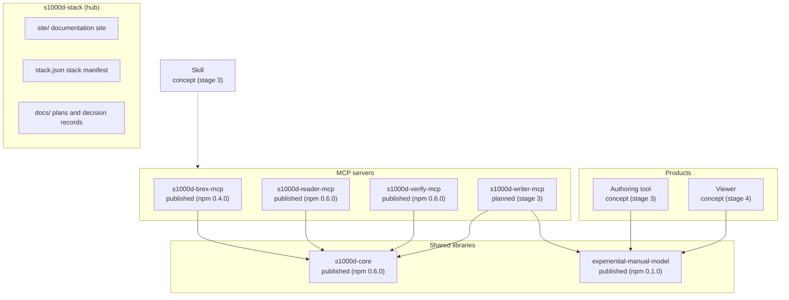

s1000d-stack consists of a hub repository that holds only the stack manifest and the documentation site, and independent component repositories. The expert agents (MCP and Skill) come first; they are then used as development tools to build the products (the authoring tool and the viewer).

## Components

| Component | Role | Status (2026-10-27) |
| --- | --- | --- |
| [s1000d-core](https://github.com/shuji-bonji/s1000d-core) | Shared library for DMC, ICN, the identification and status section, BREX (Business Rules Exchange) checks, XSD validation, reference resolution, applicability evaluation, reading the content and deciding fix candidates | Published on [npm 0.6.0](https://www.npmjs.com/package/@shuji-bonji/s1000d-core) |
| [s1000d-brex-mcp](/s1000d-stack/mcp/brex-mcp/) | Explains and checks against BREX (5 tools) | Published on [npm 0.4.0](https://www.npmjs.com/package/@shuji-bonji/s1000d-brex-mcp) |
| [s1000d-reader-mcp](/s1000d-stack/mcp/reader-mcp/) | Returns the content of a data module as structure, resolves references, evaluates applicability (6 tools) | Published on [npm 0.6.0](https://www.npmjs.com/package/@shuji-bonji/s1000d-reader-mcp) |
| [s1000d-verify-mcp](/s1000d-stack/mcp/verify-mcp/) | Validation with the official XSD, BREX checks, detection of broken references, fix suggestions, DML/DDN reconciliation (7 tools) | Published on [npm 0.6.0](https://www.npmjs.com/package/@shuji-bonji/s1000d-verify-mcp) |
| [experiential-manual-model](https://github.com/shuji-bonji/experiential-manual-model) | Common data model for experiential manuals (independent of S1000D®). Types, JSON Schema, checks, and conversion from the 2021 work | Published on [npm 0.1.0](https://www.npmjs.com/package/@shuji-bonji/experiential-manual-model) |
| s1000d-writer-mcp | Generates data modules from the common data model | Planned (stage 3) |
| Skill | experience-to-s1000d / s1000d-publish / s1000d-review | Concept (stage 3) |
| Authoring tool and viewer | Products for people to use. They work without AI | Concept (stages 3–4) |

## Stages

| Stage | Deliverables | Completion criteria |
| --- | --- | --- |
| 1 | hub (this site), s1000d-core, s1000d-brex-mcp | Check tests pass with a self-made BREX and data modules. The default BREX can be read, and checking self-made data modules against it does not contradict the specification. The site's explanations have been checked against the specification |
| 2 | s1000d-reader-mcp, s1000d-verify-mcp, experiential-manual-model | Validation with the official XSD (obtained by the user), reference resolution and applicability evaluation work. The reader's responses include the issue and the verification status |
| 2.5 | Fix suggestions, `CsdbSource`, HTTP transport, DML/DDN reconciliation, outline mode and security classification, the [Embedding in a CSDB product](/s1000d-stack/guide/embedding/) page | An LLM agent can do the four things — schema validation, cross-reference check, applicability check, fix suggestion — and the CSDB can be read from somewhere other than a folder |
| 3 | s1000d-writer-mcp, Skill, a prototype of the authoring tool | The ticket machine example is output to S1000D through the common data model and passes verify |
| 4 | Viewer | Displays the common data model, and an AI can guide the operation through WebMCP |

## Decisions

- **Names follow S1000D.** The MCP servers and libraries start with `s1000d-`. Products for general users do not carry the S1000D name.
- **The specification, schemas and official samples are not included.** Users point `S1000D_SPEC_DIR` at the files they obtained themselves.
- **The structure follows houki-hub.** The hub holds only the stack manifest and the site; each component is an independent repository.
- **BREX check processing lives in s1000d-core.** brex-mcp and verify-mcp only call it.
- **XML uses @xmldom/xmldom, XPath uses fontoxpath.** The default BREX contains XPath 2.0 expressions.
- **XSD validation uses libxml2-wasm.** Each XSD is compiled once and reused, and the 106 official samples are validated in 0.5 seconds or less. The interface and the implementation live in s1000d-core, and verify-mcp and reader-mcp use the same one.
- **The reader does not pass applicability expressions to the LLM.** The server performs the evaluation and returns only applicable / notApplicable / undetermined and the display text.
- **Publishing to npm uses Trusted Publisher.** Pushing a tag makes GitHub Actions publish through OIDC.

The background of each decision and the open items are recorded with numbers in `docs/DECISIONS.md` in the hub repository.

## Target issues

The first target is Issue 7. Issue 4.2 is planned next, because many real examples in Japan and abroad are in the Issue 4 series. `s1000d-core` is structured so that it can read each issue separately.
