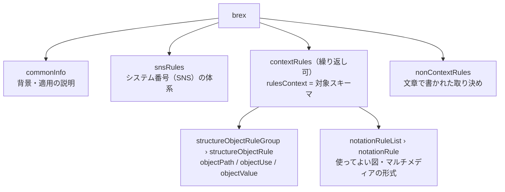

BREX（Business Rules Exchange）は、プロジェクトや組織が S1000D の使い方について合意した決まり（ビジネスルール）のうち、XML の構造に関わるものを機械で読める形で書いたデータモジュールです。すべてのデータモジュールは、自分が従う BREX を 1 つ参照します。

## BREX は「設定ファイル」ではなくデータモジュール

BREX は情報コード `022` のデータモジュールで、他のデータモジュールと同じく識別・状態部を持ち、CSDB で版管理されます。内容部 `<brex>` には 4 つのブロックが入ります。



| ブロック | 書かれているもの | 機械で検査できるか |
| --- | --- | --- |
| `snsRules` | システム・サブシステム・サブサブシステム・組立のコードと名称の階層 | 参照用（SNS の意味を引く） |
| `contextRules` › `structureObjectRule` | XPath（`objectPath`）で指した要素・属性について、使ってよいか（`allowedObjectFlag`）、説明（`objectUse`）、許可する値とその意味（`objectValue`） | できる |
| `contextRules` › `notationRuleList` | 使ってよい図・マルチメディアの形式（NOTATION） | できる |
| `nonContextRules` | スキーマや要素に結び付けられないプロジェクト固有の規則 | できない（人が判断する） |

`contextRules` は対象のスキーマごとに繰り返せます。`rulesContext` 属性にスキーマの URL を書くとその種類のデータモジュールだけに適用され、省略するとすべてに適用されます。スキーマ固有のルールは共通ルールを上書きし、かつ共通ルールの範囲を狭める方向でなければなりません。

## 1 つのルールの読み方

```xml
<structureObjectRule>
  <brDecisionRef brDecisionIdentNumber="KB-00003"/>
  <objectPath allowedObjectFlag="2">//dmIdent/dmCode/@infoCode</objectPath>
  <objectUse>使ってよい情報コード</objectUse>
  <objectValue valueForm="single" valueAllowed="040">説明</objectValue>
  <objectValue valueForm="range" valueAllowed="500~599">手順</objectValue>
  <objectValue valueForm="pattern" valueAllowed="[0-9]{2}[A-Z]">プロジェクト拡張</objectValue>
</structureObjectRule>
```

| 部分 | 意味 |
| --- | --- |
| `brDecisionIdentNumber` | ルール ID。ビジネスルール決定への参照で、既定 BREX では `BREX-S1-NNNNN`（版が変わっても番号は変わらない） |
| `objectPath` | ルールの対象を XPath で指す。`not(…)` のように真偽値を返す式も書かれる |
| `allowedObjectFlag` | `0` = 使ってはならない、`1` = 必ず含める、`2` = 任意（使うなら値は `objectValue` のどれかに合わせる） |
| `objectUse` | 人が読む説明。照合結果に添える |
| `objectValue` | 許可する値。`valueForm` が `single`（一致）、`range`（`500~599` や `brsl51~brsl99` のような範囲）、`pattern`（正規表現の全体一致）。本文がその値の意味 |
| `brSeverityLevel`（省略可） | 重大度 `brsl01`〜`brsl99`。意味はプロジェクトが決める |

この例は、このプロジェクトのテストデータ（券売機プロジェクトの BREX）から取ったものです。

## 層になった BREX

BREX は重ねて使います。プロジェクトの BREX は組織の BREX を、組織の BREX は S1000D が配布する既定 BREX を、それぞれ識別・状態部の `brexDmRef` で参照します。既定 BREX は自分自身を参照し、連鎖の終端になります。


- 下位の BREX は上位の BREX を**制限することしかできません**。上位が A〜M を許すなら、下位は A〜H に絞れますが N を許せません。
- 下位は上位のルールを繰り返しません。完全なルール集合を得るには、連鎖全体を読む必要があります。
- 照合は**各層に個別に行い**、どの層にも違反が無いときだけ合格です。層を統合して矛盾を解決するのは検査側の責務ではありません（Issue 7 Chap 7.9）。

既定 BREX（Issue 7）には 274 の構造ルールと 1,445 の許可値が入っています。設定可能属性の既定の値集合、許可する情報コード、学習コード、スキーマで表せない規則の集まりです。

:::note[既定 BREX の DMC は版で変わります]
既定 BREX の DMC は `S1000D-Y-04-10-0301-00A-022A-D` で、`Y`（システム差異コード）が仕様書の版ごとに変わります。Issue 7 の配布物に同梱されているファイルは `J` ですが、仕様書本文の記述やデータ辞書の見本とは食い違いがあります。このプロジェクトの道具は、この桁を決め打ちせず、ファイル名の形と「自分自身を参照する」性質で既定 BREX を探します。
:::

## 照合の規則（このプロジェクトの実装）

`s1000d-core` と `s1000d-brex-mcp` は次の規則で照合します。

| 項目 | 扱い |
| --- | --- |
| `allowedObjectFlag="0"` | `objectPath` の結果が空でなければ違反（`forbidden`） |
| `allowedObjectFlag="1"` | 結果が空なら違反（`missing`） |
| `allowedObjectFlag="2"` | 結果の各節点の値を `objectValue` と照合し、どれにも合わなければ違反（`value`）。`valueAllowed` を持つ `objectValue` が無ければ照合しない |
| 真偽値を返す `objectPath` | true を「対象あり」、false を「対象なし」として同じ規則で判定 |
| `rulesContext` | 対象データモジュールの `xsi:noNamespaceSchemaLocation` とスキーマのファイル名が一致するブロックと、共通ブロックを適用 |
| `notationRuleList` | DOCTYPE の `ENTITY … NDATA` で使われている NOTATION が、許可された集合（基本セット＋スキーマ固有の追加・除外）に無ければ違反（`notation`） |
| `nonContextRules` | 判定せず、手動確認の項目として返す |
| 階層 | 連鎖を既定 BREX までたどり、各層に個別に照合。どの層にも違反が無く、見つからなかった BREX も無いときだけ合格 |

:::caution[BREX の照合は XSD の検証を含みません]
BREX のルールは「スキーマに適合しているデータモジュール」を前提に書かれています。スキーマの誤りは BREX の違反を隠したり、逆に生んだりします。XML スキーマによる検証は別に行ってください（段階 2 の `s1000d-verify-mcp` で扱う予定です）。
:::

## 公式サンプルも既定 BREX に違反する

配布物の Bike Samples（自転車の例、105 のデータモジュール）を「自転車 BREX → 既定 BREX」の 2 層に照合すると、既定 BREX への違反が合計 55 件見つかります。公式サンプルでも既定 BREX をすべて満たしてはいません。既定 BREX 側の厳しさなのか、サンプル側の不備なのかは調べきれていませんが、「既定 BREX の違反が出ること」と「データモジュールが使えないこと」は別だ、という感覚を持っておくと結果を読みやすくなります。
