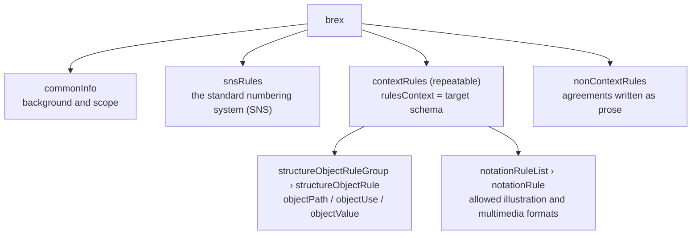
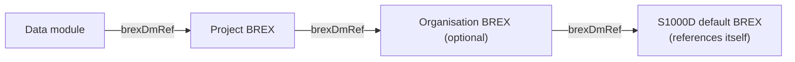

BREX (Business Rules Exchange) is a data module that writes down, in a machine-readable form, those of the rules a project or organisation has agreed on for using S1000D® (business rules) that concern the XML structure. Every data module references exactly one BREX that it follows.

## A BREX is a data module, not a "configuration file"

A BREX is a data module with information code `022`. Like any other data module, it has an identification and status section and is version-controlled in the CSDB. Its content section `<brex>` holds four blocks.



| Block | What it contains | Can a machine check it? |
| --- | --- | --- |
| `snsRules` | The hierarchy of system, subsystem, sub-subsystem and assembly codes and their names | For reference (looking up the meaning of an SNS code) |
| `contextRules` › `structureObjectRule` | For the element or attribute pointed to by an XPath (`objectPath`): whether it may be used (`allowedObjectFlag`), a description (`objectUse`), and the allowed values with their meaning (`objectValue`) | Yes |
| `contextRules` › `notationRuleList` | The allowed illustration and multimedia formats (NOTATION) | Yes |
| `nonContextRules` | Project-specific rules that cannot be tied to a schema or an element | No (a person decides) |

`contextRules` can be repeated once per target schema. When the `rulesContext` attribute holds a schema URL, the rules apply only to data modules of that type; when it is omitted, they apply to all. Schema-specific rules override the common rules, and may only narrow what the common rules allow.

## How to read a single rule

```xml
<structureObjectRule>
  <brDecisionRef brDecisionIdentNumber="KB-00003"/>
  <objectPath allowedObjectFlag="2">//dmIdent/dmCode/@infoCode</objectPath>
  <objectUse>Allowed information codes</objectUse>
  <objectValue valueForm="single" valueAllowed="040">Description</objectValue>
  <objectValue valueForm="range" valueAllowed="500~599">Procedure</objectValue>
  <objectValue valueForm="pattern" valueAllowed="[0-9]{2}[A-Z]">Project extension</objectValue>
</structureObjectRule>
```

| Part | Meaning |
| --- | --- |
| `brDecisionIdentNumber` | The rule ID. A reference to a business rule decision; in the default BREX it is `BREX-S1-NNNNN` (the number stays the same across issues) |
| `objectPath` | Points to the target of the rule with an XPath. Expressions that return a boolean, such as `not(…)`, also appear |
| `allowedObjectFlag` | `0` = must not be used, `1` = must be present, `2` = optional (if used, the value must match one of the `objectValue` entries) |
| `objectUse` | A description for people to read. It is attached to the check result |
| `objectValue` | An allowed value. `valueForm` is `single` (exact match), `range` (a range such as `500~599` or `brsl51~brsl99`) or `pattern` (a regular expression matching the whole value). The text content is the meaning of that value |
| `brSeverityLevel` (optional) | The severity level, `brsl01` to `brsl99`. Its meaning is decided by the project |

This example is taken from this project's test data (the BREX of a ticket vending machine project).

## Layered BREX

BREX are used in layers. A project BREX references an organisation BREX, and the organisation BREX references the default BREX distributed by S1000D, each through `brexDmRef` in its identification and status section. The default BREX references itself and ends the chain.



- A lower BREX can **only restrict** the BREX above it. If the upper layer allows A to M, the lower layer can narrow that to A to H but cannot allow N.
- A lower BREX does not repeat the rules of the upper layers. To obtain the complete set of rules, the whole chain has to be read.
- The check is **run against each layer separately**, and it passes only when no layer has a violation. Merging the layers and resolving contradictions between them is not the checker's responsibility (Issue 7 Chap 7.9).

The default BREX (Issue 7) contains 274 structure object rules and 1,445 allowed values. It is the collection of default value sets for configurable attributes, allowed information codes, learn codes, and rules that the schema cannot express.

:::note[The DMC of the default BREX changes with the issue]
The DMC of the default BREX is `S1000D-Y-04-10-0301-00A-022A-D`, where `Y` (the system difference code) changes with each issue of the specification. The file included in the Issue 7 distribution uses `J`, but this disagrees with statements in the specification text and with the examples in the data dictionary. The tools in this stack do not hard-code this digit; they find the default BREX by the shape of its file name and by its property of referencing itself.
:::

## In this stack

The check logic lives in the shared library `s1000d-core`, and `s1000d-brex-mcp` and `s1000d-verify-mcp` call it. It checks by the following rules.

| Item | Handling |
| --- | --- |
| `allowedObjectFlag="0"` | A violation if the result of `objectPath` is not empty (`forbidden`) |
| `allowedObjectFlag="1"` | A violation if the result is empty (`missing`) |
| `allowedObjectFlag="2"` | The value of each node in the result is checked against `objectValue`; a violation if it matches none of them (`value`). No check is made if there is no `objectValue` with `valueAllowed` |
| `objectPath` that returns a boolean | true is treated as "target present" and false as "target absent", and the same rules are applied |
| `rulesContext` | The block whose schema file name matches the `xsi:noNamespaceSchemaLocation` of the target data module is applied, together with the common block |
| `notationRuleList` | A violation if a NOTATION used in `ENTITY … NDATA` in the DOCTYPE is not in the allowed set (the base set plus schema-specific redefinitions and exclusions) (`notation`). A BREX that has no inclusion (`allowedNotationFlag="1"`) and only exclusions (`"0"`) is treated as forbidding only the excluded formats and not restricting any others. This is because `allowedNotationFlag` is always relative to the base set, and when a BREX does not define the base set, the scope is to be decided by other means |
| `nonContextRules` | Not evaluated; returned as manual checks |
| Layers | The chain is followed up to the default BREX and each layer is checked separately. The check passes only when no layer has a violation and no BREX is missing |

:::caution[A BREX check does not include XSD validation]
BREX rules are written on the assumption that the data module conforms to the schema. Schema errors can hide BREX violations or, conversely, create them. Validation against the XML schema is done by [`s1000d-verify-mcp`](/s1000d-stack/mcp/verify-mcp/), which combines the XSD, BREX and reference results into a single verification status.
:::

## The official samples also violate the default BREX

Checking the Bike Samples from the distribution (the bicycle example: 105 of its 106 data modules, excluding the bicycle BREX itself) against the two layers "bicycle BREX → default BREX" finds 18 violations of the default BREX (all of them `forbidden`: an element that must not be used is present). Even the official samples do not satisfy the default BREX in full. Whether this is strictness on the side of the default BREX or defects on the side of the samples has not been investigated, but keeping in mind that "violations of the default BREX are reported" and "the data module is unusable" are two different things makes the results easier to read.

:::note[Difference from earlier versions]
This page used to say "a total of 55 violations". Most of them came from an error in this stack's NOTATION check (it read a `notationRuleList` with exclusions only as "forbid everything"), reported in the bicycle BREX layer. It was fixed in `s1000d-core` 0.3.0 (2026-10-27).
:::
