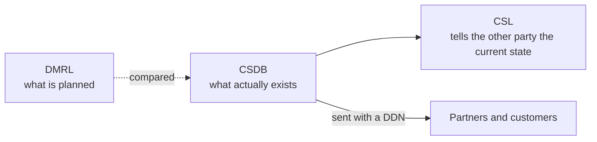

The CSDB (common source database) is the place that stores and manages everything needed to produce the technical publications of one project. S1000D® defines the data structure of what goes into the CSDB (the CSDB objects), but it does not define how a CSDB is designed or with which software it is implemented (Chap 4.2 of Issue 7).

## Role of the CSDB

The CSDB supports producing and authoring technical publications, quality assurance, and data exchange with partners and customers. It also makes it possible to output to various media — paper, PDF, IETM and so on — regardless of the format in which the data is stored.

Paper publications and an IETM can be produced from the same data modules because the source of every output is kept in one place, the CSDB. This idea is called single source, multiple outputs.

## What goes into the CSDB

The data module is at the centre of the CSDB. Illustrations, videos and similar files are not placed inside data modules; they are referenced by an ICN (information control number). The objects managed in the CSDB are listed below. All of them except illustrations, multimedia and similar files are produced in XML.

| CSDB object | What it is for | File name prefix |
| --- | --- | --- |
| Data module | The smallest unit of information: descriptions, procedures, fault information, BREX (Business Rules Exchange) and so on | `DMC-` |
| Illustrations, multimedia and similar files | Illustrations and videos referenced from data modules by ICN | `ICN-` |
| ICN metadata file | Management information for illustrations and multimedia | `IMF-` |
| Publication module | Which data modules are arranged in which order to make a publication | `PMC-` |
| Data management list (DML) | The list of data modules a project plans to produce (DMRL), or the list of the current state of the CSDB (CSL) | `DML-` |
| Comment | Findings or questions about data modules and other objects | `COM-` |
| Data update file | Used to update the data modules of a common information repository (CIR) by differences | `UPF-` |
| Data dispatch note (DDN) | The note attached when data is sent to another party. It states the sender, the receiver and what is sent | `DDN-` |

How files are named is defined in Chap 7.5.1 as part of the rules for exchanging data as files. How to read the file name of a data module is explained in [Data modules and the DMC](/s1000d-stack/guide/data-module-and-dmc/).

## The planned list and the current-state list

Of the data management lists, the DMRL (Data Management Requirement List) is the list of data modules and publication modules a project plans to produce. It is created at the start of the project and kept up to date throughout. Because it is a list of plans, it also contains objects that are not yet in the CSDB. The CSL (CSDB Status List) is a list for telling another party the current state of the CSDB. In a project produced by several companies, for example, the CSL is used to confirm that the data modules and illustrations one company sent have been correctly added to the other party's CSDB. Practices such as producing and checking a CSL after each exchange are decided by the project's business rules.

## The CSDB as a product

The specification calls a tool that supports defining, creating, managing and delivering CSDB objects a CSDB (management) system. Because the implementation of a CSDB is outside the specification, commercial CSDB products provide these functions with their own databases and screens. So that data can be exchanged between different products, the specification defines forms of exchange. One of them is sending a set of files with a DDN (Chap 7.5.1).

## In this stack

- A folder in which files are placed under names such as `DMC-….XML` is treated as the CSDB. The folders are given with the environment variable `S1000D_CSDB_DIR`, `csdbDirs` in the config file, or the `csdbDirs` argument of a tool, and several can be listed (see [Getting started](/s1000d-stack/guide/getting-started/))
- The kind of each object is identified by the file name prefix (`DMC-`, `PMC-`, `DML-`, `DDN-`, `IMF-`, `UPF-`, `ICN-`, `COM-`), and an index that can be looked up by DMC, PMC and file name is built. Reference resolution and the search along the BREX chain use this index
- `verify_csdb` in s1000d-verify-mcp validates the whole CSDB, and `reconcile_dml` compares a DML or DDN with the CSDB and returns what is missing, what has a different issue, and what is not listed in the DML
- s1000d-writer-mcp writes only with `write: true`, and writes into the first folder of the given CSDB
- To use a CSDB product's database or API as the CSDB, plug the product's implementation into `CsdbSource` (see [Embedding in a CSDB product](/s1000d-stack/use-cases/embedding/))
